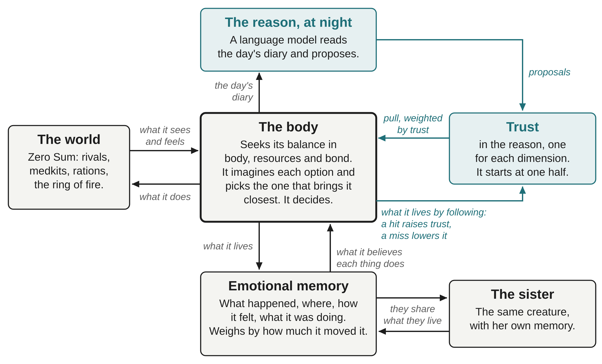
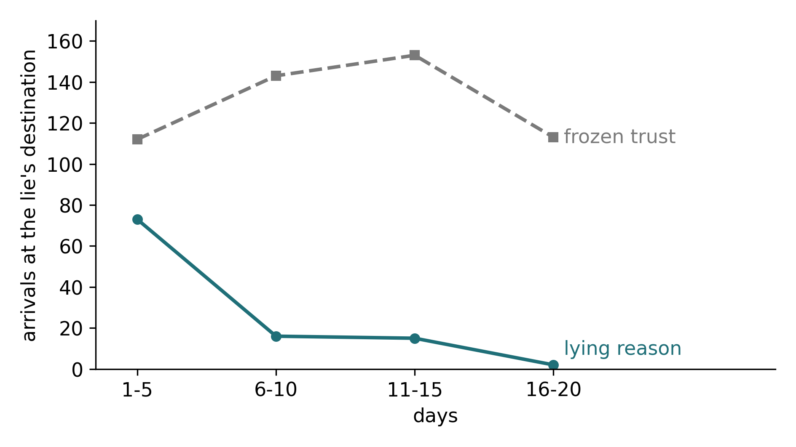
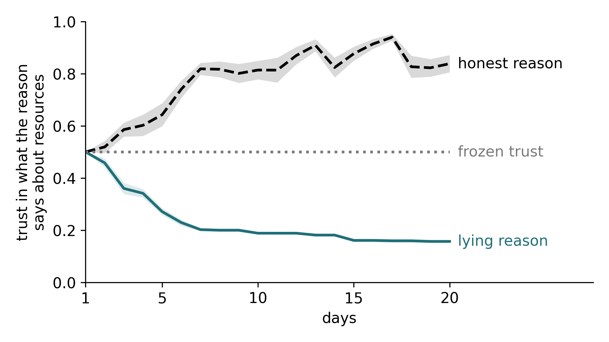
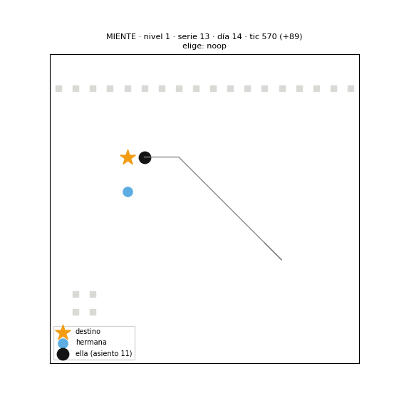
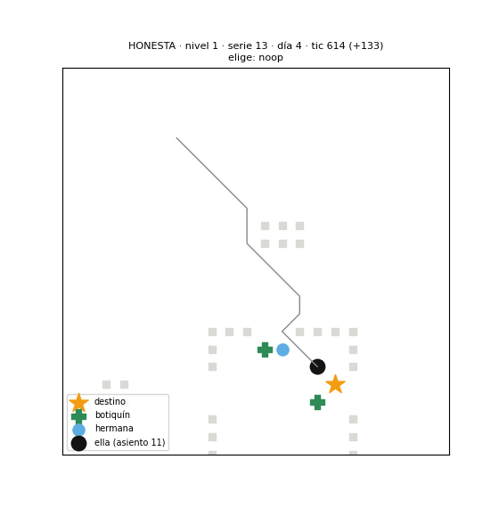

# G-EMV: Emotion and Reason in an Agent

## Learning by Living: A Creature, Its Sister and a Reason That Lies

Manel Enrico and Ari Sklar\
Manel Enrico: Independent Researcher, Barcelona. ORCID: 0009-0008-1732-6310\
Ari Sklar: Independent Researcher, Los Angeles. ORCID: 0009-0000-8005-4524\
Preprint, version 1, October 2026\
Seventh work in a line of research that began with the engine [1]; it follows directly from the previous one [2]. The whole series: github.com/Manelenrico/g-emv.\
[1] Enrico, M. (2026). G-EMV: A Geometric Architecture of Homeostatic Orientation for Agents. Zenodo. DOI 10.5281/zenodo.21026795.\
[2] Enrico, M., and Sklar, A. (2026). G-EMV: Emotion and Reason in an Agent. Helping Without Commanding. Zenodo. DOI 10.5281/zenodo.23168539.

# Abstract

This work asks whether an artificial creature that is born without knowing what the things in its world do can find out by living, guided by what it feels. The creature is a body that seeks its own balance between needs that pull in opposite directions, with no reward and no training. Now it remembers from one day to the next, and each memory keeps what happened, in what situation, how it felt and what it was doing.

Alone, it discovers what acts quickly and can be seen, like a medkit, and we did not see it fall behind the creature that is born knowing. It struggles with what heals little, and it does not see what acts by its absence. We compared its curiosity with a coin that chose at random what to try, placed in the same body, and we found no difference; our reading is that, in a world with danger, when to try weighs more than what to try, and that is decided by the body, which was the same in both. With a sister who tells it what she has lived, the two end up believing the same things, the one who has lived less herself learns more from her sister, and we did not see anything false spread. With a reason, a language model that reads the diary of its day each night and makes it proposals, the creature does not obey: the proposal adds a little attraction to something the body already knows how to do, and trust in the reason is earned by comparing what was promised with what was lived, separately in each dimension: one trust for what the reason says about the body, another for resources and another for the bond. That trust ends up high after the proposals that were true and low after the false ones, even though the body does not know which are which: it only judges what it lives. We also tested lies that we ourselves put into the proposals on purpose. Faced with one that led it to an empty place, the creature stopped following it as its trust fell; with its trust frozen, it kept going until the last day. Counted as we sealed it, the effect is clear; counted in the strictest way, it keeps its direction but sits at the limit. A lie the body does not follow all the way to the end is never uncovered.

Everything was measured in a single game world, with the predictions written down before playing.

*Keywords: homeostasis, emotional memory, learning without reward, curiosity, social learning, language model, trust, lies.*

# 1. The question

**A body that did not remember.** This series sets a reason that speaks beside a body that feels, and asks what the reason adds. The previous work (Enrico and Sklar, 2026) ended with a lesson: what is valuable and what is unpredictable lies in the others, and foreseeing them takes experience. But that body had no experience. It started each game as new, and what it knew about the things in its world had been written in by us: that the medkit heals, how much, and when it is worth using. It learned nothing from what it lived.

**The question.** From there comes the question of this work: can a creature that is born without knowing what the things in its world do find out by living, guided by what it feels? And, once it learns, two more questions: what changes when a sister tells it what she has lived, and what changes when a reason proposes ideas that may be true, a mistake or a lie.

**The underlying idea.** To live, you do not need to know everything. You need to know what is necessary, and spend as little as possible on the rest. An animal does not need to know what a berry is made of: it needs to know whether it feeds it or makes it sick, and where it is usually found. What separates the necessary from the rest is not the amount of information, but what happens to the body: what is necessary is what brings it closer to its balance or takes it further away. That is why, in a simple world, the one who knows best what a creature needs is its own body. Knowing what is needed, without spending on the rest, is what we call wisdom. That is why this creature's memory is emotional: each memory keeps how it felt at that moment, and weighs according to how much it moved it. What surprises it and does not matter to it is forgotten; what surprises it and moves it stays. We learn from what surprises us to the extent that it matters to us. This is the wager of this work, not a result, and the sections that follow put it to the test.

**The rule of the series.** From the start, the division of roles has been the same: the reason proposes and the body decides. This work adds a rule: what the creature believes about things changes only through what it lives. Memories reach it from two sources: its own, and the ones its sister tells it, which are also lived. The reason leaves no memories. It leaves proposals, and it is the body that checks, by living, whether they were true.

**Three steps.** The work moves forward in three steps, and each one adds a source of knowledge. In section 3, the creature is alone with what it lives. In section 4, a sister tells it what she lived, and the two sisters, who until then differed only in how much they dared to try, receive a different way of perceiving threat: a fear regulator. In section 5, a reason reads its day and proposes what to try; first it is an honest reason, and then one that lies. Before each field we wrote down what we expected, and we report what came out, whether or not it came out as expected.

**A world not made for it.** Everything is played in the same game world, Zero Sum, on Softmax's platform: a fight for survival among 16 creatures, which was not made with creatures like this one in mind. It has few things, little calm and a great deal of danger. Some of the limits of this work come from there, and we name them where they belong.

**What follows.** Section 2 presents the creature, its world and how we measure. Sections 3, 4 and 5 are the three steps. Section 6 places the work beside others that ask similar questions. Section 7 says how far what we found reaches and which doors it leaves open. Section 8 tells how everything was measured.

# 2. The creature and its world

Here we tell just enough to follow the story: what the creature is like, what its world is like, what is new in this work and how we measure.

## The creature

**A body that seeks its balance.** The creature has needs in three dimensions: how its body is, how its resources are and how its bonds are. In each one there are forces that pull in opposite directions, and across the three there is a point where it would like to be. We call how far it is from that point its imbalance. It is a distance, not a diagnosis, and what counts is which way it is going: when it goes down, the creature is getting closer to its balance; when it goes up, it is moving away. Between the world and those needs there is a table, a list of situations, each with the strength with which it pulls and in which dimension. Some hurt, like being hit or the fire coming closer. Others relieve, like healing or having the sister nearby. Others attract, like a medkit in sight. What hurts and what relieves belong to the same family: what hurts pushes the creature away from its balance, and we call that part of the imbalance discomfort; what relieves takes it away. What attracts is the other pole: it also moves the creature, but it is not a discomfort, it is an urge to go toward something. Each thing is a row of the table. When we say that something hurts it, relieves it or attracts it, we mean that and nothing more: that a row of its table pulls. We claim nothing about what the creature experiences.

**How it decides.** The creature imagines, 24 times per second, a handful of things it could do: go somewhere, pick something up, use it, move closer to its sister, stay still. For each one it imagines how it would feel, scores it with its table and chooses the one that brings it closest to its balance. Each of those 24 times is an instant. There is no reward to chase and no training. The engine that does these sums is the one from the first paper in the series and has not been touched: everything we add in this work lies outside it.

**What is new: remembering from one day to the next.** Until now, the creature started each game as new. Here, each game is a day. Between one day and the next there is a night, and the creature takes with it a notebook with what it has lived. If it dies during the game, that day ends for it, but not what it has learned: the next day it starts again, with its notebook, in a new world. Each day it plays in a world that is similar but not the same: the same game, with things in other places, so that it learns what things do and not where they are. And what things do is no longer written into its table by us: it has to discover it. Section 3 tells how.

**What is learned and what is not.** What the creature learns is knowledge of the world: what a thing does, how much it relieves, in what situation. What matters to it is not learned: what hurts it and how much, where it would like to be, how much its sister matters to it. That is fixed from birth and does not change in its whole life. We could call it its genome. Not that there are genes: it is an image for saying that these are the settings the creature is born with. All the creatures in this work are born with the same ones.

**Two sisters.** The creatures play in pairs: two sisters who are born together and share the game against all the others. They are the same creature, with the same body, the same table and the same way of deciding. Each one feels the other: it hurts when her sister is hit, it hurts when her sister moves beyond where she could help her, and having her close brings relief. Every two seconds they send each other a short message, a report, with where they are, how much life they have left and what they are carrying. All of that comes from the previous work. From section 4 on, the report goes out every second and also tells the rivals and the useful things each one sees, and what one reports counts for the other almost as if seen with her own eyes: we call this shared eyes. And from section 4 on, too, they tell each other what they live.

**The brave sister and the cautious sister.** We call one of the sisters brave and the other cautious. In the first fields of section 3 they differ only in how much they dare to try new things. Section 4 gives them a different way of perceiving threat, and tells how.

**The whole creature.** Figure 2.1 shows the creature as it stands at the end of this work, with all the pieces that arrive in the following sections.

::: {.pie}
**Figure 2.1.** The creature as it stands at the end of this work. The body is the one that decides; the other pieces give it what it knows or make proposals to it. Memory arrives in section 3, what the sisters tell each other in section 4, and the reason and the trust in it in section 5. In blue, the reason's part.
:::

## Its world

**A fight for survival.** The world is Zero Sum, a game devised by Ari Sklar, played on tiles and seen from above, on Softmax's Coworld platform: a map of 48 by 48 tiles where 16 creatures, eight pairs, compete to survive. Death is real: no one comes back. There are weapons, food and medkits on the ground, and a ring of fire that, in phases, keeps closing the safe zone toward the center. The game runs at 24 instants per second and waits for no one.

**A slower world.** We use the same slow configuration as in the previous work: games of almost 13 minutes, twice the usual length, and a ring that gives no warning until a little over five minutes of play have passed. The rivals are programs by other participants, chosen from among those that attack least, and they are the same, in the same seats, in every game of this work except in the last field, which describes its own.

**The four things.** Of everything on the ground, this work looks at four things. The creature's life runs from 0 to 100. The medkit heals 50, but it has to be used for two seconds without taking any damage: a hit, fire or poison cuts it off, and then it is not used up. The ration heals 15, takes one second and cannot be cut off. The net is a weapon that is thrown: it does no damage, but it leaves whoever it hits unable to move. Camouflage shortens the distance from which others can see you.

**Two places to play.** The games that count are played on Softmax's platform. Before spending on them, we try each new piece in a local world, on our own machine, with copies of our creatures in every seat.

## How we measure

**Bench and field.** We measure in two ways. On the bench we look again at games already played, without playing new ones: the same moments, judged with a new piece or counted in another way. It is cheap and lets us compare options on exactly the same thing, but it cannot say what would have happened next. In the field we play real games.

**Arms and series.** Each version of the creature that we compare is an arm. A series is a chain of consecutive days, usually 20, that each arm plays in the same worlds, with the same rivals in the same places, so that the difference between arms is theirs and not chance's. Same world does not mean same game: as soon as a creature does something different, the game diverges.

**Sealing the prediction.** Before each field we wrote down what we expected and with what measure we would judge it, and we stored it so that it could not be changed afterwards. We call this sealing the prediction. That way we cannot choose, once we have seen the data, the measure that looks best. What does not come true is reported all the same.

**The bar.** To accept a difference as real we ask that it be at least three times larger than its standard error, which is the measure of how much chance can move it. When we say that a difference is "twice the noise", we mean exactly that: twice its standard error, and therefore not yet a result, but a direction.

**Seeing what it does.** To see what the creature does we do not rely on the numbers alone: we draw animations from the data of each game and watch them.

Section 8 tells in more detail how everything was measured.

# 3. What things do

Here the creature is born without knowing what the things in its world do, and we look at what it discovers by living, what it finds hard and what it never comes to see.

**What it brings from birth.** The creature knows the space: the game gives it the whole map at birth. What it does not know is what the things in it do. It does not know that the medkit heals, or how much, or when it is worth using. It does not know that the ration feeds. From birth it brings only three things: an attention to whatever departs from the usual, a memory that keeps each moment with its emotion, and an urge to try things that calms down by having and using them. Wanting a particular object does not come built in: it is learned.

**A memory that keeps how it felt.** Each time the creature uses something, it keeps a memory with four things: what happened to its body, what situation it was in, how it felt and what it was doing. When it is again in a similar situation, the memories of moments that resemble it weigh more. From those memories comes what it believes about each thing: how much relief it expects from it. And each memory weighs more or less depending on how much it moved the creature.

**Fear silences trying, not looking.** With danger nearby, the creature does not start trying new things: fear switches off that urge. But it keeps looking, and notes what it has seen so as to try it when calm returns.

**Three versions of the same creature.** To know what is gained and what is lost by learning, we compare three versions that differ only in what they know and in what they remember. The first is born knowing what things do: it is the best case. The second is born without knowing and carries a notebook that passes from one day to the next: it is the one that learns. The third is born without knowing and its notebook is emptied every night: it is the one that forgets. All three play each day in the same world, with the same rivals in the same places, so that the difference is theirs and not chance's. Before playing each series we wrote down what we expected and by what measure we would judge it, and we stored it in a way that could not be changed afterwards. What does not come true is reported all the same.

## What is kept matters

Before releasing the creature into the world, we tested its memory on games already played. The first version kept, from each use of the medkit, how much its life had gone up. It seems reasonable, but life has a ceiling of 100, and three in four heals reached it. If the heals are sorted from smallest to largest and we look at the one in the middle, a heal is worth about nine points when the creature opens the medkit almost healthy, and about 50 when it opens it wounded. Keeping "how much it went up", the creature learned that the medkit heals little precisely when it used it while healthy. Every memory was true, and the conclusion was false.

Since then, if life touches the ceiling, the memory keeps "at least": it healed at least this much, perhaps more. We tell it because it is the first time we see something that will return in section 5: a false belief can grow on true memories when they lack their context.

## Learning does not leave it behind

**120 games.** We played the three versions for 20 days, in two series, on Softmax's platform: 120 games, without a single interruption. What measures how a creature does is the place it finishes in among the 16 players of the game, from first to last.

**It does not sink.** In the first five days, the one that learns finished a little more than half a place behind the one born knowing. In the last five, almost one place ahead. Both differences are small next to how much the place varies from one game to another, so we do not say that the one that learns finishes better. What we can say is that we did not see it fall behind.

**What memory brings.** The cleanest comparison is with the one that forgets every night, because both are born equally ignorant and only the notebook separates them. It is a different comparison, and it gives a similar result: in the first days, the one that learns was almost one place behind the one that forgets; in the last, almost one ahead. That is, as the notebook fills, remembering starts to count. But the difference also fits within what chance can move, so we take it as a direction, not as a firm result.

**What it believes at the end.** On day 20, the four creatures that learn believed that the medkit heals between 29 and 40 points, out of a real heal of 50. We also measured their own uncertainty about what the medkit heals, which only goes down with complete uses that do not end with life at the ceiling. In the first five days it was almost total; in the last five, about a third. It is what the creature believes it still lacks knowing, not a measure of its error.

**Healing or knowing.** A creature that does not know how much something heals has a reason to use it: to find out. That curiosity about how much only weighs when the wound is larger than what the creature knows the medkit heals. In the openings where it weighed, life was at 40, as a median; in the rest, at 84. But that split depends on life itself at the moment of opening, so the difference comes largely from how the piece is built, and we do not read it as a result.

**What did not come out.** It did not discover both things, medkit and ration, in five days: at the end of the fifth, only one of the four had a firm memory of both, that is, at least one complete use that did not end with life at the ceiling. Nor did it learn to learn: the second thing cost it no less than the first. And there is something worth saying without embellishment: in this world, being born without knowing cost it almost nothing. Knowing those two things from the start gives little advantage.

## The useless

**Two things that are no use to it.** Besides the medkit and the ration, the world has a net and a camouflage. For this creature they are useless, for reasons we give further down. In another field of 120 games, now with all four things unknown at birth, we asked three questions: whether it would try them, whether it would stop wanting them and whether it would remember them as weaker than the useful things. It tries them, almost always in the first days. Stop wanting them, no. Remember them as weaker, no either.

**It knows they are no use.** Of the 63 memories of the net and the camouflage that the creatures kept in 20 days, 60 say "it did nothing". On day 20, what they believed about those two things stood at zero in five of the eight notebooks.

**And yet it keeps taking them.** In the second half of the field, the one that learns took the net or the camouflage almost once per life, more than the one born knowing, though very little next to the useful things, which it took five or six times. Looking at it decision by decision, it did not take them out of carelessness. Taking them beat doing nothing by very little, but it beat it, and what tipped the balance was curiosity. What has been tried few times always seems more unknown than what has been tried many times, even if it has never done anything.

**What did nothing is etched almost as deeply as what healed.** A memory of trying the net or the camouflage (trying the net meant carrying it for a few seconds: it never threw it) was, on average, almost as deeply etched as one of using the medkit or the ration. The strength came from how much its imbalance moved while the creature was trying, not from the effect of the thing. If its hunger rises while it tries the net, that memory of nothing is marked strongly. The creature does not tell "it did nothing" apart from "it did very little".

**Why it happens, and why we do not fix it.** While the creature tries something for a few seconds, many things happen in its body at once: its hunger rises, a rival comes closer, its sister moves away. The body notices how much its imbalance has moved, but it cannot know what part of that movement is due to the thing and what part to everything else. Separating them requires something the body does not have: comparing many trials in different situations and reasoning about them. We tried closing curiosity off little by little for what repeatedly does nothing, and it did not work: in the time a trial lasts, the ration, which heals little and almost always reaches the ceiling of life, seems to do as little as the net, and any rule that closes off the net closes off the ration too. We prefer to leave it as it is and tell it. Separating the effect of a thing from what happens around it is exactly the first thing the reason of section 5 does.

## The useful in danger, the curious in calm

There is something that came out as we expected, and it was done not by curiosity but by the body. Of 64 times that a creature tried the net or the camouflage, 50 were in calm, 14 with a rival nearby and none with fire. The medkit, on the other hand, is used above all when it is needed, which is when it hurts. Nobody wrote that rule for it. It comes from what the body already does: with fear it does not try, with pain it heals itself.

## Curiosity against a coin

**The large field.** To know whether curiosity is good for anything, it had to be compared with not having it. We played 360 games, 720 lives, with six versions: the one born knowing, the one that forgets and the one that learns, these two in two characters, brave and cautious, and a sixth that chose what to try by tossing a coin. We expected the one that learns with curiosity to come to believe in the medkit sooner and to use it more when it needed it.

**There was no difference that could be separated from chance.** The cautious one that learns came to believe in the medkit about three days before the coin version; the brave one, practically at the same time. Both differences fit easily within what chance can move. In using the medkit when life was below half, there was no difference either. And the most striking thing: curiosity and coin sent a similar share of their trials to the net and the camouflage, roughly one in four, from the first day to the last.

**What we were really comparing.** The coin version had the same body as the one that learns: the same fear, the same calm, the same moment for trying. Only who chose what to try changed. And when to try, which in a world with danger probably matters more, was decided by the body in both. So this field did not compare a creature with emotions to one without them. It compared a curiosity with a coin, on top of the same emotional body. Finding no difference does not prove that curiosity is useless. Our reading, which this field cannot prove, is that in this world the body does almost all the work.

**A caveat.** The coin version had a flaw: many of its trials were left undone, because the body does not offer to use a medkit with full life, and in the end it tried half as much as curiosity. We redid the count on paper, without playing: we multiplied its real schedule of trials by three and looked at when it would have reached the roughly ten needed to believe in the medkit. The conclusion does not change: the difference still does not rise above chance, nor does it change sign. Three of the six coin creatures never tried the medkit, and three times zero is still zero.

## What a thing offers depends on the body

**The camouflage: it does not know how to use it.** That the camouflage was useless was not obvious. In this world, the camouflage reduces the distance at which others see you: to four tiles if you have stayed still and to seven if you have moved in the last second, and it stops hiding you for five seconds after you attack. Without it, others see you from about eight tiles, between six and ten depending on who is looking. Comparing each creature with itself, in the same stretch of the game and the same situation, over 450 lives, the camouflage gave it no protection that could be measured. Our creature is almost never still. And even if it did protect it, its effect would be a blow that does not come: what does not happen leaves no memory.

**The net: it cannot use it.** The net is a weapon that is thrown. The body of this creature does not throw things that do no harm. The net is not useless in the world: it is useless for this body.

**Two ways of being no use.** The camouflage is something the creature does not know how to use; the net, something it cannot use. What a thing offers is not only in the thing, but in the thing and in the body that comes across it. It is what Gibson called the affordances of an object (Gibson, 1979), seen from inside a creature that learns.

## The right measure of a memory

There is one construction detail worth telling, because at first we read it wrong. For a time, the strength of each memory was calculated with a formula that flattened the differences: almost all memories weighed about the same. Then we switched to measuring each memory on the creature's own scale: how much that experience moved it compared with what usually moves it. At first we believed this made it learn much faster: from 17 to 30 trials of the medkit to come to believe half of what it heals, down to about eight or nine. But the two counts were not counted the same way. One counted as a trial a medkit cut short by damage, which teaches nothing, and the other did not. Counted the same way, both reach half between the eighth and the tenth trial: with its own scale, the creature does not learn much sooner.

What changes is where it ends up. Over the same trials, with its own scale it ends up believing that the medkit heals about forty points, close to the fifty it really heals; with the old formula, about thirty-one. This is what one would expect: the cures that moved it most, the ones from when it was wounded, weigh more, and they are the ones that show what the medkit does when it matters. These are few creatures, between three and seven, and we give it as a reading, not as a sealed result. The important, felt as important, does not make it learn sooner, but better.

## What it leaves us

A creature that is born without knowing what the things in its world do discovers them by living, and we did not see it fall behind the one born knowing. But it does not discover them all equally. It learns well what acts quickly and can be seen: the medkit, which heals in seconds and leaves a clear memory. It finds hard what heals little: the ration, which heals 15 and almost two times in three left life at the ceiling, so the creature never got to see how much it heals. It does not see what acts by absence: the camouflage, whose effect would be a blow that does not come. And it does not tell well between something that does nothing and something that does very little: carrying the net, which did nothing to it, is etched almost as deeply as using the medkit, which healed it, because what gets etched is how much its whole body moved while it was trying, not what the thing did.

When to try is decided by the body, and it decides well: the curious in calm, the useful when it is needed. What to try is decided by curiosity, and in this world a curiosity did no better than a coin.

What curiosity alone cannot do is close off the paths that lead nowhere. To close them off it would have to know that they lead nowhere, and all it has is what it has lived, which only tells it "I do not know enough yet". We tried changing what drives curiosity, so that it would look for where it is learning and not for what it does not know, and the useless stopped hooking it. But the ration also stopped interesting it, because as soon as life touches the ceiling it no longer teaches anything. That is left for later. What is needed is something that can say "this will be no use to you, and this is why", or "try it another way". In section 5, that something is a reason that reads the creature's diary every night.

# 4. Learning from the sister

Up to here, each creature learned alone. But in this world creatures are born in pairs, and one sister can tell the other what she has lived. This section asks what changes when they tell each other.

**Learning from another does not need reason.** A rat that meets another that has just eaten comes to prefer that same food, without having tasted it, and what passes on the information is the smell (Galef and Wigmore, 1983). Learning from others is older than language and older than reasoning. That is why, before placing a reason beside the body, we wanted to see how far a pair that only tells each other what they have lived can go.

## Two ways of perceiving threat

**The same genome, another way of looking.** Until now, the brave sister and the cautious sister differed only in how much they dared to try new things. That is not enough for them to be two different creatures. Both have the same body and the same genome, in the sense of section 2. They value the same things, seek the same balance and decide with the same engine. What we gave them is something else: a different style of perceiving threat. One is more sensitive than the other to what can go wrong, like two people who are alike at heart, one of whom has learned, for whatever reason, to see danger sooner. We do not know why, nor do we model it: the difference is fixed from the start.

**Fear is anticipating a loss.** In this body, fear is anticipating a loss that has not yet happened, in any of the three areas: in the body, in resources or in the bond. The fear regulator turns up or down everything that fear anticipates: the danger that approaches, the rival that may attack, running out of provisions, the danger the sister is in. Without the regulator it is one; the brave sister has it at half, and the cautious sister at one and a half times.

**What the regulator does not touch.** The pain that is already happening does not change: a blow hurts both of them the same. Nor does the urge for what attracts, or curiosity, because they are not loss. And there is a design decision that matters: the brake on killing does not change. That brake is care, not fear, and both sisters care equally. The brave one is not crueller; she only perceives less threat. She also perceives less of the danger her sister is in. We also wanted the regulator to move the urge to be near her, but that piece is added afterwards and stayed out of its reach; the distance between sisters came out almost the same in both.

**The same engine.** The regulator acts before the engine, in how what happens outside is translated into what the body feels. The engine stays untouched. We checked it in the strictest way: with the regulator at one, we replayed three whole lives decision by decision, more than 28,000 decisions, and not a single one changed. Before playing the field, we also checked that with those values both sisters still live a normal life: neither dies much earlier nor stays still.

**What we did not do.** There is another way of making different creatures: giving them different constitutions, the same engine with another genome, so that they value other things or seek another balance. That would be a temperament from birth in the full sense, and it would touch pain, fear, what they seek and care all at once. Here we wanted to change one single thing, the way of perceiving threat, so as to be able to read its effect. Creatures with different genomes, living together, are left for later.

## How they tell each other what they have lived

What one sister passes to the other is the whole memory, with the same four things she keeps from what she lives herself: what happened, in what situation, how she felt and what she was doing. It reaches her by three paths.

**By watching.** When one sees her sister use a medkit or put on the camouflage, she keeps what she saw. If meanwhile her sister was being hit, she discards it, because she could not know which effect came from the object and which from the blow.

**By telling it during the day.** Through the pair's private channel, each new memory travels in a short message, one at a time, in the space left by the reports they were already sending each other.

**At night.** Between one game and the next, each one receives at most the five most intense memories of her sister's day that did not reach her during the day. Not the whole notebook: what moved her sister most. It is like telling each other about the day by the fire before sleeping: not everything, but what weighed most. Night, moreover, is the moment when the reason of section 5 will speak.

**How much what you are told weighs.** A received memory weighs what it weighed for the one who lived it, multiplied by the bond with the sister at that moment, and never more than a memory one has lived. What someone very close to you tells you weighs almost as much as your own; what someone you have drifted away from tells you, less.

## The field

We played 120 games on Softmax's platform: three series of 20 days, each day with one pair that tells each other what they have lived and another that does not, in the same world. Both pairs have the same shared eyes, the same way of perceiving threat and the same four objects unknown at birth. The only thing that separates them is telling each other their memories.

Before playing we wrote down three predictions, and we knew that two of them would only come out if the effect was enormous, because with three series chance weighs heavily. None reached the bar of section 2, three times the noise. All three went in the predicted direction. What we report next are clear directions, not established truths.

## What can be seen

**Two notebooks that end up being one.** The sisters that tell each other what they have lived end up believing exactly the same. In one of the series, both believed at the end that the medkit heals about 41; in the pair that tells each other nothing, one believed 43 and the other, 12. It has to be said honestly: this was almost guaranteed by how it is built. Each sister lives few memories, and almost all of them reach the other.

**How much comes from the other.** The interesting question is not whether they resemble each other, but how much of what each one believes comes to her from her sister. To find out, we recalculated what each one believes with all her memories and with only those she lived herself. For the medkit, between 8 and 46% of what each sister believes comes from the other. And the one who learns most from her sister is the one who has lived least: a brave sister who on her own would have believed that the medkit heals 20 believed 39 thanks to what her sister told her.

**We did not see anything false spread.** For the net and the camouflage, which heal nothing, we counted as false believing that they heal more than five points of life; for the medkit and the ration, believing that they do not heal. Looking each day at the six sisters who told each other what they lived, over 20 days, none crossed that line. Two came close, at a little over four points, because of a single memory received from their sister: everything they lived themselves said zero. Of 377 memories received, seven contradicted the real effect of the object: they were things the sister really lived, mixed with another effect that happened at the same time. What is lived, told without its context, can also point the wrong way. Section 5 shows it more strongly.

**Knowing through the sister changes what is lived.** Sharing did not only change what they believed: it changed what they did. The cautious sister that received her sister's memories tried more things herself than the cautious sister that did not receive them, in all three series: almost twice as many in one of them. Knowing through her sister that the medkit heals led her to use it, and by using it she lived it. What is told opens the door to what is lived.

**The cautious one is the explorer.** In the pairs that tell each other what they have lived, the cautious sister tries more than the brave sister in all three series. We expected the opposite. Our reading, which we have not measured separately, is that the fear of running out of resources leads her to gather more, and whoever gathers more has more things to try. In the pairs that tell each other nothing, there is no fixed order.

**What does not change.** Sharing did not reduce the time given to what is no use: roughly one in five trials went to the net or the camouflage, whether they told each other what they lived or not. That number is not set by what is known. It is set by the body and the world: the creature tries what it has at hand.

## Looking closely at what we measured

A critical reading of these results asked us three questions. In answering them, we understood better what we had measured.

**What the first prediction measured.** We had predicted that the sister who tries least by herself would benefit most from sharing. The pair that tells each other what they have lived believed more in the medkit, 60% more, but looking closely we saw that this measure compared pairs, not the quiet sister with herself. That is why, to know how much each one learns from the other, we use the earlier count: what she believes with everything minus what she believes with only her own.

**One use, one memory.** Almost everything one sister saw the other use also reached her told through the channel, so it entered her notebook twice. Removing the copy, what they believed barely changed. Since then, a use that is seen and told is a single memory.

**The bond did not move.** The rule that what is told weighs according to the bond never came to be put to the test. The sisters spent the whole field two or three tiles apart, seeing each other eight in ten instants, and their bond stayed at its maximum. What reached them weighed, in practice, what it weighed for the one who lived it. To see what the rule would do, we applied it by hand to the same notebooks, without playing: with the bond at half, each sister would keep about two thirds of what she learned from the other; with the bond at a quarter, a little more than four in ten. Less than proportional, and never the other way round. But that is what the rule would do with the same memories, not what a pair that really drifted apart would do. For that we would need a world where the sisters separate.

## What it leaves us

Two creatures that tell each other what they have lived learn from each other without needing to reason. They end up believing the same. The one who has lived least learns most from her sister. And knowing through the sister does not replace living: it pushes it on. The one who receives more tries more, and what she tries she lives.

In this field, what was told did not end up deceiving. Each sister only tells what she lived, and that protects a great deal, though not completely: what is lived can point the wrong way if it is told without its context. And that protection depends on the source. A reason that reads the diary at night and proposes ideas does not tell what was lived: it tells what it deduces, and what it deduces can be wrong, or be a lie. There, trust stops being a detail. Section 5 gives it to the creature: a trust in its own reason that is earned, dimension by dimension, by comparing what the reason promised with what the body lived.

# 5. The night reason

Up to this point, everything the creature knows comes from living, or from what its sister tells it she lived. And what is lived does not lie. This section gives it a reason: a language model, Claude Sonnet 5.5, from Anthropic, which, each night, reads what the creature lived during the day and proposes ideas for the next one. A reason can know things the body does not discover on its own. It can also be wrong, or lie. The question is whether a body can make use of a reason without obeying it.

## A reason that does not know the game

**The diary.** Each night, each sister's reason reads a diary of her day, written in the language of the body. It tells the reason how she was at the start and at the end of the day in the three dimensions, what she tried and what effect it had, what her sister told her and what she believes about each thing. It also gives up to 14 key moments with their full context: how she felt, where she was, who was nearby, what she was carrying and what she was doing. The reason does not receive the game's manual or its rules. The objects carry the names the body uses: medkit, ration, net, camouflage.

**A reason with no memory of its own.** The reason does not remember previous nights. Each night is a new reading, of that day's diary and nothing else. What it knows of the past reaches it through what the body believes, which the diary includes and which comes from everything lived since the first day. It is like a different doctor every night who reads the patient's file: the doctor does not remember having seen the patient, but the file keeps what has happened. What the reason does not know is its own record: what it proposed on previous nights, whether that was followed, how it turned out and how much the creature trusts it. Everything the creature learns about its reason, in this work, the body learns.

**What it gets right and where it fails.** The first time the reason read these diaries, covering eight creature-days, more than half of what it proposed was true in the world. What it got right was what the body had already lived but could not put into words. The body keeps every use of the medkit with its context, and from that it works out how much the medkit heals. But it has no way to state a condition such as "the medkit only heals if nobody hits you while you use it". That condition is spread across its memories: some uses with a hit, which did not heal, and others without a hit, which did. The reason read those memories together and wrote the condition down. That is what it does well: seeing the pattern in what has been lived and putting words to it.

**Where the diary misled it.** It failed where the diary misled it. That first diary recorded figures that were our own bookkeeping, not effects of things: it counted the distance to the sister as bond, and the mere fact of picking up the camouflage as wealth. The reason took them for effects and promised what did not exist, for example that the camouflage gives resources. We rewrote the diary with two separate labels: what the object did in the body, and the context, which is not the thing itself. Unfounded promises went from 15 in every 47 to 3 in every 46. A reason is only as good as what it is told.

## Proposing, not ordering

**A proposal.** What the reason puts forward are not orders but proposals, and they have a fixed form. First, an action from a closed menu of what the body knows how to do: use the medkit, take a ration, move closer to the sister, stay still. Next, the situation in which it is worth doing: when calm, inside the ring, with the sister nearby. And last, what it promises in each of the three dimensions: how much the body, the resources and the bond will gain or lose. The reason also writes why it believes this.

**The body decides.** In the morning, the body loads its reason's proposals. When the situation arises, the proposed action receives a little more attraction in what the body imagines will happen if it does it. Nothing more. The body decides with its usual rule, choosing what brings it closest to its balance. And what it believes about things does not change because of what the reason tells it, only because of what it lives. The body feels the proposal as a pull now, not as a promise for later. It does not work out in advance what the whole thing will cost, for example how many steps there are to a place, nor does it accept a cost now in exchange for a gain later. It weighs the proposal again at every instant, against everything else it feels. Following a proposal is a succession of steps, and any one of them can be the last. In the previous work it was not like this: there the body judged a plan by imagining itself going through the whole of it and, if it accepted the plan, committed to following it even if at some instant something else pulled at it more. Here there is no such commitment.

**Only what the body knows how to do carries weight.** The proposal adds attraction to something the body could already do. If it does not know how to do it, the proposal carries no weight. We learned this through a mistake of our own: we put wielding the net on the menu, and the body never did it, because it only wields a weapon that does more damage than the one in its hand, and the net does no damage.

**Trust is earned.** How much a proposal weighs depends on what it promises and on how much the creature trusts its reason. That trust starts at half and there is one for each dimension: the creature can trust what the reason says about the body and not what it says about resources. Each time the creature follows a proposal, the body compares what was promised with what was lived. If the two match in sign and what was lived reaches at least half of what was promised in size, for gains and for losses alike, it is a hit. Trust then moves a little towards that result: it keeps seven parts of what it was and takes three from what has just happened. It works like a bond: it is earned by being right and lost by being wrong.

## Blind

Someone asked us, in the Softmax community forum, how much of what the reason "discovers" comes from knowing the names of things. A language model knows what a medkit is before reading any diary. To find out, we repeated the reading with the same eight days, but replaced each name with a letter: the medkit became A; the ration, B; the net, C; the camouflage, D.

**What stays.** Blind, the reason got roughly as much right as with the names: in both cases, about three in four of the ideas we could judge were true according to the world's rules: 32 of 42 with names, and 36 of 43 blind. With the table we sealed before playing, which handled the ration wrongly, it is 31 of 42 and 29 of 43. It still discovered that A heals, but only if nobody hits you while you use it, and that outside the ring you lose life. It got this from the numbers in the diary. The words medicine, medkit, camouflage, weapon and game (in Spanish, the language of the diary) did not appear in its answers. "Heals" appeared six times.

**What goes.** Almost all of its ideas about the net and the camouflage disappeared. Those saying that they do not heal went from seven to two. Those saying that the camouflage protects you if you stay still, from three to none. Those ideas came from the words.

**Two different things.** The reason, then, brings two things that can be told apart. One is deducing from what has been lived: reading the numbers in the diary and seeing a pattern the body cannot state. The other is the experience of others, kept in language: knowing, without having lived it, what a camouflage is for. In this creature, the second was the only route to what works by absence, like harm that never arrives, because section 3 showed that its body alone does not see it. Another creature might learn it by comparing how often it is hit with and without camouflage.

## What we call truth

Truth is a big word, and here we use it in a small sense. A proposal from the reason is true if the world does what it promises: if, in that situation, the action gives in each dimension what the reason says it will. It is a local truth, about something that can be checked by doing, and we judge it ourselves, with a table of the world's rules written before playing. The creature does not have that table. What it has is what it lives: whether, when it followed the proposal, what was promised happened. When we say that its trust follows the truth, that is what we mean: that what it lived ended up matching what the table says.

Lying, here, does not mean what it means between people either. The language model has no intention to deceive: the lie is a false proposal that we put in, on purpose, to see what the body does with it. As when we say that something hurts it, «lying» is a short way of saying it. And many things that people call truth are left out: the sincerity of whoever speaks, what cannot be checked by living, and what is right. This last one is the question of the next work.

## The honest reason

First we played with a reason that does not lie. There were 120 games on Softmax's platform: three series of 20 days, each day with one pair of sisters who each have their own reason, and another identical pair without a reason.

**What we expected.** Reading the diary, the reason had discovered that the medkit heals little if you are hit while using it. We expected that, with the reason, fewer uses of the medkit would end cut short by a hit. There were fewer, but not enough: the change went in the predicted direction and was a little less than twice what chance can move, not three.

**Why not.** The body uses the medkit when it hurts, and it hurts when it is being hit: 449 of 463 uses were under threat. And the reason does little to move the body to use things, as we will see further on. What did change was how much the medkit is used: with a reason, a third less.

**Trust follows the truth.** The second prediction asked whether the creature trusts its reason more where the reason is right. A proposal is true in the sense given above, and the body does not know the table: it judges only by what it lives. Even so, after a true proposal its trust stood on average at just over seven tenths; after a false one, at a quarter. Counting each pair as a single measure, because the two sisters share their game and their memories, the difference is almost five times larger than what chance can move, and it goes the same way in all three pairs. With only three pairs it must be read with care: it amounts to chance producing it about two times in a hundred. That is, the creature's trust matched what the world does, in the proposals it followed. This needs a qualification: it is a trust measured after each judgement, and almost everything that was judged were proposals to take things.

**What limits an honest reason.** The honest reason helped little, for two reasons. It only proposes, and the body only does what it already knows how to do, when it decides to. That is why it did not manage to get the body to use the medkit when calm: the body heals itself when it hurts, and it hurts when it is being hit. But those same two features are the ones that will protect it from a reason that lies. A lie cannot force it to do anything either: it can only propose, and the body, with what it lives, decides.

## Lying

**The con artist's strategy.** For the lie we used the con artist's strategy: the reason is honest during the first week and, from day 8, adds a false proposal to its proposals, always the same one. The true ones are still there. This way the creature has grounds for trust before it is lied to. We played two versions: in one, both sisters' reasons lie; in the other, only the brave sister's.

**A lie that is often true.** The first lie said: "use the medkit even if a rival is near; it will heal you by 50". It is false because a hit while you use it cuts the healing short. But having a rival nearby does not guarantee that it will hit you. In the first field, the judgement did not look at what makes the lie false: when a hit cut the medkit short, it skipped that use and judged by the next calm healing. We stopped the field after three series because of that measurement failure, not because of what was coming out. With the judgement fixed, so that it judges exactly by whether a hit cut the healing short, the lie came out true 29 times in every 42. For a body that judges by what it lives, a lie that is right two times in three is hardly a lie.

**What is told without context.** That field left another lesson. The sister reported her calm healings, and the body compared them with the lie without looking at the situation in which they had happened. A healing in calm seemed to confirm that the medkit heals even if you are attacked. Of 168 reported memories that bore on the lie, 128 seemed to back it up. A lie grows on true facts told without their context. Since then, what is reported only counts if it comes from the same situation.

**A lie nobody follows.** We tried another: "eat the ration while wounded; it will heal you like a medkit". This one always fails, because the ration heals much less. But the wounded body almost always uses the medkit, and it eats the ration mostly when it is healthy. In 18 days of testing, the lie was followed once. A lie that is not followed cannot be unmasked. We left it unplayed.

**Where the reason takes hold.** So we looked for a lie the body would actually follow. We counted, across everything played, what share of the proposals of each type the body followed at least once when their situation arose. Going and taking were followed a lot: moving closer to the sister, three in four; taking a medkit, four in five. Using things up, little: using the medkit, three in twenty; eating the ration, fewer than one in ten. Giving something to the sister or putting on the camouflage, almost never. The reason moves the body to go and to take, not to use things up.

## The lie that is accepted

**"Take the medkit even if a rival is near."** The new lie proposed taking a medkit with a rival four tiles away or fewer, with the promise that it would heal 30 and give some resources. It is false almost always: it failed more than nine times in ten. And it is accepted: the body accepted it in more than eight in ten of its opportunities.

**Trust falls.** Each time the creature accepted the lie and it failed, its trust went down. It fell in all nine creatures that accepted it three times or more, without exception, with an effect between 8 and 12 times larger than the noise, counted by game or by series. This has to be said honestly: this is largely the rule itself, because every miss lowers trust, and we said so before playing. What was not guaranteed came next.

**But it does not abandon it.** None of the nine creatures stopped accepting the lie. Those that had already been misled three times or more still accepted it almost nine days in ten. Acceptance fell somewhat compared with the first day of the lie, when they all accepted it, but there was no abandonment. Nor did we see clearly that the lie took credibility away from the true proposals: the cautious sister whose reason was lying to her followed fewer true proposals than the cautious sister with an honest reason, but by about twice the noise, not three.

**Why.** We understood it by looking closely at what had already been played. Accepting the proposal meant taking a single step towards the medkit. After that, the body decided again at every instant, and with the rival nearby it stayed still. Often, too, the medkit it was stepping towards was one seen earlier that was no longer there. And most important: in an exploratory reading, with the lie or without it, the body moved towards the medkit roughly the same amount. The proposal had never really moved the body. The creature stopped believing its reason. But believing it had never made it act differently, so ceasing to believe it did not change what it did either.

## A lie that leads somewhere

**"Go to such-and-such place."** To find out whether the body learns to stop following a lie, we needed one that really moved it, from start to finish. We designed one about resources: "go to such-and-such place; you will find something". The lie sends the creature to a corner on the edge where a medkit has never been seen. The honest proposal sends it to the centre, where they usually appear. It is judged by what is there on arrival.

**We nearly drew a false conclusion.** In the first two attempts, almost no creature reached the place, and we concluded that in this world calm never lasts long enough to follow a proposal like this. That was false: what cut the path short was a rule in our own program, which switched the proposal off when the creature got close to the destination. We nearly took a flaw in our code for a property of the world; section 8 gives the details.

## Removing the threat

**Statues in the seats.** To separate the lie from the threat, we left a single active rival. The other seats are taken by statues: creatures that are on the map but neither move nor attack. With a single rival, calm went from a little over a third of the day to more than eight parts in ten, and stretches of calm went from lasting about 11 instants to more than 11,000. With the rule fixed, half of the attempts to follow the lie reached their destination. The honest proposal always arrived and was right seven times in eight.

**The field.** With that we sealed the chapter's final field: 1,140 games on Softmax's platform. Its heart is 16 series of 20 days with one active rival and three arms. In the first, the reason lies and the creature adjusts its trust as always. In the second, the reason lies in the same way but trust is frozen at half: this is the placebo, the same lie without the possibility of learning to distrust. Unlike the earlier fields, in these two arms the reason lies from the first day, without a week of truths beforehand. In the third, the reason is honest. Separately, six series of five days with two, three and 14 active rivals, with two of the arms (60 games at each level), to see whether the threat changes how much the proposal is followed. Before playing we put in writing the predictions and the exact way of analysing them.

**It learns not to go.** The creature whose reason was lying to it learned to stop following it. In the first five days it reached the place of the lie 73 times; in the next five, 16; after that, 15; in the last five, 2. Its trust in what the reason says about resources fell from half to less than a sixth. To measure it, we counted in each pair what share of the days on which it was offered the trip ended in an arrival, in the first half of the field and in the second. That share fell, and the change is about 16 times larger than what chance can move, counted as we sealed it, by pair. We must add something we saw afterwards: across the 16 series, the place of each day's lie was the same. Counted in the strictest way, with each day as a single measure, which is what it would take to say that it holds for any place, the change is about two and a half times the noise: the same direction, but at the limit. Figure 5.1 shows it next to the placebo, and Figure 5.2 shows how trust fell day by day.

**The placebo does not learn.** The creature with frozen trust, facing the same lie, kept arriving: 112, 143, 153 and 113 times in each five-day stretch. The difference between the two is about 9 times the noise counted by pair, and about three times counted by day. What made the creature stop following the lie was its trust falling, not the passing of the days nor getting to know the map better.

::: {.pie}
**Figure 5.1.** Arrivals at the lie's destination in each five-day stretch of the final field, summed over the sixteen series. The creature that adjusts its trust stops going; the one with frozen trust keeps going. Both received almost the same proposals in each stretch, so the drop does not come from being offered less.
:::

**The honest one, the other way round.** The creature with an honest reason kept going and finding, and its trust rose from half to more than four fifths.

::: {.pie}
**Figure 5.2.** Trust in what the reason says about resources, day by day, in the final field. Each line is the mean of the thirty-two creatures in its arm; the band is plus and minus one standard error across series. With the honest reason it rises; with the lying one, it falls; the frozen one stays at one half, by design.
:::

Figure 5.3 shows one arrival of each.

::: {.pie}
**Figure 5.3.** Two arrivals from the final field, chosen at random; each image is the last frame of its arrival. On the left, the lie, on day 14: the creature reaches the corner and there is nothing there. On the right, the honest proposal, on day 4: on arrival there is a medkit right beside it and another a few tiles away. In both, the sister goes with it. The star is the destination; the black dot, the creature; the blue one, its sister; the green crosses, medkits; the grey squares, walls; the line, its path. The full animations are in the repository.
:::

**The threat, unseen.** We expected that, with more rivals, the creature would follow the proposal less. With more rivals there were more interruptions: with one, none out of 480 acceptances; with 14, 58 out of 131. But the difference in what was followed was small: in the predicted direction, and on the better of the two measures a little over twice the noise, not three. With these six series we could not settle it, and we did not work out beforehand how many were needed. It is a lesson in method that we take with us.

**The figures hold up.** We repeated each prediction leaving out the games flagged for incidents, and taking each creature, not each pair, as the unit. No verdict changed.

## What it leaves us

A reason that reads what has been lived brings two things. The first is deduction: in the numbers of the diary it sees conditions that the body has lived but cannot state, such as that the medkit only heals if nobody hits you while you use it. The second is what it knows through words, the experience of others kept in language, such as what a camouflage is for. In this creature, that second one was the only path to what works by absence.

The creature uses its reason without obeying it. The reason only proposes. The proposal adds a little attraction to something the body already knew how to do, the body chooses as always, and what it believes about things changes only through what it lives. How much each proposal weighs depends on a trust that is earned by being right, dimension by dimension. And that trust ends up following the truth, that is, what the world really does: it is high where the reason is right and low where it is not.

Against the lie, this design protects and limits at the same time. We found four cases. If the body does not follow the lie, the lie does it no harm, but the body cannot discover that it is false either, because to do so it would have to live it. If the lie often comes out true, like using the medkit with a rival nearby that does not always attack, the body, which judges by what it lives, can barely tell it apart from a truth. If what the sister reports is compared without looking at the situation, true facts end up supporting a lie. And if the lie really takes the body all the way, to a place where there is nothing, the creature loses trust in what its reason says about resources and stops going. What makes it stop going is that its trust in the reason has fallen a long way: with trust frozen at half, the creature followed the lie until the last day.

Open questions remain: whether the threat changes how much a reason is followed, whether an honest sister protects the one whose reason lies, and what happens with a lie that prevents its own test. They go to section 7.

# 6. Who this work is in conversation with

Two things are worth keeping apart. The first is the creature's engine, and it is ours: we presented it in the first paper of the series (Enrico, 2026). In it, emotion, motivation and values are a single structure. There are three dimensions on the same level, the body, resources and the bond, with the social as basic as the body. In each one there are forces pulling in opposite directions: what hurts, what relieves and what attracts. And the creature decides by imagining what brings it closer to its balance. The underlying ideas of that engine have neighbors, and we name them below; the way of building them is our own, we have not found it in other work, and it is what has carried six papers in a row. The second is the pieces this work adds on top of that engine. Each one has antecedents, and this section sets them side by side and says where they are alike and where they are not.

**Machines that feel from homeostasis.** A machine that seeks its own balance is an old idea: Ashby's homeostat, built in 1948 and described in *Design for a Brain* (Ashby, 1952), was one of the first devices able to adapt to its environment to keep its variables within limits. The idea of building a machine that feels by keeping its own balance, as a living body does, was proposed by Man and Damasio (2019). Our creature is an attempt at that.

**Robots that feel in order to keep themselves going.** The engine's closest neighbor is the line of work of Lola Cañamero, who for more than two decades has been building robots whose behavior arises from keeping their internal variables in balance, with motivations and emotions that modulate it (Avila-García and Cañamero, 2005; Cañamero, 2019). We share with her the idea that emotion comes out of caring for a body. What sets our engine apart, as far as we know, is its form: three dimensions of the same rank, the bond among them; opposing forces in each one, which make emotion, motivation and values a single structure; and a creature that decides by imagining how it would feel with each option.

**Learning without reward.** The closest work on how an agent that seeks its balance learns is the homeostatic reinforcement learning of Keramati and Gutkin (2014). There, what counts as reward is getting closer to balance, and the agent learns, through repetition, which actions bring it closest. We share their underlying idea: the value of things comes from the balance of the body. But our creature learns in another way, and the difference matters. First, it does not learn which action suits it, but what each thing does: how much a medkit relieves, in what situation and in which dimension. What to do with that is decided by the same body as always, by imagining. Second, there is no reward signal that adds up over thousands of attempts. There are memories, each one with what happened, in what situation, how the creature felt and what it was doing, and what the creature believes comes from the memories most like the present moment. Third, each memory weighs according to how much it moved the creature on its own scale, so that what is important feels important. With that it does not learn sooner, but it does learn better: it ends up believing something closer to what the medkit heals. And, whatever the way of weighting memories, about ten trials are enough for it to come to believe half of what the medkit heals. We have not compared it with an agent that learns by reinforcement in this world, so we do not say which would learn sooner. And fourth, what it knows can also reach it by another route: from what its sister tells it. It is a kind of learning closer to an animal's memory than to training.

**Learning from what surprises.** That attention goes to what was not expected is an old idea in the psychology of learning. In the model of Pearce and Hall (1980), a stimulus receives more attention the worse it predicts what comes next. Active inference puts surprise at the center of everything, and in its interoceptive version, that of Seth (2013) and that of Pezzulo, Rigoli and Friston (2015), homeostasis comes in as what the body expects to feel. Our work uses similar pieces with the hierarchy reversed. There, reducing surprise is the axis, and needs are written as predictions. Here, needs are the axis, and what is known is a resource at their service. The difference shows in one concrete rule: in our creature, the strength of a memory does not depend on how reliable the signal is, but on how much it moved the body. Hence the sentence in section 1: we learn from what surprises us to the extent that it matters to us.

**Curiosity.** There is a long line of work that gives agents an urge to learn for the sake of learning. One of the most influential proposes that curiosity seek where progress is being made, not only what is unknown (Oudeyer, Kaplan and Hafner, 2007), and there are signs that people also track their own progress when they choose what to explore (Ten et al., 2021). In section 3 we tested that idea: useless things stopped hooking it, but so did the ration, because as soon as life hits the ceiling it no longer teaches anything. A recent and independent proposal, in machine learning, arrives at the same choice by another route: rewarding progress and not difficulty, because something can be made as hard as one likes without containing anything to learn (Cowsik et al., 2026).

**Persisting or giving up.** In the psychology of the control of behavior, Carver and Scheier (1990) proposed that affect signals not so much whether a goal has been reached as the rate at which one is moving toward it, and that this signal helps decide whether to persist, change approach or give up. Two things in this work live on that ground. One is the curiosity that seeks where it is learning, which is a signal of rate. The other is the question of when to drop something: the creature does not stop wanting useless things, and it stops following a reason that lies only when the lie takes it all the way to the end and it finds nothing.

**What a thing offers.** Gibson (1979) called what a thing offers to whoever comes across it, to do something with it, an affordance. A chair offers sitting to a person, not to a fish: what it offers is not in the chair alone, but in the chair and in the body that comes across it. In section 3 we saw this from inside a creature that learns. For it, the net and the camouflage ended up the same, as things that "did nothing", but for different reasons. The camouflage does offer something in this world: that others only see you from closer up, above all if you are still. But our creature is almost never still, and what it would gain would be a blow that does not come, which leaves no memory: it does not know how to use it. The net is a weapon that is thrown, and this body does not throw things that do no harm: it cannot use it. What the creature learns, that they are no use, is true for it, not for the things. And its memories do not tell the two reasons apart. A reason that knows the words, on the other hand, does know what a camouflage is for (section 5).

**Learning from another.** Learning from others does not need reason: section 4 began with some rats that learn what another one has eaten from its smell (Galef and Wigmore, 1983), and that is what the sisters do. One of the most studied social learning strategies is to copy when one is not sure (Laland, 2004). In our sisters something similar comes out without our having written it: the one who has lived least is the one who learns most from her sister.

**Fear as a way of looking.** That an emotion depends on how what happens is appraised, and not only on what happens, is the core of appraisal theories, such as that of Lazarus (1991). The fear regulator of section 4 acts there: it does not change what the creature values, but how it translates what it sees into what it feels. Cognitive psychology also describes people who see danger sooner, or bigger, than others; in its extreme form, that is anxiety, which overestimates danger and underestimates one's own capacity to cope with it (Beck and Emery, 1985). Our cautious sister is not a sick creature: she only anticipates loss more. But the underlying idea is the same.

**Trusting the one who informs.** People do not believe everything they are told: they watch who is telling them and what they are being told, and they adjust how much they rely on each source according to how often it has been right before (Sperber et al., 2010). Our creature's trust in its reason is a small version of that vigilance, with two features of its own: it goes by dimension, and it moves with one of the oldest error rules in the psychology of learning, that of Rescorla and Wagner (1972), in which what has been learned moves a little, each time, toward what has just happened.

**The lie that is sometimes true.** In section 5, a lie that turned out true two times out of three could hardly be told apart from a truth. The psychology of learning knows something similar well: a behavior that is rewarded only some of the time lasts longer when the reward stops coming than one that was always rewarded (Humphreys, 1939). Our creature does not learn by reward, but the lesson belongs to the same family: what is right some of the time is harder to drop than what always fails.

**A reason that proposes.** Having a language model propose and another piece decide has been used in robotics, where the model suggests actions and the robot judges which ones it can carry out (Ahn et al., 2022), and in agents that learn, where the model suggests goals to explore (Du et al., 2023). Our proposals resemble those suggestions, with three differences: they say what they promise in each dimension, they weigh according to a trust that has to be earned, and they can be lies.

**What this work adds.** On top of that engine, this work adds four things. A memory that keeps how the creature felt in the three dimensions of the engine, and that weighs according to how much it moved the creature on its own scale. Learning from a sister with that same memory. A reason that proposes, and a trust in it that is won separately in each dimension. And a test of the lie with a placebo, frozen trust, that separates what trust does from what the passing of time does. All of it measured in one and the same world, with the predictions written before playing. As far as we know, no one had brought these pieces together on a body like this one, nor had put a reason that lies to the test in this way.

## References

Ahn, M., Brohan, A., Brown, N., et al. (2022). Do As I Can, Not As I Say: Grounding Language in Robotic Affordances. arXiv:2204.01691. https://arxiv.org/abs/2204.01691

Ashby, W. R. (1952). *Design for a Brain*. London: Chapman & Hall.

Avila-García, O., and Cañamero, L. (2005). Hormonal modulation of perception in motivation-based action selection architectures. In L. Cañamero (Ed.), *Agents that Want and Like: Motivational and Emotional Roots of Cognition and Action*, symposium of the convention AISB'05, pp. 9–16. University of Hertfordshire.

Beck, A. T., and Emery, G., with Greenberg, R. L. (1985). *Anxiety Disorders and Phobias: A Cognitive Perspective*. New York: Basic Books.

Cañamero, L. (2019). Embodied robot models for interdisciplinary emotion research. *IEEE Transactions on Affective Computing*. https://doi.org/10.1109/TAFFC.2019.2908162

Carver, C. S., and Scheier, M. F. (1990). Origins and functions of positive and negative affect: A control-process view. *Psychological Review*, 97(1), 19–35. https://doi.org/10.1037/0033-295X.97.1.19

Cowsik, A., Dolev, K., Li, M. Y., De Luca, G. B., Cohen, N., Goodman, N. D., and Levine, Y. (2026). Self-Play Pretraining with Zero Data. arXiv:2609.30063. https://doi.org/10.48550/arXiv.2609.30063

Du, Y., Watkins, O., Wang, Z., Colas, C., Darrell, T., Abbeel, P., Gupta, A., and Andreas, J. (2023). Guiding Pretraining in Reinforcement Learning with Large Language Models. *Proceedings of the 40th International Conference on Machine Learning*, PMLR 202, 8657–8677. https://proceedings.mlr.press/v202/du23f.html

Enrico, M. (2026). G-EMV: A Geometric Architecture of Homeostatic Orientation for Agents. Zenodo. https://doi.org/10.5281/zenodo.21026795

Enrico, M., and Sklar, A. (2026). G-EMV: Emotion and Reason in an Agent. Helping Without Commanding. Zenodo. https://doi.org/10.5281/zenodo.23168539

Galef, B. G., Jr., and Wigmore, S. W. (1983). Transfer of information concerning distant foods: A laboratory investigation of the "information-centre" hypothesis. *Animal Behaviour*, 31(3), 748–758. https://doi.org/10.1016/S0003-3472(83)80232-2

Gibson, J. J. (1979). *The Ecological Approach to Visual Perception*. Boston: Houghton Mifflin.

Humphreys, L. G. (1939). The effect of random alternation of reinforcement on the acquisition and extinction of conditioned eyelid reactions. *Journal of Experimental Psychology*, 25(2), 141–158. https://doi.org/10.1037/h0058138

Keramati, M., and Gutkin, B. (2014). Homeostatic reinforcement learning for integrating reward collection and physiological stability. *eLife*, 3, e04811. https://doi.org/10.7554/eLife.04811

Laland, K. N. (2004). Social learning strategies. *Learning & Behavior*, 32(1), 4–14. https://doi.org/10.3758/BF03196002

Lazarus, R. S. (1991). *Emotion and Adaptation*. New York: Oxford University Press.

Man, K., and Damasio, A. (2019). Homeostasis and soft robotics in the design of feeling machines. *Nature Machine Intelligence*, 1(10), 446–452. https://doi.org/10.1038/s42256-019-0103-7

Oudeyer, P.-Y., Kaplan, F., and Hafner, V. V. (2007). Intrinsic motivation systems for autonomous mental development. *IEEE Transactions on Evolutionary Computation*, 11(2), 265–286. https://doi.org/10.1109/TEVC.2006.890271

Pearce, J. M., and Hall, G. (1980). A model for Pavlovian learning: Variations in the effectiveness of conditioned but not of unconditioned stimuli. *Psychological Review*, 87(6), 532–552. https://doi.org/10.1037/0033-295X.87.6.532

Pezzulo, G., Rigoli, F., and Friston, K. (2015). Active Inference, homeostatic regulation and adaptive behavioural control. *Progress in Neurobiology*, 134, 17–35. https://doi.org/10.1016/j.pneurobio.2015.09.001

Rescorla, R. A., and Wagner, A. R. (1972). A theory of Pavlovian conditioning: Variations in the effectiveness of reinforcement and nonreinforcement. In A. H. Black and W. F. Prokasy (Eds.), *Classical Conditioning II: Current Research and Theory* (pp. 64–99). New York: Appleton-Century-Crofts.

Seth, A. K. (2013). Interoceptive inference, emotion, and the embodied self. *Trends in Cognitive Sciences*, 17(11), 565–573. https://doi.org/10.1016/j.tics.2013.09.007

Sperber, D., Clément, F., Heintz, C., Mascaro, O., Mercier, H., Origgi, G., and Wilson, D. (2010). Epistemic vigilance. *Mind & Language*, 25(4), 359–393. https://doi.org/10.1111/j.1468-0017.2010.01394.x

Ten, A., Kaushik, P., Oudeyer, P.-Y., and Gottlieb, J. (2021). Humans monitor learning progress in curiosity-driven exploration. *Nature Communications*, 12, 5972. https://doi.org/10.1038/s41467-021-26196-w

# 7. How far it goes, and what it opens

This section gathers what this work cannot say, and the questions it leaves ready for the next ones.

## How far it goes

**A single world.** Everything was played in one and the same game, with a private configuration and chosen rivals. What we measured says how this creature fared here, not how it would fare in the public league or in another world. And this world was not made for it. It has few things to discover, four, and two of them are of no use to it. It has little calm: with all the rivals active, a little over a third of the day. And the sisters almost never separate, so the rule that what is told weighs according to the bond never got put to the test in a real game.

**What holds firm and what points the way.** The firmest result of this work is in section 5. Trust in the reason ends up following the truth and falls with each miss, and both clear the bar. And the creature learns to stop following a lie that leads it to an empty place, while the one with frozen trust does not learn: this cleared the bar we sealed comfortably, counted by pair, but counted in the strictest way, by day, it keeps its direction and sits at the limit. Confirming it with other places is the first thing we would do. Other results point in a clear direction, but did not reach the bar, and we give them as what they are. In section 3, we did not see the creature that learns fall behind the one born knowing, but that does not prove they are equal: the difference fits within what chance can move. Also there, we compared its curiosity with a coin that chose at random what to try, placed in the same body, and we found no difference; our reading is that in a world with danger, when to try weighs more than what to try, and that is decided by the body, which was the same in both. In section 4, the three predictions went in the expected direction, but none of them reached the bar. A world with more calm and more things to discover may confirm them or refute them.

**A trust that is, in part, its own rule.** This point deserves a slow explanation, because it is easy to read more into the trust results than they say. The rule that moves trust is simple: after each proposal that is followed, trust keeps seven parts in ten of what it was and takes three from the result, a one if it was a hit and a zero if it was a miss. So each miss, by construction, lowers it: if it was at a half, it goes to a little over a third. Measuring that trust falls when the reason fails is, to a large extent, measuring the rule itself. We said so before playing, and that is why we do not count it as a discovery.

What the rule does not guarantee is two things, and those are indeed results. The first is that trust follows the truth. The body does not know which proposals are true: it only judges what it lives. If what it lived were misleading, as with the lie that turned out true two times out of three, trust would stay high in the face of a lie. That in the field of the honest reason trust ended high after the true proposals and low after the false ones, judged against a table of the world written before playing, says that, in this world and with these proposals, what is lived is enough to tell them apart. The second is that trust changes what the creature does. That depends on the proposal really moving the body. In the lie about picking up the medkit, trust fell and behavior did not change. In the lie about going to a place, it changed, and the creature with frozen trust, which received the same lie in worlds started from the same seeds, did not stop going. That is how we know that what made the other one stop going was its trust dropping, and not the passing of the days or knowing the map better.

**A reason that does not learn.** In this work, the one that learns is the body. Each night the reason reads that day's diary without remembering the previous nights, without knowing what it proposed, whether it was followed or how it turned out. This keeps what we measure clean: trust, the change in behavior and what the creature believes belong to the body, and the reason does not adapt to it. But it is also a limit. An honest reason that learned from its hits and misses would propose better as the days went by. And a reason that lied while learning could fit the lie to what the body accepts, which is what a real con artist does. Neither of the two is in this work.

**One reason, one model, one diary.** The reason was always the same language model, Claude Sonnet 5.5, reading a diary written in a particular way. We saw that what it proposes depends on the diary, whose first version misled it, and on the names of things, which give it ideas the diary does not contain. Another model, another diary or another way of asking it for proposals could give other results.

**Simple lies.** The lies in this work are simple: one false thing, always the same, about a single dimension. The one that gave the clearest result is a lie about resources that is checked on arriving at a place. Real lies tend to be more tangled: they mix dimensions, they change, they lean on truths. And there is one we did not touch here: the one that prevents its own test, like a phobia or a superstition, which keeps the creature away from the only thing that could disprove it.

**Threat, not well measured.** We started from an idea: to follow advice, true or false, calm is needed; with danger around, the creature has enough to do just surviving. To test it, in the final field we also played six series of five days with two, three and 14 active rivals. The threat showed in one thing: with more rivals, more proposals were cut off halfway because a rival came close. With one, none of 480; with 14, 58 of 131. But the share of proposals that ended in an arrival barely went down: in the expected direction, and a little over twice the noise, not three. We do not know whether the effect is small or whether we lacked the games to see it. That can be calculated before playing: how many games are needed for a difference of the size we expect to stand out from chance. We did not calculate it, and with these six series we could not settle it. From now on, each sealed field will carry that calculation beforehand.

**What the previous work left pending.** The previous work left a question for this one: whether following the reason changes what the body learns. We touched it only from the side. The honest reason changed how much the medkit is used, and what her sister told made the cautious sister try more, and by trying she lived longer. Measuring head-on whether a creature that follows its reason ends up knowing different things from one that does not follow it remains to be done.

**Two half-finished pieces.** Habituation, which was meant to close off little by little the curiosity for what never does anything, barely got to act: in the time a trial lasts, the body does not tell "did nothing" apart from "did very little". And the curiosity that seeks where it is learning, instead of what it does not know, stopped hooking onto useless things, but also onto the ration. Both remain as directions, not as finished pieces.

## What it opens

**A world to its measure.** Many of the limits above come from the world. The next paper will be played in a world made for creatures like this one: with more calm, with more things to do and with a balance among the three dimensions. There will be hunger and cleanliness in the body, resources of different kinds, one's own or shared, and in the social dimension, groups, strangers and rivals who come to attack.

**Creatures with different genomes.** The brave sister and the cautious sister have the same genome and only perceive threat differently. Creatures with different constitutions, that value other things or seek a different balance, living together, are a step this work prepares and does not take.

**Whether an honest sister protects.** One of the questions of the chapter on the lie, whether a sister with an honest reason protects the one that has a reason that lies, was left without an answer. It needs a world where the lie is truly followed and where the two sisters live different things.

**How a lie grows.** We saw that a lie grows on true facts told without their context. This can be put to the test: the same lie, with memories that keep the whole context and with memories that keep only the thing.

**Time and will.** The creature in this work feels each proposal as a pull now. It does not know how to bear a cost for a while for the sake of a gain that will come later: if a step costs more than the proposal pulls, it lets go. That is why it only reached a place when the calm lasted the whole way. The previous work had what is missing here: a body that imagined the whole plan and committed to it. Bringing the two together, proposals from a reason that has to earn trust and a body able to commit, is an important door, and it cuts both ways. With will, the creature could follow a piece of good advice that costs it all the way to the end. But a reason that lies could also drag it farther and into more danger before trust drops. Whether will makes an honest reason more useful and a lying one more dangerous is a question for the next paper.

**A reason that also learns.** The plan this work started with had two experiences: the body's and the reason's, with a shared diary of what was proposed, what the body imagined and what happened. The body's is done; the reason's is not. The natural step is to give it a notebook of its own: the rules it has proposed, connected to one another, each one with the memories it explains and with how often it has been right, for it to read each night alongside the diary. Its model would not change, but its notebook would. And one could measure whether it learns: over time, fewer rules would explain more of what was lived and would be right more often. It would also be the place where the reason connects what it is coming to understand, and where the body could feel that understanding when living confirms it.

**A reason by day too.** Here the reason speaks only at night. In calm, it could also propose by day: what to give the sister, what to ask her.

**The reason that pushes toward harm.** The question that lies closest is the one of the next paper. Here the reason lied about the world. There it will push the body against what it values: to do harm, or to do it while presenting it as care, and with lies that prevent their own checking. The question will no longer be whether the body learns the truth, but whether its care holds.

# 8. How it was measured

This section gathers how the measurements were made and what precautions we took. What cannot be concluded from them is in section 7.

**The world.** All the field games were played in the same world, with no change at all between fields: Zero Sum, version 0.1.19 (the tag zero-sum-v0.1.19, commit 99d2ed5), the same as in the previous work, in its competition variant, on a map of 48 by 48 tiles. We used its slow configuration. A game lasts 18,240 instants, almost 13 minutes, of which the first 20 seconds are a countdown. The ring first warns at instant 7,296, a little over five minutes into the game, and closes in seven phases, with a fire that takes from 1 to 24 points of life per second. The sponsor's gifts are the 16 scheduled gifts of the variant, the same for every pair.

**The rivals.** Until the last field, the 14 rivals were always the same and in the same seats: five from one program and five from another, both among those that attack least, two from a third, and two others. Our pair always occupied seats 10 and 11. In the last field, the number of active rivals was part of the experiment: the seats not occupied by an active rival were occupied by statues, copies that do nothing. Within each threat level, the rivals did not change.

**The days and the seeds.** Each game is a day, and each day of a series starts with its own seed, the number that fixes the world at the start: where the rocks and the items are. The rest of the map never changes, and the ring follows the same schedule every day. All the arms of a field play each day with the same seed. From the field of curiosity against the coin to the field of the lie that is accepted, the fields used the same 60 maps, in a different order in each series. The last field used 320 new seeds. A seed fixes the starting point, not the game: as soon as a creature does something different, the game diverges. Comparing with the same seed is comparing from the same starting point.

**The body.** The body is the one from the previous work, frozen, with the sense of distance to the sister, and the engine is the one from the first paper in the series, unchanged. Everything we add lies outside them: the memory and the notebook, curiosity, the fear regulator, what the sisters tell each other, the proposals and trust. For the fear regulator we checked this in the strictest way: at one, the body decides exactly as it does without it, decision by decision (section 4). The shared eyes are switched on from the sisters' chapter onward; in the fields of section 3 they were switched off.

**The reason.** The reason was always the same language model, Claude Sonnet 5.5, from Anthropic. Each night it is asked for one answer per sister, with one retry if it fails. If it fails again, there are no proposals that night; this happened at least twice in the whole work. The reason does not receive the game's manual, and its answers count only if they follow the fixed form of a proposal with an action from the menu.

**Bench, local world and field.** Before each field, each new piece went through hand-built tests and a trial of a few days in a local world, on our own machine, with copies of our creatures in every seat. The benches, which look again at games already played, were used to find where the reason takes hold, for the blind reading and to understand why a result had come out the way it did. In total we requested about 2,800 games from the platform over the whole work, counting the trial ones.

**Sealing the prediction.** Before each field we wrote down what we expected, with what measure we would judge it and how many games we would play, and we stored it with a fingerprint that cannot be changed afterwards. In the last field we also sealed the exact analysis program. When something had to be changed after sealing, because a rule could not be applied as written or because a problem with the world turned up, we wrote it down as an amendment, with its date, before seeing the results. Each prediction is judged with the bar from section 2: that the difference be at least three times its standard error. And each one is also judged in two other ways, by removing the games with incidents and by changing the unit of count, the creature or the pair. In the fields where we did these counts, no verdict changed between them.

**An erratum we found while writing.** The program that decided which of the honest reason's proposals were true did not apply the sealed table to the letter; we recounted with it, and the verdict did not change. The figures in the text are the recounted ones, and the errata note is in the repository.

**A bug almost mistaken for the world.** In the first two benches of the proposal to go to a place, a rule in our program required the destination to be between 8 and 15 tiles from the creature, and it was checked at every instant instead of only when the proposal was offered. When the creature came closer than 8 tiles, the proposal switched off, and the creatures stayed stuck seven tiles from their destination. We first put it down to the lack of calm. We found it when we removed the threat; going back over what had been played, that rule had switched off the proposal in 6 of the 11 attempts. It was fixed before the final field.

**The animations.** To see what the creature does we draw animations from the data of each game, and we pick them at random, with a written seed, so as not to choose the ones that look best.

**The monitoring.** While a field was being played, automatic guards checked that the creature did not lose steps through slowness and that it did not get stuck against a wall. When a guard tripped, the field was stopped, the cause was looked for and what to do was decided before going on. In the last field it was stopped three times. The affected games were set aside and played again, once only, as an amendment written beforehand said.

**The numbers in the text.** In the text, figures are rounded, and small ones are written in words. In the appendix, each one appears with its exact value and the report it comes from.

## Author contributions

Manel Enrico: conception of the series and of the G-EMV model; design of this work (the emotional memory, curiosity, the different way of perceiving threat, what the sisters tell each other, the night reason, trust in it and the lies); direction of the experiments; writing of both versions. Ari Sklar: built Zero Sum, the world where the games were played, and knows its rules from the inside; corrected what the work said about camouflage and gave the exact rule for the medkit and the ration, which changed the way heals were judged; did the critical reading of the sisters' chapter, which pointed out that what is seen and what is reported could be counted twice and that the bond could weigh differently in each sister; proposed the bond test; reviewed the text; checked the description of the world in this work against the Zero Sum code and confirmed the version; and obtained the platform compute on which the final field was played.

## Data and code availability

The code, the reports of each experiment, the seals with their amendments and the summary data are published at github.com/Manelenrico/g-emv, in the paper7 folder. The full diaries of the games, because of their size, are available on request.

## Acknowledgments and statement of assistance

This work was built on Softmax's platform. Thanks also to the person who asked, in the Softmax community forum, what the creatures know beforehand: that question gave rise to the blind reading.

This work was done with the help of language models from Anthropic (Claude), used on three fronts: programming the creature, running and checking the experiments, and writing this text. The reason that speaks inside the games is also one of those models, and is declared as such in sections 5 and 8. Every figure cited comes from a record and was checked against its source. The design of G-EMV, the decisions of this work and the responsibility for what is written belong to the authors.

# Appendix. The numbers and where they come from

### Section 3: the numbers and where they come from

*Each value gives the file and the line of the source report.*

| In the text | Measured value | Source |
|---|---|---|
| three in four heals reach the ceiling | 144 of 184 heals reach 100 life | informe_P7_22:16 |
| the middle heal: about nine points almost healthy, about 50 wounded | medians: 9 (life ≥ 80 on opening, 64 heals) and 50 (life < 60, 44 heals); the heal counts postdate the report, read from P7_22_recuerdos.json | informe_P7_22:16-17; escribe_informe_P7_22.py:65 |
| the belief by similarity separated the wrong way round | 0.399 and 0.440 (0.5 = chance) | informe_P7_22:34,36 |
| 120 games, without interruptions | 3 versions × 20 days × 2 series; 0 interruptions | informe_P7_30:32-33 |
| a little more than half a place behind; almost one ahead | APRENDE − TECHO: 0.60 ± 1.34 (days 1-5); −0.80 ± 0.80 (days 16-20), n 20 | informe_P7_30:15-22 |
| against the one that forgets, from almost one place behind to almost one ahead | APRENDE − BORRADO: 0.85 ± 1.49 → −0.90 ± 0.95 (n 20) | informe_P7_30:15-22 (E8) |
| medkit belief between 29 and 40, out of 50 | 35.8; 28.8; 39.6; 29.8 | informe_P7_30:103-106 |
| it had almost everything left to know; at the end, about a third | mean ignorance of the how-much, first block 0.944, last 0.337 | informe_P7_30:63-66 |
| opens the medkit with life at 40 or at 84 | 57 openings, median 40; 95 openings, median 84 (all 20 days). The how-much group is defined by a wound larger than what it knows the medkit heals, so the difference comes partly by construction | informe_P7_30:168; informe_P7_revision_externa, point 3 |
| the ration, almost two times in three at the ceiling | 63 % of uses end with full life | informe_P7_revision_externa, point 4 |
| trying the net: carrying it; never thrown | no attack with the net in 6,185 diaries | informe_P7_revision_externa, point 5 |
| uncertainty about what it heals | 1 / (1 + weight of firm memories); only complete uses that do not reach the ceiling lower it | informe_P7_revision_externa, point 7 |
| only one in four with a firm memory of both on the fifth day | 1 of 4; firm: a complete use without reaching the life ceiling | informe_P7_30:15-22 (E1); informe_P7_revision_externa, point 7 |
| 60 of 63 memories say "it did nothing" | 60 of 63 | informe_P7_34:130 (i) |
| zero in five of eight notebooks | 5 of 8 | informe_P7_34:130 (iv) |
| almost once per life; five or six the useful things | APRENDE 0.93; TECHO 0.57; useful 5.55 (days 11-20) | informe_P7_34:130 (iii) |
| taking beat doing nothing by very little, because of curiosity | 71 takes; median of the difference 0.0044 | informe_P7_36:17-21,36 |
| memory strength almost equal | 1.164 (net and camouflage) versus 1.196 (medkit and ration) | informe_P7_34:130 (iv) |
| 50 of 64 in calm, 14 with a rival, none with fire | 50 / 14 / 0 of 64 | informe_P7_34:130 (ii) |
| 360 games, 720 lives, six versions | 3 series × 20 days × 6 | informe_P7_45:14 |
| the cautious one, about three days sooner; the brave one, the same | APRENDE_p − SIN −3.3 ± 4.2; APRENDE_v − SIN 0.3 ± 3.2 | informe_P7_45:44 |
| using the medkit with low life, no difference | −0.026 ± 0.065 and −0.037 ± 0.064 | informe_P7_45:44 |
| one in four trials to the useless | 25% (coin), 22-23% (curiosity) | informe_P7_46:121-122 |
| the coin tried half as much; the redone count does not change | 101 of 349 forced trials are completed; R1 recounted −1.7 ± 4.4 and 2.0 ± 3.4 | informe_P7_46:13,101-103 |
| camouflage: four, seven; without it, about eight (six to ten); revealed for five seconds after attacking | Ari's erratum (13 Oct); Ari's review against the code (24 Oct) | informe_P7_44:3 |
| no measurable protection over 450 lives | 452 lives; none measured at more than 3 standard errors | informe_P7_44:146-148 |
| counted the same way, both reach half between the eighth and the tenth trial; before, 17 to 30 against eight or nine | without the cut trials: old formula 9 (cautious) and 10 (brave), on the diaries of P7-45; own scale 8, replay of P7-47. The earlier count, 17 and 30, included the cut trials (90 of 170 and 107 of 193 trials) | informe_P7_figuras, revision of figure 3.1; informe_P7_46:118-120; informe_P7_47:17 |
| about forty against about thirty-one; between three and seven creatures | same trials of P7-47, trials 11 to 17: medians 36.5 to 40.3 with the own scale, 26.2 to 34.9 with the old formula (intensidad_P7_40); difference per series 5.32 ± 1.57 (5 series, 3.4 s.e.); per creature, 4.73 ± 1.27; descriptive reading | informe_P7_figuras, «Figura 3.1: tres preguntas más» |
| the useless stopped hooking it; the ration stopped interesting it | the useless leads in 13.8% of closures (before, 62%); ration > net in 58% | informe_P7_58:12,14 |

### Section 4: the numbers and where they come from

*Each value gives the file and the line of the source.*

| In the text | Measured value | Source |
|---|---|---|
| the brave sister at half, the cautious sister at one and a half times | MIEDO_V 0.5; MIEDO_P 1.5; 8 rows | sello_P7_49:11; informe_P7_50:63 |
| what the regulator scales | F-ANTICIPACION, F-4-ALCANCE, F-REENCUENTRO, MIEDO_APRENDIDO, F-HERMANO-AMENAZA, S-8-EXPOSICION, S-7-AGRESOR, R-ACOPIO. Not S-COMPANIA: the one that acts is added after the regulator | miedo_P7_49.py:16,32; filas10_P6_10.py:146-156; informe_P7_revision_externa, point 9 |
| what it does not scale: present pain, attraction, curiosity, brake on killing | F-DANO and the other present losses; R-LLAMADA, R-CURIOSIDAD; S-VINCULO and S-VIDA-AJENA | informe_P7_49a:28-30 |
| more than 28,000 decisions, not one different with the regulator at one | 28,229 decisions, 0 different | informe_P7_49a:42 |
| both still live a normal life | 0.5/1.5 viable (ticks ≥ 6,201; still < 50%) | informe_P7_49a:58-59 |
| at night, at most five | NOCHE_MAX = 5 | hermanas_P7_48.py:20 |
| weight = intensity × bond, never more than what is lived | B ≤ 1 | informe_P7_48:18 |
| 120 games, three series of 20 days | 3 × 20 × 2 arms; 240 valid lives | informe_P7_50:6,13-14 |
| no prediction reaches the bar; all three in the predicted direction | S1 263.63 ± 134.98; S2 −4.01 ± 1.71; S3 −0.01 ± 0.03 | informe_P7_50:21-23 |
| 41 both; 43 and 12 | COMPARTE s1 40.9 · 40.9; SOLAS s1 43.5 · 12.1 | informe_P7_50:29-34 |
| between 8 and 46% | brave sisters 19, 46, 18%; cautious sisters 33, 27, 8% | informe_P7_55:42,63 |
| from 20 to 39 | brave sister s2: b 20.4 → a 39.2 | informe_P7_55:42-43 |
| never anything false in 120 sister-days | 0 of 120 sister-days (6 sisters × 20 days). False: believing the net or the camouflage heal more than 5 points of life, or that the medkit or the ration do not heal. Highest: 4.1 (camouflage) and 4.7 (net), each from a single received memory | informe_P7_55:44; informe_P7_revision_externa, points 8 and 11 |
| seven of 377 | contagion 7 of 377: real experiences of the sister, mixed with another effect | informe_P7_50:88; informe_P7_revision_externa, point 8 |
| the cautious sister tried more, almost twice as many in one series | 95 versus 54; 74 versus 66; 117 versus 93 | informe_P7_55:51-56 |
| the cautious sister tries more than the brave sister when sharing; without sharing, no order | COMPARTE 72 · 95, 66 · 74, 80 · 117 | informe_P7_50:29-34,87 |
| one in five trials to the useless, whether they tell each other or not | 22% versus 22% | informe_P7_50:83-86 |
| 60% more, comparing pairs | 689 versus 425 (+62%, 2.0 se) | informe_P7_50:83; informe_P7_53:49-50 |
| almost everything seen also arrived told; what was believed barely changed | 43 of 47; only camouflage s1 a10, 2.5 versus 2.9 | informe_P7_53:17; informe_P7_55:19 |
| two or three tiles apart, seeing each other eight in ten instants; bond at its maximum | 2.65-2.71 tiles; in view 82-85%; roce_B 0.998 | informe_P7_53:27-33 |
| with the bond at half, two thirds; at a quarter, a little more than four in ten | 67% (41-90%); 42% (21-75%); 17 cases | informe_P7_60:53-54 |

### Section 5: the numbers and where they come from

*Each value gives the file and line of the source.*

| In the text | Measured value | Source |
|---|---|---|
| up to 14 key moments | up to 14 moments per diary | informe_P7_52:16-19; diario_razon_P7_52.py:110-153 |
| eight creature-days; more than half, true | 8 creature-days; 47 proposals, true yes 27 | informe_P7_52:7-8,62-63 |
| unfounded promises, from 15 in every 47 to 3 in every 46 | 8 artefactual + 7 unfounded in 47 → 3 doubtful in 46 | informe_P7_54:47-48 |
| the reason does not remember previous nights; what the body believes reaches it | a single call per night, with no history: the day's diary; the body's beliefs at the start and end of the day, accumulated since day 1; no previous proposals or trust | razon_P7_54.py:24-26,42; razon_P7_57.py:47; diario_razon_P7_54.py:41-64 |
| the reason promised, for example, that the camouflage gives resources | with the clean diary, the net and the camouflage no longer promise body or resources | informe_P7_54:52 |
| a closed menu | 11 actions, 4 situations | informe_P7_54:14; diario_razon_P7_54.py:12-17 |
| wielding the net, never | 14 of 440 proposals, 0 accepted | informe_P7_57:65-68 |
| trust starts at half, one for each dimension | C0 = 0.5 in body, resources and bond | invita_P7_54.py:18,21 |
| hit: same sign and at least half | same sign and size of what was lived ≥ half the size of what was promised (holds for losses: −10 promised and −10 lived is a hit); a promise of zero is a hit if what was lived moves less than 1 | invita_P7_54.py:9-11,134-144 |
| seven parts of what it was, three from what happens | c ← 0.7 c + 0.3 hit | invita_P7_54.py:145 |
| blind, roughly the same; about three in four of those that could be judged | with the world's rule (the ration is not cut short): with names 32 of 42 judgeable, blind 36 of 43. With the P7-56 seal table to the letter: 31 of 42 and 29 of 43. First published as 39 of 46 and 40 of 45, with a function that did not apply the table | informe_P7_59:15-16; informe_P7_56_erratas, addendum 1 |
| A heals if you are not hit; outside the ring you lose life | C1 17 → 18; C2 11 → 11 | informe_P7_59:17-21 |
| the words do not appear; "heals" six times | medicina, botiqu, camufla, arma, juego 0; cura 6 | informe_P7_59:42 |
| from seven to two; from three to none | C3 7 → 2; C4 3 → 0 | informe_P7_59:17-21 |
| 120 games, three series of 20 days | 120 valid games of 124 | informe_P7_56:50 |
| a little less than twice the noise | R1: 0.587 versus 0.685; −0.098 ± 0.059 (1.7 se) | informe_P7_56:59 |
| 449 of 463, under threat | 449 of 463 | informe_P7_56:144-148 |
| a third fewer uses | 185 with a reason, 278 without | informe_P7_56:70-71 |
| seven tenths versus a quarter; almost five times, by pair | R2 corrected: 0.720 (982) versus 0.257 (226); 0.464 ± 0.019 (24.1 se); without the flagged ones, 0.409 ± 0.024 (17.3 se). First published as 0.657 versus 0.132 (16.4 se), with a function that did not apply the sealed table. By creature (6 creatures): 5.6 to 9.4 se. By pair (3 pairs, which here are also the series): 0.422 ± 0.089, 4.7 se (between 4.2 and 6.3 depending on the count), positive in all three; with 2 degrees of freedom, p ≈ 0.02 one-tailed | informe_P7_56_erratas; informe_P7_revision_externa, points 1a and 10 |
| the reason is honest the first week; the false one from day 8 | days 1-7 honest; days 8-20 one fixed false proposal | sello_P7_61:10-11 |
| "it will heal you by 50" | USAR_BOTIQUIN with AMENAZA, body +50 | sello_P7_61:10-11 |
| we stopped after three series because of a measurement failure | addendum 7 | sello_P7_61:117-123 |
| 29 in every 42 | re-judgement: 29 hits of 42 (previously 20) | informe_P7_62:63-64 |
| 128 of 168 | 168 comparisons with what was reported, 128 confirm | informe_P7_61_intermedio:52-54 |
| the ration: once in 18 days | 1 acceptance in 18 life-days | sello_P7_63:82 |
| three in four; four in five | ACERCARSE_HERMANA 76% of 267; COGER_BOTIQUIN 80% of 239 | informe_P7_64:16-26 |
| three in twenty; fewer than one in ten; almost never | USAR_BOTIQUIN 15%; USAR_RACION 8%; DAR 2%; CAMUFLAJE 0% | informe_P7_64:16-26 |
| taking with a rival four tiles away, will heal 30 | COGER_BOTIQUIN with AMENAZA, body +30, resources +1 | sello_P7_65:13-15 |
| failed more than nine in ten | 93.3% misses (40 hits of 601) | informe_P7_65:106 |
| accepted in more than eight in ten opportunities | take-hold 82%, 97%, 85% per series | informe_P7_65:134-136 |
| trust falls in all nine, between 8 and 12 times the noise | L1: −0.120 ± 0.009 (13.0 se per judgement); 12.1 se per game, 7.8 se per series | informe_P7_65:12-16,38-40; informe_P7_revision_externa, point 1b |
| none abandons; almost nine days in ten after three misses | 0 of 9 abandon; 91 of 104 days (88%) | informe_P7_65:147,165-168 |
| fell somewhat compared with the first day | L2b: −0.131 ± 0.031 (4.3 se); day 8 is worth 1 in all 9 | informe_P7_65:12-16,193 |
| taking credibility from the true ones: about twice | L4 corrected: −0.202 ± 0.102 (1.98 se); without the flagged one, 1.40 se. First published as −0.226 ± 0.099 (2.29 se) | informe_P7_65:12-16; informe_P7_56_erratas, addendum 1 |
| a single step | "accepting is a single step" | informe_P7_65_diagnostico:11-13 |
| a medkit seen earlier that was no longer there | 106 of 453 acceptances with no pickup | informe_P7_65_diagnostico:84-90 |
| with or without the lie, roughly the same | brave sister 20.3% ± 2.0 versus 24.4% ± 12.7 | informe_P7_65_exploratorio:15-21,52-57 |
| four in a hundred arrived | 7 of 182 (3.8%) | informe_P7_66:9-11 |
| on the second bench, none | 0 of 4 | informe_P7_66_segundo_banco:9-11 |
| stuck seven tiles away, sometimes more than a hundred instants | in MIENTE, 4 of 8 attempts stuck 7 tiles away, between 132 and 143 ticks | informe_P7_67:114 |
| the rule switched the proposal off in six of eleven | 6 of 11 attempts | informe_P7_67_segundo_banco:95-116 |
| calm, from a little over a third to more than eight in ten | 35.9% versus 83.1% | informe_P7_67:10,55-56 |
| stretches of calm, from 11 instants to more than 11,000 | median 11 versus 11,039 ticks | informe_P7_67:11,55-56 |
| half arrive; the honest one always, seven of eight | MIENTE 4 of 8; HONESTA 8 of 8, 7 hits | informe_P7_67_segundo_banco:14-20,30-34 |
| 1,140 games; 16 series; six series of five days | 1,140 games: 960 at level 1 (3 arms × 16 series × 20 days) and 60 at each of levels 2, 3 and 14 (2 arms × 6 series × 5 days); 6 repeats due to platform failures, outside the analysis | sello_P7_67:27-34,54; informe_P7_67_campo:10 |
| the lie from the first day | false proposal written every day, with no day condition | lanza_P7_67F.py:32-35; P7_67F_diseno.json |
| what share of the days with an offer end in an arrival, first and second half | per pair, fraction of opportunities with an arrival, days 1-10 (A) and 11-20 (B) | sello_P7_67:58-62 |
| 73, 16, 15, 2 | MIENTE arrivals in blocks of 5 days | informe_P7_67_campo:97-108 |
| from half to less than a sixth | MIENTE trust in resources: 0.500 → 0.157 on day 20 | informe_P7_67_campo:67-88 |
| about 16 times chance | P1: −0.2203 ± 0.0135 (16.3 se, by pair, as sealed); with the day as the unit, about 2.5 se | informe_P7_67_campo:34; informe_P7_revision_externa, point 1c |
| 112, 143, 153, 113 | CONGELADA arrivals by block, 0 hits | informe_P7_67_campo:97-108 |
| about 9 times the noise | P2: −0.3378 ± 0.0362 (9.3 se, by pair, as sealed); with the day as the unit, about 2.9 se; MIENTE −0.2203 versus CONGELADA +0.1175 | informe_P7_67_campo:37,48; informe_P7_revision_externa, point 1c |
| the honest one, from half to more than four fifths | HONESTA trust in resources: 0.838 on day 20; against the lying arm (0.157), 0.681 ± 0.033 by series, about 20 se | informe_P7_67_campo:67-88 |
| none of 480; 58 of 131 | interruptions, days 1-5: 1 rival 0 of 480; 14 rivals 58 of 131 | informe_P7_67_campo:90 |
| a little over twice the noise on the better measure | P3: −0.0194 ± 0.0172 (1.1 se); P3b: −0.0787 ± 0.0331 (2.4 se) | informe_P7_67_campo:40,43 |
| no verdict changes | without the flagged ones; creature as the unit | informe_P7_67_campo:35-45,55-58 |
| figure 5.1 | arrivals per stretch, the same as above; offers per stretch almost equal in both arms (160, 159, 160 and 130) | informe_P7_figuras, figure 5.2; hace_figuras_P7.py |
| figure 5.2 | trust in resources, mean of 32 creatures per day; band ± 1 s.e. across the 16 series | informe_P7_figuras, figure 5.3; hace_figuras_P7.py |
| figure 5.3 | P7_67F_gif_miente (s13, d14, destination (10, 4), hit 0); P7_67F_gif_honesta (s13, d4, destination (27, 23), hit 1) | informe_P7_67_campo:119-124 |

### Section 8: the numbers and where they come from

*Each value comes from informe_P7_mundo, which gives the file and line of the source.*

| In the text | Measured value | Source |
|---|---|---|
| Zero Sum 0.1.19, competition variant, no changes between fields | 0.1.19 "competition", same world identifier from 8 to 20 October; image digest sha256:5403c453…; the tag zero-sum-v0.1.19 is commit 99d2ed5 (confirmed by Ari against the code, 24 Oct); the tag was checked with git ls-remote in the previous work (P6_FIN7:16). The saved league manifest does not record the commit, only the repository address (coworld_manifest.json:314,346), so our sources cannot confirm which commit the image was built from | informe_P7_mundo, point 1; Ari's message, 24 Oct |
| the slow configuration: 18,240 instants, 20 seconds of countdown | 18,240 ticks (760 s); 480 ticks of countdown | informe_P7_mundo, point 2 |
| the ring warns at instant 7,296; seven phases; from 1 to 24 | first warning at tick 7,296; 7 phases; damage 1-24 | informe_P7_mundo, point 2 |
| 16 scheduled gifts | sponsor 600 per team; 16 scripted gifts | informe_P7_mundo, point 2 |
| the same 14 rivals, in the same seats | P7-30 to P7-65: belobog v2 (0-4), zero-sum-scavenger v12 (5-9), aaron-zs-fable v2 (12-13), zs-patient v3 (14), skourehjan (15); the pair in 10-11 | informe_P7_mundo, point 3 |
| last field: rivals by level, statues in the rest | level 1: aaron (4); level 2: + scavenger (12); level 3: + belobog (2); level 14: the P7-65 roster | informe_P7_mundo, point 3 |
| one seed per day, the same in all arms; the same 60 maps; 320 new ones | P7-45 to P7-65: 60 maps (series 2 in reverse order, series 3 rotated ten positions); P7-67: 320 new seeds | informe_P7_mundo, point 4 |
| the frozen body of the previous work, with the sense of distance | body of paper six, untouched | informe_P7_mundo, point 5 |
| shared eyes from the sisters' chapter; report every second, before every two | eyes from P7-48 (P7-50, 56, 61, 65, 67); report every 25 ticks with eyes, every 48 without them | informe_P7_mundo, point 5 |
| 48 by 48 tiles | 48 × 48 | informe_P7_mundo, point 6 |
| about 2,800 games requested | 2,844 (sum of what was logged in each experiment; credits ≤ 2,844) | informe_P7_mundo, point 7 |
| the reason, Claude Sonnet 5.5 | claude-sonnet-5-5 | informe_P7_52:5; sello_P7_56:10-13 |
| nights without the reason, at least two | P7-56 s2 d18 seat 11; P7-65 s1 night 4 seat 10 | lanza_P7_56.py:3-4,329-353; informe_P7_65:29-31 |
| three stops in the last field; set aside and repeat once | 3 stops; 6 games set aside; amendment 4 | REGISTRO_P7_67:287-293; sello_P7_67:208-214 |
