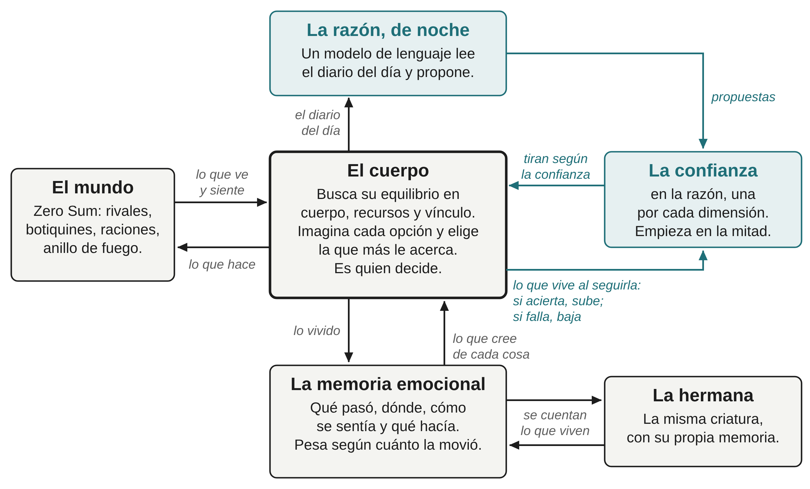
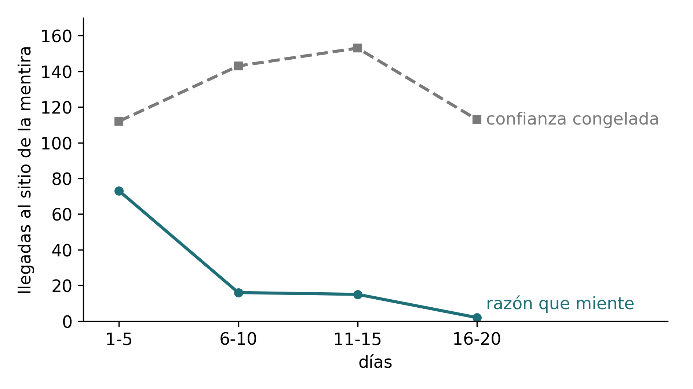
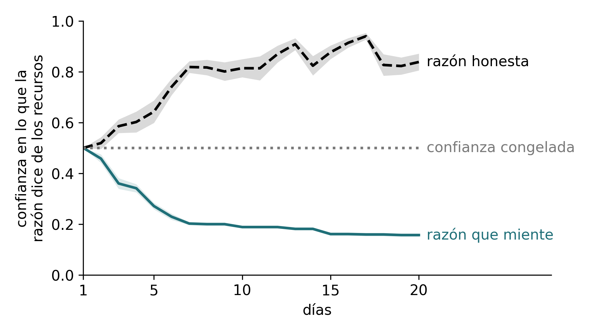

# G-EMV: emoción y razón en un agente

## Aprender viviendo: una criatura, su hermana y una razón que miente

Manel Enrico y Ari Sklar\
Manel Enrico: investigador independiente, Barcelona. ORCID: 0009-0008-1732-6310\
Ari Sklar: investigador independiente, Los Ángeles. ORCID: 0009-0000-8005-4524\
Preprint, versión 1, octubre de 2026. Versión en español; la publicada en Zenodo es la inglesa: *G-EMV: Emotion and Reason in an Agent. Learning by Living: A Creature, Its Sister and a Reason That Lies*.\
Séptimo trabajo de una línea de investigación que empezó con el motor [1]; sigue directamente al anterior [2]. Toda la serie: github.com/Manelenrico/g-emv.\
[1] Enrico, M. (2026). G-EMV: A Geometric Architecture of Homeostatic Orientation for Agents. Zenodo. DOI 10.5281/zenodo.21026795.\
[2] Enrico, M., y Sklar, A. (2026). G-EMV: Emotion and Reason in an Agent. Helping Without Commanding. Zenodo. DOI 10.5281/zenodo.23168539.

# Resumen

Este trabajo pregunta si una criatura artificial que nace sin saber qué hacen las cosas de su mundo puede descubrirlo viviendo, guiada por lo que siente. La criatura es un cuerpo que busca su propio equilibrio entre necesidades que tiran en direcciones opuestas, sin recompensa ni entrenamiento. Ahora recuerda de un día para otro, y cada recuerdo guarda qué pasó, en qué situación, cómo se sentía y qué estaba haciendo.

Sola, descubre lo que actúa rápido y se ve, como un botiquín, y no vimos que se quedara atrás de la que nace sabiendo. Le cuesta lo que cura poco y no ve lo que actúa por ausencia. Comparamos su curiosidad con una moneda que elegía al azar qué probar, puesta en el mismo cuerpo, y no encontramos diferencia; nuestra lectura es que, en un mundo con peligro, pesa más cuándo probar que qué probar, y eso lo decide el cuerpo, que era el mismo en las dos. Con una hermana que le cuenta lo vivido, las dos acaban creyendo lo mismo, aprende más de su hermana quien menos ha vivido por sí misma, y no vimos que se contagiara nada falso. Con una razón, un modelo de lenguaje que lee cada noche el diario de su día y le hace propuestas, la criatura no obedece: la propuesta suma un poco de atracción a algo que el cuerpo ya sabe hacer, y la confianza en la razón se gana comparando lo prometido con lo vivido, por separado en cada dimensión: una confianza para lo que la razón dice del cuerpo, otra para los recursos y otra para el vínculo. Esa confianza acaba alta después de las propuestas que eran verdad y baja después de las falsas, aunque el cuerpo no sabe cuáles lo son: solo juzga lo que vive. Probamos también mentiras que pusimos nosotros a propósito en las propuestas. Ante una que la llevaba a un sitio vacío, la criatura dejó de seguirla cuando su confianza bajó; con la confianza congelada, siguió yendo hasta el último día. Contado como lo sellamos, el efecto es claro; contado de la manera más estricta, mantiene la dirección pero queda en el límite. Una mentira que el cuerpo no sigue hasta el final no llega a descubrirla.

Todo se midió en un solo mundo de juego, con las predicciones escritas antes de jugar.

*Palabras clave: homeostasis, memoria emocional, aprendizaje sin recompensa, curiosidad, aprendizaje social, modelo de lenguaje, confianza, mentira.*

# 1. La pregunta

**Un cuerpo que no recordaba.** Esta serie pone junto a un cuerpo que siente una razón que habla, y pregunta qué le añade. El trabajo anterior (Enrico y Sklar, 2026) terminó con una lección: lo valioso y lo imprevisible está en los otros, y para preverlos hace falta experiencia. Pero aquel cuerpo no tenía experiencia. Empezaba cada partida como nuevo, y lo que sabía de las cosas de su mundo se lo habíamos escrito nosotros: que el botiquín cura, cuánto y cuándo conviene. No aprendía nada de lo que vivía.

**La pregunta.** De ahí sale la pregunta de este trabajo: ¿puede una criatura que nace sin saber qué hacen las cosas de su mundo descubrirlo viviendo, guiada por lo que siente? Y, una vez que aprende, dos preguntas más: qué cambia cuando una hermana le cuenta lo que ha vivido, y qué cambia cuando una razón le propone ideas que pueden ser verdad, un error o una mentira.

**La idea de fondo.** Para vivir no hace falta saberlo todo. Hace falta saber lo necesario, y gastar lo mínimo en lo demás. Un animal no necesita saber de qué está hecha una baya: necesita saber si le alimenta o le enferma, y dónde suele haberla. Lo que separa lo necesario de lo demás no es la cantidad de información, sino lo que le pasa al cuerpo: es necesario lo que lo acerca o lo aleja de su equilibrio. Por eso, en un mundo sencillo, quien mejor sabe lo que una criatura necesita es su propio cuerpo. A saber lo que hace falta, sin gastar en el resto, lo llamamos sabiduría. Por eso la memoria de esta criatura es emocional: cada recuerdo guarda cómo se sentía en ese momento, y pesa según cuánto la movió. Lo que la sorprende y no le importa se le olvida; lo que la sorprende y la mueve se le queda. Aprendemos de lo que nos sorprende en la medida en que nos importa. Es la apuesta de este trabajo, no un resultado, y las secciones siguientes la ponen a prueba.

**La regla de la serie.** Desde el principio, el reparto es el mismo: la razón propone y el cuerpo decide. Este trabajo añade una regla: lo que la criatura cree de las cosas solo cambia por lo vivido. Le llegan recuerdos de dos fuentes: los suyos y los que le cuenta su hermana, que también son vividos. La razón no deja recuerdos. Deja propuestas, y es el cuerpo quien comprueba, viviendo, si eran verdad.

**Tres pasos.** El trabajo avanza en tres pasos, y cada uno añade una fuente de saber. En la sección 3, la criatura está sola con lo que vive. En la sección 4, una hermana le cuenta lo que vivió ella, y las dos hermanas, que hasta ahí solo se diferenciaban en cuánto se atrevían a probar, reciben una manera distinta de percibir la amenaza: un regulador del miedo. En la sección 5, una razón lee su día y le propone qué probar; primero es una razón honesta, y después una que miente. Antes de cada campo dejamos escrito lo que esperábamos, y contamos lo que salió, haya salido o no.

**Un mundo que no está hecho para ella.** Todo se juega en un mismo mundo de juego, Zero Sum, dentro de la plataforma de Softmax: un combate por sobrevivir entre dieciséis criaturas, que no se hizo pensando en criaturas como esta. Tiene pocas cosas, poca calma y mucho peligro. Algunos de los límites de este trabajo vienen de ahí, y los decimos en su sitio.

**Lo que sigue.** La sección 2 presenta la criatura, su mundo y cómo medimos. Las secciones 3, 4 y 5 son los tres pasos. La sección 6 pone el trabajo junto a otros que se preguntan cosas parecidas. La sección 7 dice hasta dónde llega lo que encontramos y qué puertas deja abiertas. La sección 8 cuenta cómo se midió todo.

# 2. La criatura y su mundo

Aquí se cuenta lo justo para seguir la historia: cómo es la criatura, cómo es su mundo, qué es nuevo en este trabajo y cómo medimos.

## La criatura

**Un cuerpo que busca su equilibrio.** La criatura tiene necesidades en tres dimensiones: cómo está su cuerpo, cómo están sus recursos y cómo están sus vínculos. En cada una hay fuerzas que tiran en direcciones opuestas, y sobre las tres hay un punto donde querría estar. A lo lejos que está de ese punto lo llamamos desequilibrio. Es una distancia, no un diagnóstico, y lo que cuenta es hacia dónde va: cuando baja, la criatura se acerca a su equilibrio; cuando sube, se aleja. Entre el mundo y esas necesidades hay una tabla, una lista de situaciones, cada una con la fuerza con que tira y en qué dimensión. Unas duelen, como que te golpeen o que el fuego se acerque. Otras alivian, como curarse o tener a la hermana al lado. Otras atraen, como un botiquín a la vista. Lo que duele y lo que alivia son de la misma familia: lo que duele aleja a la criatura de su equilibrio, y a esa parte del desequilibrio la llamamos malestar; lo que alivia se la quita. Lo que atrae es el otro polo: también mueve a la criatura, pero no es un malestar, sino unas ganas de ir hacia algo. Cada cosa es una fila de la tabla. Cuando decimos que algo le duele, le alivia o le atrae, queremos decir eso y nada más: que una fila de su tabla tira. No afirmamos nada sobre lo que la criatura experimenta.

**Cómo decide.** Veinticuatro veces por segundo, la criatura imagina un puñado de cosas que podría hacer: ir a algún sitio, coger algo, usarlo, acercarse a su hermana, quedarse quieta. Para cada una imagina cómo se sentiría, la puntúa con su tabla y elige la que más le acerca a su equilibrio. Cada una de esas veinticuatro veces es un instante. No hay recompensa que perseguir ni entrenamiento. El motor que hace estas cuentas es el del primer trabajo de la serie y no se ha tocado: todo lo que añadimos en este trabajo está fuera de él.

**Lo que es nuevo: recordar de un día para otro.** Hasta ahora, la criatura empezaba cada partida como nueva. Aquí, cada partida es un día. Entre un día y el siguiente hay una noche, y la criatura se lleva un cuaderno con lo que ha vivido. Si muere durante la partida, ese día se acaba para ella, pero no lo aprendido: al día siguiente vuelve a empezar, con su cuaderno, en un mundo nuevo. Cada día juega en un mundo parecido pero no igual: el mismo juego, con las cosas en otros sitios, para que aprenda qué hacen las cosas y no dónde están. Y lo que hacen las cosas ya no se lo escribimos nosotros en la tabla: lo tiene que descubrir. La sección 3 cuenta cómo.

**Lo que se aprende y lo que no.** Lo que la criatura aprende es conocimiento del mundo: qué hace una cosa, cuánto alivia, en qué situación. Lo que vale para ella no se aprende: qué le duele y cuánto, dónde querría estar, cuánto le importa su hermana. Eso está fijado de nacimiento y no cambia en toda su vida. Podríamos llamarlo su genoma. No es que haya genes: es una imagen para decir que son los ajustes con que nace la criatura. Todas las criaturas de este trabajo nacen con los mismos.

**Dos hermanas.** Las criaturas juegan por parejas: dos hermanas que nacen juntas y comparten la partida contra todas las demás. Son la misma criatura, con el mismo cuerpo, la misma tabla y la misma manera de decidir. Cada una siente a la otra: le duele que a su hermana le peguen, le duele que se aleje más allá de donde podría ayudarla, y le alivia tenerla cerca. Cada dos segundos se mandan un mensaje corto, un parte, con dónde están, cuánta vida les queda y qué llevan. Todo eso viene del trabajo anterior. Desde la sección 4, el parte sale cada segundo y cuenta además los rivales y las cosas útiles que cada una ve, y lo que cuenta una cuenta para la otra casi como visto con sus propios ojos: lo llamamos ojos compartidos. Y desde la sección 4, también, se cuentan lo que viven.

**La valiente y la prudente.** A una de las hermanas la llamamos valiente y a la otra, prudente. En los primeros campos de la sección 3 solo se diferencian en cuánto se atreven a probar cosas nuevas. La sección 4 les da una manera distinta de percibir la amenaza, y cuenta cómo.

**La criatura entera.** La figura 2.1 muestra cómo queda la criatura al final de este trabajo, con todas las piezas que irán llegando en las secciones siguientes.

::: {.pie}
**Figura 2.1.** La criatura, tal como queda al final de este trabajo. El cuerpo es quien decide; las demás piezas le dan lo que sabe o le proponen. La memoria llega en la sección 3, lo que se cuentan las hermanas en la 4, y la razón y la confianza en ella en la 5. En azul, la parte de la razón.
:::

## Su mundo

**Un combate por sobrevivir.** El mundo es Zero Sum, un juego ideado por Ari Sklar, de casillas y visto desde arriba, en la plataforma Coworld de Softmax: un mapa de cuarenta y ocho por cuarenta y ocho casillas donde dieciséis criaturas, ocho parejas, compiten por sobrevivir. Se muere de verdad: no se vuelve a aparecer. Hay armas, comida y botiquines en el suelo, y un anillo de fuego que, por fases, va cerrando la zona segura hacia el centro. El juego avanza a veinticuatro instantes por segundo y no espera a nadie.

**Un mundo más lento.** Usamos la misma configuración lenta del trabajo anterior: partidas de casi trece minutos, el doble de las normales, y un anillo que no avisa hasta pasados algo más de cinco minutos de juego. Los rivales son programas de otros participantes, elegidos entre los que menos atacan, y son los mismos, en los mismos asientos, en todas las partidas de este trabajo salvo en el último campo, que cuenta los suyos.

**Las cuatro cosas.** De todo lo que hay en el suelo, este trabajo mira cuatro cosas. La vida de la criatura va de cero a cien. El botiquín cura cincuenta, pero hay que usarlo dos segundos sin recibir ningún daño: un golpe, el fuego o el veneno lo cortan, y entonces no se gasta. La ración cura quince, tarda un segundo y no se corta. La red es un arma que se lanza: no hace daño, pero deja quieto a quien la recibe. El camuflaje acorta la distancia desde la que te ven los demás.

**Dos sitios donde jugar.** Las partidas que cuentan se juegan en la plataforma de Softmax. Antes de gastar en ellas, probamos cada pieza nueva en un mundo local, en nuestra propia máquina, con copias de nuestras criaturas en todos los asientos.

## Cómo medimos

**Banco y campo.** Medimos de dos maneras. En el banco volvemos a mirar partidas ya jugadas, sin jugar otras nuevas: los mismos momentos, juzgados con una pieza nueva o contados de otra manera. Es barato y permite comparar opciones sobre exactamente lo mismo, pero no dice qué habría pasado después. En el campo jugamos partidas de verdad.

**Brazos y series.** Cada versión de la criatura que comparamos es un brazo. Una serie es una cadena de días seguidos, normalmente veinte, que cada brazo juega en los mismos mundos, con los mismos rivales en los mismos sitios, para que la diferencia entre brazos sea suya y no del azar. Mismo mundo no quiere decir misma partida: en cuanto una criatura hace algo distinto, la partida se separa.

**Sellar la predicción.** Antes de cada campo escribimos lo que esperábamos y con qué medida lo íbamos a juzgar, y lo guardamos de manera que no se pueda cambiar después. A eso lo llamamos sellar la predicción. Así no podemos elegir, vistos los datos, la medida que mejor queda. Lo que no se cumple se cuenta igual.

**El listón.** Para dar una diferencia por buena pedimos que sea al menos tres veces mayor que su error típico, que es la medida de cuánto puede moverla el azar. Cuando decimos que una diferencia es «dos veces el ruido», queremos decir eso: dos veces su error típico, y por tanto todavía no un resultado, sino una dirección.

**Ver lo que hace.** Para ver lo que hace la criatura no nos fiamos solo de los números: dibujamos animaciones a partir de los datos de cada partida y las miramos.

La sección 8 cuenta con más detalle cómo se midió todo.

# 3. Lo que hacen las cosas

Aquí la criatura nace sin saber qué hacen las cosas de su mundo, y miramos qué descubre viviendo, qué le cuesta y qué no llega a ver.

**Lo que trae de nacimiento.** La criatura conoce el espacio: el juego le da el mapa entero al nacer. Lo que no conoce es qué hacen las cosas que hay en él. No sabe que el botiquín cura, ni cuánto, ni cuándo conviene usarlo. No sabe que la ración alimenta. De nacimiento solo trae tres cosas: una atención a lo que se sale de lo normal, una memoria que guarda cada momento con su emoción, y unas ganas de probar que se calman teniendo y usando. Querer un objeto concreto no viene de fábrica: se aprende.

**Una memoria que guarda cómo se sintió.** Cada vez que la criatura usa algo, guarda un recuerdo con cuatro cosas: qué le pasó al cuerpo, en qué situación estaba, cómo se sentía y qué estaba haciendo. Cuando vuelve a estar en una situación parecida, pesan más los recuerdos de momentos que se le parecen. De esos recuerdos sale lo que cree de cada cosa: cuánto espera que le alivie. Y cada recuerdo pesa más o menos según cuánto movió a la criatura.

**El miedo calla el probar, no el mirar.** Con peligro cerca, la criatura no se pone a probar cosas nuevas: el miedo apaga esas ganas. Pero sigue mirando, y apunta lo que ha visto para probarlo cuando vuelva la calma.

**Tres versiones de la misma criatura.** Para saber qué se gana y qué se pierde aprendiendo, comparamos tres versiones que solo se diferencian en lo que saben y en lo que recuerdan. La primera nace sabiendo lo que hacen las cosas: es lo mejor que podría ir. La segunda nace sin saber y lleva un cuaderno que pasa de un día al siguiente: es la que aprende. La tercera nace sin saber y su cuaderno se vacía cada noche: es la que olvida. Las tres juegan cada día en el mismo mundo, con los mismos rivales en los mismos sitios, para que la diferencia sea suya y no del azar. Antes de jugar cada serie dejamos escrito lo que esperábamos y con qué medida lo íbamos a juzgar, y lo guardamos de manera que no se pueda cambiar después. Lo que no se cumple se cuenta igual.

## Lo que se guarda importa

Antes de soltar a la criatura en el mundo, probamos su memoria sobre partidas ya jugadas. La primera versión guardaba, de cada uso del botiquín, cuánto había subido la vida. Parece razonable, pero la vida tiene un techo de cien, y tres de cada cuatro curas llegaban a él. Si se ordenan las curas de menor a mayor y se mira la del medio, una cura vale unos nueve puntos cuando la criatura abre el botiquín casi sana, y unos cincuenta cuando lo abre herida. Guardando "cuánto subió", la criatura aprendía que el botiquín cura poco justo cuando lo usaba sana. Cada recuerdo era cierto, y la conclusión era falsa.

Desde entonces, si la vida toca el techo, el recuerdo guarda "al menos": curó al menos esto, quizá más. Lo contamos porque es la primera vez que vemos algo que volverá en la sección 5: una creencia falsa puede crecer sobre recuerdos verdaderos cuando les falta el contexto.

## Aprender no la deja atrás

**Ciento veinte partidas.** Jugamos las tres versiones durante veinte días, en dos series, en la plataforma de Softmax: ciento veinte partidas, sin ningún corte. Lo que mide cómo le va a una criatura es el puesto en que acaba entre los dieciséis jugadores de la partida, del primero al último.

**No se hunde.** En los cinco primeros días, la que aprende acababa algo más de medio puesto por detrás de la que nace sabiendo. En los cinco últimos, casi un puesto por delante. Las dos diferencias son pequeñas al lado de lo que varía el puesto de una partida a otra, así que no decimos que la que aprende acabe mejor. Lo que sí podemos decir es que no vimos que se quedara atrás.

**Lo que aporta la memoria.** La comparación más limpia es con la que olvida cada noche, porque las dos nacen igual de ignorantes y solo las separa el cuaderno. Es otra comparación, y da un resultado parecido: en los primeros días, la que aprende iba casi un puesto por detrás de la que olvida; en los últimos, casi uno por delante. Es decir, a medida que el cuaderno se llena, recordar empieza a contar. Pero la diferencia también cabe en lo que el azar puede mover, así que la tomamos como una dirección, no como un resultado firme.

**Lo que cree al final.** El día veinte, las cuatro criaturas que aprenden creían que el botiquín cura entre veintinueve y cuarenta puntos, de una cura real de cincuenta. Medimos también su propia incertidumbre sobre lo que cura el botiquín, que solo baja con usos completos que no acaban con la vida al tope. En los cinco primeros días era casi total; en los cinco últimos, alrededor de un tercio. Es lo que la criatura cree que le falta por saber, no una medida de su error.

**Curarse o conocer.** Una criatura que no sabe cuánto cura algo tiene una razón para usarlo: saberlo. Esa curiosidad del cuánto solo pesa cuando la herida es mayor que lo que la criatura sabe que cura el botiquín. En las aperturas en que le pesaba, la vida estaba en cuarenta, de mediana; en las demás, en ochenta y cuatro. Pero esa separación depende de la propia vida al abrir, así que la diferencia sale en buena parte de cómo está hecha la pieza, y no la leemos como un resultado.

**Lo que no salió.** No descubrió las dos cosas, botiquín y ración, en cinco días: al acabar el quinto, solo una de las cuatro tenía un recuerdo firme de las dos, es decir, al menos un uso completo que no acabara con la vida al tope. Tampoco aprendió a aprender: la segunda cosa no le costó menos que la primera. Y hay algo que conviene decir sin adornos: en este mundo, nacer sin saber casi no le costó nada. Conocer de entrada esas dos cosas da poca ventaja.

## Lo inútil

**Dos cosas que no le sirven.** El mundo tiene, además del botiquín y la ración, una red y un camuflaje. Para esta criatura son inútiles, por razones que contamos más abajo. En otro campo de ciento veinte partidas, ahora con las cuatro cosas desconocidas al nacer, preguntamos tres cosas: si las probaría, si dejaría de quererlas y si las recordaría más débiles que lo útil. Las prueba, casi siempre en los primeros días. Deja de quererlas, no. Las recuerda más débiles, tampoco.

**Sabe que no sirven.** De los sesenta y tres recuerdos de red y camuflaje que guardaron las criaturas en veinte días, sesenta dicen "no hizo nada". El día veinte, lo que creían de esas dos cosas estaba en cero en cinco de los ocho cuadernos.

**Y aun así las sigue cogiendo.** En la segunda mitad del campo, la que aprende cogía la red o el camuflaje casi una vez por vida, más que la que nace sabiendo, aunque muy poco al lado de las cosas útiles, que cogía cinco o seis veces. Mirándolo decisión a decisión, no las cogía por descuido. Coger ganaba a no hacer nada por muy poco, pero ganaba, y lo que inclinaba la balanza era la curiosidad. Lo que se ha probado pocas veces siempre parece más desconocido que lo que se ha probado muchas, aunque nunca haya hecho nada.

**Lo que no hizo nada se graba casi como lo que curó.** Un recuerdo de probar la red o el camuflaje (probar la red era llevarla encima unos segundos: nunca llegó a lanzarla) quedaba, de media, casi tan grabado como uno de usar el botiquín o la ración. La fuerza salía de cuánto se movía su desequilibrio mientras la criatura probaba, no del efecto de la cosa. Si mientras prueba la red le sube el hambre, ese recuerdo de nada queda marcado con fuerza. La criatura no distingue "no hizo nada" de "hizo muy poco".

**Por qué pasa, y por qué no lo arreglamos.** Mientras la criatura prueba algo durante unos segundos, en su cuerpo pasan muchas cosas a la vez: le sube el hambre, se acerca un rival, se aleja la hermana. El cuerpo nota cuánto se ha movido su desequilibrio, pero no puede saber qué parte de ese movimiento es de la cosa y qué parte es de todo lo demás. Separarlo pide algo que el cuerpo no tiene: comparar muchas pruebas en situaciones distintas y razonar sobre ellas. Probamos a cerrar la curiosidad poco a poco para lo que repetidamente no hace nada, y no funcionó: en el tiempo que dura una prueba, la ración, que cura poco y casi siempre llega al tope de vida, parece hacer tan poco como la red, y cualquier regla que cierra la red cierra también la ración. Preferimos dejarlo así y contarlo. Separar el efecto de una cosa de lo que pasa alrededor es justo lo primero que hace la razón de la sección 5.

## Lo útil en peligro, lo curioso en calma

Hay algo que salió como esperábamos, y no lo hizo la curiosidad sino el cuerpo. De sesenta y cuatro veces que una criatura probó la red o el camuflaje, cincuenta fueron en calma, catorce con un rival cerca y ninguna con fuego. El botiquín, en cambio, se usa sobre todo cuando hace falta, que es cuando duele. Nadie le escribió esa regla. Sale de lo que ya hace el cuerpo: con miedo no prueba, con dolor se cura.

## Curiosidad contra una moneda

**El campo grande.** Para saber si la curiosidad sirve de algo había que compararla con no tenerla. Jugamos trescientas sesenta partidas, setecientas veinte vidas, con seis versiones: la que nace sabiendo, la que olvida y la que aprende, estas dos en dos caracteres, valiente y prudente, y una sexta que elegía qué probar tirando una moneda. Esperábamos que la que aprende con curiosidad llegara antes a creer en el botiquín y lo usara más cuando le hacía falta.

**No hubo diferencia que se pudiera separar del azar.** La prudente que aprende llegó a creer en el botiquín unos tres días antes que la de la moneda; la valiente, prácticamente igual. Las dos diferencias caben de sobra en lo que el azar puede mover. En usar el botiquín cuando la vida estaba por debajo de la mitad, tampoco hubo diferencia. Y lo más llamativo: curiosidad y moneda mandaban a la red y al camuflaje una parte parecida de sus pruebas, más o menos una de cada cuatro, del primer día al último.

**Lo que estábamos comparando de verdad.** La versión de la moneda tenía el mismo cuerpo que la que aprende: el mismo miedo, la misma calma, el mismo momento de probar. Solo cambiaba quién elegía qué probar. Y cuándo probar, que en un mundo con peligro probablemente importa más, lo decidía el cuerpo en las dos. Así que este campo no comparó una criatura con emociones con una sin ellas. Comparó una curiosidad con una moneda, encima del mismo cuerpo emocional. No encontrar diferencia no prueba que la curiosidad no sirva. Nuestra lectura, que este campo no puede demostrar, es que en este mundo el cuerpo hace casi todo el trabajo.

**Una salvedad.** La versión de la moneda tenía un defecto: muchas de sus pruebas se quedaban sin hacer, porque el cuerpo no ofrece usar un botiquín con la vida llena, y al final probó la mitad que la curiosidad. Rehicimos la cuenta sobre el papel, sin jugar: multiplicamos por tres su calendario real de pruebas y miramos cuándo habría llegado a las unas diez que hacen falta para creer en el botiquín. La conclusión no cambia: la diferencia sigue sin salir del azar ni cambia de signo. Tres de las seis criaturas de la moneda no probaron nunca el botiquín, y tres veces cero sigue siendo cero.

## Lo que una cosa ofrece depende del cuerpo

**El camuflaje: no sabe usarlo.** Que el camuflaje fuera inútil no era evidente. En este mundo, el camuflaje reduce la distancia a la que te ven los demás: a cuatro casillas si te has quedado quieto y a siete si te has movido en el último segundo, y deja de ocultarte durante cinco segundos después de atacar. Sin él, te ven desde unas ocho casillas, entre seis y diez según quién mire. Comparando cada criatura consigo misma, en el mismo tramo de la partida y la misma situación, en cuatrocientas cincuenta vidas, el camuflaje no le dio ninguna protección que se pudiera medir. Nuestra criatura casi nunca está quieta. Y aunque la protegiera, su efecto sería un golpe que no llega: lo que no pasa no deja recuerdo.

**La red: no puede usarla.** La red es un arma que se lanza. El cuerpo de esta criatura no lanza cosas que no hacen daño. La red no es inútil en el mundo: es inútil para este cuerpo.

**Dos maneras de no servir.** El camuflaje es algo que la criatura no sabe usar; la red, algo que no puede usar. Lo que una cosa ofrece no está solo en la cosa, sino en la cosa y en el cuerpo que se la encuentra. Es lo que Gibson llamó las affordances de un objeto (Gibson, 1979), visto desde dentro de una criatura que aprende.

## La medida justa de un recuerdo

Hay un detalle de construcción que conviene contar, porque al principio lo leímos mal. Durante un tiempo, la fuerza de cada recuerdo se calculaba con una fórmula que aplastaba las diferencias: casi todos los recuerdos pesaban parecido. Después pasamos a medir cada recuerdo en la escala de la propia criatura: cuánto la movió esa experiencia comparado con lo que suele moverla. Al principio creímos que eso la hacía aprender mucho más deprisa: de diecisiete a treinta pruebas del botiquín para llegar a creer la mitad de lo que cura, a unas ocho o nueve. Pero las dos cuentas no contaban igual. Una contaba como prueba el botiquín que un daño cortaba, que no enseña nada, y la otra no. Contadas igual, las dos llegan a la mitad entre la octava y la décima prueba: con su propia escala, la criatura no aprende mucho antes.

Lo que cambia es dónde acaba. Sobre las mismas pruebas, con su propia escala acaba creyendo que el botiquín cura unos cuarenta puntos, cerca de los cincuenta que cura de verdad; con la fórmula antigua, unos treinta y uno. Es lo que cabe esperar: pesan más las curas que más la movieron, las de cuando estaba herida, que son las que muestran lo que el botiquín hace cuando importa. Son pocas criaturas, entre tres y siete, y lo damos como una lectura, no como un resultado sellado. Lo importante, notado como importante, no la hace aprender antes, sino mejor.

## Lo que deja dicho

Una criatura que nace sin saber qué hacen las cosas de su mundo las descubre viviendo, y no vimos que se quedara atrás de la que nace sabiendo. Pero no las descubre todas igual. Aprende bien lo que actúa rápido y se ve: el botiquín, que cura en segundos y deja un recuerdo claro. Le cuesta lo que cura poco: la ración, que cura quince y casi dos de cada tres veces dejaba la vida en el tope, así que la criatura no llegaba a ver cuánto cura. No ve lo que actúa por ausencia: el camuflaje, cuyo efecto sería un golpe que no llega. Y no distingue bien entre algo que no hace nada y algo que hace muy poco: llevar la red encima, que no le hizo nada, se le queda casi tan grabado como usar el botiquín, que le curó, porque lo que graba es cuánto se movió todo su cuerpo mientras probaba, no lo que hizo la cosa.

Cuándo probar lo decide el cuerpo, y lo decide bien: lo curioso en calma, lo útil cuando hace falta. Qué probar lo decide la curiosidad, y en este mundo una curiosidad no lo hizo mejor que una moneda.

Lo que la curiosidad sola no puede hacer es cerrar los caminos que no llevan a ninguna parte. Para cerrarlos tendría que saber que no llevan a ninguna parte, y lo único que tiene es lo vivido, que solo le dice "todavía no sé bastante". Probamos a cambiar lo que mueve la curiosidad, para que buscara dónde está aprendiendo y no qué ignora, y lo inútil dejó de engancharla. Pero la ración también dejó de interesarle, porque en cuanto la vida toca el techo ya no enseña nada. Queda para más adelante. Lo que hace falta es algo que pueda decir "esto no te va a servir, y esta es la razón", o "pruébalo de otra manera". En la sección 5, ese algo es una razón que lee cada noche el diario de la criatura.

# 4. Aprender de la hermana

Hasta aquí, cada criatura aprendía sola. Pero en este mundo las criaturas nacen de dos en dos, y una hermana puede contarle a la otra lo que ha vivido. Esta sección pregunta qué cambia cuando se lo cuentan.

**Aprender de otro no necesita razón.** Una rata que se encuentra con otra que acaba de comer pasa a preferir esa misma comida, sin haberla probado, y lo que le pasa la información es el olor (Galef y Wigmore, 1983). Aprender de los demás es más antiguo que el lenguaje y que el razonamiento. Por eso, antes de poner una razón junto al cuerpo, quisimos ver hasta dónde llega una pareja que solo se cuenta lo vivido.

## Dos maneras de percibir la amenaza

**El mismo genoma, otra manera de mirar.** Hasta ahora, la valiente y la prudente solo se diferenciaban en cuánto se atrevían a probar cosas nuevas. Eso no basta para que sean dos criaturas distintas. Las dos tienen el mismo cuerpo y el mismo genoma, en el sentido de la sección 2. Valoran lo mismo, buscan el mismo equilibrio y deciden con el mismo motor. Lo que les dimos es otra cosa: un estilo distinto de percibir la amenaza. Una es más sensible que la otra a lo que puede salir mal, como dos personas iguales de fondo, una de las cuales ha aprendido, por lo que sea, a ver el peligro antes. No sabemos por qué, ni lo modelamos: la diferencia está fijada desde el principio.

**El miedo es anticipar una pérdida.** En este cuerpo, el miedo es anticipar una pérdida que todavía no ha ocurrido, en cualquiera de las tres áreas: en el cuerpo, en los recursos o en el vínculo. El regulador del miedo sube o baja todo lo que anticipa: el peligro que se acerca, el rival que puede atacar, quedarse sin provisiones, el peligro que corre la hermana. Sin regulador vale uno; la valiente lo tiene a la mitad, y la prudente, a una vez y media.

**Lo que el regulador no toca.** El dolor que ya está pasando no cambia: un golpe duele igual a las dos. Las ganas de lo que atrae y la curiosidad, tampoco, porque no son pérdida. Y hay una decisión de diseño que importa: el freno a matar no cambia. Ese freno es cuidado, no miedo, y las dos hermanas cuidan igual. La valiente no es más cruel; solo percibe menos amenaza. Percibe menos también el peligro que corre su hermana. Queríamos además que el regulador moviera las ganas de estar cerca de ella, pero esa pieza se suma después y quedó fuera de su alcance; la distancia entre hermanas salió casi igual en las dos.

**El mismo motor.** El regulador actúa antes del motor, en cómo se traduce lo que pasa fuera a lo que el cuerpo siente. El motor sigue sin tocarse. Lo comprobamos de la manera más estricta: con el regulador en uno, repetimos tres vidas enteras decisión a decisión, más de veintiocho mil decisiones, y no cambió ni una. Antes de jugar el campo, comprobamos también que con esos valores las dos hermanas siguen viviendo una vida normal: ninguna muere mucho antes ni se queda quieta.

**Lo que no hicimos.** Hay otra manera de hacer criaturas distintas: darles constituciones distintas, el mismo motor con otro genoma, para que valoren otras cosas o busquen otro equilibrio. Eso sería un temperamento de nacimiento en sentido pleno, y tocaría a la vez el dolor, el miedo, lo que buscan y el cuidado. Aquí queríamos cambiar una sola cosa, la manera de percibir la amenaza, para poder leer su efecto. Criaturas con genomas distintos, viviendo juntas, quedan para más adelante.

## Cómo se cuentan lo vivido

Lo que una hermana le pasa a la otra es el recuerdo entero, con las mismas cuatro cosas que guarda de lo que vive ella: qué pasó, en qué situación, cómo se sentía y qué estaba haciendo. Le llega por tres caminos.

**Mirando.** Cuando una ve que su hermana usa un botiquín o se pone el camuflaje, guarda lo que vio. Si mientras tanto a la hermana la estaban golpeando, lo descarta, porque no podría saber qué efecto fue del objeto y cuál del golpe.

**Contándoselo de día.** Por el canal privado de la pareja, cada recuerdo nuevo viaja en un mensaje corto, uno cada vez, en el hueco de los partes que ya se mandaban.

**De noche.** Entre una partida y la siguiente, cada una recibe como mucho los cinco recuerdos más intensos del día de su hermana que no le llegaron de día. No el cuaderno entero: lo que más la movió. Es como contarse el día junto al fuego antes de dormir: no todo, sino lo que más pesó. La noche, además, es el momento en que hablará la razón de la sección 5.

**Cuánto pesa lo que te cuentan.** Un recuerdo recibido pesa lo que pesó para quien lo vivió, multiplicado por el vínculo con la hermana en ese momento, y nunca más que uno vivido. Lo que te cuenta alguien muy unido a ti pesa casi como lo tuyo; lo que te cuenta alguien de quien te has alejado, menos.

## El campo

Jugamos ciento veinte partidas en la plataforma de Softmax: tres series de veinte días, cada día con una pareja que se cuenta lo vivido y otra que no, en el mismo mundo. Las dos parejas tienen los mismos ojos compartidos, la misma manera de percibir la amenaza y los mismos cuatro objetos desconocidos al nacer. Lo único que las separa es contarse los recuerdos.

Antes de jugar dejamos escritas tres predicciones, y sabíamos que dos de ellas solo saldrían si el efecto era enorme, porque con tres series el azar pesa mucho. Ninguna llegó al listón de la sección 2, tres veces el ruido. Las tres fueron en la dirección prevista. Lo que contamos a continuación son direcciones claras, no verdades establecidas.

## Lo que se ve

**Dos cuadernos que acaban siendo uno.** Las hermanas que se cuentan lo vivido acaban creyendo exactamente lo mismo. En una de las series, las dos creían al final que el botiquín cura unos cuarenta y uno; en la pareja que no se cuenta nada, una creía cuarenta y tres y la otra, doce. Hay que decirlo con honestidad: esto estaba casi garantizado por cómo está hecho. Cada hermana vive pocos recuerdos, y casi todos le llegan a la otra.

**Cuánto viene de la otra.** La pregunta interesante no es si se parecen, sino cuánto de lo que cree cada una le viene de su hermana. Para saberlo, recalculamos lo que cree cada una con todos sus recuerdos y solo con los que vivió ella. Del botiquín, entre un ocho y un cuarenta y seis por ciento de lo que cree cada hermana viene de la otra. Y quien más aprende de su hermana es quien menos ha vivido: una valiente que por sí sola habría creído que el botiquín cura veinte, creía treinta y nueve gracias a lo que le contó su hermana.

**No vimos contagiarse nada falso.** Para la red y el camuflaje, que no curan nada, contamos como falso creer que curan más de cinco puntos de vida; para el botiquín y la ración, creer que no curan. Mirando cada día las seis hermanas que se contaban lo vivido, durante veinte días, ninguna cruzó esa línea. Dos se quedaron cerca, en algo más de cuatro puntos, por un solo recuerdo recibido de su hermana: todo lo que ellas mismas vivieron decía cero. De trescientos setenta y siete recuerdos recibidos, siete contradecían el efecto real del objeto: eran cosas que la hermana vivió de verdad, mezcladas con otro efecto que pasó a la vez. Lo vivido, contado sin su contexto, también puede apuntar mal. La sección 5 lo muestra con más fuerza.

**Saber por la hermana cambia lo que se vive.** Compartir no solo cambió lo que creían: cambió lo que hacían. La prudente que recibía los recuerdos de su hermana probó más cosas por sí misma que la prudente que no los recibía, en las tres series: casi el doble en una de ellas. Saber por la hermana que el botiquín cura la llevaba a usarlo, y usándolo lo vivía. Lo contado abre la puerta a lo vivido.

**La prudente es la exploradora.** En las parejas que se cuentan lo vivido, la prudente prueba más que la valiente en las tres series. Esperábamos lo contrario. Nuestra lectura, que no hemos medido aparte, es que el miedo a quedarse sin recursos la lleva a recoger más, y quien recoge más tiene más cosas que probar. En las parejas que no se cuentan nada, no hay un orden fijo.

**Lo que no cambia.** Compartir no redujo el tiempo dedicado a lo que no sirve: más o menos una de cada cinco pruebas iba a la red o al camuflaje, se contaran lo vivido o no. Ese número no lo pone lo que se sabe. Lo ponen el cuerpo y el mundo: la criatura prueba lo que tiene a mano.

## Mirar de cerca lo que medimos

Una lectura crítica de estos resultados nos hizo tres preguntas. Respondiéndolas, entendimos mejor qué habíamos medido.

**Lo que medía la primera predicción.** Habíamos predicho que la hermana que menos prueba por sí misma se beneficiaría más de compartir. La pareja que se cuenta lo vivido creía más en el botiquín, un sesenta por ciento más, pero mirando de cerca vimos que esa medida comparaba parejas, no a la hermana callada con ella misma. Por eso, para saber cuánto aprende cada una de la otra, usamos la cuenta de antes: lo que cree con todo menos lo que cree solo con lo suyo.

**Un uso, un recuerdo.** Casi todo lo que una hermana veía usar a la otra le llegaba también contado por el canal, así que entraba dos veces en su cuaderno. Quitando la copia, lo que creían apenas cambió. Desde entonces, un uso visto y contado es un solo recuerdo.

**El vínculo no se movió.** La regla de que lo contado pesa según el vínculo no llegó a ponerse a prueba. Las hermanas estuvieron todo el campo a dos o tres casillas, viéndose ocho de cada diez instantes, y su vínculo se quedó al máximo. Lo que les llegaba pesó, en la práctica, lo que pesó para quien lo vivió. Para ver qué haría la regla, la aplicamos a mano sobre los mismos cuadernos, sin jugar: con el vínculo a la mitad, cada hermana conservaría unas dos terceras partes de lo que aprendió de la otra; con el vínculo a un cuarto, algo más de cuatro de cada diez. Menos que proporcional, y nunca al revés. Pero eso es lo que la regla haría con los mismos recuerdos, no lo que haría una pareja que de verdad se distanciara. Para eso haría falta un mundo donde las hermanas se separen.

## Lo que deja dicho

Dos criaturas que se cuentan lo vivido aprenden la una de la otra sin necesidad de razonar. Acaban creyendo lo mismo. Aprende más de su hermana quien menos ha vivido. Y saber por la hermana no sustituye a vivir: lo empuja. La que recibe más prueba más, y lo que prueba lo vive.

En este campo, lo contado no llegó a engañar. Cada hermana solo cuenta lo que vivió, y eso protege mucho, aunque no del todo: lo vivido puede apuntar mal si se cuenta sin su contexto. Y esa protección depende de la fuente. Una razón que lee el diario de noche y propone ideas no cuenta lo vivido: cuenta lo que deduce, y lo que deduce puede estar mal, o ser mentira. Ahí la confianza deja de ser un detalle. La sección 5 se la da a la criatura: una confianza en su propia razón que se gana, dimensión a dimensión, comparando lo que la razón prometió con lo que el cuerpo vivió.

# 5. La razón de noche

Hasta aquí, todo lo que la criatura sabe le viene de vivir o de lo que su hermana le cuenta que vivió. Y lo vivido no miente. Esta sección le añade una razón: un modelo de lenguaje, Claude Sonnet 5.5, de Anthropic, que, cada noche, lee lo que la criatura vivió durante el día y le propone ideas para el siguiente. Una razón puede saber cosas que el cuerpo no descubre solo. También puede equivocarse, o mentir. La pregunta es si un cuerpo puede servirse de una razón sin obedecerla.

## Una razón que no conoce el juego

**El diario.** Cada noche, la razón de cada hermana lee un diario de su día, escrito en el idioma del cuerpo. Le dice cómo estaba al empezar y al acabar en las tres dimensiones, qué probó y qué efecto tuvo, qué le contó su hermana y qué cree de cada cosa. Le da además hasta catorce momentos clave con todo su contexto: cómo se sentía, dónde estaba, quién había cerca, qué llevaba y qué hacía. No recibe el manual del juego ni sus reglas. Los objetos llevan los nombres que usa el cuerpo: botiquín, ración, red, camuflaje.

**Una razón sin memoria propia.** La razón no recuerda las noches anteriores. Cada noche es una lectura nueva, del diario de ese día y nada más. Lo que sabe del pasado le llega por lo que cree el cuerpo, que el diario incluye y que viene de todo lo vivido desde el primer día. Es como un médico distinto cada noche que lee el historial del paciente: no recuerda haberlo visto, pero el historial guarda lo que ha pasado. Lo que la razón no sabe es lo suyo: qué propuso las noches anteriores, si se siguió, cómo salió y cuánto confía en ella la criatura. Todo lo que aprende de su razón, en este trabajo, lo aprende el cuerpo.

**Lo que acierta y dónde falla.** La primera vez que la razón leyó estos diarios, sobre ocho días de criatura, más de la mitad de lo que propuso era verdad en el mundo. Lo que acertaba era lo que el cuerpo ya había vivido pero no podía formular. El cuerpo guarda cada uso del botiquín con su contexto, y de ahí saca cuánto cura. Pero no tiene manera de enunciar una condición como «el botiquín solo cura si nadie te golpea mientras lo usas». Esa condición está repartida en sus recuerdos: unos usos con golpe, que no curaron, y otros sin golpe, que sí. La razón leyó esos recuerdos juntos y la escribió. Eso es lo que hace bien: ver el patrón en lo vivido y ponerle palabras.

**Donde el diario la engañaba.** Falló donde el diario la engañaba. Aquel primer diario apuntaba cifras que eran cuentas nuestras, no efectos de las cosas: contaba como vínculo la distancia a la hermana, y como riqueza el hecho de coger el camuflaje. La razón las tomó por efectos y prometió lo que no existía, por ejemplo que el camuflaje da recursos. Rehicimos el diario con dos etiquetas separadas: lo que el objeto hizo en el cuerpo, y el contexto, que no es la cosa. Las promesas sin base pasaron de quince de cada cuarenta y siete a tres de cada cuarenta y seis. Una razón es tan buena como lo que se le cuenta.

## Proponer, no ordenar

**Una propuesta.** Lo que la razón propone no son órdenes, son propuestas, y tienen una forma fija. Primero, una acción de un menú cerrado con lo que el cuerpo sabe hacer: usar el botiquín, coger una ración, acercarse a la hermana, quedarse quieta. Después, la situación en que conviene hacerla: en calma, dentro del anillo, con la hermana cerca. Y por último, lo que promete en cada una de las tres dimensiones: cuánto ganará o perderá el cuerpo, los recursos y el vínculo. La razón escribe también por qué lo cree.

**El cuerpo decide.** Por la mañana, el cuerpo carga las propuestas de su razón. Cuando se da la situación, la acción propuesta recibe un poco más de atracción en lo que el cuerpo imagina que pasará si la hace. Nada más. El cuerpo decide con su regla de siempre, eligiendo lo que más le acerca a su equilibrio. Y lo que cree de las cosas no cambia por lo que la razón le diga, solo por lo que viva. El cuerpo siente la propuesta como un tirón ahora, no como una promesa para después. No calcula de antemano lo que le costará entera, por ejemplo cuántos pasos hay hasta un sitio, ni acepta un coste ahora a cambio de una ganancia más tarde. La vuelve a pesar en cada instante, contra todo lo demás que siente. Seguir una propuesta es una sucesión de pasos, y cualquiera puede ser el último. En el trabajo anterior no era así: allí el cuerpo juzgaba un plan imaginándose a sí mismo recorriéndolo entero y, si lo aceptaba, se comprometía a seguirlo aunque en algún instante otra cosa le tirara más. Aquí no hay ese compromiso.

**Solo pesa lo que el cuerpo sabe hacer.** La propuesta suma atracción a algo que el cuerpo ya podía hacer. Si no sabe hacerlo, no pesa. Lo aprendimos por un error nuestro: pusimos en el menú empuñar la red, y el cuerpo no lo hizo nunca, porque solo empuña un arma que haga más daño que la que lleva en la mano, y la red no hace daño.

**La confianza se gana.** Cuánto pesa una propuesta depende de lo que promete y de cuánto confía la criatura en su razón. Esa confianza empieza a medias y es una por dimensión: se puede confiar en lo que la razón dice del cuerpo y no en lo que dice de los recursos. Cada vez que la criatura sigue una propuesta, el cuerpo compara lo prometido con lo vivido. Si coincide en el signo y llega al menos a la mitad en tamaño, tanto en ganancias como en pérdidas, es un acierto. La confianza se mueve entonces un poco hacia ese resultado: se queda con siete partes de lo que era y toma tres de lo que acaba de pasar. Funciona como un vínculo: se gana acertando y se pierde fallando.

## A ciegas

Alguien nos preguntó, en el foro de la comunidad de Softmax, cuánto de lo que «descubre» la razón le viene de conocer los nombres de las cosas. Un modelo de lenguaje sabe qué es un botiquín antes de leer ningún diario. Para saberlo, repetimos la lectura con los mismos ocho días, pero cambiando cada nombre por una letra: el botiquín pasó a ser A; la ración, B; la red, C; el camuflaje, D.

**Lo que se queda.** A ciegas, la razón acertó más o menos lo mismo que con los nombres: en los dos casos, unas tres de cada cuatro de las ideas que pudimos juzgar eran verdad según las reglas del mundo: treinta y dos de cuarenta y dos con nombres, y treinta y seis de cuarenta y tres a ciegas. Con la tabla que sellamos antes de jugar, que trataba mal la ración, salen treinta y uno de cuarenta y dos y veintinueve de cuarenta y tres. Siguió descubriendo que A cura, pero solo si nadie te golpea mientras la usas, y que fuera del anillo se pierde vida. Lo sacó de los números del diario. En sus respuestas no aparecieron las palabras medicina, botiquín, camuflaje, arma ni juego. Apareció seis veces «cura».

**Lo que se va.** Desaparecieron casi todas sus ideas sobre la red y el camuflaje. Las que decían que no curan pasaron de siete a dos. Las que decían que el camuflaje protege si estás quieta, de tres a ninguna. Esas ideas venían de las palabras.

**Dos cosas distintas.** La razón aporta, pues, dos cosas que se pueden separar. Una es deducir de lo vivido: leer los números del diario y ver un patrón que el cuerpo no sabe enunciar. La otra es la experiencia de otros, guardada en el lenguaje: saber, sin haberlo vivido, para qué sirve un camuflaje. En esta criatura, la segunda fue la única vía hacia lo que funciona por ausencia, como un daño que no llega, porque la sección 3 mostró que su cuerpo solo no lo ve. Otra criatura podría aprenderlo comparando cuántas veces la golpean con y sin camuflaje.

## Qué llamamos verdad

Verdad es una palabra grande, y aquí la usamos en un sentido pequeño. Una propuesta de la razón es verdad si el mundo hace lo que promete: si, en esa situación, la acción da en cada dimensión lo que la razón dice que dará. Es una verdad local, sobre algo que se puede comprobar haciendo, y la juzgamos nosotros, con una tabla de las reglas del mundo escrita antes de jugar. La criatura no tiene esa tabla. Lo que tiene es lo vivido: si, cuando siguió la propuesta, le pasó lo prometido. Cuando decimos que su confianza sigue a la verdad, queremos decir eso: que lo vivido acabó coincidiendo con lo que dice la tabla.

Mentir, aquí, tampoco quiere decir lo que quiere decir entre personas. El modelo de lenguaje no tiene intención de engañar: la mentira es una propuesta falsa que ponemos nosotros, a propósito, para ver qué hace el cuerpo con ella. Como cuando decimos que algo le duele, «mentir» es una manera corta de decirlo. Y quedan fuera muchas cosas que las personas llaman verdad: la sinceridad de quien habla, lo que no se puede comprobar viviendo, y lo que está bien. Esto último es la pregunta del trabajo siguiente.

## La razón honesta

Primero jugamos con una razón que no miente. Fueron ciento veinte partidas en la plataforma de Softmax: tres series de veinte días, cada día con una pareja de hermanas que tienen cada una su razón, y otra pareja igual sin razón.

**Lo que esperábamos.** Leyendo el diario, la razón había descubierto que el botiquín cura poco si te golpean mientras lo usas. Esperábamos que, con ella, menos usos del botiquín acabaran cortados por un golpe. Fueron menos, pero no lo bastante: el cambio fue en la dirección prevista y algo menos de dos veces lo que puede mover el azar, no tres.

**Por qué no.** El cuerpo usa el botiquín cuando le duele, y le duele cuando le están golpeando: cuatrocientos cuarenta y nueve de cuatrocientos sesenta y tres usos fueron con amenaza. Y la razón mueve poco al cuerpo a usar cosas, como veremos más abajo. Lo que sí cambió fue cuánto se usa el botiquín: con razón, un tercio menos.

**La confianza sigue a la verdad.** La segunda predicción preguntaba si la criatura confía más en su razón donde la razón tiene razón. Una propuesta es verdad en el sentido de arriba, y el cuerpo no conoce la tabla: solo juzga por lo que vive. Aun así, después de una propuesta verdadera su confianza quedaba de media en algo más de siete décimas; después de una falsa, en una cuarta parte. Contando cada pareja como una sola medida, porque las dos hermanas comparten partida y recuerdos, la diferencia es casi cinco veces mayor que lo que puede mover el azar, y va en la misma dirección en las tres parejas. Con solo tres parejas hay que leerla con cuidado: equivale a que el azar la diera unas dos veces de cada cien. Es decir, la confianza de la criatura coincidió con lo que el mundo hace, en las propuestas que siguió. Hay que matizarlo: es una confianza medida después de cada juicio, y casi todo lo que se juzgó fueron propuestas a coger cosas.

**Lo que limita a una razón honesta.** La razón honesta ayudó poco por dos motivos. Solo propone, y el cuerpo solo hace lo que ya sabe hacer, cuando él decide. Por eso no consiguió que el cuerpo usara el botiquín en calma: el cuerpo se cura cuando le duele, y le duele cuando le pegan. Pero esos mismos dos motivos son los que lo protegerán de una razón que miente. Una mentira tampoco puede obligarle a nada: solo puede proponer, y el cuerpo, con lo que vive, decide.

## Mentir

**La estrategia del estafador.** Para la mentira usamos la estrategia de un estafador: la razón es honesta la primera semana y, desde el día ocho, añade a sus propuestas una falsa, siempre la misma. Las verdaderas siguen ahí. Así la criatura tiene motivos para confiar antes de que le mientan. Jugamos dos versiones: en una mienten las razones de las dos hermanas; en la otra, solo la de la valiente.

**Una mentira que a menudo es verdad.** La primera mentira decía: «usa el botiquín aunque haya un rival cerca; te curará cincuenta». Es falsa porque un golpe mientras lo usas corta la cura. Pero tener un rival cerca no garantiza que te golpee. En el primer campo, el juicio no miraba lo que hace falsa la mentira: cuando un golpe cortaba el botiquín, se saltaba ese uso y juzgaba con la siguiente cura tranquila. Paramos el campo tras tres series por ese fallo de medida, no por lo que salía. Con el juicio arreglado, que juzga exactamente por si un golpe cortó la cura, la mentira salía verdad veintinueve veces de cada cuarenta y dos. Para un cuerpo que juzga por lo vivido, una mentira que acierta dos veces de cada tres casi no es una mentira.

**Lo contado sin contexto.** Ese campo dejó otra lección. La hermana contaba sus curas tranquilas, y el cuerpo las comparaba con la mentira sin mirar en qué situación habían pasado. Una cura en calma parecía confirmar que el botiquín cura aunque te ataquen. De ciento sesenta y ocho recuerdos contados que tocaban la mentira, ciento veintiocho parecían darle la razón. Una mentira crece sobre hechos verdaderos contados sin su contexto. Desde entonces, lo contado solo cuenta si viene de la misma situación.

**Una mentira que nadie sigue.** Probamos otra: «come la ración estando herida; te curará como un botiquín». Esta falla siempre, porque la ración cura mucho menos. Pero el cuerpo herido casi siempre usa el botiquín, y la ración la come sobre todo cuando está sano. En dieciocho días de prueba, la mentira se siguió una vez. Una mentira que no se sigue no se puede desenmascarar. La dejamos sin jugar.

**Dónde agarra la razón.** Buscamos entonces una mentira que el cuerpo sí siguiera. Contamos, en todo lo jugado, qué parte de las propuestas de cada tipo seguía el cuerpo al menos una vez cuando se daba su situación. Ir y coger se seguían mucho: acercarse a la hermana, tres de cada cuatro; coger un botiquín, cuatro de cada cinco. Gastar, poco: usar el botiquín, tres de cada veinte; comer la ración, menos de una de cada diez. Dar algo a la hermana o ponerse el camuflaje, casi nunca. La razón mueve al cuerpo a ir y a coger, no a gastar.

## La mentira que se acepta

**«Coge el botiquín aunque haya un rival cerca.»** La mentira nueva proponía coger un botiquín con un rival a cuatro casillas o menos, con la promesa de que curaría treinta y daría algo de recursos. Es falsa casi siempre: falló más de nueve veces de cada diez. Y se acepta: el cuerpo la aceptó en más de ocho de cada diez de sus oportunidades.

**La confianza cae.** Cada vez que la criatura aceptó la mentira y falló, su confianza bajó. Cayó en las nueve criaturas que la aceptaron tres veces o más, sin excepción, con un efecto entre ocho y doce veces mayor que el ruido, contado por partida o por serie. Hay que decirlo con honestidad: esto es en buena parte la propia regla, porque cada fallo baja la confianza, y lo dijimos antes de jugar. Lo que no estaba garantizado venía después.

**Pero no la abandona.** Ninguna de las nueve criaturas dejó de aceptar la mentira. Las que ya habían fallado tres veces o más la aceptaron aún casi nueve de cada diez días. La aceptación bajó algo respecto al primer día de la mentira, en que la aceptaron todas, pero no hubo abandono. Tampoco vimos con claridad que la mentira quitara crédito a las propuestas verdaderas: la prudente a quien mentía su razón siguió menos propuestas verdaderas que la prudente de razón honesta, pero unas dos veces el ruido, no tres.

**Por qué.** Lo entendimos mirando de cerca lo ya jugado. Aceptar la propuesta era dar un solo paso hacia el botiquín. Después, el cuerpo volvía a decidir en cada instante, y con el rival cerca se quedaba quieto. Muchas veces, además, el botiquín hacia el que daba el paso era uno visto antes que ya no estaba. Y lo más importante: en una lectura exploratoria, con la mentira o sin ella, el cuerpo se movía hacia el botiquín más o menos lo mismo. La propuesta nunca había movido de verdad al cuerpo. La criatura dejó de creer a su razón. Pero creerla nunca le había hecho actuar de otra manera, así que dejar de creerla tampoco cambió lo que hacía.

## Una mentira que lleve a algún sitio

**«Ve a tal sitio.»** Para saber si el cuerpo aprende a dejar de seguir una mentira, hacía falta una que lo moviera de verdad, de principio a fin. Diseñamos una de recursos: «ve a tal sitio; encontrarás algo». La mentira manda a un rincón del borde donde nunca se ha visto un botiquín. La propuesta honesta manda al centro, donde suelen aparecer. Se juzga por lo que hay al llegar.

**Casi sacamos una conclusión falsa.** En los dos primeros intentos, casi ninguna criatura llegaba al sitio, y concluimos que en este mundo la calma nunca dura lo bastante para seguir una propuesta así. Era falso: lo que cortaba el camino era una regla de nuestro propio programa, que apagaba la propuesta cuando la criatura se acercaba al destino. Casi damos por propiedad del mundo un fallo de nuestro código; la sección 8 cuenta el detalle.

## Quitar la amenaza

**Estatuas en los asientos.** Para separar la mentira de la amenaza, dejamos un solo rival activo. Los demás asientos los ocupan estatuas: criaturas que están en el mapa, pero no se mueven ni atacan. Con un solo rival, la calma pasó de algo más de un tercio del día a más de ocho de cada diez partes, y los ratos de calma pasaron de durar unos once instantes a más de once mil. Con la regla arreglada, la mitad de los intentos de seguir la mentira llegaron a su destino. La honesta llegó siempre y acertó siete veces de cada ocho.

**El campo.** Con eso sellamos el campo final del capítulo: mil ciento cuarenta partidas en la plataforma de Softmax. Su corazón son dieciséis series de veinte días con un rival activo y tres brazos. En el primero, la razón miente y la criatura ajusta su confianza como siempre. En el segundo, la razón miente igual pero la confianza está congelada a medias: es el placebo, la misma mentira sin la posibilidad de aprender a desconfiar. A diferencia de los campos anteriores, en estos dos brazos la razón miente desde el primer día, sin una semana de verdades antes. En el tercero, la razón es honesta. Aparte, seis series de cinco días con dos, tres y catorce rivales activos, con dos de los brazos (sesenta partidas en cada nivel), para ver si la amenaza cambia cuánto se sigue la propuesta. Antes de jugar dejamos escritas las predicciones y la manera exacta de analizarlas.

**Aprende a no ir.** La criatura a quien mentía su razón aprendió a dejar de seguirla. En los cinco primeros días llegó al sitio de la mentira setenta y tres veces; en los cinco siguientes, dieciséis; después, quince; en los cinco últimos, dos. Su confianza en lo que la razón dice de los recursos bajó de la mitad a menos de una sexta parte. Para medirlo, contamos en cada pareja qué parte de los días en que se le ofrecía ir acababan en llegada, en la primera mitad del campo y en la segunda. Esa parte bajó, y el cambio es unas dieciséis veces mayor que lo que puede mover el azar, contado como lo sellamos, por pareja. Hay que añadir algo que vimos después: en las dieciséis series, el sitio de la mentira de cada día era el mismo. Contado de la manera más estricta, con cada día como una sola medida, que es lo que haría falta para decir que vale con cualquier sitio, el cambio queda en unas dos veces y media el ruido: la misma dirección, pero en el límite. La figura 5.1 lo muestra junto al placebo, y la figura 5.2, cómo bajaba la confianza día a día.

**El placebo no aprende.** La criatura de confianza congelada, frente a la misma mentira, siguió llegando: ciento doce, ciento cuarenta y tres, ciento cincuenta y tres y ciento trece veces en cada tramo de cinco días. La diferencia entre las dos es unas nueve veces el ruido contada por pareja, y unas tres veces contada por día. Lo que hizo dejar de seguir la mentira fue que la confianza bajara, no el paso de los días ni conocer mejor el mapa.

::: {.pie}
**Figura 5.1.** Llegadas al sitio de la mentira en cada tramo de cinco días del campo final, sumadas sobre las dieciséis series. La criatura que ajusta su confianza deja de ir; la de confianza congelada sigue yendo. Las dos recibieron casi las mismas propuestas en cada tramo, así que la caída no viene de que se le propusiera menos.
:::

**La honesta, al revés.** La criatura de razón honesta siguió yendo y encontrando, y su confianza subió de la mitad a más de cuatro quintas partes.

::: {.pie}
**Figura 5.2.** La confianza en lo que la razón dice de los recursos, día a día, en el campo final. Cada línea es la media de las treinta y dos criaturas de su brazo; la banda, más y menos un error típico entre series. Con la razón honesta sube; con la que miente, baja; la congelada se queda en la mitad, como se diseñó.
:::

La figura 5.3 muestra una llegada de cada.

::: {.pie}
**Figura 5.3.** Dos llegadas del campo final, elegidas al azar; es el último fotograma de cada una. A la izquierda, la mentira, el día catorce: la criatura llega al rincón y no hay nada. A la derecha, la propuesta honesta, el día cuatro: al llegar hay un botiquín al lado y otro a pocas casillas. En las dos, la hermana va con ella. La estrella es el destino; el punto negro, la criatura; el azul, su hermana; las cruces verdes, botiquines; los cuadrados grises, paredes; la línea, su recorrido. Las animaciones completas están en el repositorio.
:::

**La amenaza, sin verse.** Esperábamos que, con más rivales, la criatura siguiera menos la propuesta. Con más rivales hubo más interrupciones: con uno, ninguna de cuatrocientas ochenta aceptaciones; con catorce, cincuenta y ocho de ciento treinta y una. Pero la diferencia en lo que se seguía fue pequeña: en la dirección prevista, y en la mejor de las dos medidas algo más de dos veces el ruido, no tres. Con estas seis series no pudimos resolverlo, y no calculamos antes de sellar cuántas hacían falta. Es una lección de método que nos llevamos.

**Las cuentas aguantan.** Repetimos cada predicción quitando las partidas marcadas por incidencias, y tomando cada criatura, no cada pareja, como unidad. Ningún veredicto cambió.

## Lo que deja dicho

Una razón que lee lo vivido aporta dos cosas. La primera es deducir: en los números del diario ve condiciones que el cuerpo ha vivido pero no puede enunciar, como que el botiquín solo cura si nadie te golpea mientras lo usas. La segunda es lo que sabe por las palabras, la experiencia de otros guardada en el lenguaje, como para qué sirve un camuflaje. En esta criatura, esa segunda fue la única vía hacia lo que funciona por ausencia.

La criatura usa su razón sin obedecerla. La razón solo propone. La propuesta suma un poco de atracción a algo que el cuerpo ya sabía hacer, el cuerpo elige como siempre, y lo que cree de las cosas solo cambia por lo que vive. Cuánto pesa cada propuesta depende de una confianza que se gana acertando, dimensión a dimensión. Y esa confianza acaba siguiendo a la verdad, es decir, a lo que el mundo hace de verdad: es alta donde la razón tiene razón y baja donde no.

Contra la mentira, este diseño protege y limita a la vez. Encontramos cuatro casos. Si el cuerpo no sigue la mentira, no le hace daño, pero tampoco puede descubrir que es falsa, porque para eso tendría que vivirla. Si la mentira sale verdad a menudo, como usar el botiquín con un rival cerca que no siempre ataca, el cuerpo, que juzga por lo vivido, apenas la distingue de una verdad. Si lo que cuenta la hermana se compara sin mirar la situación, hechos verdaderos acaban apoyando una mentira. Y si la mentira lleva de verdad al cuerpo hasta el final, a un sitio donde no hay nada, la criatura pierde la confianza en lo que su razón dice de los recursos y deja de ir. Lo que la hace dejar de ir es que su confianza en la razón ha bajado mucho: con la confianza congelada a medias, la criatura siguió la mentira hasta el último día.

Quedan preguntas abiertas: si la amenaza cambia cuánto se sigue una razón, si una hermana honesta protege a la que tiene una razón que miente, y qué pasa con una mentira que impide su propia prueba. Van a la sección 7.

# 6. Con quién conversa este trabajo

Conviene separar dos cosas. La primera es el motor de la criatura, y es nuestro: lo presentamos en el primer trabajo de la serie (Enrico, 2026). En él, la emoción, la motivación y los valores son una sola estructura. Hay tres dimensiones al mismo nivel, el cuerpo, los recursos y el vínculo, con lo social tan básico como el cuerpo. En cada una hay fuerzas que tiran en direcciones opuestas: lo que duele, lo que alivia y lo que atrae. Y la criatura decide imaginando qué la acerca a su equilibrio. Las ideas de fondo de ese motor tienen vecinos, y los nombramos abajo; la manera de construirlas es propia, no la hemos encontrado en otros trabajos, y es la que ha sostenido seis trabajos seguidos. La segunda son las piezas que este trabajo añade sobre ese motor. Cada una tiene antecedentes, y esta sección los pone a su lado y dice en qué se parecen y en qué no.

**Máquinas que sienten desde la homeostasis.** Una máquina que busca su propio equilibrio es una idea antigua: el homeostato de Ashby, construido en 1948 y descrito en *Design for a Brain* (Ashby, 1952), fue uno de los primeros aparatos capaces de adaptarse a su entorno para mantener sus variables dentro de unos límites. La idea de construir una máquina que siente a partir de mantener su propio equilibrio, como hace un cuerpo vivo, la propusieron Man y Damasio (2019). Nuestra criatura es un intento de eso.

**Robots que sienten para mantenerse.** El vecino más cercano del motor es la línea de trabajo de Lola Cañamero, que lleva más de dos décadas construyendo robots cuya conducta nace de mantener sus variables internas en equilibrio, con motivaciones y emociones que la modulan (Avila-García y Cañamero, 2005; Cañamero, 2019). Compartimos con ella la idea de que la emoción sale del cuidado de un cuerpo. Lo que distingue a nuestro motor, que sepamos, es su forma: tres dimensiones del mismo rango, el vínculo entre ellas; fuerzas opuestas en cada una, que hacen de la emoción, la motivación y los valores una sola estructura; y una criatura que decide imaginando cómo se sentiría con cada opción.

**Aprender sin premio.** El trabajo más cercano en cómo aprende un agente que busca su equilibrio es el aprendizaje por refuerzo homeostático de Keramati y Gutkin (2014). Allí, lo que cuenta como premio es acercarse al equilibrio, y el agente aprende, a base de repetir, qué acciones le acercan más. Compartimos con ellos la idea de fondo: el valor de las cosas sale del equilibrio del cuerpo. Pero nuestra criatura aprende de otra manera, y la diferencia importa. Primero, no aprende qué acción le conviene, sino qué hace cada cosa: cuánto alivia un botiquín, en qué situación y en qué dimensión. Qué hacer con eso lo decide el cuerpo de siempre, imaginando. Segundo, no hay una señal de premio que se vaya sumando a lo largo de miles de intentos. Hay recuerdos, cada uno con lo que pasó, en qué situación, cómo se sentía y qué hacía, y lo que la criatura cree sale de los recuerdos que más se parecen al momento presente. Tercero, cada recuerdo pesa según cuánto movió a la criatura en su propia escala, de manera que lo importante se nota como importante. Con eso no aprende antes, pero sí mejor: acaba creyendo algo más cerca de lo que cura el botiquín. Y, sea cual sea la manera de pesar los recuerdos, le bastan unas diez pruebas para llegar a creer la mitad de lo que cura el botiquín. No lo hemos comparado con un agente que aprende por refuerzo en este mundo, así que no decimos cuál aprendería antes. Y cuarto, lo que sabe puede venirle también por otro camino: de lo que le cuenta su hermana. Es un aprendizaje más parecido a la memoria de un animal que a un entrenamiento.

**Aprender de lo que sorprende.** Que la atención se vaya a lo que no se esperaba es una idea antigua en la psicología del aprendizaje. En el modelo de Pearce y Hall (1980), un estímulo recibe más atención cuanto peor predice lo que viene. La inferencia activa lleva la sorpresa al centro de todo, y en su versión interoceptiva, la de Seth (2013) y la de Pezzulo, Rigoli y Friston (2015), la homeostasis entra como lo que el cuerpo espera sentir. Nuestro trabajo usa piezas parecidas con la jerarquía al revés. Allí, reducir la sorpresa es el eje, y las necesidades se escriben como predicciones. Aquí, las necesidades son el eje, y lo que se sabe es un recurso a su servicio. La diferencia se ve en una regla concreta: en nuestra criatura, la fuerza de un recuerdo no depende de cuán fiable es la señal, sino de cuánto movió al cuerpo. De ahí la frase de la sección 1: aprendemos de lo que nos sorprende en la medida en que nos importa.

**La curiosidad.** Hay una larga línea de trabajos que dan a los agentes ganas de aprender por aprender. Una de las más influyentes propone que la curiosidad busque dónde se está progresando, no solo lo que se ignora (Oudeyer, Kaplan y Hafner, 2007), y hay indicios de que las personas también siguen su propio progreso cuando eligen qué explorar (Ten y otros, 2021). En la sección 3 probamos esa idea: lo inútil dejó de engancharla, pero la ración también, porque en cuanto la vida toca el techo ya no enseña nada. Una propuesta reciente e independiente, en el aprendizaje automático, llega a la misma elección por otro camino: premiar el progreso y no la dificultad, porque algo puede hacerse tan difícil como se quiera sin contener nada que aprender (Cowsik y otros, 2026).

**Persistir o dejarlo.** En la psicología del control de la conducta, Carver y Scheier (1990) propusieron que el afecto no señala tanto si se ha alcanzado una meta como a qué ritmo se avanza hacia ella, y que esa señal ayuda a decidir si persistir, cambiar de manera o abandonar. Dos cosas de este trabajo viven en ese terreno. Una es la curiosidad que busca dónde está aprendiendo, que es una señal de ritmo. La otra es la pregunta de cuándo dejar algo: la criatura no deja de querer lo inútil, y deja de seguir a una razón que miente solo cuando la mentira la lleva hasta el final y no encuentra nada.

**Lo que ofrece una cosa.** Gibson (1979) llamó affordance a lo que una cosa ofrece a quien se la encuentra para hacer algo con ella. Una silla ofrece sentarse a una persona, no a un pez: lo que ofrece no está solo en la silla, sino en la silla y en el cuerpo que se la encuentra. En la sección 3 vimos esto desde dentro de una criatura que aprende. Para ella, la red y el camuflaje acabaron igual, como cosas que «no hicieron nada», pero por razones distintas. El camuflaje sí ofrece algo en este mundo: que los demás solo te vean de más cerca, sobre todo si estás quieta. Pero nuestra criatura casi nunca está quieta, y lo que ganaría sería un golpe que no llega, que no deja recuerdo: no sabe usarlo. La red es un arma que se lanza, y este cuerpo no lanza cosas que no hacen daño: no puede usarla. Lo que la criatura aprende, que no sirven, es verdad para ella, no para las cosas. Y sus recuerdos no distinguen las dos razones. Una razón que conoce las palabras, en cambio, sí sabe para qué sirve un camuflaje (sección 5).

**Aprender de otro.** Aprender de los demás no necesita razón: la sección 4 empezaba con unas ratas que aprenden qué ha comido otra por el olor (Galef y Wigmore, 1983), y es lo que hacen las hermanas. Una de las estrategias de aprendizaje social más estudiadas es copiar cuando uno no está seguro (Laland, 2004). En nuestras hermanas sale algo parecido sin haberlo escrito: quien menos ha vivido es quien más aprende de su hermana.

**El miedo como una manera de mirar.** Que una emoción dependa de cómo se valora lo que pasa, y no solo de lo que pasa, es el centro de las teorías de la valoración, como la de Lazarus (1991). El regulador del miedo de la sección 4 actúa ahí: no cambia lo que la criatura valora, sino cómo traduce lo que ve a lo que siente. La psicología cognitiva describe también personas que ven el peligro antes, o más grande, que otras; en su forma extrema, eso es la ansiedad, que sobrestima el peligro y subestima la propia capacidad de afrontarlo (Beck y Emery, 1985). Nuestra prudente no es una criatura enferma: solo anticipa más la pérdida. Pero la idea de fondo es la misma.

**Confiar en quien informa.** Las personas no se creen todo lo que les dicen: vigilan quién se lo dice y qué les dice, y ajustan cuánto se fían de cada fuente según lo que ha acertado antes (Sperber y otros, 2010). La confianza de nuestra criatura en su razón es una versión pequeña de esa vigilancia, con dos rasgos propios: va por dimensiones, y se mueve con una regla de error de las más antiguas de la psicología del aprendizaje, la de Rescorla y Wagner (1972), en la que lo aprendido se acerca un poco, cada vez, a lo que acaba de pasar.

**La mentira que a veces es verdad.** En la sección 5, una mentira que salía verdad dos veces de cada tres casi no se distinguía de una verdad. La psicología del aprendizaje conoce bien algo parecido: una conducta que se premia solo algunas veces se mantiene más tiempo cuando el premio deja de llegar que una que se premiaba siempre (Humphreys, 1939). Nuestra criatura no aprende por premio, pero la lección es de la misma familia: lo que acierta a veces es más difícil de dejar que lo que siempre falla.

**Una razón que propone.** Que un modelo de lenguaje proponga y otra pieza decida se ha usado en robótica, donde el modelo sugiere acciones y el robot juzga cuáles puede hacer (Ahn y otros, 2022), y en agentes que aprenden, donde el modelo sugiere metas que explorar (Du y otros, 2023). Nuestras propuestas se parecen a esas sugerencias, con tres diferencias: dicen lo que prometen en cada dimensión, pesan según una confianza que se gana, y pueden ser mentira.

**Lo que añade este trabajo.** Sobre ese motor, este trabajo añade cuatro cosas. Una memoria que guarda cómo se sentía la criatura en las tres dimensiones del motor, y que pesa según cuánto la movió en su propia escala. Aprender de una hermana con esa misma memoria. Una razón que propone, y una confianza en ella que se gana por separado en cada dimensión. Y una prueba de la mentira con un placebo, la confianza congelada, que separa lo que hace la confianza de lo que hace el paso del tiempo. Todo medido en un mismo mundo, con las predicciones escritas antes de jugar. Que sepamos, nadie había juntado estas piezas sobre un cuerpo así, ni había puesto a prueba de esta manera una razón que miente.

## Referencias

Ahn, M., Brohan, A., Brown, N., y otros (2022). Do As I Can, Not As I Say: Grounding Language in Robotic Affordances. arXiv:2204.01691. https://arxiv.org/abs/2204.01691

Ashby, W. R. (1952). *Design for a Brain*. Londres: Chapman & Hall.

Avila-García, O., y Cañamero, L. (2005). Hormonal modulation of perception in motivation-based action selection architectures. En L. Cañamero (ed.), *Agents that Want and Like: Motivational and Emotional Roots of Cognition and Action*, simposio de la convención AISB'05, pp. 9–16. Universidad de Hertfordshire.

Beck, A. T., y Emery, G., con Greenberg, R. L. (1985). *Anxiety Disorders and Phobias: A Cognitive Perspective*. Nueva York: Basic Books.

Cañamero, L. (2019). Embodied robot models for interdisciplinary emotion research. *IEEE Transactions on Affective Computing*. https://doi.org/10.1109/TAFFC.2019.2908162

Carver, C. S., y Scheier, M. F. (1990). Origins and functions of positive and negative affect: A control-process view. *Psychological Review*, 97(1), 19–35. https://doi.org/10.1037/0033-295X.97.1.19

Cowsik, A., Dolev, K., Li, M. Y., De Luca, G. B., Cohen, N., Goodman, N. D., y Levine, Y. (2026). Self-Play Pretraining with Zero Data. arXiv:2609.30063. https://doi.org/10.48550/arXiv.2609.30063

Du, Y., Watkins, O., Wang, Z., Colas, C., Darrell, T., Abbeel, P., Gupta, A., y Andreas, J. (2023). Guiding Pretraining in Reinforcement Learning with Large Language Models. *Proceedings of the 40th International Conference on Machine Learning*, PMLR 202, 8657–8677. https://proceedings.mlr.press/v202/du23f.html

Enrico, M. (2026). G-EMV: A Geometric Architecture of Homeostatic Orientation for Agents. Zenodo. https://doi.org/10.5281/zenodo.21026795

Enrico, M., y Sklar, A. (2026). G-EMV: Emotion and Reason in an Agent. Helping Without Commanding. Zenodo. https://doi.org/10.5281/zenodo.23168539

Galef, B. G., Jr., y Wigmore, S. W. (1983). Transfer of information concerning distant foods: A laboratory investigation of the "information-centre" hypothesis. *Animal Behaviour*, 31(3), 748–758. https://doi.org/10.1016/S0003-3472(83)80232-2

Gibson, J. J. (1979). *The Ecological Approach to Visual Perception*. Boston: Houghton Mifflin.

Humphreys, L. G. (1939). The effect of random alternation of reinforcement on the acquisition and extinction of conditioned eyelid reactions. *Journal of Experimental Psychology*, 25(2), 141–158. https://doi.org/10.1037/h0058138

Keramati, M., y Gutkin, B. (2014). Homeostatic reinforcement learning for integrating reward collection and physiological stability. *eLife*, 3, e04811. https://doi.org/10.7554/eLife.04811

Laland, K. N. (2004). Social learning strategies. *Learning & Behavior*, 32(1), 4–14. https://doi.org/10.3758/BF03196002

Lazarus, R. S. (1991). *Emotion and Adaptation*. Nueva York: Oxford University Press.

Man, K., y Damasio, A. (2019). Homeostasis and soft robotics in the design of feeling machines. *Nature Machine Intelligence*, 1(10), 446–452. https://doi.org/10.1038/s42256-019-0103-7

Oudeyer, P.-Y., Kaplan, F., y Hafner, V. V. (2007). Intrinsic motivation systems for autonomous mental development. *IEEE Transactions on Evolutionary Computation*, 11(2), 265–286. https://doi.org/10.1109/TEVC.2006.890271

Pearce, J. M., y Hall, G. (1980). A model for Pavlovian learning: Variations in the effectiveness of conditioned but not of unconditioned stimuli. *Psychological Review*, 87(6), 532–552. https://doi.org/10.1037/0033-295X.87.6.532

Pezzulo, G., Rigoli, F., y Friston, K. (2015). Active Inference, homeostatic regulation and adaptive behavioural control. *Progress in Neurobiology*, 134, 17–35. https://doi.org/10.1016/j.pneurobio.2015.09.001

Rescorla, R. A., y Wagner, A. R. (1972). A theory of Pavlovian conditioning: Variations in the effectiveness of reinforcement and nonreinforcement. En A. H. Black y W. F. Prokasy (eds.), *Classical Conditioning II: Current Research and Theory* (pp. 64–99). Nueva York: Appleton-Century-Crofts.

Seth, A. K. (2013). Interoceptive inference, emotion, and the embodied self. *Trends in Cognitive Sciences*, 17(11), 565–573. https://doi.org/10.1016/j.tics.2013.09.007

Sperber, D., Clément, F., Heintz, C., Mascaro, O., Mercier, H., Origgi, G., y Wilson, D. (2010). Epistemic vigilance. *Mind & Language*, 25(4), 359–393. https://doi.org/10.1111/j.1468-0017.2010.01394.x

Ten, A., Kaushik, P., Oudeyer, P.-Y., y Gottlieb, J. (2021). Humans monitor learning progress in curiosity-driven exploration. *Nature Communications*, 12, 5972. https://doi.org/10.1038/s41467-021-26196-w

# 7. Hasta dónde llega, y lo que abre

Esta sección reúne lo que este trabajo no puede decir, y las preguntas que deja preparadas para los siguientes.

## Hasta dónde llega

**Un solo mundo.** Todo se jugó en un mismo juego, con una configuración privada y rivales elegidos. Lo que medimos dice cómo le fue a esta criatura aquí, no cómo le iría en la liga pública ni en otro mundo. Y este mundo no se hizo para ella. Tiene pocas cosas que descubrir, cuatro, y dos de ellas no le sirven. Tiene poca calma: con todos los rivales activos, algo más de un tercio del día. Y las hermanas casi nunca se separan, así que la regla de que lo contado pesa según el vínculo no llegó a ponerse a prueba en una partida de verdad.

**Lo firme y lo que apunta.** Lo más firme de este trabajo está en la sección 5. La confianza en la razón acaba siguiendo a la verdad y cae con cada fallo, y las dos cosas pasan el listón. Y la criatura aprende a dejar de seguir una mentira que la lleva a un sitio vacío, mientras que la de confianza congelada no aprende: esto pasó con holgura el listón que sellamos, contado por pareja, pero contado de la manera más estricta, por día, mantiene la dirección y queda en el límite. Confirmarlo con otros sitios es lo primero que haríamos. Otros resultados apuntan en una dirección clara, pero no llegaron al listón, y los damos como lo que son. En la sección 3, no vimos que la criatura que aprende se quedara atrás de la que nace sabiendo, pero eso no prueba que sean iguales: la diferencia cabe en lo que puede mover el azar. También allí, comparamos su curiosidad con una moneda que elegía al azar qué probar, puesta en el mismo cuerpo, y no encontramos diferencia; nuestra lectura es que en un mundo con peligro pesa más cuándo probar que qué probar, y eso lo decide el cuerpo, que era el mismo en las dos. En la sección 4, las tres predicciones fueron en la dirección esperada, pero ninguna llegó al listón. Un mundo con más calma y más cosas que descubrir puede confirmarlas o desmentirlas.

**Una confianza que es, en parte, su propia regla.** Este punto merece explicarse despacio, porque es fácil leer en los resultados de la confianza más de lo que dicen. La regla que mueve la confianza es sencilla: después de cada propuesta seguida, la confianza se queda con siete partes de lo que era y toma tres del resultado, un uno si acertó y un cero si falló. Así que cada fallo, por construcción, la baja: si estaba a la mitad, pasa a algo más de un tercio. Medir que la confianza cae cuando la razón falla es, en buena parte, medir la propia regla. Lo dijimos antes de jugar, y por eso no lo contamos como un descubrimiento.

Lo que la regla no garantiza son dos cosas, y esas sí son resultados. La primera es que la confianza siga a la verdad. El cuerpo no sabe qué propuestas son verdad: solo juzga lo que vive. Si lo vivido engañara, como con la mentira que salía verdad dos veces de cada tres, la confianza se quedaría alta frente a una mentira. Que en el campo de la razón honesta la confianza acabara alta después de las propuestas verdaderas y baja después de las falsas, juzgadas con una tabla del mundo escrita antes de jugar, dice que, en este mundo y con estas propuestas, lo vivido basta para separarlas. La segunda es que la confianza cambie lo que la criatura hace. Eso depende de que la propuesta moviera de verdad al cuerpo. En la mentira de coger el botiquín, la confianza cayó y la conducta no cambió. En la de ir a un sitio, cambió, y la criatura de confianza congelada, que recibía la misma mentira en mundos con las mismas semillas, no dejó de ir. Por eso sabemos que lo que hizo dejar de ir a la otra fue que su confianza bajara, y no el paso de los días ni conocer mejor el mapa.

**Una razón que no aprende.** En este trabajo, quien aprende es el cuerpo. La razón lee cada noche el diario de ese día sin recordar las noches anteriores, sin saber qué propuso, si se siguió ni cómo salió. Así, lo que medimos es limpio: la confianza, el cambio de conducta y lo que cree la criatura son del cuerpo, y la razón no se adapta a él. Pero es también un límite. Una razón honesta que aprendiera de sus aciertos y fallos propondría mejor con los días. Y una razón que mintiera aprendiendo podría ajustar la mentira a lo que el cuerpo acepta, que es lo que hace un estafador de verdad. Ninguna de las dos cosas está en este trabajo.

**Una razón, un modelo, un diario.** La razón fue siempre el mismo modelo de lenguaje, Claude Sonnet 5.5, leyendo un diario escrito de una manera concreta. Vimos que lo que propone depende del diario, que la primera versión la engañaba, y de los nombres de las cosas, que le dan ideas que el diario no tiene. Otro modelo, otro diario o otra manera de pedirle propuestas podrían dar otros resultados.

**Mentiras sencillas.** Las mentiras de este trabajo son sencillas: una cosa falsa, siempre la misma, sobre una sola dimensión. La que dio el resultado más claro es una mentira sobre los recursos que se comprueba al llegar a un sitio. Las mentiras de verdad suelen ser más enredadas: mezclan dimensiones, cambian, se apoyan en verdades. Y hay una que aquí no tocamos: la que impide su propia prueba, como una fobia o una superstición, que mantiene a la criatura lejos de lo único que podría desmentirla.

**La amenaza, sin medir bien.** Partíamos de una idea: para seguir un consejo, verdadero o falso, hace falta calma; con peligro alrededor, la criatura tiene bastante con sobrevivir. Para ponerla a prueba, en el campo final jugamos además seis series de cinco días con dos, tres y catorce rivales activos. La amenaza se notó en una cosa: con más rivales, más propuestas se cortaban a medio camino porque un rival se acercaba. Con uno, ninguna de cuatrocientas ochenta; con catorce, cincuenta y ocho de ciento treinta y una. Pero la parte de las propuestas que acababan en llegada apenas bajó: en la dirección esperada, y algo más de dos veces el ruido, no tres. No sabemos si el efecto es pequeño o si nos faltaron partidas para verlo. Eso se puede calcular antes de jugar: cuántas partidas hacen falta para que una diferencia del tamaño que esperamos se distinga del azar. No lo calculamos, y con estas seis series no pudimos resolverlo. Desde ahora, cada campo sellado llevará antes ese cálculo.

**Lo que el anterior dejó pendiente.** El trabajo anterior dejó una pregunta para este: si seguir a la razón cambia lo que el cuerpo aprende. La tocamos solo de lado. La razón honesta cambió cuánto se usa el botiquín, y lo que contaba la hermana hizo probar más a la prudente, y probando vivió más. Medir de frente si una criatura que sigue a su razón acaba sabiendo otras cosas que la que no la sigue queda por hacer.

**Dos piezas a medias.** La habituación, que debía cerrar poco a poco la curiosidad por lo que nunca hace nada, apenas llegó a actuar: en el tiempo que dura una prueba, el cuerpo no distingue «no hizo nada» de «hizo muy poco». Y la curiosidad que busca dónde está aprendiendo, en lugar de qué ignora, dejó de engancharse a lo inútil, pero también a la ración. Las dos se quedan como direcciones, no como piezas terminadas.

## Lo que abre

**Un mundo a su medida.** Muchos de los límites de arriba vienen del mundo. El trabajo siguiente se jugará en un mundo hecho para criaturas como esta: con más calma, con más cosas que hacer y con un equilibrio entre las tres dimensiones. Habrá hambre y limpieza en el cuerpo, recursos de distintos tipos, propios o compartidos, y en lo social, grupos, desconocidos y rivales que vienen a atacar.

**Criaturas con genomas distintos.** La valiente y la prudente tienen el mismo genoma y solo perciben distinto la amenaza. Criaturas con constituciones distintas, que valoren otras cosas o busquen otro equilibrio, viviendo juntas, son un paso que este trabajo prepara y no da.

**Si una hermana honesta protege.** Una de las preguntas del capítulo de la mentira, si una hermana con una razón honesta protege a la que tiene una razón que miente, se quedó sin respuesta. Hace falta un mundo donde la mentira se siga de verdad y donde las dos hermanas vivan cosas distintas.

**Cómo crece una mentira.** Vimos que una mentira crece sobre hechos verdaderos contados sin su contexto. Se puede poner a prueba: la misma mentira, con recuerdos que guardan el contexto entero y con recuerdos que solo guardan la cosa.

**El tiempo y la voluntad.** La criatura de este trabajo siente cada propuesta como un tirón ahora. No sabe aguantar un coste durante un rato a cambio de una ganancia que llegará después: si un paso cuesta más de lo que tira la propuesta, la suelta. Por eso solo llegaba a un sitio cuando la calma duraba todo el camino. El trabajo anterior tenía lo que aquí falta: un cuerpo que imaginaba el plan entero y se comprometía con él. Juntar las dos cosas, propuestas de una razón que se gana la confianza y un cuerpo capaz de comprometerse, es una puerta importante, y tiene dos filos. Con voluntad, la criatura podría seguir hasta el final un buen consejo que cuesta. Pero una razón que miente también podría arrastrarla más lejos y a más peligro antes de que la confianza baje. Que la voluntad haga más útil a una razón honesta y más peligrosa a una que miente es una pregunta para el trabajo siguiente.

**Una razón que también aprende.** El plan con el que empezó este trabajo tenía dos experiencias: la del cuerpo y la de la razón, con un diario común de lo que se propuso, lo que el cuerpo imaginó y lo que pasó. La del cuerpo está hecha; la de la razón, no. El paso natural es darle un cuaderno propio: las reglas que ha propuesto, conectadas entre sí, cada una con los recuerdos que explica y con lo que ha acertado, que lea cada noche junto al diario. Su modelo no cambiaría, pero su cuaderno sí. Y se podría medir si aprende: con el tiempo, menos reglas explicarían más de lo vivido y acertarían más. Sería también el sitio donde la razón conecta lo que va comprendiendo, y donde el cuerpo podría sentir esa comprensión cuando se confirma viviendo.

**Una razón también de día.** Aquí la razón habla solo de noche. En calma, también podría proponer de día: qué darle a la hermana, qué preguntarle.

**La razón que empuja a hacer daño.** La pregunta que queda más cerca es la del trabajo siguiente. Aquí la razón mentía sobre el mundo. Allí empujará al cuerpo contra lo que valora: a hacer daño, o a hacerlo presentándolo como cuidado, y con mentiras que impiden comprobarlas. La pregunta ya no será si el cuerpo aprende la verdad, sino si su cuidado aguanta.

# 8. Cómo se midió

Esta sección recoge cómo se hicieron las medidas y qué precauciones tomamos. Lo que no se puede concluir de ellas está en la sección 7.

**El mundo.** Todas las partidas de campo se jugaron en el mismo mundo, sin ningún cambio entre campos: Zero Sum, versión 0.1.19 (la etiqueta zero-sum-v0.1.19, commit 99d2ed5), la misma del trabajo anterior, en su variante de competición, en un mapa de cuarenta y ocho por cuarenta y ocho casillas. Usamos su configuración lenta. La partida dura dieciocho mil doscientos cuarenta instantes, casi trece minutos, de los que los veinte primeros segundos son una cuenta atrás. El anillo avisa por primera vez en el instante siete mil doscientos noventa y seis, algo más de cinco minutos de juego, y se cierra en siete fases, con un fuego que quita de uno a veinticuatro puntos de vida por segundo. Los regalos del patrocinador son los dieciséis programados de la variante, iguales para todas las parejas.

**Los rivales.** Hasta el último campo, los catorce rivales fueron siempre los mismos y en los mismos asientos: cinco de un programa y cinco de otro entre los que menos atacan, dos de un tercero, y otros dos. Nuestra pareja ocupó siempre los asientos diez y once. En el último campo, el número de rivales activos era parte del experimento: los asientos que no ocupaba un rival activo los ocupaban estatuas, copias que no hacen nada. Dentro de cada nivel de amenaza, los rivales no cambiaron.

**Los días y las semillas.** Cada partida es un día, y cada día de una serie empieza con su propia semilla, el número que fija el mundo al empezar: dónde están las rocas y las cosas. El resto del mapa no cambia nunca, y el anillo sigue el mismo horario todos los días. Todos los brazos de un campo juegan cada día con la misma semilla. Desde el campo de la curiosidad contra la moneda hasta el de la mentira que se acepta, los campos usaron los mismos sesenta mapas, en otro orden en cada serie. El último campo usó trescientas veinte semillas nuevas. Una semilla fija el punto de partida, no la partida: en cuanto una criatura hace algo distinto, la partida se separa. Comparar con la misma semilla es comparar desde el mismo punto de partida.

**El cuerpo.** El cuerpo es el del trabajo anterior, congelado, con la sensación de distancia a la hermana, y el motor es el del primer trabajo de la serie, sin cambios. Todo lo que añadimos está fuera de ellos: la memoria y el cuaderno, la curiosidad, el regulador del miedo, lo que se cuentan las hermanas, las propuestas y la confianza. Para el regulador del miedo lo comprobamos de la manera más estricta: en uno, el cuerpo decide exactamente igual que sin él, decisión a decisión (sección 4). Los ojos compartidos están encendidos desde el capítulo de las hermanas; en los campos de la sección 3 estaban apagados.

**La razón.** La razón fue siempre el mismo modelo de lenguaje, Claude Sonnet 5.5, de Anthropic. Cada noche se le pide una respuesta por hermana, con un reintento si falla. Si falla otra vez, esa noche no hay propuestas; pasó al menos dos veces en todo el trabajo. La razón no recibe el manual del juego, y sus respuestas solo cuentan si siguen la forma fija de una propuesta con una acción del menú.

**Banco, mundo local y campo.** Antes de cada campo, cada pieza nueva pasó pruebas construidas a mano y una prueba de unos días en un mundo local, en nuestra propia máquina, con copias de nuestras criaturas en todos los asientos. Los bancos, que vuelven a mirar partidas ya jugadas, se usaron para buscar dónde agarra la razón, para la lectura a ciegas y para entender por qué un resultado había salido como salió. En total pedimos unas dos mil ochocientas partidas a la plataforma en todo el trabajo, contando las de prueba.

**Sellar la predicción.** Antes de cada campo escribimos lo que esperábamos, con qué medida lo íbamos a juzgar y cuántas partidas íbamos a jugar, y lo guardamos con una huella que no se puede cambiar después. En el último campo sellamos también el programa exacto de análisis. Cuando hubo que cambiar algo después de sellar, porque una regla no se podía aplicar tal como estaba escrita o porque apareció un problema del mundo, lo escribimos como enmienda, con su fecha, antes de ver los resultados. Cada predicción se juzga con el listón de la sección 2: que la diferencia sea al menos tres veces su error típico. Y cada una se juzga también de otras dos maneras, quitando las partidas con incidencias y cambiando la unidad de cuenta, la criatura o la pareja. En los campos donde hicimos estas cuentas, ningún veredicto cambió entre ellas.

**Una errata que encontramos al escribir.** El programa que decidía qué propuestas de la razón honesta eran verdad no aplicaba al pie de la letra la tabla sellada; lo recontamos con ella, y el veredicto no cambió. Las cifras del texto son las recontadas, y la fe de erratas está en el repositorio.

**Un fallo que casi se toma por el mundo.** En los dos primeros bancos de la propuesta de ir a un sitio, una regla de nuestro programa pedía que el destino estuviera a entre ocho y quince casillas de la criatura, y se comprobaba en cada instante en lugar de solo al ofrecer la propuesta. Al acercarse a menos de ocho casillas, la propuesta se apagaba, y las criaturas se quedaban clavadas a siete casillas de su destino. Lo atribuimos primero a la falta de calma. Lo descubrimos al quitar la amenaza; revisando lo jugado, esa regla había apagado la propuesta en seis de los once intentos. Se corrigió antes del campo final.

**Las animaciones.** Para ver lo que hace la criatura dibujamos animaciones a partir de los datos de cada partida, y las elegimos al azar, con una semilla escrita, para no escoger las que mejor quedan.

**La vigilancia.** Mientras se jugaba un campo, unas guardas automáticas vigilaban que la criatura no perdiera pasos por lentitud y que no se quedara atascada contra una pared. Cuando una guarda saltaba, el campo se paraba, se buscaba la causa y se decidía qué hacer antes de seguir. En el último campo se paró tres veces. Las partidas afectadas se apartaron y se jugaron otra vez, una sola, como decía una enmienda escrita antes.

**Los números del texto.** En el texto las cifras van redondeadas y en palabras. En el apéndice, cada una aparece con su valor exacto y el informe del que sale.

## Contribuciones de los autores

Manel Enrico: concepción de la serie y del modelo G-EMV; diseño de este trabajo (la memoria emocional, la curiosidad, la manera distinta de percibir la amenaza, lo que se cuentan las hermanas, la razón de noche, la confianza en ella y las mentiras); dirección de los experimentos; escritura de las dos versiones. Ari Sklar: construyó Zero Sum, el mundo donde se jugaron las partidas, y conoce sus reglas desde dentro; corrigió lo que el trabajo decía del camuflaje y dio la regla exacta del botiquín y la ración, que cambió la manera de juzgar las curas; hizo la lectura crítica del capítulo de las hermanas, que señaló que lo visto y lo contado podían sumarse dos veces y que el vínculo podía pesar distinto en cada hermana; propuso la prueba del vínculo; revisó el texto; comprobó con el código de Zero Sum la descripción del mundo que hace este trabajo y confirmó la versión; y consiguió el cómputo de la plataforma con que se jugó el campo final.

## Disponibilidad de datos y código

El código, los informes de cada experimento, los sellos con sus enmiendas y los datos resumidos se publican en github.com/Manelenrico/g-emv, en la carpeta paper7. Los diarios completos de las partidas, por su tamaño, están disponibles a petición.

## Agradecimientos y declaración de ayuda

Este trabajo se construyó sobre la plataforma de Softmax. Gracias también a quien preguntó en el foro de la comunidad de Softmax por lo que las criaturas saben de antemano: esa pregunta dio pie a la lectura a ciegas.

Este trabajo se hizo con la ayuda de modelos de lenguaje de Anthropic (Claude), usados en tres frentes: la programación de la criatura, la ejecución y comprobación de los experimentos, y la escritura de este texto. La razón que habla dentro de las partidas es también uno de esos modelos, y así se declara en las secciones 5 y 8. Cada cifra citada sale de un registro y se comprobó contra su fuente. El diseño de G-EMV, las decisiones de este trabajo y la responsabilidad de lo escrito son de los autores.

# Apéndice. Los números y de dónde salen

### Sección 3: los números y de dónde salen

*Cada valor da el archivo y la línea del informe de origen.*

| En el texto | Valor medido | Fuente |
|---|---|---|
| tres de cada cuatro curas llegan al techo | 144 de 184 curas llegan a 100 de vida | informe_P7_22:16 |
| la cura del medio: unos nueve puntos casi sana, unos cincuenta herida | medianas: 9 (vida ≥ 80 al abrir, 64 curas) y 50 (vida < 60, 44 curas); los recuentos de curas son posteriores al informe, leídos de P7_22_recuerdos.json | informe_P7_22:16-17; escribe_informe_P7_22.py:65 |
| la creencia por parecido separaba al revés | 0,399 y 0,440 (0,5 = azar) | informe_P7_22:34,36 |
| ciento veinte partidas, sin cortes | 3 versiones × 20 días × 2 series; 0 cortes | informe_P7_30:32-33 |
| algo más de medio puesto por detrás; casi uno por delante | APRENDE − TECHO: 0,60 ± 1,34 (días 1-5); −0,80 ± 0,80 (días 16-20), n 20 | informe_P7_30:15-22 |
| frente a la que olvida, de casi un puesto por detrás a casi uno por delante | APRENDE − BORRADO: 0,85 ± 1,49 → −0,90 ± 0,95 (n 20) | informe_P7_30:15-22 (E8) |
| creencia del botiquín entre veintinueve y cuarenta, de cincuenta | 35,8; 28,8; 39,6; 29,8 | informe_P7_30:103-106 |
| le quedaba casi todo por saber; al final, alrededor de un tercio | ignorancia media del cuánto, primer bloque 0,944, último 0,337 | informe_P7_30:63-66 |
| abre el botiquín con la vida en cuarenta o en ochenta y cuatro | 57 aperturas, mediana 40; 95 aperturas, mediana 84 (los veinte días). El grupo del cuánto se define por una herida mayor que lo que sabe que cura, así que la diferencia sale en parte por construcción | informe_P7_30:168; informe_P7_revision_externa, punto 3 |
| la ración, casi dos de cada tres veces en el tope | 63 % de los usos acaban con la vida llena | informe_P7_revision_externa, punto 4 |
| probar la red: llevarla encima; nunca se lanzó | ningún ataque con la red en 6.185 diarios | informe_P7_revision_externa, punto 5 |
| incertidumbre sobre lo que cura | 1 / (1 + peso de los recuerdos firmes); solo la bajan los usos completos sin llegar al tope | informe_P7_revision_externa, punto 7 |
| solo una de cuatro con recuerdo firme de las dos al quinto día | 1 de 4; firme: un uso completo sin llegar al tope de vida | informe_P7_30:15-22 (E1); informe_P7_revision_externa, punto 7 |
| sesenta de sesenta y tres recuerdos dicen "no hizo nada" | 60 de 63 | informe_P7_34:130 (i) |
| cero en cinco de ocho cuadernos | 5 de 8 | informe_P7_34:130 (iv) |
| casi una vez por vida; cinco o seis las útiles | APRENDE 0,93; TECHO 0,57; útil 5,55 (días 11-20) | informe_P7_34:130 (iii) |
| coger ganaba por muy poco, por la curiosidad | 71 cogidas; mediana de la diferencia 0,0044 | informe_P7_36:17-21,36 |
| fuerza del recuerdo casi igual | 1,164 (red y camuflaje) frente a 1,196 (botiquín y ración) | informe_P7_34:130 (iv) |
| cincuenta de sesenta y cuatro en calma, catorce con rival, ninguna con fuego | 50 / 14 / 0 de 64 | informe_P7_34:130 (ii) |
| trescientas sesenta partidas, setecientas veinte vidas, seis versiones | 3 series × 20 días × 6 | informe_P7_45:14 |
| la prudente, unos tres días antes; la valiente, igual | APRENDE_p − SIN −3,3 ± 4,2; APRENDE_v − SIN 0,3 ± 3,2 | informe_P7_45:44 |
| usar el botiquín con la vida baja, sin diferencia | −0,026 ± 0,065 y −0,037 ± 0,064 | informe_P7_45:44 |
| una de cada cuatro pruebas a lo inútil | 25 % (moneda), 22-23 % (curiosidad) | informe_P7_46:121-122 |
| la moneda probó la mitad; la cuenta rehecha no cambia | 101 de 349 forzadas acaban; R1 recontado −1,7 ± 4,4 y 2,0 ± 3,4 | informe_P7_46:13,101-103 |
| camuflaje: cuatro, siete; sin él, unas ocho (de seis a diez); cinco segundos al descubierto tras atacar | fe de erratas de Ari (13-oct); revisión de Ari con el código (24-oct) | informe_P7_44:3 |
| ninguna protección medible en cuatrocientas cincuenta vidas | 452 vidas; ninguna medida a más de 3 errores típicos | informe_P7_44:146-148 |
| contadas igual, las dos llegan a la mitad entre la octava y la décima prueba; antes, de diecisiete a treinta frente a ocho o nueve | sin contar las cortadas: fórmula antigua 9 (prudente) y 10 (valiente), sobre los diarios de P7-45; escala propia 8, réplica de P7-47. La cuenta anterior, 17 y 30, contaba las cortadas (90 de 170 y 107 de 193 pruebas) | informe_P7_figuras, revisión de la figura 3.1; informe_P7_46:118-120; informe_P7_47:17 |
| unos cuarenta frente a unos treinta y uno; entre tres y siete criaturas | mismas pruebas de P7-47, pruebas 11 a 17: medianas 36,5 a 40,3 con la escala propia, 26,2 a 34,9 con la fórmula antigua (intensidad_P7_40); diferencia por serie 5,32 ± 1,57 (5 series, 3,4 ee); por criatura, 4,73 ± 1,27; lectura descriptiva | informe_P7_figuras, «Figura 3.1: tres preguntas más» |
| lo inútil dejó de engancharla; la ración dejó de interesar | lo inútil manda en 13,8 % de los cierres (antes 62 %); ración > red en 58 % | informe_P7_58:12,14 |

### Sección 4: los números y de dónde salen

*Cada valor da el archivo y la línea de la fuente.*

| En el texto | Valor medido | Fuente |
|---|---|---|
| la valiente a la mitad, la prudente a una vez y media | MIEDO_V 0,5; MIEDO_P 1,5; 8 filas | sello_P7_49:11; informe_P7_50:63 |
| qué escala el regulador | F-ANTICIPACION, F-4-ALCANCE, F-REENCUENTRO, MIEDO_APRENDIDO, F-HERMANO-AMENAZA, S-8-EXPOSICION, S-7-AGRESOR, R-ACOPIO. No S-COMPANIA: la que actúa se suma después del regulador | miedo_P7_49.py:16,32; filas10_P6_10.py:146-156; informe_P7_revision_externa, punto 9 |
| qué no escala: dolor presente, atracción, curiosidad, freno a matar | F-DANO y demás pérdidas presentes; R-LLAMADA, R-CURIOSIDAD; S-VINCULO y S-VIDA-AJENA | informe_P7_49a:28-30 |
| más de veintiocho mil decisiones, ni una distinta con el regulador en uno | 28.229 decisiones, 0 distintas | informe_P7_49a:42 |
| las dos siguen viviendo una vida normal | 0,5/1,5 viables (tics ≥ 6.201; quietas < 50 %) | informe_P7_49a:58-59 |
| de noche, como mucho cinco | NOCHE_MAX = 5 | hermanas_P7_48.py:20 |
| peso = intensidad × vínculo, nunca más que lo vivido | B ≤ 1 | informe_P7_48:18 |
| ciento veinte partidas, tres series de veinte días | 3 × 20 × 2 brazos; 240 vidas válidas | informe_P7_50:6,13-14 |
| ninguna predicción llega al listón; las tres en la dirección prevista | S1 263,63 ± 134,98; S2 −4,01 ± 1,71; S3 −0,01 ± 0,03 | informe_P7_50:21-23 |
| cuarenta y uno las dos; cuarenta y tres y doce | COMPARTE s1 40,9 · 40,9; SOLAS s1 43,5 · 12,1 | informe_P7_50:29-34 |
| entre un ocho y un cuarenta y seis por ciento | valientes 19, 46, 18 %; prudentes 33, 27, 8 % | informe_P7_55:42,63 |
| de veinte a treinta y nueve | valiente s2: b 20,4 → a 39,2 | informe_P7_55:42-43 |
| nunca algo falso en ciento veinte días de hermana | 0 de 120 hermana-días (6 hermanas × 20 días). Falso: creer que la red o el camuflaje curan más de 5 puntos de vida, o que el botiquín o la ración no curan. Máximos: 4,1 (camuflaje) y 4,7 (red), cada uno por un solo recuerdo recibido | informe_P7_55:44; informe_P7_revision_externa, puntos 8 y 11 |
| siete de trescientos setenta y siete | contagio 7 de 377: experiencias reales de la hermana, mezcladas con otro efecto | informe_P7_50:88; informe_P7_revision_externa, punto 8 |
| la prudente probó más, casi el doble en una serie | 95 frente a 54; 74 frente a 66; 117 frente a 93 | informe_P7_55:51-56 |
| la prudente prueba más que la valiente al compartir; sin compartir, sin orden | COMPARTE 72 · 95, 66 · 74, 80 · 117 | informe_P7_50:29-34,87 |
| una de cada cinco pruebas a lo inútil, se cuenten o no | 22 % frente a 22 % | informe_P7_50:83-86 |
| un sesenta por ciento más, comparando parejas | 689 frente a 425 (+62 %, 2,0 ee) | informe_P7_50:83; informe_P7_53:49-50 |
| casi todo lo visto llegaba también contado; apenas cambió lo creído | 43 de 47; solo camuflaje s1 a10, 2,5 frente a 2,9 | informe_P7_53:17; informe_P7_55:19 |
| a dos o tres casillas, viéndose ocho de cada diez instantes; vínculo al máximo | 2,65-2,71 casillas; a la vista 82-85 %; roce_B 0,998 | informe_P7_53:27-33 |
| con el vínculo a la mitad, dos tercios; a un cuarto, algo más de cuatro de cada diez | 67 % (41-90 %); 42 % (21-75 %); 17 casos | informe_P7_60:53-54 |

### Sección 5: los números y de dónde salen

*Cada valor da el archivo y la línea de la fuente.*

| En el texto | Valor medido | Fuente |
|---|---|---|
| hasta catorce momentos clave | hasta 14 momentos por diario | informe_P7_52:16-19; diario_razon_P7_52.py:110-153 |
| ocho días de criatura; más de la mitad, verdad | 8 criatura-días; 47 propuestas, verdad sí 27 | informe_P7_52:7-8,62-63 |
| las promesas sin base, de quince de cada cuarenta y siete a tres de cada cuarenta y seis | 8 de artefacto + 7 sin base en 47 → 3 dudosas en 46 | informe_P7_54:47-48 |
| la razón no recuerda las noches anteriores; le llega lo que cree el cuerpo | una sola llamada por noche, sin historial: el diario del día; creencias del cuerpo al empezar y al acabar el día, acumuladas desde el día 1; sin propuestas anteriores ni confianza | razon_P7_54.py:24-26,42; razon_P7_57.py:47; diario_razon_P7_54.py:41-64 |
| la razón prometió, por ejemplo, que el camuflaje da recursos | con el diario limpio, la red y el camuflaje ya no prometen cuerpo ni recursos | informe_P7_54:52 |
| un menú cerrado | 11 acciones, 4 situaciones | informe_P7_54:14; diario_razon_P7_54.py:12-17 |
| empuñar la red, nunca | 14 de 440 propuestas, 0 aceptadas | informe_P7_57:65-68 |
| la confianza empieza a medias, una por dimensión | C0 = 0,5 en cuerpo, recursos y vínculo | invita_P7_54.py:18,21 |
| acierto: mismo signo y al menos la mitad | signo igual y tamaño de lo vivido ≥ la mitad del tamaño de lo prometido (vale para pérdidas: −10 prometido y −10 vivido es acierto); una promesa de cero acierta si lo vivido se mueve menos de 1 | invita_P7_54.py:9-11,134-144 |
| siete partes de lo que era, tres de lo que pasa | c ← 0,7 c + 0,3 acierto | invita_P7_54.py:145 |
| a ciegas, más o menos lo mismo; unas tres de cada cuatro de las juzgables | con la regla del mundo (la ración no se corta): con nombres 32 de 42 juzgables, a ciegas 36 de 43. Con la tabla del sello de P7-56 al pie de la letra: 31 de 42 y 29 de 43. Publicado primero como 39 de 46 y 40 de 45, con una función que no aplicaba la tabla | informe_P7_59:15-16; informe_P7_56_erratas, addendum 1 |
| A cura si no te golpean; fuera del anillo se pierde vida | C1 17 → 18; C2 11 → 11 | informe_P7_59:17-21 |
| las palabras no aparecen; «cura» seis veces | medicina, botiqu, camufla, arma, juego 0; cura 6 | informe_P7_59:42 |
| de siete a dos; de tres a ninguna | C3 7 → 2; C4 3 → 0 | informe_P7_59:17-21 |
| ciento veinte partidas, tres series de veinte días | 120 partidas válidas de 124 | informe_P7_56:50 |
| algo menos de dos veces el ruido | R1: 0,587 frente a 0,685; −0,098 ± 0,059 (1,7 ee) | informe_P7_56:59 |
| cuatrocientos cuarenta y nueve de cuatrocientos sesenta y tres, con amenaza | 449 de 463 | informe_P7_56:144-148 |
| un tercio menos de usos | 185 con razón, 278 sin ella | informe_P7_56:70-71 |
| siete décimas frente a una cuarta parte; casi cinco veces, por pareja | R2 corregida: 0,720 (982) frente a 0,257 (226); 0,464 ± 0,019 (24,1 ee); sin las marcadas, 0,409 ± 0,024 (17,3 ee). Publicada primero como 0,657 frente a 0,132 (16,4 ee), con una función que no aplicaba la tabla sellada. Contando por criatura (6 criaturas): 5,6 a 9,4 ee. Por pareja (3 parejas, que aquí son también las series): 0,422 ± 0,089, 4,7 ee (entre 4,2 y 6,3 según la cuenta), positiva en las tres; con 2 grados de libertad, p ≈ 0,02 de una cola | informe_P7_56_erratas; informe_P7_revision_externa, puntos 1a y 10 |
| la razón es honesta la primera semana; la falsa desde el día ocho | días 1-7 honesta; días 8-20 una falsa fija | sello_P7_61:10-11 |
| «te curará cincuenta» | USAR_BOTIQUIN con AMENAZA, cuerpo +50 | sello_P7_61:10-11 |
| paramos tras tres series por un fallo de medida | addendum 7 | sello_P7_61:117-123 |
| veintinueve de cada cuarenta y dos | re-juicio: 29 aciertos de 42 (antes 20) | informe_P7_62:63-64 |
| ciento veintiocho de ciento sesenta y ocho | 168 contrastes con lo contado, 128 confirman | informe_P7_61_intermedio:52-54 |
| la ración: una vez en dieciocho días | 1 aceptación en 18 vidas-día | sello_P7_63:82 |
| tres de cada cuatro; cuatro de cada cinco | ACERCARSE_HERMANA 76 % de 267; COGER_BOTIQUIN 80 % de 239 | informe_P7_64:16-26 |
| tres de cada veinte; menos de una de cada diez; casi nunca | USAR_BOTIQUIN 15 %; USAR_RACION 8 %; DAR 2 %; CAMUFLAJE 0 % | informe_P7_64:16-26 |
| coger con un rival a cuatro casillas, curará treinta | COGER_BOTIQUIN con AMENAZA, cuerpo +30, recursos +1 | sello_P7_65:13-15 |
| falló más de nueve de cada diez | 93,3 % de fallos (40 aciertos de 601) | informe_P7_65:106 |
| aceptada en más de ocho de cada diez oportunidades | agarre 82 %, 97 %, 85 % por serie | informe_P7_65:134-136 |
| la confianza cae en las nueve, entre ocho y doce veces el ruido | L1: −0,120 ± 0,009 (13,0 ee por juicio); 12,1 ee por partida, 7,8 ee por serie | informe_P7_65:12-16,38-40; informe_P7_revision_externa, punto 1b |
| ninguna abandona; casi nueve de cada diez días tras tres fallos | 0 de 9 abandonan; 91 de 104 días (88 %) | informe_P7_65:147,165-168 |
| bajó algo respecto al primer día | L2b: −0,131 ± 0,031 (4,3 ee); el día 8 vale 1 en las 9 | informe_P7_65:12-16,193 |
| quitar crédito a las verdaderas: unas dos veces | L4 corregida: −0,202 ± 0,102 (1,98 ee); sin la marcada, 1,40 ee. Publicada primero como −0,226 ± 0,099 (2,29 ee) | informe_P7_65:12-16; informe_P7_56_erratas, addendum 1 |
| un solo paso | «aceptar es un solo paso» | informe_P7_65_diagnostico:11-13 |
| un botiquín visto antes que ya no estaba | 106 de 453 aceptaciones sin cogida | informe_P7_65_diagnostico:84-90 |
| con o sin la mentira, más o menos lo mismo | valiente 20,3 % ± 2,0 frente a 24,4 % ± 12,7 | informe_P7_65_exploratorio:15-21,52-57 |
| cuatro de cada cien llegaban | 7 de 182 (3,8 %) | informe_P7_66:9-11 |
| en el segundo banco, ninguna | 0 de 4 | informe_P7_66_segundo_banco:9-11 |
| clavadas a siete casillas, a veces más de cien instantes | en MIENTE, 4 de 8 intentos clavados a 7 casillas, entre 132 y 143 tics | informe_P7_67:114 |
| la regla apagó la propuesta en seis de once | 6 de 11 intentos | informe_P7_67_segundo_banco:95-116 |
| la calma, de algo más de un tercio a más de ocho de cada diez | 35,9 % frente a 83,1 % | informe_P7_67:10,55-56 |
| los ratos de calma, de once instantes a más de once mil | mediana 11 frente a 11.039 tics | informe_P7_67:11,55-56 |
| la mitad llega; la honesta siempre, siete de ocho | MIENTE 4 de 8; HONESTA 8 de 8, 7 aciertos | informe_P7_67_segundo_banco:14-20,30-34 |
| mil ciento cuarenta partidas; dieciséis series; seis series de cinco días | 1.140 partidas: 960 en el nivel 1 (3 brazos × 16 series × 20 días) y 60 en cada nivel 2, 3 y 14 (2 brazos × 6 series × 5 días); 6 repeticiones por fallos de la plataforma, fuera del análisis | sello_P7_67:27-34,54; informe_P7_67_campo:10 |
| la mentira desde el primer día | falsa escrita todos los días, sin condición de día | lanza_P7_67F.py:32-35; P7_67F_diseno.json |
| qué parte de los días con oferta acaban en llegada, primera y segunda mitad | por pareja, fracción de oportunidades con llegada, días 1-10 (A) y 11-20 (B) | sello_P7_67:58-62 |
| setenta y tres, dieciséis, quince, dos | llegadas de MIENTE por bloques de 5 días | informe_P7_67_campo:97-108 |
| de la mitad a menos de una sexta parte | confianza en recursos de MIENTE: 0,500 → 0,157 el día 20 | informe_P7_67_campo:67-88 |
| unas dieciséis veces el azar | P1: −0,2203 ± 0,0135 (16,3 ee, por pareja, como se selló); con el día como unidad, unas 2,5 ee | informe_P7_67_campo:34; informe_P7_revision_externa, punto 1c |
| ciento doce, ciento cuarenta y tres, ciento cincuenta y tres, ciento trece | llegadas de CONGELADA por bloques, 0 aciertos | informe_P7_67_campo:97-108 |
| unas nueve veces el ruido | P2: −0,3378 ± 0,0362 (9,3 ee, por pareja, como se selló); con el día como unidad, unas 2,9 ee; MIENTE −0,2203 frente a CONGELADA +0,1175 | informe_P7_67_campo:37,48; informe_P7_revision_externa, punto 1c |
| la honesta, de la mitad a más de cuatro quintas partes | confianza en recursos de HONESTA: 0,838 el día 20; frente a la mentirosa (0,157), 0,681 ± 0,033 por serie, unas 20 ee | informe_P7_67_campo:67-88 |
| ninguna de cuatrocientas ochenta; cincuenta y ocho de ciento treinta y una | interrupciones, días 1-5: 1 rival 0 de 480; 14 rivales 58 de 131 | informe_P7_67_campo:90 |
| algo más de dos veces el ruido en la mejor medida | P3: −0,0194 ± 0,0172 (1,1 ee); P3b: −0,0787 ± 0,0331 (2,4 ee) | informe_P7_67_campo:40,43 |
| ningún veredicto cambia | sin las marcadas; criatura como unidad | informe_P7_67_campo:35-45,55-58 |
| figura 5.1 | llegadas por tramo, las mismas de arriba; ofertas por tramo casi iguales en los dos brazos (160, 159, 160 y 130) | informe_P7_figuras, figura 5.2; hace_figuras_P7.py |
| figura 5.2 | confianza en recursos, media de 32 criaturas por día; banda ± 1 ee entre las 16 series | informe_P7_figuras, figura 5.3; hace_figuras_P7.py |
| figura 5.3 | P7_67F_gif_miente (s13, d14, destino (10, 4), acierto 0); P7_67F_gif_honesta (s13, d4, destino (27, 23), acierto 1) | informe_P7_67_campo:119-124 |

### Sección 8: los números y de dónde salen

*Cada valor sale de informe_P7_mundo, que da el archivo y la línea de la fuente.*

| En el texto | Valor medido | Fuente |
|---|---|---|
| Zero Sum 0.1.19, variante de competición, sin cambios entre campos | 0.1.19 «competition», mismo identificador de mundo del 8 al 20 de octubre; digest de la imagen sha256:5403c453…; la etiqueta zero-sum-v0.1.19 es el commit 99d2ed5 (confirmado por Ari con el código, 24-oct); la etiqueta se comprobó con git ls-remote en el trabajo anterior (P6_FIN7:16). El manifiesto guardado de la liga no registra el commit, solo la dirección del repositorio (coworld_manifest.json:314,346), así que no podemos comprobar desde nuestras fuentes de qué commit se construyó la imagen | informe_P7_mundo, punto 1; mensaje de Ari, 24-oct |
| la configuración lenta: dieciocho mil doscientos cuarenta instantes, veinte segundos de cuenta atrás | 18.240 tics (760 s); 480 tics de cuenta atrás | informe_P7_mundo, punto 2 |
| el anillo avisa en el instante siete mil doscientos noventa y seis; siete fases; de uno a veinticuatro | primer aviso en el tic 7.296; 7 fases; daño 1-24 | informe_P7_mundo, punto 2 |
| dieciséis regalos programados | patrocinador 600 por equipo; 16 regalos con guion | informe_P7_mundo, punto 2 |
| los mismos catorce rivales, en los mismos asientos | P7-30 a P7-65: belobog v2 (0-4), zero-sum-scavenger v12 (5-9), aaron-zs-fable v2 (12-13), zs-patient v3 (14), skourehjan (15); la pareja en 10-11 | informe_P7_mundo, punto 3 |
| último campo: rivales por nivel, estatuas en el resto | nivel 1: aaron (4); nivel 2: + scavenger (12); nivel 3: + belobog (2); nivel 14: el roster de P7-65 | informe_P7_mundo, punto 3 |
| una semilla por día, la misma en todos los brazos; los mismos sesenta mapas; trescientas veinte nuevas | P7-45 a P7-65: 60 mapas (serie 2 en orden inverso, serie 3 rotada diez posiciones); P7-67: 320 semillas nuevas | informe_P7_mundo, punto 4 |
| el cuerpo congelado del trabajo anterior, con la sensación de distancia | cuerpo del seis sin tocar | informe_P7_mundo, punto 5 |
| ojos compartidos desde el capítulo de las hermanas; parte cada segundo, antes cada dos | ojos desde P7-48 (P7-50, 56, 61, 65, 67); parte cada 25 tics con ojos, cada 48 sin ellos | informe_P7_mundo, punto 5 |
| cuarenta y ocho por cuarenta y ocho casillas | 48 × 48 | informe_P7_mundo, punto 6 |
| unas dos mil ochocientas partidas pedidas | 2.844 (suma de lo apuntado en cada experimento; créditos ≤ 2.844) | informe_P7_mundo, punto 7 |
| la razón, Claude Sonnet 5.5 | claude-sonnet-5-5 | informe_P7_52:5; sello_P7_56:10-13 |
| noches sin razón, al menos dos | P7-56 s2 d18 asiento 11; P7-65 s1 noche 4 asiento 10 | lanza_P7_56.py:3-4,329-353; informe_P7_65:29-31 |
| tres paradas en el último campo; apartar y repetir una vez | 3 paradas; 6 partidas apartadas; enmienda 4 | REGISTRO_P7_67:287-293; sello_P7_67:208-214 |
