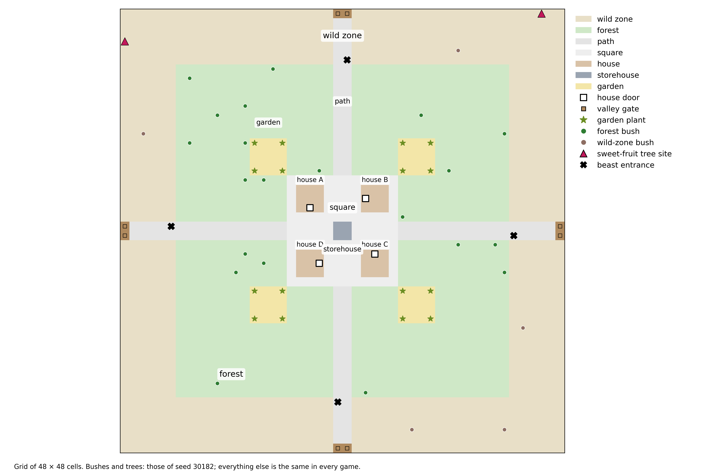
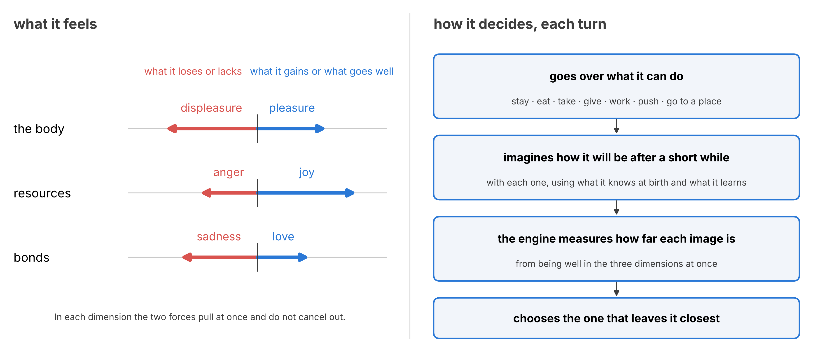
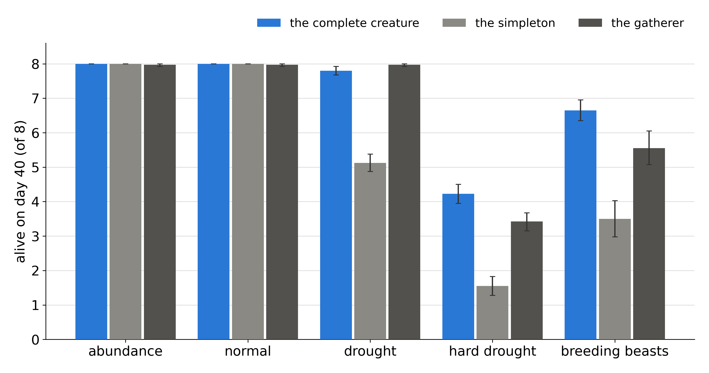
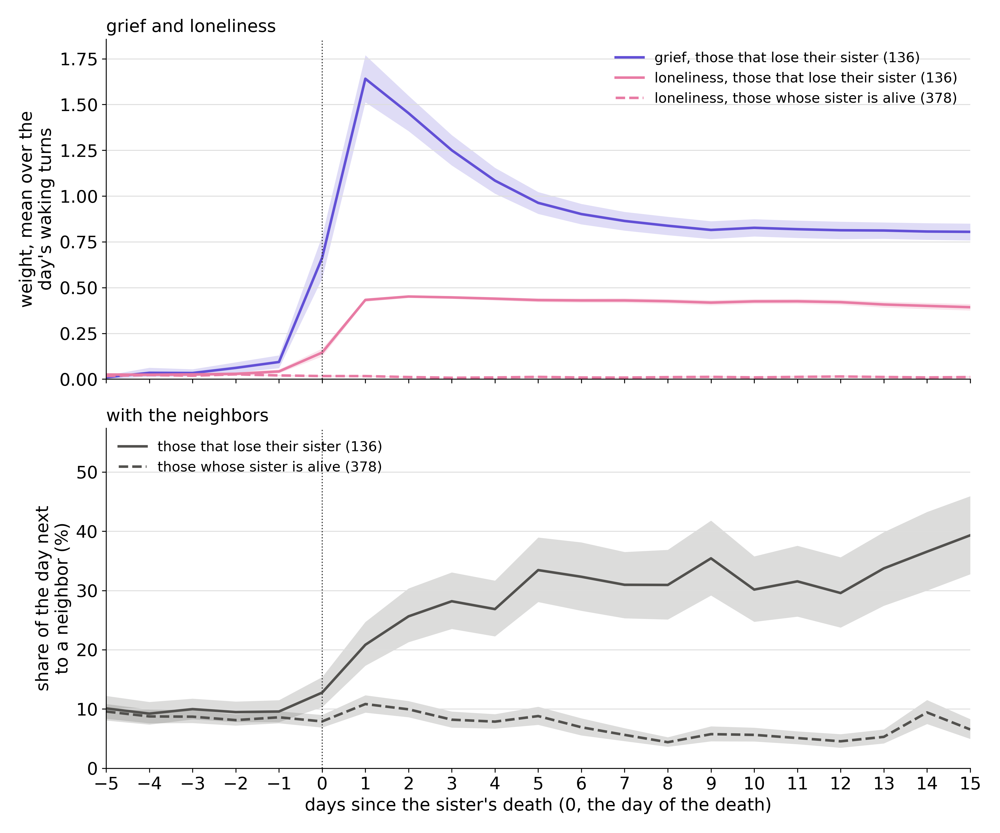
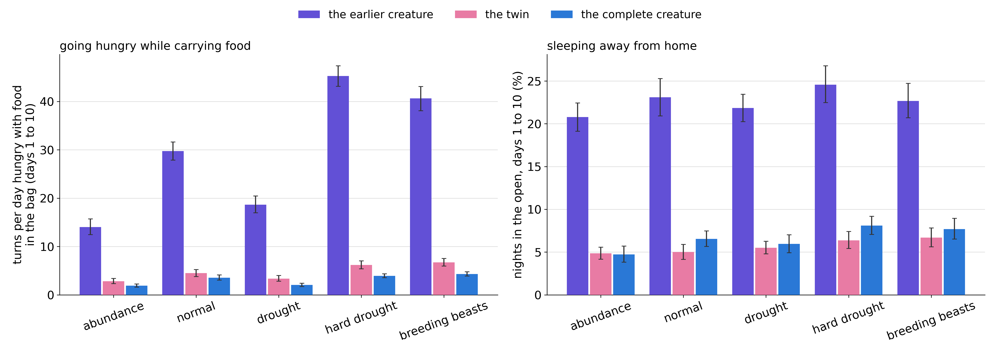
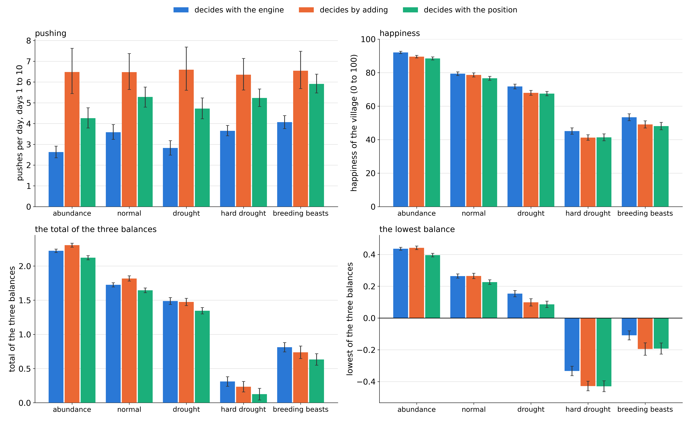

# G-EMV: Emotion and Reason in an Agent

## A Body That Lives in the Present: A Creature, Its Sister and a Valley

Manel Enrico. Independent Researcher, Barcelona. ORCID: 0009-0008-1732-6310

Preprint, version 1, November 2026. The whole series: github.com/Manelenrico/g-emv

Eighth work in a line of research that began with the engine (Enrico, 2026); it follows the previous one (Enrico and Sklar, 2026).

# Abstract

This work presents an artificial creature that lives in the present, and asks what kind of life it leads on its own. It feels what it loses and what it gains in three dimensions at once, the body, resources and its bonds with the others, and it seeks its equilibrium in all three: it imagines a short while ahead and decides no further than that. There is no reward and no training. It has no reasoning part and almost no curiosity. We put it with seven others in a small world where they have to survive and live together, because they can die there. That world is a valley made for the creature, the same for every player.

What can be felt in the moment comes to it without anyone telling it: it gathers with the others in the face of danger, kills none of them, looks after its sister and the hungry, and goes home to sleep. In hard worlds it outlives a player that follows simple rules. When it loses its sister it becomes restless, calls and seeks out its neighbors. We wrote the grief ourselves, and that company relieves it; the restlessness and the calls we did not.

What requires looking far ahead it does not manage: it does not store for later or go for what is far away. The valley is played in 5 variants, which we call worlds. In the hardest one, where food runs short twice for 5 days in a row, about 4 of the 8 reach the end alive: they starve even though the valley gave more than enough earlier. Two senseless habits it had were fixed by changing what it can see, not a number. Once fixed it lives better, but in that world it does not live longer, and there one of our bets failed.

Finally we compare three creatures that feel the same and differ only in how they combine what they feel to decide: by adding it up, by how far each dimension is from its target, or with the engine. They get almost equally far. The engine creature pushes less and lives a little longer than the one that adds. If being well means that nothing is going badly in any of the three dimensions, its village is well more of the time. If it means the sum of the three, where one good thing covers a bad one, the two cannot be told apart. We do not see that it obtains more: it spreads it better.

Everything was measured in one valley, with 114 bets written before playing, of which 90 proved right. The valley is published whole; later works rest on it and this creature.

**Keywords:** homeostasis, artificial emotion, gain and loss, group living, behavior without training, grief and loneliness, the commons, how to combine several needs, predictions written beforehand.

# 1. The question

**A body that lives in the present.** The creature of this work feels, imagines a short while ahead and decides no further than that. What is told here is what such a body does on its own when it is given a place to live with others, and where that ends. It does well what can be felt in the moment: gathering in the face of danger, looking after its sister, going home. It does not do what can only be felt later: storing for a shortage that has not yet come, going for what is far away. That limit is the starting point of the works that follow, which add curiosity and a reason that looks far ahead.

**Where we come from.** This series places a reason that speaks beside a body that feels, and asks what it adds. In the earlier works that body lived in worlds made by others: a fight for survival among 16, with few things, little calm and much danger, in games of a few minutes. There we saw that the body learns from what it lives through, that it learns from its sister and that it can make use of a reason without obeying it.

**What those worlds did not let us see.** In a world like that, almost all a creature can do is avoid: being hit, being reached by the fire, being left alone. To survive it was enough to lose as little as possible in what matters to it. There was no time to go and look for anything good. And our engine has had two sides since the first work: what is lost and what is gained. Of the second, wanting something because it is good and not only because it removes a harm, those creatures used almost nothing.

**A step back.** That is why this work takes a step back, and does so in two ways at once. It develops in the creature the side of gaining: what it looks forward to, what it seeks, what it enjoys when it has it. And it makes a world where that fits, with less urgency, with time, and with good things to obtain as well as harms to avoid. We wanted to see the complete creature. Here there is no reasoning part, and almost no curiosity. We had announced something else for this work, and this was needed first: without knowing what the whole body does when it has room to live, one cannot say afterwards what a reason adds to it.

**The question.** What kind of life does a creature that feels what it loses and what it gains lead, on its own, when it is put with seven others in a world where they have to survive and live together for 40 days? Two more questions follow. The first is whether that life is better than that of simpler players, which follow a few rules. The second is the more uncomfortable one: whether living like this requires the engine with which the creature combines what it feels, or whether it would be enough to add the good, subtract the bad and choose whatever gives most.

**The underlying idea.** The G-EMV model gives the creature three dimensions: the physical one, which here we call the body; that of resources; and the social one, which here we call bonds. A dimension is each of the three kinds of things a creature can gain or lose. In each one it feels what it loses, which weighs on it, and what it gains, which moves it to seek. Our bet is that from caring for the three at once there comes, without being written, a behavior that anyone recognizes: gathering when there is danger, looking after the sister, going home to sleep. We do not tell it to do so. We give it what weighs on it and what it looks forward to, and we watch. It is a bet, not a result, and the following sections put it to the test. They also look at where it ends.

**What there is not, and what there is.** There is no prize to pursue and no training. The valley gives no points and nobody tells the creature whether it has done well. What does come from our hand has to be said from the start. We wrote what it knows at birth, as a young one is told what there is in its village. And we corrected it many times, watching how it lived, before leaving it as it is. How we separate those corrections from the measurements is part of this work.

**Betting before playing.** Before each experiment we wrote down what we expected, and with what measure we would judge it. In the valley we made 114 bets, and 90 proved right. Those that failed are reported all the same, and among them are some of the ones that mattered most to us.

**A world made for it.** Everything happens in a small valley, with 4 houses, a storehouse, gardens, a forest and a beast. This time we made the world ourselves, and that carries a risk we do not hide: a world can unintentionally favor whoever builds it. That is why the valley gives no points, is the same for every player and is published whole.

**What follows.** Section 2 presents the valley. Section 3, the creature and how we measure. Section 4 tells what the creature does on its own, and what it does not manage. Section 5, two senseless habits it had, how we fixed them and where we were wrong. Section 6 compares three ways of deciding with the same feelings. Section 7 places the work beside others that ask similar questions. Section 8 says how far what we found goes and what it leaves open. How everything was measured is in the appendix.

# 2. The valley

The valley is a small world, made so that in it one can live well or badly, and so that the difference can be seen. It gives no points and has no scoreboard.

It is built around the three dimensions of the model. The first is the body: one has to eat, rest and not get hurt. The second is resources: food is not simply there, it has to be looked for or worked for, and what is stored spoils. The third is bonds: nobody lives alone in the valley, and almost everything that matters happens between two. They are the same three in which, in the next section, the creature will feel what it loses and what it gains.

## The place and the day

The valley is a square 48 cells on a side. In the center there is a square with 4 houses and a storehouse. Attached to the square on the outside, at its 4 corners, are the gardens. Around them spreads the forest, and at the edge, surrounding everything, lies a strip of wild zone. Four paths leave the square toward the 4 sides and end at a closed gate. There is no way out of the valley. Figure 2.1 shows it.

Eight creatures live in it, 2 per house. We call the 2 of the same house sisters, and those of the other houses neighbors.

Time is counted in turns, and in each turn each creature does one single thing. A day has 400 turns: morning, afternoon, a short dusk and night. A game lasts 40 days. At night much less can be seen: by day a creature can see 5 cells around it, and at night 2.

**Figure 2.1.** The valley. In the center, the square with the 4 houses and the storehouse. At the 4 corners of the square, on the outside, the 4 gardens, each with its 4 plants. Around them, the forest with its bushes, and at the edge, the wild zone, where the bushes that give double are and the places where the sweet-fruit tree appears. The crosses mark where the beast comes in. The bushes are those of one game; everything else is the same in all of them.

## The body: what has to be cared for

Each creature has life, hunger and tiredness.

Hunger rises without the creature doing anything, a little each turn, and more if the creature walks, works or is cold. It needs about 3 meals a day. If it does not eat, hunger reaches its maximum in one day, and from there its life runs out in half a day more.

Tiredness rises with walking, working and pushing, and falls with sleep. An exhausted creature falls asleep wherever it is, whether it wants to or not.

At night, outside the houses, it is cold. The cold does not wound, but it makes one hungry: a night in the open costs a third of a meal. Inside a house it is always warm.

And the body can be wounded. In the wild zone the ground sometimes does harm, the beast hits hard, and one creature can also hit another. Life comes back with sleep, if hunger is not high. There is also a medicine, which appears only in the wild zone: it gives back the life that wounds took, but not the life that hunger took.

A creature dies when its life reaches zero. In the valley a creature can die of hunger or of wounds, or be killed by the beast.

## Resources: what one lives on

Each creature is born empty-handed, but not with nothing. It is born in a house, its sister's and its own, and in that house there is a pantry that only the two of them can use. The houses have no lock: a neighbor can come in. But inside a house, any house, it is not cold and the beast cannot reach anyone.

The gardens and the storehouse belong to all. The forest and the wild zone belong to no one.

Food has to be fetched, and it spoils. In the forest there are about 20 bushes that bear fruit without anyone tending them, and they give little. In the wild zone the bushes give double, and now and then a sweet-fruit tree appears and lasts a few days. The gardens are another matter. Their 16 plants all bear fruit at once, every other day, and they give up to 4 times as much if they are worked: a neglected plant gives 1 fruit, and a well-tended one, 4.

The valley is sized so that, without tending the garden, there is barely a little more than the 8 need. With the garden well tended there is more than enough. The slack comes from work.

What is picked can be carried, kept at home or left in the storehouse, and each place keeps it for a different time. The bag holds 6 things and food lasts 2 days in it. The pantry holds 4 and food lasts 4 days. The storehouse holds everything and nothing rots there, but what one leaves, another can take. At the start it holds food for 2 days.

## Bonds: whom one lives with

Of the others a creature sees only what shows on the outside: where they are, which house they are from, what they carry, whether they are thin, wounded or tired. It does not see their exact hunger.

It can give something to the one beside it. It can push it, and then the one that loses drops everything it carries and the one that wins keeps it. A push is won by whoever has its sister close by, and otherwise by the less tired one. And it can hit the other, which takes away some of its life. None of this is forbidden or ordered.

It can also call: say where it is, announce that there is food or warn of the beast. Calls can be softer or louder, and the loud ones are heard twice as far as one can see. The creature does not lie with them: it only reports what it has in front of it.

And there is the beast. By day it roams the wild zone. At night, one night in two, it comes down to the gardens and eats part of the fruit. If it finds outside a creature that is carrying food, it takes it. If the creature carries nothing, or is asleep, it hits it, and one of its blows takes almost half a life. A single creature is no match for it. Two together are: if they push it at the same time, they drive it out of the valley for a day, and the more they are, the longer it takes to return. It could also be killed with blows by several, but every blow is returned, and in none of our games does it happen.

## Five worlds

The same valley is played in 5 ways, and only one thing changes each time. In the normal world, food always grows the same. In abundance, it always grows 30 percent more. In the drought, food goes by periods of 5 days, and in the 40 days there are 2 shortages, from day 11 to 15 and from day 31 to 35, in which it grows 30 percent less. In the hard drought, the periods are the same but everything grows a good deal less: on the best days, somewhat less than in the normal world, and in the shortage, half. In the world of the breeding beasts, the beast also comes down by day, and halfway through the game a second one is born.

## What is not in the valley

The valley does not say what matters. It is a world: it has bodies, things, neighbors and some rules. It is the same for our creature and for any other player we put in it, and all of them have the same actions available. That the body matters, that what one has is missed when it is lost and that being with the others is a need, none of that is in the world. It is in the creature, and that is what the next section is about.

# 3. The creature

The creature is a body placed in that valley, with an engine inside. Nobody tells it what it has to do and nobody grades it. What it does comes from what matters to it, and what matters to it are the same three dimensions the valley is made for.

Before going on, a warning about words. We will say that the creature feels, that something weighs on it or that it misses something. In this work those words always name the same thing: a number that moves a body. We do not claim that there is someone inside who suffers it.

## Three dimensions, and two sides in each

Three dimensions of its life matter to the creature: the body, resources and bonds. They are those of the G-EMV model, which in the first work are called the physical, resource and social domains. In each one there are two forces that pull at once: one grows with what it loses or lacks, and the other with what it gains or with what goes well for it. That makes six forces, and we give each one the name of a human emotion, because it does something similar to what that emotion does in us: it signals that in that dimension there is a loss or a gain. In the body, displeasure and pleasure. In resources, anger and joy. In bonds, sadness and love.

These names are labels to find one's way, not boxes. Almost nothing that happens to the creature falls in only one of the three dimensions. Hunger is mostly body, but it is also food that is missing. Seeing its sister wounded weighs on it in bonds, and also a little in the body and in resources. What the creature feels at each moment is a mixture of the six forces, with one or another in command. When we say sadness or anger, we name a region of that mixture, not a pure emotion.

The two forces of the same dimension do not cancel out. A creature can be hungry and be eating, or be beside its sister and see it wounded. What remains when the loss is subtracted from the gain we call the balance, and there is one per dimension: that of the body, that of resources and that of bonds.

The engine that combines the six forces is the one from our first work (Enrico, 2026). Its code has not been touched, although we leave one of its pieces unapplied. It has a property worth remembering: its resting point is not at zero, but tilted somewhat toward the side of gaining. For the creature it is not enough that nothing is missing. That is why it does not stay still when everything is going well, and why losing weighs on it more than gaining the same amount.

That piece is the ceiling. It is a maximum for the sum of the six forces. When a creature feels more than fits, the engine shrinks them all in the same proportion, like someone who cannot attend to everything at once. We removed it because, when comparing options, it misled: for a creature overwhelmed by hunger, imagining one more pain shrank its hunger, and the worse option came out a little better. No creature in this work applies it. In what the creature feels it changes little, because the forces reach that maximum in between 1 and 3 of every 1,000 turns. How much it changes what the creature imagines, and with it what it decides, was not recorded. But it has to be said: in this, the engine of this work is not exactly that of the first. The appendix gives the full account.

## What weighs on it and what it gains

In the body, what weighs on it is hunger, tiredness, the cold of the night outside the house, the life it is missing, and the beast when it is near or when it has already hit it. Hunger does not always weigh the same: when it presses, it weighs up to twice as much.

In resources, what weighs on it is the food it lacks. It does not look only at what it has now, but at what it has against what it will need before it spoils. It also weighs on it not to be carrying a medicine, and that one of the others lacks something.

In bonds, what weighs on it is being alone, being far from its sister, seeing one of the others wounded or thin, and harming them itself: hitting or pushing one of the others is a loss for the one that does it. And their death weighs on it. That we call grief, and over the days it fades.

On the other side is what it gains. It gains every time one of those losses is relieved: on eating, on resting, on entering the house, on finding its sister. It gains when it gives something to another, for the gesture and for the relief it imagines in the other. And it gains, simply, when it lives well: with its body cared for, food for a couple of days and its sister in sight. The good it feels lasts only briefly. It fades to half in a tenth of a day.

There are, then, two ways for things to go better for the creature in a dimension. One is to remove a loss: that is relief. The other is to add a gain and leave the loss where it is. They are not the same, because in the second the loss is still there, even if it weighs less in the whole. Section 6 shows that the engine tells them apart, and that it prefers the first.

On the side of gaining it lacks two things. It has no joy of its own at obtaining something: when it finds food, what it feels is that food is no longer missing. And when something good it expected does not arrive, that does not weigh on it. It learns, and nothing more.

Of the weights above, two almost never switch off, and this is worth knowing. The first is food. The creature wants to have stored the food for the next 2 days, and what it lacks to get there weighs on it. For the creature that is 6 or 7 meals, and the bag holds only 6. So even with a full bag it is almost always missing something, and this stops weighing on it only when it also has food in the pantry. So food weighs on it almost always, even when there is plenty in the valley.

The second is its sister. The creature does not see how much life another has left: it sees only whether it is healthy, wounded, badly wounded or about to die. And when it does the sum, it assumes for a healthy sister somewhat less than full life. The result is that its sister always weighs on it a little, even when the sister is fine. We did not seek that effect, and we declare it. It has a consequence that must be known: when the sister dies, that small weight disappears at the same time as grief arrives, which is much larger.

## Its resources and its bonds

For the creature, its resources are the stored food: what it carries in the bag, what is in its pantry and an eighth of what it has seen in the storehouse, as if its share among 8 fell to it. It also counts the fruit it expects from the garden it has worked. It does not count the house as something it has. And there is nothing in it resembling a territory: no place is worth more for being its own.

Its bonds are with its sister and with its neighbors, and they count one by one. It has no sense of the group. Each of the others matters to it for two things. The first comes from birth: the sister matters almost 3 times as much as a neighbor. The second is made by living, and we call it dealings: it grows with the time they spend together and with what they give each other, and falls with what they take from each other. A neighbor that takes its food comes to matter less to it.

## How it decides

In each turn the creature goes over what it can do: stay, eat, take, give, work, push, go to a place. For each thing it imagines how it will be after a short while if it does it, and with the engine it measures how far that state is from being well in the three dimensions at once. It chooses the one that leaves it closest. There is no rule other than that. Figure 3.1 sums it up.

That short while is about 44 turns, a tenth of a day. And each image holds one single thing, an action or a place to go. The creature does not chain plans. Only as evening falls does it look further, to the next morning, and that is what makes it look for where to sleep.

It is, in the most literal sense, a body that lives in the present. Almost everything this work finds, the good and what is missing, comes from there.

**Figure 3.1.** The creature inside. On the left, what it feels: in each dimension, a force of losing and a force of gaining, which pull at once. On the right, how it decides: it imagines how it will be after a short while with each thing it can do, the engine measures how far each image is from being well in the three dimensions at once, and it chooses the one that leaves it closest.

## What it knows at birth

The creature is not born blank. It is born knowing what a young one is told in a village, and that we wrote for it ourselves. That is 31 things, and it does not forget them.

It knows that a meal takes hunger away and that the medicine heals. It knows that the wild zone wounds but that the medicine is there, that in the forest there are bushes that bear fruit, that the worked garden bears fruit after 2 days, and how long food keeps in each place. It knows that the beast comes at night, that the house is safe and that the beast hits whoever sleeps outside. It knows that the beast is driven out by two together. And it knows that now and then, far away, a sweet-fruit tree appears.

It also knows the map: where the houses, the storehouse and the gardens are. What it does not know is where the bushes are or which ones have fruit. That it discovers by walking.

Not everything it knows is of use to it. Of the 31 things, 8 are written and nothing in the creature reads them; the appendix says which. And there are three gaps that matter here. It knows that food does not rot in the storehouse, but when it works out how much food it will need it measures every place by how long the bag keeps food, and that knowledge does not enter the sum. It knows that a sweet-fruit tree appears, but that does not move it to look for it. And of the periods of the drought it knows nothing: we did not tell it, and it has nothing to notice them with. They are three gaps of ours, and they weigh on what this work leaves open.

## What it learns

The rest it learns by living, and it writes it down in what we call its notebook. Each time something happens to it, it keeps what that did to it: how much hunger that meal took away, how much fruit its work gave, what happened to it the night it slept outside, how things went with each neighbor. What it believes about each thing is the average of what it remembers of it.

It learns fast and forgets slowly. A single experience already counts for a third of what it believes. And what was lived fades: after 2 weeks it counts for half as much, and what it believes returns toward what it was told at birth.

It is worth saying where what it learns comes from, because that is what separates this creature from a trained agent. It comes from its own body, from what it sees and from what it hears from the others. Nobody tells it whether it has done well. There is no number that rewards a behavior, in the valley or in the creature.

What does come from outside comes from us, and it has to be said in full. We wrote what it knows at birth. And we corrected it by hand many times, watching how it lived, before leaving it as it is. The appendix tells how we separate those corrections from the measurements.

## Two temperaments

In each house, one sister is born bold and the other cautious. For the bold one fears weigh half as much as usual, and for the cautious one, one and a half times as much. Temperament touches only the fears: the beast, the sister in danger, being far from the sister, not carrying medicine. It does not touch hunger, loneliness or grief.

## What this creature does not have

It has no reasoning part: there is nothing in it that thinks with words or that looks beyond that short while.

Nor does it have the curiosity of our earlier works. A small piece is left: not knowing where there is food weighs on it a little, and that leads it to explore. That piece switches off sooner than it should, because when it counts the bushes it knows it also counts the garden plants. In almost all the creatures it has switched off by about the third day, when they know roughly half of the forest bushes and almost none of those in the wild zone. It is a flaw of ours. We left it as it was when we sealed, and we declare it.

The creature of this work also carries two pieces that arrived late, the reserve and the going-home voice. They have their story, and section 5 tells it. The creature without those two pieces we call the earlier creature. The one that carries them, the complete creature: it is the protagonist of this work.

## How we measure

**Betting before playing.** Each experiment in this work was done in two stages. First we wrote down what we expected to happen, with the measure and the bar by which we would judge it, and we stored it with a date so that it could not be changed afterwards. Only then did we play the games, in randomly drawn valleys that nobody had seen. The exception is the comparison of the three ways of deciding, which was played in the valleys of the previous sealed experiment so that we could compare game by game; the engine creature had already been played in them. We call this sealing, and each thing written, a bet. What fails is reported all the same.

This work rests on three sealed experiments. In the first the earlier creature played, in 1,600 games. In the second, the complete creature, in 1,200. In the third, 400 more games to compare three ways of deciding, in the same valleys as the second.

**Whom it is compared with.** The creature is measured against five players that live in the same valley and have the same actions available.

- **The simpleton.** It follows a few fixed rules: it eats if it is hungry, goes to the storehouse, works the garden or searches the forest when the storehouse empties, and goes home at dusk or if it sees the beast. It does not give, does not push and does not call. It is the floor: the least that does something in the valley.

- **The gatherer.** It is a machine for finding food. It knows all the sources, remembers when it saw them with fruit and returns to them. It does not work the garden and it does not deal with anyone either. It is the bar for finding food.

- **The twin without a positive side.** It is our creature with a single difference: it does not feel what it gains, only what it lacks. It serves to find out what the side of gaining adds, and what it costs.

- **The one that adds and the position creature.** They are our whole creature, with another way of combining what it feels when it comes to deciding. Section 6 presents them.

The first two differ from the creature in many things at once. They show whether the whole creature lives better or worse than something simple, not which piece of it achieves that. That is what the other three are for, which change only one thing.

**What is measured.** The first thing is how many live: of the 8 that start, how many are still alive on day 40, and what the rest died of. When we say that one creature lives a fraction of a creature more than another, we mean that, on average, that many more of its village reach day 40 alive.

The second is the behaviors: whom they gather with, whom they give to, where they sleep. Each has its measure, and section 4 gives it.

The third is how they live. We say that a creature is well in a turn when its three balances are above zero at once: that of the body, that of resources and that of bonds. A balance above zero means that, in that dimension, what it gains weighs more than what it loses. We call the happiness of a creature the share of its waking time in which it is well, and the happiness of the village the average of the 8.

It is not enough for one dimension to go very well: none of the three may go badly. And the word is used here like the others in this work. It names a state of the creature, not an experience. Nor is it something the valley gives or the creature pursues: we calculate it ourselves afterwards, looking at its balances.

One detail matters for what comes next. The balances are what reaches the engine, not what the engine does with it: in each dimension, what the creature gains minus what it loses. So this measure does not depend on the way of deciding. When in section 6 we compare our creature with others that decide differently, we will measure them all with the same yardstick, and that yardstick is not the engine's.

It has a trap that must be known. A creature that dies counts for the time it was alive, and the first days tend to be the good ones. So we repeated the calculations with only those that reach the end alive. The differences we give hold.

**How the comparison is made.** Each world is played 40 times. Each time, chance is different: where the bushes are, when the tree appears, where the beast starts. Within a sealed experiment, two players are always compared in the same 40 valleys, game by game, so that the difference is theirs and not luck's.

For each difference we give its size and a margin, which comes from resampling the 40 games 10,000 times. When the whole margin lies on one side of zero, we say that the difference separates. When it crosses zero, we say that it does not separate. That is not the same as saying that it does not exist: it is saying that with 40 games we cannot tell it from chance.

And we always distinguish two things. A bet is something written before playing. An observation is something seen afterwards, looking at the data. Both are reported, and of each number we say which of the two it is. An observation can be very clear, but it has not run the risk of failing.

The appendix explains in more detail how everything was measured.

What follows is what such a body, without reason and almost without curiosity, does on its own.

# 4. What it does on its own

We have not told the creature to gather with the others, or to look after its sister, or to sleep at home. There is no rule in it that says so. It has the six forces, what it knows at birth and a short while of imagination. This section tells what it does with that when it is left to live for 40 days.

The numbers are those of the complete creature, in the 200 games it played in the second of the three sealed experiments. Before playing we bet that it would live longer than the simpleton, that they would not kill each other, that they would gather in the face of the beast and drive it out, that they would give more to the sister and to the one that is going hungry, and that they would sleep at home. All of it proved right. We had already made the same bets, in the same words, for the earlier creature, and they proved right as well. The rest are observations, and we say so in each place. At the end come the things it does not manage.

## It lives

The first thing to ask of a body is that it stay alive. Where food is not lacking, in the normal world and in abundance, all 8 reach day 40 alive. There the creature cannot be told apart from anyone: the simpleton also arrives with all 8.

The difference appears when the world gets hard. In the drought, 7.8 of our 8 creatures arrive alive, and 5.1 of the 8 simpletons. With the breeding beasts, 6.7 against 3.5. In the hard drought, 4.2 against 1.6. That is close to 3 more creatures in each of the three worlds, and the three margins lie very far from zero. It is in figure 4.1.

**Figure 4.1.** How many reach day 40 alive, out of 8, in the 5 worlds. Each bar is the average of 40 games, with its margin. In the two easy worlds there is no difference. When the world gets hard, the creature lives longer than the simpleton in the three worlds and longer than the gatherer in two. In the drought the gatherer lives a little longer.

About the gatherer we had made no bet, so this is an observation. The gatherer only knows how to find food, and it finds it better than the creature does. In the drought it lives a little longer: 8.0 against 7.8, a small difference but one that separates. In the other two hard worlds it is our creature that lives longer: 4.2 against 3.4 in the hard drought, and 6.7 against 5.6 with the breeding beasts.

Two things have to be read in those numbers. A creature that was not trained for anything lives longer than a machine for finding food wherever something more than food is needed. And in the hard drought half of them die. Section 5 deals with that.

## They do not kill each other

In the valley one can hit, and a blow takes away some life. In none of the games, in none of the 5 worlds, did a creature die at the hands of another. No rule prevents it. Hitting another weighs on the one that hits, and nothing more has been needed.

## They gather when there is danger

When the beast is in sight, the creature has another right next to it almost a third of the time. The simpleton, in the same situation, 1 time in 12. No rule orders it to gather. The beast weighs on it, company relieves it, and the result resembles a herd.

And together they drive it out. The creature knows from birth that the beast is driven out by two together, but going to do it is its own doing: one has to approach what frightens, and approach at the same time as another. In the world of the breeding beasts they do it about 7 times per game. In the other worlds, where the beast only comes down some nights, almost never. They drove it out 304 times, always two or more together: one alone cannot. The beast can also be killed with blows by several, and the creature knows that from birth too. They do not do it in any game: every blow they give it, the beast returns, and two together, by pushing, drive it out without receiving any.

## They look after each other

The creature gives food, and it gives almost all of it to its sister: about 25 times as much as to each of its neighbors, and never less than 13 times as much in any world.

It also matters whom the gift goes to. In abundance, where almost no one goes hungry, only 6 of every 100 meals given go to a thin creature: they give for the sake of giving. In the normal world it is 28. In the drought, 42, and in the hard drought and with the breeding beasts, half. That rise does not mean that it shares better when there is hunger. The creature gives to the one right next to it, which 4 times out of 5 is its sister, and it almost never has more than one. When there is hunger, that one is thin more often, and even if it gave without looking, the figure would rise almost as much. Looking at whom it gives to adds between 2 and 7 points in every 100, and in abundance that cannot be told from zero. One thing does hold: in every gift in which it had a thin one right next to it, the food went to a thin one. The creature has no rule for sharing according to need. What it has is that the hunger of the others weighs on it. The other half, in the hard drought too, still goes to one that is not thin.

## They sleep at home

As evening falls the creature looks further than by day, to the next morning, and what it sees takes it home: outside it is cold and there is the beast, and inside is its sister. It sleeps inside its house between 86 and 97 percent of the nights, depending on the world.

It was not always so. Sleeping outside for no reason was one of the two habits we had to understand, and section 5 tells the story.

## Grief and loneliness

When a creature's sister dies, two different things happen to it, and it is worth saying from the start which one we put in and which we did not. Almost nothing in this part was bet: these are measurements made afterwards, on 136 creatures that lose their sister, compared with 378 whose sister is alive in the same games. Figure 4.2 puts them together.

**Finding out.** The first thing is to know it, and that is not automatic. The creature knows that its sister has died only if it sees it: if it sees the sister die, or if it sees the body, which stays where it is until the end of the following day. Nobody tells it, and it does not deduce it from no longer seeing the sister. Counting all the deaths of sisters, of every 5 creatures, 2 see it happen, 2 find the body a while later and 1 never comes to know.

**The grief we wrote ourselves.** It is a weight that appears when the creature knows of the death, and it has the size of what the other was to it: a fixed part, from birth, for being its sister, and another that comes from the dealings they had. We made it so that it would ease. The strongest part goes in about 5 days, and a remainder is left, somewhat less than a third, that does not go. We wanted it so, in order that the loss would not leave the creature stopped forever, nor as if nothing had happened. That is why, when we measure that a creature's grief falls to half in about 5 days, we are measuring our own rule. It is not a finding.

**The loneliness we did not write for this.** There is no rule in the creature for the death of a sister. What it has, and always had, is a weight for being alone: it rises when it has gone half a day without seeing or hearing its sister, and only its sister removes it completely. A neighbor in sight relieves it in part. When the sister dies, that weight rises as on any other day on which they are apart, and now there is no one to remove it. Fifteen days later, four fifths of that rise remains. The same happens to the one that never came to know that its sister had died: it has no grief, but it is alone.

**It seeks out its neighbors.** We had bet on this. By day it is seen right next to a neighbor almost 3 times as often as before, and at night too. Nor is there a rule that sends it to them. It comes from two things. One always holds and holds for all: a neighbor in sight relieves loneliness. The other we wrote ourselves with the grief: being right next to another relieves it. This second one we did put in, and in an earlier test it was what brought it closest to its neighbors in the first days.

**Figure 4.2.** Before and after losing the sister. Above, grief and loneliness, day by day, of the 136 creatures that lose their sister, and the loneliness of the 378 whose sister is alive. Grief rises and eases. Loneliness rises and stays. The grief drawn is all that the creature carries, including grief for the neighbors that have died, and the creatures do not all find out on the same day: that is why the average does not fall to the third that the rule leaves for each death. Below, the share of the day they spend right next to a neighbor. The bands are the margin.

**And it does not come to a stop.** We looked at this afterwards, with no bet, and it is what we least expected. By day it used to be still for 95 turns out of 240, and now it is still for about 70, while those whose sister is alive stay still more than before. It spends two thirds more time working the garden. It calls three quarters more often. It walks farther from its house and sleeps in it less: from 86 nights in every 100 to 65. And it has restless nights, 13 in every 100 where before there were 3. We give that name to a night in which it does not spend more than half the time asleep in any one place. In the following 10 days, when the strongest part of the grief has gone, the restless nights ease and so do, in part, the nights away from its house and the calls, which stay at 40 percent more than before. The rest does not ease: compared with those whose sister is alive, it still stops little, works more and walks far, the same as in the first days. It does not eat less or go hungrier. Six of the 136 die, against 11 of the 378 whose sister is alive: there are too few deaths to say whether those that lose their sister die more, and the margin of the difference crosses zero.

For two of those things we know where they come from. It calls more because, when it imagines a call, it imagines that someone comes and that it stops being alone. And it sleeps at home less because what took it home was its sister, and the going-home voice no longer sounds. Why it works more and does not stay still we cannot explain.

**It is never well again.** Of the 136, 84 are not well again for a single turn in what remains of their game, in the sense of section 3. Among the 378 whose sister is alive, that happens to 6. It has to be read with the above: the remainder of grief that does not go and the loneliness that no one removes leave it two fixed weights, and with them it is hard to have the three balances above zero. Part of that number we put in ourselves.

What is left as a result is modest, and we think it is true. We did not write what a creature does when it loses its sister. We wrote how much losing the sister weighs on it, that this weight eases and that being right next to another relieves it. The rest comes from pieces that were there for something else: that loneliness does not ease, that it is restless, calls and sleeps badly, and that even so it keeps eating and working. That it seeks company comes in part from what we wrote. We do not claim that this is sorrow. We claim that it has a shape anyone recognizes.

## What it does not manage

It would be misleading to tell only the above. What follows are observations, except where something else is said.

**They push each other, and not out of hunger.** A push takes from the other everything it carries. In a game there are about 100, and almost 9 in every 10 are given by a creature that at that moment is not hungry. Almost all go to one that is carrying something: it pushes to keep what the other carries, not because it is hungry. Most are between neighbors. Afterwards they separate, and they are together again almost always, within hours. But something remains: in half the cases, the one that took never again matters to the other as much as before. We see no punishment. The one that took is given somewhat less afterwards, but neighbors almost never give each other anything, neither before nor after.

**They give senselessly.** Now and then two sated sisters pass food back and forth to each other, turn after turn. We bet that it would be rare, and it is: 1 game in every 200. We have not fixed it.

**They do not make use of what is far away.** From the sweet-fruit tree they take fewer than 3 fruits in every 100. The gatherer, 27. We had bet on this too: with nothing that looks far ahead, the creature hardly uses it.

**They do not store in common.** The food that is in the storehouse at the start they take away in the first 3 days, and afterwards almost no one leaves anything there: in the 200 games, one single meal. They store in their pantry, which belongs to the two sisters, and in their bag.

**In the easy world they do not live longer than the simpleton.** In the normal world food always grows the same and the beast only comes down some nights. To reach day 40 it is enough to eat when one is hungry and get into the house at night, and the simpleton does that with its handful of rules. The 8 of each village arrive alive. Everything our creature has in addition does not help it there to live longer. It helps when the world gets hard, and it helps it to live in another way: in company, and looking after the others.

## What it leaves us

Nobody has told this creature to gather with the others, to look after its sister or to go home, and it does all three. When the world gets hard it lives longer than a player that follows rules. It kills none of the others. In the face of the beast it gathers, and two together drive it out. It gives almost everything it gives to its sister, and when it has one that is going hungry right next to it, the food goes to that one. We bet on all of that twice, and it proved right both times.

When it loses its sister, its life changes and the change lasts. One part we wrote ourselves: how much the death weighs on it, and that this weight eases. The other we did not write: it is restless, calls, seeks out its neighbors and has restless nights, and even so it keeps eating and working.

And there are things it does not manage. It takes food from the others without being hungry, it does not store in common and it does not go for what is far away. Almost all of it has the same root. The creature imagines a short while ahead and decides no further than that. What can be felt in the moment it does well: looking after the others, gathering, going home. What can only be felt later it does not do. This last point is our reading, not a measurement.

Two more habits did not come from there, but from flaws in how it did its sums. Finding and fixing them is the next section.

# 5. Two senseless habits, and their two fixes

The creature of the previous section is not the first one we sealed. The earlier one did almost everything we have told, and in addition two things that made no sense: it went hungry while carrying food, and it slept in the open a few steps from its house. This section tells how we found them, what they were and what happened when we fixed them. We report it in full because it is where we were most wrong.

## It went hungry with food in the bag

In the droughts of the first of the three sealed experiments, the earlier creature spent about 30 turns each day awake, hungry and with food in the bag, without eating it. Its twin, the one from section 3, which is the same as it but does not feel what it gains, spent 5 turns like that in the same valleys.

At first we did not even know whether eating was among the things it considered. We played some games again, keeping, at each decision, all the options the creature had in front of it and how much each was worth. Eating was always among them. What happened is that it lost against staying still or working the garden, and it lost above all in one situation: when a single meal was left in the bag. Of the times it did not eat, 7 in 10 were when it was carrying only one.

The creature was saving the last one. For the creature, stored food is something it has, and having it does it good. Eating one of five hardly changes that. Eating the last one leaves the bag empty, and that loss weighed on it more than the hunger it removed. The harder the drought, the more it saved it. And the bag with one meal was exactly what the others took from it by pushing.

The fix was not a number. It was an idea, and it is one of the few times we changed the creature on principle and not because of a flaw in a sum. The reserve is worth the hunger it is going to save you from. When hunger arrives, eating it is not losing it: it is using it. So, when the creature is hungry enough to eat, eating what it carries stops counting for it as losing what it has. While it is not hungry, storing still does it good. We call this the reserve.

We decided it before seeing its effect, with a written rule, and we tested it a single time. It worked the first time. In the sealed experiment, the turns with hunger and food in the bag go from 32 a day to 3.

## It slept outside, a few steps from home

The earlier creature slept in the open 1 night in 4. Its twin, 1 in 18. And it was not because it stayed working or went far for food: at the end of the afternoon it stayed still in the forest or in the garden, less than 20 steps from its door, and night caught it there.

Here we were wrong twice before getting it right. First we believed that it did not see dusk coming. It did: the twin, with the same sight, set off for home right then. Then we believed that it did not care enough about the cold. We played a valley without cold, and it went on sleeping outside just the same.

The cause came, once again, from looking at its options one by one. What held it back was its sister. Having the sister in sight does it good, and the sister was outside too. When the creature imagines going home, it imagines that the others stay where they are: leaving is, for the creature, leaving its sister. Its sister did the same sum. Each one stayed because the other was there. Both would have been better off at home, together, and neither of the two could imagine "let us both go".

The fix is the least that resolves that. From mid-afternoon, a creature that leans toward going home says so, and says it only to its sister, if the sister is near and awake. The sister, on hearing it, can imagine the house with the other inside. It does not order anything: it lets the sister see an option it did not see before, and the sister's engine decides. We call it the going-home voice. It has to be said that it is a voice made by us and simpler than the other calls of the valley: it costs nothing, it bypasses the hearing the creatures use for everything else, and with it the one that listens knows where its sister is even without seeing it.

Before this one we had tried four richer ways of giving them a voice, among them asking, showing how one is and warning. None improved anything, and at least one made things worse. This one, which only says which way one leans, did.

In the complete creature, which carries the reserve and the voice, the nights in the open go from 1 in 4 to 1 in 14 (figure 5.1). The fall is all due to the voice: with the reserve alone they stay at 1 in 4. We count as a night in the open one that it spends asleep outside its house for more than half the time, also if it is in another's house. The two sisters sleep in the same house between 83 and 95 percent of the nights, depending on the world; before, between 54 and 70. And the beast finds them asleep outside far fewer times: from between 2 and 4 blows per game to around 1.

**Figure 5.1.** The two habits, before and after, in the first 10 days of the second sealed experiment, where the three creatures play the same valleys. On the left, the turns per day they spend hungry and with food in the bag. On the right, the nights they sleep in the open. The complete creature ends up close to the twin, which does not feel what it gains and hardly had those habits.

## What changed, and what did not

The complete creature lives better than the earlier one, and that is clear. It goes less hungry, it is less cold, less food is taken from it and the beast surprises it less. It is the happiest of all in the 5 worlds. In the drought, its village is well 72 percent of the time, against 67 for the earlier one, and the creature that fares worst, 56 against 43.

It also dies less of hunger where there is food. In the 40 games of the drought, deaths from hunger fall from 16 to 3, and with the breeding beasts, from 26 to 10. In the drought a third of a creature more reaches the end alive than with the earlier one. This last point we had not bet: it is an observation, and they are two averages that could not be compared game by game.

And here is our error. In the test games, the reserve seemed to leave almost one more creature alive in the hard drought. We bet on it. In the sealed experiment, in new valleys, it left none that can be seen: the difference stays right next to zero, with the margin on both sides. That bet failed, and so did the one we made for the complete creature in that world.

We had taken one link for granted without checking it. The earlier creature reached the first shortage with twice the hunger of its twin, and we assumed that this was why it died more. The double hunger showed up again in the new valleys. The extra deaths did not. The complete creature reaches the shortage with half the hunger of the earlier one, and dies just the same.

## The hard drought

In the hard drought about 140 creatures starve in 40 games, whichever creature it is: the earlier one, the complete one and the twin. Almost all die in the periods of shortage.

It is not that the valley does not give. On average it produces twice what the living need. What happens is that for 5 days in a row it grows barely enough, and what was left over before is no longer there. We have done the sum, and it is a sum, not a result: in the 10 days before the first shortage more than 50 meals rot in the bags and on the plants, not counting the pantries, which were not recorded, and in the shortage about 27 fewer are eaten than in the 5 days before.

The reserve even has a cost here, which we had declared before playing and which proved right: a creature that eats what it carries when it is hungry reaches the shortage with nothing stored more often than one that saves the last.

So the complete creature, where food runs short for 5 days in a row, dies like all the others, even though the valley gave more than enough earlier. Fixing its sums took away its senseless hunger. It did not give it what it does not have: storing today for 10 days from now, and storing it where it does not rot, which is the storehouse that belongs to all.

## What the positive side costs

One question remains that the twin lets us ask. Does a creature that feels only what it lacks live longer than one that also feels what it gains?

With the earlier creature, yes, a little. In the drought a quarter of a creature more reached the end alive in its twin's village, and it came out the same size in two sealed experiments; putting them together, the difference separates. In the hard drought the two experiments do not agree: in one almost one more twin reached the end alive, in the other the same number. We cannot give a number.

With the complete creature, no. In no world does it live less than its twin by a difference that separates, and in the normal world it lives somewhat longer. It is reasonable to think that what the earlier one lost was, in good part, what its two habits cost it, but we have not measured that separately.

And it has to be said what kind of life the twin's is. It is never well, in the sense of section 3, because it has nothing to be well with: for the twin the good does not exist. It pushes half as much as the complete creature, that much is true. It lives just as long, with less in its life.

## What it leaves us

The two habits had the same shape. The creature did the sum it had correctly, and the sum was badly posed. It saved the last meal because eating it counted for it as losing it. It slept outside because it could not imagine its sister going home with it. Neither of the two was fixed by raising or lowering a number. They were fixed by changing what the creature can see: that the reserve is there to be used, and that the other also leans toward going home.

Once fixed, it lives better. It goes less hungry and is less cold, less is taken from it, the beast surprises it less, and its village is well for more of the time. And we do not see that feeling what it gains still costs it life against the twin that feels only what it lacks.

It does not live longer where food is lacking for 5 days in a row. There we were wrong: we took for granted in the test games what did not come out in new valleys. What is seen in a test is not a measurement. And what the hard drought asks for is not a sum better done. It is looking far ahead, and that this creature does not have.

The question that mattered most to us remains: whether all this required the engine, or whether adding would have been enough. That is the next section.

# 6. Deciding in three ways

So far we have compared the creature with players simpler than it. The most uncomfortable question remains, and it is the one that mattered most to us. The creature feels six forces, and decides with them. Is the engine needed for that? Would it not be enough to add the good, subtract the bad and choose whatever gives most?

To find out we made three creatures that feel exactly the same. They have the same body, know the same things, feel the same losses and the same gains, and carry the reserve and the going-home voice. They differ only in the last step: how they combine what they feel in order to choose.

- **The one that adds.** In each of the three dimensions it subtracts what it loses from what it gains, adds the three results and chooses whatever gives most. It is what anyone who did not know our engine would do.

- **The position creature.** It uses only one part of the engine: how far each balance is from its target. What goes beyond the target does not count for it. It knows nothing of how much force is pulling at once.

- **The engine creature.** It is our creature. It looks at the position like the previous one, and counts two more things. One is tension, which is what the two forces of the same dimension add up to when they pull at once: it costs the engine to have much gain and much loss together, even if the balance is the same. The other is the coupling between the three dimensions: the more tension there is in one, the more it matters how far the other two are from their targets.

An example helps to see the difference. Take four states that add up to the same. In the first, the three dimensions are going equally well. In the second, the body is going badly and resources are going very well. In the third, the three balances are those of the first, but they come from little gain and little loss. In the fourth they are also those of the first, but they come from much gain and much loss at once.

For the one that adds, the four are equal, because they add up to the same. The position creature singles out only the second, which seems worse to it: the body is far from its target, and that weighs on it more than it helps that resources are going very well. The other three are all the same to it. The engine creature orders them all. It prefers the third, then the first, then the second, and the fourth seems to it by far the worst.

Put another way. The one that adds lets one dimension cover another completely. The position creature, only halfway. And the engine creature, in addition, prefers removing a loss to covering it with a gain.

We put each one in its own village, with seven others the same as it, in the same 40 valleys of each world. And we bet two things.

## It lives a little longer

The first bet was that, with the 5 worlds together, the engine creature would live longer than the one that adds. It proves right, and narrowly: a fifth of a creature more, out of 8, reaches day 40 alive. The whole margin lies above zero.

The second was the same in the drought alone. It fails: the difference is a tenth and the margin crosses zero.

In only one world does the advantage separate from zero. In the hard drought half a creature more reaches the end alive in the engine village than in the village that adds, mostly because it dies less of hunger: 139 deaths in 40 games against 169. That world supplies half of the advantage. In the other four the difference touches zero or crosses it.

Against the position creature, in lives it does not separate in any world.

And one more thing has to be said. With the earlier creature we had measured this same advantage and it was double, two fifths of a creature. When the creature's sums were fixed, the engine's advantage fell to half. We do not know for certain that this is the reason, because between one experiment and the other the valleys change too, but it is what we expected might happen and we had said so beforehand.

So whoever expects the engine to give many more lives than a sum will not find it here. We expected it.

## It lives in another way

What changes clearly is something else, and we had not bet on it. Everything that follows is observation.

**It pushes less, above all on arrival.** In the first 10 days, in the 5 worlds, in the village that adds there are about 6.5 pushes a day. In the engine village, between 2.5 and 4. The one that adds pushes the same however much food there is. After those 10 days the three villages push about equally, except in abundance, where the engine village keeps pushing less to the end. And in the normal world, at the end, it is the engine village that pushes a little more.

**It sleeps at home more.** All three carry the same going-home voice, and even so, in the first 10 days, the engine creature spends fewer nights in the open than the other two in the 5 worlds. For the rest of the game we did not do the count.

**Its village is a few points happier.** With the 5 worlds together, the engine village is well for 3 percentage points more of the time than the village that adds, and 4 more than the position village. It is a small difference, and we give it with its size. It holds if we count only the creatures that reach the end alive. In abundance and in the two droughts it is ahead for the whole game, although in the droughts there is some stretch in which the difference does not separate. With the breeding beasts, up to the halfway point. In the normal world it is there only at the start.

**And it lives more evenly.** The happiness of a village rises and falls with the rhythm of the garden, which bears fruit every other day. That swing moves the engine village less than the other two. Against the one that adds it separates in four worlds, in the hard drought narrowly, and in abundance it does not. Against the position village, in all except the hard drought.

**The yardstick it is measured with.** Before going on we have to look at what this is measured with, because a reasonable suspicion is possible. Happiness was defined by us, the same people who made the engine. If we had defined it with what the engine calculates, the engine creature would come out happier by construction, and the result would be worth nothing.

That is not the case. Happiness is measured with the three balances, which are calculated in the same way for the three creatures: a creature is well in a turn when the three are above zero. What separates them comes after that point, and none of it enters the measure: neither tension nor coupling. If the yardstick resembles any of the three, it is the one that adds, which decides with those same three numbers and with nothing else.

One thing about the yardstick is our choice, and it has to be said: we ask that the three dimensions go well at once. The one that adds lets a very high balance cover a low one; the measure does not. So we also measured the other way, with the total of the three balances, which is the yardstick of the one that adds. We did it afterwards, with no bet.

With the total, the engine creature and the one that adds cannot be told apart: with the 5 worlds together they do not separate. In the two easy worlds, abundance and the normal one, the total of the one that adds is higher, and clearly so. In the three hard ones they do not separate.

What does set the engine creature apart is the worst of the three dimensions. If in each turn we look at the lowest of the three balances, in the engine village it is higher. It is so in the two droughts and with the breeding beasts. In the two easy worlds there is no difference.

Put together: the engine creature does not obtain more in total. What it obtains is better spread among the three dimensions, and that appears when the world gets hard. Whether its village comes out happier depends, therefore, on what is understood by being well. If it is having all three, it comes out ahead. If it is the total, the two cannot be told apart, and in the easy worlds the one that adds is ahead. Figure 6.1 puts the four measures together.

**Figure 6.1.** Three ways of deciding, in the 5 worlds. Top left, the pushes per day in the first 10 days. Top right, the happiness of the village, which is the share of the time in which the three balances are above zero at once. Bottom left, the total of the three balances, which is the yardstick of the one that adds. Bottom right, the lowest of the three balances. The engine creature does not obtain more in total, and in the hard worlds its worst dimension is less low. Each bar carries its margin; the differences the text gives are calculated game by game.

Against the position creature there is no such doubt. The engine creature does better than it in the four measures of the figure, in the 5 worlds. In how many reach the end alive they cannot be told apart.

## What it leaves us

Three creatures that feel the same, and that differ only in how they combine what they feel, get almost equally far. The engine creature lives a little longer than the one that adds, narrowly, and in only one world does that advantage separate. What changes is how they live. The engine creature pushes less, sleeps at home more, and the happiness of its village swings less.

Whether its village is happier depends on the yardstick. With ours, which asks for the three dimensions at once, it is. With the total, it is not: the two cannot be told apart, and in the easy worlds the one that adds is ahead. We do not see the engine creature obtain more. What it obtains is better spread among the three dimensions, and that appears when the world gets hard.

Against the position creature there is no such doubt: the engine creature does better than it by every yardstick of being well, although we do not see that it lives longer. Tension and the coupling between the three dimensions add something.

We do not know why. We have an explanation that convinces us and that we have not tested: for the one that adds, a large gain covers a loss, and for the engine creature it does not, because in it gaining and losing at once do not cancel out: it prefers removing a loss to covering it. And above the three ways of deciding there is the world. In the hard drought the three villages are well for less than half the time, however they decide.

# 7. Who this work is in conversation with

Two things should be kept apart. The first is the creature's engine, and it is ours: we presented it in the first work of the series (Enrico, 2026). It has three dimensions of the same rank, the body, resources and bonds. In each one there is a force of gaining and a force of losing. And the creature decides by imagining what brings it closer to its equilibrium. The second is what this work does with that engine. It does not add a piece to it: it gives it a place to live with others for 40 days, and compares three ways of deciding while feeling the same. This section sets beside it what others have done, and says where we are alike and where we are not.

**Machines that look after their equilibrium.** That a machine should be guided by keeping its own variables within limits is an old idea: Ashby's homeostat (1952). Man and Damasio (2019) proposed building feeling machines from there. Cañamero has spent more than two decades making robots whose behavior comes from looking after their internal state, with motivations and emotions that modulate it (Avila-García and Cañamero, 2005; Cañamero, 2019). And Keramati and Gutkin (2014) showed how an agent can learn, by repetition, which actions bring it closer to its equilibrium. We share the starting point with all of them. Ours has two features of its own. Unlike the agent of Keramati and Gutkin, our creature is not trained: it is born knowing some things about its world, imagines a short while ahead and chooses. And the bond is in it a need of the same rank as the body, so that in the valley there does not live one creature that looks after itself: there live 8 that need each other.

**The needs of people.** Psychology has a long tradition of theories about what a person needs. Maslow (1943) ordered them in steps, from those of the body to the highest. Alderfer (1969) reduced them to three families: existence, relatedness and growth. Baumeister and Leary (1995) argued that belonging, having stable ties with others, is a basic need and not an addition. And Deci and Ryan (2000) treat needs as necessary conditions for being well. Our engine also has three, but they are not Alderfer's: what he calls existence is here two dimensions, the body and resources, and growth has no dimension of its own. Nor are there steps: the three are worth the same. Baumeister and Leary go as far as saying that belonging can be a need almost as strong as eating. Placing it at the same rank as the body is our decision. And our way of measuring whether a creature is well, which asks for the three dimensions at once, is in line with treating needs as conditions and not as terms of a sum. The underlying difference is of another kind. Those are theories about people, made with observation, experiments and questionnaires. Ours is a creature that can be set to live and be measured. We do not say that it describes people.

**Gaining and losing.** That losing weighs more than gaining the same amount is one of the best-known findings on how people decide (Kahneman and Tversky, 1979). In our engine that is not written as a rule: it comes from where the point of equilibrium lies, and we explained it in the first work. Closer to this work is the idea of Cacioppo and Berntson (1994) that the good and the bad are not the two ends of a single line. They are two things that can be activated separately, and when both are activated at once there is no indifference, there is conflict. What in our engine we call tension resembles that. Section 6 puts that idea to the test in behavior: a creature that looks only at what is gained minus what is lost, and another on which it also weighs that the two forces pull at once. What we find is modest: the second does not obtain more in total, but what it obtains is better spread.

**Combining several needs.** The question of how to combine several needs in order to choose what to do has a history, and we are not the first to compare ways of doing it. Tyrrell (1993) had several mechanisms of choice live in the same simulated world, with the same needs, and compared them. Cañamero and her collaborators compared architectures in which the strongest need rules with others in which all of them vote, and measured them by how long they lasted and also by the quality of that life (Cañamero, Avila-García and Hafner, 2002; Avila-García, Cañamero and te Boekhorst, 2003). More recently, Dulberg and others (2023) compared an agent that combines all its needs into a single number with another made of parts, one per need, and found that the second keeps its equilibrium much better. And Pihlakas and Pyykkö (2024) propose tests for agents in which excess in one thing does not make up for lack in another. Our comparison belongs to that family. What it has of its own is the sum of four things. The creatures are not trained, unlike Dulberg's agents, so the difference cannot come from one learning better than another. Eight live together, and the bond is one of the three needs. The alternative to the sum is not to split the creature into parts, but to let gaining and losing in the same dimension weigh at once. And we also read the result with the yardstick of the one that adds. Our result is more modest than theirs: the engine creature does not keep more in total, it spreads it better.

**Active inference.** In active inference, an organism acts so that what it expects to happen to it happens, and in its interoceptive version what it expects are the states of its own body (Seth, 2013; Pezzulo, Rigoli and Friston, 2015). We use similar pieces with the hierarchy reversed, as we said in the previous work (Enrico and Sklar, 2026). There the central thing is reducing surprise, and needs are written as predictions. Here the central thing is the needs. In this work the creature learns little, only what it writes down of what it lives through, and it hardly explores, so the comparison stops there. It will return with curiosity, which is the next work.

**The herd.** Hamilton (1971) showed that a herd need not be explained by the good of the group. It is enough that each animal seeks to be safer, putting others between itself and the predator. Our creatures gather when the beast is in sight, and there is nothing in them that looks out for the group either. But the path is different. They do not calculate where they are safer: the beast weighs on them and company relieves them. And they do something Hamilton's herd does not do, which is to drive it out by two together.

**What belongs to all.** Ostrom (1990) gathered cases of communities that look after something that belongs to all for generations, without anyone imposing it from outside. She also described what those that last tend to have: rules made by the neighbors themselves, watching that they are kept and some response for whoever does not keep them. The same problem has been studied with trained artificial agents (Perolat and others, 2017). Our creatures have none of that. They cannot agree on a rule, and there is no piece in them that looks beyond a short while. The common storehouse empties in 3 days and almost no one leaves food in it again. In the light of Ostrom it is no surprise. The valley's problem, moreover, is not exactly hers: here what is missing is not restraint in taking, it is leaving something for later. We report it as a limit of this creature and as the first thing we would like to see change when it has a reason.

**Looking far ahead.** Suddendorf and Corballis (2007) hold a disputed hypothesis about animals: that they cannot anticipate a need they do not feel now, and that when they store food they do it by instinct, not thinking of a future hunger. Our creature is a case of that made on purpose. It imagines a short while ahead and decides no further than that. It looks after others, gathers and goes home, because that can be felt in the moment. It does not store for 10 days from now and it does not go for the tree that is half a valley away. It is not a finding about animals: it is what a body does when we have not given it anything to look far ahead with.

**Simulated societies.** There is a tradition of growing societies in a computer from individuals with very simple rules. In the world of Epstein and Axtell (1996), agents that differ in little more than how far they see and how much they consume follow a rule such as looking around and going to where there is most food, and from that come migrations and inequality. At the other extreme, Park and others (2023) populate a village with agents driven by a language model, which remember, make plans and converse. Our creature lies between the two. It has more inside than a rule, because it feels in three dimensions and imagines, and it is not a language model nor has it been trained. That is why we compare it with two players that follow simple rules, the simpleton and the gatherer. And there is a difference of method: what we expected we wrote down before playing, and what failed is reported.

**Grief and loneliness.** Here care is needed. Bowlby (1980) described in people, after a loss, a phase of yearning and searching, with restlessness. Stroebe and Schut (1999) describe grief as a going back and forth between attending to the loss and attending to the life that goes on. Cacioppo, Cacioppo and Boomsma (2014) propose that loneliness is an unpleasant signal, like hunger, and that pushes one to return to others. And there are measurements showing that those who feel lonely do not sleep fewer hours, but spend more time awake during the night (Cacioppo and others, 2002). The creature that loses its sister is restless, calls more, seeks out its neighbors and has restless nights, and keeps eating and working. The shape is similar, and it has to be said which part we put in. We put in the grief, its size and that it eases in a few days: that period is ours and is not compared with anyone's. We also put in, since the first work, that being alone weighs, just as hunger weighs: in that we coincide with Cacioppo because of how the engine is made, not because of what we found. What we did not put in is the restlessness, the calls, the restless nights or that it seeks out its neighbors. That all of this has the shape it has in people does not prove that in them it comes from the same thing. Nor do we measure the same thing: our restless night counts where and how much the creature sleeps, not a person's sleep, and we have not looked at whether each creature goes back and forth between the loss and the life that goes on.

**What this work adds.** Three things. A world made for such a creature, where the body, resources and bonds matter at once, and where it lives for 40 days with seven others. A comparison between three ways of deciding while feeling the same, read with our yardstick and also with that of the one that adds. And a way of working: the bets written before playing, those that failed reported, and the creature's failures reported beside what it manages. The second is the one that matters most to us, and it is worth saying slowly. Comparing ways of combining needs has been done before, as we have said. Here the three creatures feel exactly the same, none is trained, and the three write down what they live through in the same way. So whatever comes out different between them cannot come from what they feel or from how they learn, only from how they combine it and from what that way of deciding then changes in the life of the village. Done like this, with untrained creatures that live together, we have not found that comparison. It may exist without our knowing it.

# 8. How far it goes, and what it opens

This section gathers what this work cannot say, and the questions it leaves ready.

## How far it goes

**A single valley, and made by us.** Everything happens in one valley, with 8 creatures, for 40 days. The 5 worlds are not 5 different places: they are that same valley with one single thing changed each time, the food that grows or the beasts that come down. Nothing has been tested anywhere else. And we made the valley, the same people who made the creature: a world can unintentionally favor whoever builds it. That is why it gives no points, is the same for every player and is published whole. But whoever wants to be sure will have to put the creature in a world that is not ours.

**What is firm and what is only suggested.** The firmest part is what we bet on twice, in the same words, for the earlier creature and for the complete one, and which proved right both times: it lives longer than the simpleton when the world gets hard, they do not kill each other, they gather in the face of the beast and drive it out, they give more to the sister and to the one that is going hungry, and they sleep at home. The rest weighs less. The comparison with the gatherer is an observation. Of the two bets on the engine and the sum, one proved right narrowly and the other failed. And almost everything we report about how the three ways of deciding live, and about the creature that loses its sister, we saw afterwards, without having bet on it.

**A small advantage, and one that depends on the yardstick.** In the engine village a fifth of a creature more, out of 8, reaches the end alive than in the village that adds, and in only one world does that advantage separate. Its village is well a few points more of the time if being well is gaining more than is lost in the three dimensions at once, which is what having the three balances above zero means. If being well is the total of the three, they cannot be told apart, and in the easy worlds the one that adds is ahead. Whoever expects the engine to give a clearly better life than a sum does not find it here. We do not know whether the valley leaves little room or whether the sum already carries inside almost everything that matters.

**We do not know why.** That the engine creature pushes less and spreads better we explain with a conjecture: in it gaining and losing at once do not cancel out. We have not tested it. The measure that looked, decision by decision, at where the two creatures part changes sign depending on which decisions are counted, and so it supports nothing. Nor do we know why the one that loses its sister works more and does not stay still.

**Each way of deciding lived in its own village.** The three creatures have not met. Each lived with seven others the same as it. We do not know what happens when one that adds and an engine creature live in the same village, nor which would fare better.

**The grief we put in ourselves.** How much the death of a sister weighs and that this weight eases are rules of ours. Measuring that after 5 days it has fallen is measuring the rule. And that most of those that lose their sister are never well again comes in part from there: the remainder of grief and the loneliness leave them two fixed weights. What comes on its own is the behavior, and that, except for seeking out the neighbors, we saw without betting on it.

**A creature corrected many times.** The creature of this work is the result of more than 60 versions, and 6 were sealed. Between one sealed experiment and the next we watched it and changed it. We followed rules to keep ourselves from tuning the creature until we got the result we wanted, but the risk exists, and once we fell into it: a piece that in the tests seemed to leave almost one more creature alive left none in new valleys. Eighteen of the 114 bets were written after seeing tests and risked less. Two prove right because we lowered the bar: with the earlier bar it would be 88 that proved right and 26 that failed.

**What we gave it ready-made.** The creature is not trained: it only writes down what happens to it. It is born knowing 31 things about its world, which we wrote for it, and 8 it never comes to use. Two of its numbers do not come from the theory: how much its sister matters to it from birth and how much a neighbor does were measured in an earlier version, in 4 games. The going-home voice is simpler than the other calls of the valley: it costs nothing and arrives without passing through hearing. And it does not apply one piece of the engine, the ceiling, as we explained in section 3.

**We gave it less to feel than the engine distinguishes.** The engine separates four things in each dimension: that a loss rises, that it falls, that a gain rises and that it falls. What this creature gains is of few kinds. It gains when a loss is relieved. It gains from being well: the body cared for, food stored, the others in sight. And little more: the taste of a meal and the gesture of giving. There is in it no joy of its own at obtaining something, distinct from the relief that it is no longer missing. And when something good it expected does not arrive, that does not weigh on it: it only writes it down. What part of what it gains is of each kind we do not know, because it was not recorded. It may be one of the reasons why the difference with the sum is small. We have not measured it.

**The flaws it carries.** When we sealed we knew of 23 flaws in the creature, and while writing 11 more have come out. Three matter for reading this work. Its urge to explore switches off on the third day, so the creature here has almost no curiosity. It carries, unsought, a fixed weight for its sister even when the sister is healthy. And it measures every place for storing by how long food lasts in the bag, so that the storehouse, where food does not rot, seems no better to it than its house. They are all in the appendix.

**We have not compared it with a trained creature.** The simpleton and the gatherer are players that follow rules. We have not put in the valley an agent that learns by reinforcement, so we do not say that our creature lives better or worse than one.

**The words.** Happiness, grief, loneliness and fear name here states of the creature that we calculate ourselves. We do not say that it feels anything. And happiness, as we measure it, carries a choice of ours: asking for the three dimensions at once.

## What it opens

**Curiosity, and a richer side of gaining.** It is the next work, and it has already begun. The creature here almost stops exploring by about the third day and knows little of its valley. We want to give it an urge to see what it has not seen that is not a fourth need, but something that runs through the three, and to measure what it gains with it and what it costs. With it come the two things that are missing here: that finding can be felt, and that not finding what was expected can be felt too. And we want to look at one thing that bears directly on this work: whether the way of combining what is felt weighs more when there is something to discover.

**A reason that looks far ahead.** Almost everything this creature does not manage asks for the same thing: looking beyond a short while. Storing before the shortage. Going for what is far away. Not taking food from a neighbor it will want to be with tomorrow. In the earlier works of the series, a reason proposed and the body decided. The natural step is to bring it to the valley and see whether a creature with a reason stores in time, and whether the hard drought stops killing half of them. Storing in the storehouse that belongs to all asks for something more than looking far ahead: that what one leaves is not taken by another. It resembles Ostrom's problem, and it comes afterwards.

**Separating grief from loneliness.** They arrive at almost the same time and we have not been able to separate them. There are two ways to do it. One is already in the data: the creatures that never come to know that their sister has died have loneliness and no grief, but they are few. The other is to play with a creature without the rule of grief and see what is left of the restlessness.

**Testing the conjecture.** The position creature is the engine creature without two pieces: tension, which is what weighs when gaining and losing pull at once, and the coupling, by which the tension of one dimension makes it matter more how far the other two are from their targets. It is the one that comes out worst by every yardstick of being well. Those two pieces together add something, then. What remains is to separate them, with a creature that has tension and no coupling, and another the other way round. And what remains is to mix the three ways of deciding in the same village.

**A place to try ideas.** We publish the valley so that others can use it. Anyone can put another player in it, or change the world: more days, more creatures, creatures that are born valuing different things. Questions about loneliness, care or what belongs to all can be posed here on a small scale, with creatures in which one thing is changed. It does not replace studying people. It shows what follows from an idea before one checks it.

# Data and code availability

The code of the valley and of the creature, the seals of each experiment with their bets, the reports and the summarized data are published at github.com/Manelenrico/g-emv, in the folder paper8. The complete games, because of their size, are available on request.

# Assistance statement

This work was done with the help of Anthropic language models (Claude), used on three fronts: programming the valley and the creature, running and checking the experiments, and writing this text. Inside the games there is no language model. Every figure cited was checked against its source, and the appendix says where each comes from. The design of G-EMV, the decisions of this work and responsibility for the text are the author's.

# References

Alderfer, C. P. (1969). An empirical test of a new theory of human needs. Organizational Behavior and Human Performance, 4(2), 142–175. https://doi.org/10.1016/0030-5073(69)90004-X

Ashby, W. R. (1952). Design for a Brain. London: Chapman and Hall.

Avila-García, O., and Cañamero, L. (2005). Hormonal modulation of perception in motivation-based action selection architectures. In L. Cañamero (ed.), Agents that Want and Like: Motivational and Emotional Roots of Cognition and Action, AISB'05 symposium, pp. 9–16.

Avila-García, O., Cañamero, L., and te Boekhorst, R. (2003). Analyzing the performance of "winner-take-all" and "voting-based" action selection policies within the two-resource problem. In Advances in Artificial Life, ECAL 2003, Lecture Notes in Artificial Intelligence 2801, pp. 733–742. Springer. https://doi.org/10.1007/978-3-540-39432-7_79

Baumeister, R. F., and Leary, M. R. (1995). The need to belong: Desire for interpersonal attachments as a fundamental human motivation. Psychological Bulletin, 117(3), 497–529. https://doi.org/10.1037/0033-2909.117.3.497

Bowlby, J. (1980). Attachment and Loss, vol. 3. Loss: Sadness and Depression. London: Hogarth Press.

Cacioppo, J. T., and Berntson, G. G. (1994). Relationship between attitudes and evaluative space: A critical review, with emphasis on the separability of positive and negative substrates. Psychological Bulletin, 115(3), 401–423. https://doi.org/10.1037/0033-2909.115.3.401

Cacioppo, J. T., Cacioppo, S., and Boomsma, D. I. (2014). Evolutionary mechanisms for loneliness. Cognition and Emotion, 28(1), 3–21. https://doi.org/10.1080/02699931.2013.837379

Cacioppo, J. T., Hawkley, L. C., Berntson, G. G., Ernst, J. M., Gibbs, A. C., Stickgold, R., and Hobson, J. A. (2002). Do lonely days invade the nights? Potential social modulation of sleep efficiency. Psychological Science, 13(4), 384–387. https://doi.org/10.1111/1467-9280.00469

Cañamero, L. (2019). Embodied robot models for interdisciplinary emotion research. IEEE Transactions on Affective Computing, 12(2), 340–351 (online 2019). https://doi.org/10.1109/TAFFC.2019.2908162

Cañamero, L., Avila-García, O., and Hafner, E. (2002). First experiments relating behavior selection architectures to environmental complexity. Proceedings of the IEEE/RSJ International Conference on Intelligent Robots and Systems, vol. 3, 3024–3029. https://doi.org/10.1109/IRDS.2002.1041732

Deci, E. L., and Ryan, R. M. (2000). The "what" and "why" of goal pursuits: Human needs and the self-determination of behavior. Psychological Inquiry, 11(4), 227–268. https://doi.org/10.1207/S15327965PLI1104_01

Dulberg, Z., Dubey, R., Berwian, I. M., and Cohen, J. D. (2023). Having multiple selves helps learning agents explore and adapt in complex changing worlds. Proceedings of the National Academy of Sciences, 120(28), e2221180120. https://doi.org/10.1073/pnas.2221180120

Enrico, M. (2026). G-EMV: A Geometric Architecture of Homeostatic Orientation for Agents. Zenodo. https://doi.org/10.5281/zenodo.21026795

Enrico, M., and Sklar, A. (2026). G-EMV: Emotion and Reason in an Agent. Learning by Living: A Creature, Its Sister and a Reason That Lies. Zenodo. https://doi.org/10.5281/zenodo.23674082

Epstein, J. M., and Axtell, R. L. (1996). Growing Artificial Societies: Social Science from the Bottom Up. Washington: Brookings Institution Press.

Hamilton, W. D. (1971). Geometry for the selfish herd. Journal of Theoretical Biology, 31(2), 295–311. https://doi.org/10.1016/0022-5193(71)90189-5

Kahneman, D., and Tversky, A. (1979). Prospect theory: An analysis of decision under risk. Econometrica, 47(2), 263–291. https://doi.org/10.2307/1914185

Keramati, M., and Gutkin, B. (2014). Homeostatic reinforcement learning for integrating reward collection and physiological stability. eLife, 3, e04811. https://doi.org/10.7554/eLife.04811

Man, K., and Damasio, A. (2019). Homeostasis and soft robotics in the design of feeling machines. Nature Machine Intelligence, 1(10), 446–452. https://doi.org/10.1038/s42256-019-0103-7

Maslow, A. H. (1943). A theory of human motivation. Psychological Review, 50(4), 370–396. https://doi.org/10.1037/h0054346

Ostrom, E. (1990). Governing the Commons: The Evolution of Institutions for Collective Action. Cambridge: Cambridge University Press.

Park, J. S., O'Brien, J. C., Cai, C. J., Morris, M. R., Liang, P., and Bernstein, M. S. (2023). Generative agents: Interactive simulacra of human behavior. Proceedings of the 36th Annual ACM Symposium on User Interface Software and Technology. https://doi.org/10.1145/3586183.3606763

Perolat, J., Leibo, J. Z., Zambaldi, V., Beattie, C., Tuyls, K., and Graepel, T. (2017). A multi-agent reinforcement learning model of common-pool resource appropriation. Advances in Neural Information Processing Systems, 30, 3644–3653. https://arxiv.org/abs/1707.06600

Pezzulo, G., Rigoli, F., and Friston, K. (2015). Active Inference, homeostatic regulation and adaptive behavioural control. Progress in Neurobiology, 134, 17–35. https://doi.org/10.1016/j.pneurobio.2015.09.001

Pihlakas, R., and Pyykkö, J. (2024). From homeostasis to resource sharing: Biologically and economically aligned multi-objective multi-agent AI safety benchmarks. https://doi.org/10.48550/arXiv.2410.00081

Seth, A. K. (2013). Interoceptive inference, emotion, and the embodied self. Trends in Cognitive Sciences, 17(11), 565–573. https://doi.org/10.1016/j.tics.2013.09.007

Stroebe, M., and Schut, H. (1999). The dual process model of coping with bereavement: Rationale and description. Death Studies, 23(3), 197–224. https://doi.org/10.1080/074811899201046

Suddendorf, T., and Corballis, M. C. (2007). The evolution of foresight: What is mental time travel, and is it unique to humans? Behavioral and Brain Sciences, 30(3), 299–313. https://doi.org/10.1017/S0140525X07001975

Tyrrell, T. (1993). Computational Mechanisms for Action Selection. PhD thesis, University of Edinburgh. https://era.ed.ac.uk/handle/1842/20257

# Appendix. How it was measured, the numbers and where they come from

In the text the figures are rounded and many are in words. This appendix gives for each one the value with more digits, or the count it comes from. It was prepared by a program that goes through the text sentence by sentence and looks up each figure in the record that counted it. There are 185. Where one did not match, the text was corrected. No game was played to do this.

Here is what is needed to read the work. The complete tables, with the file and the line each number comes from and the place of each thing in the code, are published with the data.

## How it was measured

This part gathers how the measurements were made and what precautions we took. What cannot be concluded from them is in section 8.

**The ten sealed experiments.** In the valley we have sealed ten times. In total there were 114 bets, and 90 proved right. The 24 that failed are in A.2, one by one. This work rests on the last three, which are the ones section 3 presents. In each one the 5 worlds are played in 40 valleys. The valleys of the first two of those three were drawn for the occasion and nobody had seen them before. The third was played in the same valleys as the second, so that we could compare game by game: the engine creature was not played again: its results were read from the second. When we wrote the bets of that third one we therefore already knew how the engine creature had fared in those valleys.

**Watching and correcting is not measuring.** Between one sealed experiment and the next we corrected the creature. We watched it live in test games, found a habit that made no sense, looked for where it came from and changed a piece. The creature of this work is the result of more than 60 versions, and 6 of them have been sealed.

That carries a known danger: tuning until the result we want comes out. To avoid falling into it we followed three rules. Test games are played in valleys already seen, and what happens in them serves only to find out whether a piece does what it should. How many creatures live is counted only in the sealed experiments, never in the test games. And each change is accepted or rejected with a rule written before testing it.

Once we trusted the test games and we were wrong. In them, a new piece seemed to leave almost one more creature alive. In the sealed experiment it left none. We report it in section 5.

Nor are all the bets worth the same, and it is right to say so. Eighteen of the 114 were written after seeing test games: they confirm in new valleys something we had already seen, and they risk less. And two prove right because we lowered the bar: they are the same bet, made in two consecutive sealed experiments. We asked that there be no senseless run of gifts between sisters that are not hungry. We did not achieve it, and we went on to ask that they be few. A.2 says which are which. And the margins are for each comparison separately: with so many comparisons, some will separate from zero by chance. That is why the text rests on what was bet and treats the rest as an indication.

**What happiness is calculated with.** The happiness of a creature is the share of its turns, alive and awake, in which its three balances are greater than zero. The balances are taken from what the creature feels in that turn, before the engine does anything with it. That is why the rule is the same for the three ways of deciding of section 6. Moreover, the sign of each balance would not change if it were taken after the engine.

**The ceiling.** The engine has a maximum for everything that can be felt at once: if the forces together exceed it, it shrinks them all in the same proportion. The creature of this work does not apply it. We removed it because, when comparing options, it misled. A creature overwhelmed by hunger, on imagining that it hit its sister, imagined more pain, and with more pain the engine shrank its hunger: hitting came out a little better than not doing so. Since then it compares what it imagines with the forces whole. Our intention was to remove it only there. On going over the code to write this text we saw that it does not apply it anywhere: what it feels in each turn is recorded as it is, without that last step. In what it feels, the forces together exceed the maximum in somewhat more than 1 of every 1,000 turns. In what it imagines this was not recorded. The table is in A.8. Below the maximum the two calculations give the same, and we checked that automatically. The engine's file has not been touched.

**The measure we do not use.** There is another measure, built differently, that looks decision by decision at where the creature and the one that adds part. It has a detail that must be declared: in exact ties it counts what the creature chose as a match, although the creature would have chosen at random among the tied options. In the 10 games where we counted it they are fewer than 4 of every 100 decisions. We have followed it in five experiments and it changes sign depending on which decisions are counted. We do not use it to support anything, and no piece of the creature was accepted with it. It is in A.7, in full.

**What was not recorded.** The games keep, turn by turn, the six forces already combined and the three balances of each creature. They do not keep each thing that makes it gain separately. That is why we cannot say what part of what it gains comes from a relief and what part from being well.

**The flaws we know of.** The sealed creature carries flaws that we know of and have not fixed, because fixing them would have meant starting again. When we sealed we knew of 23, and while writing this work 11 more have come out. They are all in A.3.

**The numbers in the text.** In the text the figures are rounded and many are in words. In A.9, each one appears with its exact value.

## A.1 The ten sealed experiments

A sealed experiment is an experiment with its bets written and stored before playing. The three experiments of the text are sealed experiments 8, 9 and 10. The other seven are the road to them, with earlier versions of the creature, and their failed bets count all the same.

| sealed | what was played | date | games | bets | proved right |
|---|---|---|---|---|---|
| 1 | 5 worlds, 40 valleys | 2 Nov 2026 | 1,200 | 14 | 8 |
| 2 | 2 worlds, to confirm what was seen in the first | 3 Nov 2026 | 320 | 6 | 4 |
| 3 | short scenes, not whole games | 3 Nov 2026 | 2,800 short ones | 3 | 0 |
| 4 | questions put to the creatures, without games | 3 Nov 2026 | 3,600 questions, no game | 3 | 0 |
| 5 | 5 worlds, 40 valleys | 7 Nov 2026 | 1,400 | 12 | 11 |
| 6 | 5 worlds, 40 valleys | 9 Nov 2026 | 1,400 | 15 | 10 |
| 7 | 5 worlds, 40 valleys | 11 Nov 2026 | 1,400 | 15 | 14 |
| 8 | 5 worlds, 40 valleys: the earlier creature | 15 Nov 2026 | 1,600 | 21 | 21 |
| 9 | 5 worlds, 40 valleys: the complete creature | 18 Nov 2026 | 1,200 | 23 | 21 |
| 10 | the same valleys as 9: the three ways of deciding | 19 Nov 2026 | 400 new | 2 | 1 |
| total |  |  |  | 114 | 90 |

## A.2 The 24 bets that failed

Each one with the sealed experiment in which it was made, what we bet and what the result was. The numbers in square brackets are the margin. "The engine creature", "the one that adds" and "the position creature" are the three ways of deciding, in the version of the creature that existed at each sealed experiment; "without gains" means without the side of gaining.

| # | sealed | name | what we bet | result |
|---|---|---|---|---|
| 1 | 1 | P2a | With the beast by day, the engine creatures move away from the beast more often and sooner than the ones that add, with equal gains. | it fails |
| 2 | 1 | P2b | With the beast 5 cells or less from the food, the ones that add approach the food more times than the engine creatures. | it fails |
| 3 | 1 | P3b | With gains they visit more different places per day and spend more time with the sister in sight. | no: the sister yes, the places no |
| 4 | 1 | P5b | They warn of the beast more than half of the times they see it. | no: yes in beast by day, no in the other four |
| 5 | 1 | P5c | After the death of one of the others, the survivor's love falls and its sadness rises on the following day, more for the sister than for a neighbor. | no: love does not fall |
| 6 | 1 | P5f | Contact calls are more frequent with one of the others within earshot than with none. | no: it comes out in 1 of 10 |
| 7 | 2 | C1 | In beast by day, the engine creature lives longer than the one that adds. | alive, the engine creature − the one that adds: +0.30 [−0.05, +0.65] |
| 8 | 2 | C4 | In beast by day, the engine creature lives longer than the position creature (…) | alive, the engine creature − the position creature: +0.05 [−0.28, +0.38] |
| 9 | 3 | D1 | In scene F (three dimensions), the engine creature and the one that adds choose differently more often than in the scenes of one dimension (C and D). | F − average of C and D: −0.069 [−0.106, −0.037] |
| 10 | 3 | D2 | Negativity bias (the work of the engine): in scenes A, B and E, the engine creature needs a higher step of gain than the one that adds to accept the pain (…) | switch point and acceptance: +0.00 in A and in B; E, −0.15 |
| 11 | 3 | D3 | Without gains the engine and the sum hardly separate: in all the scenes, the engine creature without gains and the one that adds without gains choose the same more often than the engine creature and the one that adds. | in the six scenes: not in any |
| 12 | 4 | M1 | Negativity bias (the work of the engine): in A and B, the engine creature needs a larger gain than the one that adds to accept the pain (…) | switch point: +0.00 [0, 0] |
| 13 | 4 | M2 | Without gains, engine and sum hardly separate: the difference in switch points between the engine creature without gains and the one that adds without gains is smaller than between the engine creature and the one that adds. | normalized difference: +0.000 [0, 0] |
| 14 | 4 | M3 | Tension: in C, the switch point of the engine creature separates more from that of the position creature the higher the hunger. | slope: −0.00615 [−0.00628, −0.00603] |
| 15 | 5 | P9 | The engine creature sleeps at home at least 60% of what it sleeps, in all the worlds. | ≥ 60% in the five: hard drought 59.64% |
| 16 | 6 | P9 | The engine creature sleeps inside its house at least 45% of the nights in all the worlds, and never in a doorway blocking the entrance. | ≥ 45% and 0 in a doorway: 172 times in a doorway (129 after the erratum) |
| 17 | 6 | P11 | In ambivalent moments, the engine creature and the one that adds choose differently more often than in the rest, with the complete measure (decisions to go included). | the measure of A.7 had to come out below zero: +0.132 [+0.103, +0.161] |
| 18 | 6 | P12 | Without a reasoning part, the engine creature takes less than 15% of the fruit of the tree, less than the gatherer, and more than half of its returns from the tree are after nightfall. | the three things: returns at night, 48% |
| 19 | 6 | P14 | The neighbors that have robbed the engine creature receive less food from it, per head, than the neighbors that have never robbed it, in the worlds where there are robberies. | in all those worlds: in three worlds they receive more |
| 20 | 6 | P15 | No run of more than 10 gifts of the same kind back and forth between the same two creatures, with fewer than 40 turns between one and the next, in any game. | none > 10 in 200: one of 15 |
| 21 | 7 | P17 | The longest back-and-forth run of gifts of the engine creature is of 10 or fewer. | none > 10 in 200: 89 and 29 |
| 22 | 9 | P25 | In the hard drought, the earlier creature with the reserve lives longer than the earlier creature, with the lower limit of the interval above zero. | the whole margin had to lie above zero: −0.05 [−0.40, +0.28] |
| 23 | 9 | P31 | In the hard drought, the complete creature lives longer than the earlier creature, with the lower limit of the interval above zero. | the whole margin had to lie above zero: +0.20 [−0.23, +0.62] |
| 24 | 10 | E2 | In the drought, the complete creature lives longer than the one that adds | the whole margin had to lie above zero: +0.12 [−0.07, +0.33] |

**Those that risked less.** Eighteen of the 114 bets were written after seeing test games, and the sealed file itself says so. Ten are from sealed experiment 1 and eight from sealed experiment 9; among the latter are the two that failed in it. Another eight were written after looking at games already sealed: the six of sealed experiment 2 and one same bet in sealed experiments 7 and 8.

**Those that prove right because the bar was lowered.** There are two, and they are the same bet. In sealed experiment 7 we asked that there be no run of more than 10 back-and-forth gifts between two sisters, and it failed. In 8 we went on to ask that there be 4 or fewer in the 200 games, and there was 1. Sealed experiment 9 repeats it with that bar, and there was 1. With the first bar, both would have failed.

## A.3 The flaws we know of

The sealed creature carries flaws that we did not fix, because fixing them would have meant starting again. The first 23 we knew of when we sealed. The last 11 came out while writing this work.

- **1.** What it imagines does not reach as far as going to the sweet-fruit tree and coming back.

- **2.** It remembers the sweet-fruit tree as if it were one more bush.

- **3.** It does not see how much life the beast has left. When it imagines killing it, it assumes the beast has all its life.

- **4.** When it imagines pushing the beast, it counts those right next to it as if they pushed with it.

- **5.** The size of the bag, 6 things, is written by hand in what it imagines when taking.

- **6.** The other's hunger it assumes by eye: much if it sees it thin, little if not.

- **7.** One of its pieces was left switched off, and for that reason it sees its sister as stiller than it is.

- **8.** It does not know that the beasts breed or that food goes by periods.

- **9.** The valley does not announce the periods.

- **10.** What it believes sleeping outside costs has mixed into it the life that is lost through hunger.

- **11.** Sometimes it pushes one that carries nothing: between 2 and 6 of every 100 pushes.

- **12.** It does not know that at night it will sleep straight through.

- **13.** When imagining, carrying food counts for nothing for the body.

- **14.** When walking it goes around the others only when it is heading for its house.

- **15.** Who gave it something it deduces from what it sees, and it can be wrong.

- **16.** It takes food without being hungry (section 4).

- **17.** It goes somewhat hungrier, on average, than an earlier version, and we do not know why.

- **18.** Two sated sisters can pass food to each other without stopping (section 4).

- **19.** Four pieces to give them a face and a voice are switched off, because they did not work (section 5).

- **20.** It has no way of asking for help.

- **21.** In a test, the creature with the reserve and without the voice lived somewhat less in abundance, and we do not know why.

- **22.** In a test, against the twin, it lived somewhat less in the hard drought.

- **23.** The going-home voice works only between sisters, and only when awake.

- **24.** Its urge to explore switches off by about the third day, because when it counts what it knows it also counts the garden plants and the tree (section 8).

- **25.** It carries a fixed weight for its sister even when the sister is healthy, because it assumes less life for the sister than the sister has (section 8).

- **26.** It measures every place for storing by how long food lasts in the bag, and for that reason the storehouse does not seem better to it than its house (section 8).

- **27.** Of what it knows at birth, 8 things are written and nothing in the creature reads them.

- **28.** What it should know about the periods does not reach it.

- **29.** It keeps what it believed before each experience, but nothing in the creature reads it.

- **30.** It feels no loss when a gain it expected does not arrive.

- **31.** What it feels on giving depends on what it believes the thing it gives was worth, without looking at whether it was of use to the other.

- **32.** The measure we do not use counts what was chosen in ties as a match ("How it was measured").

- **33.** The going-home voice does not pass through hearing and costs nothing, and with it the creature knows where its sister is even without seeing it (section 5).

- **34.** It does not apply the engine's ceiling anywhere ("How it was measured").

## A.4 The 31 things it knows at birth

They are the memories the creature brings from birth, and what it does with each one. Eight are written and nothing in the creature reads them. Of another two it does not read the memory, but it uses what they say by another route. And three more are read, but are worth zero.

| # | what it knows | does it use it? |
|---|---|---|
| 1 | a meal takes hunger away | yes, when deciding |
| 2 | the medicine heals | yes, when deciding and when learning |
| 3-4 | the wild zone wounds (by day and at night) | the harm yes; that there is medicine there, no |
| 5-6 | food appears in the forest (by day and at night) | it reads it, but it is worth zero |
| 7 | the worked garden bears fruit | yes, when deciding and when learning |
| 8 | food keeps: storehouse | yes, but of it it uses only how long food lasts in the bag |
| 9-11 | food keeps: pantry, bag and ground | no |
| 12 | the beast comes at night | yes |
| 13 | the house is safe at night | it reads it, but it is worth zero |
| 14 | if you sleep outside, the beast hits you | yes |
| 15 | the forest bushes bear fruit | yes |
| 16 | if you call, someone comes half the time | yes |
| 17 | the sister, near | yes |
| 18 | the sister, dealings | yes, when deciding and when learning |
| 19-21 | the sources: the storehouse, the boxes, the berries | yes; the berries, only if it sees one |
| 22 | storing a medicine | yes |
| 23 | giving a medicine | yes, if one of them is wounded |
| 24 | giving a meal | yes, if one of them is thin |
| 25 | sometimes a sweet-fruit tree appears far away | no |
| 26 | at dusk the beast passes by the trees | no |
| 27-28 | driving out the beast and killing it | the memory no; what it says it does use, by another route |
| 29-31 | the beast attacks only one at a time; a push is won by the larger side; pushing the beast works with two | no |

## A.5 What makes it gain

There are 14 things, of three kinds.

- **Relief: a loss falls.** When imagining, each loss that falls counts for it as a gain, and also that the other's need falls when it gives the other something. And two it really feels, for a while: eating when it is hungry and obtaining food when it lacks it.

- **Being well.** Having the body fed, rested and warm. Having food stored. Having dealings with its sister and seeing the sister. And that the others it has in sight are doing well in the body, in resources and in bonds.

- **Only when imagining.** The taste of what it is going to eat, the pleasure that receiving something will give the other, and the gesture of giving food. And there is one that it does feel on doing it: giving.

There are five more written and switched off: the pleasure of warmth, of eating, of obtaining something, of being together and of a call. What part of what the creature gains comes from each kind was not recorded in the games.

## A.6 The measures

Each measure the text uses, with its definition. The letters with a number in parentheses are the name of the bet or of the observation.

| measure | definition |
|---|---|
| **alive on day 40** | 8 minus those that have died |
| **what they die of** | the cause of each death that the valley records: hunger, the beast, the ground or a blow |
| **happiness of a creature** | the share of its turns, alive and awake, in which its three balances are above zero at once. The balances are taken from what it feels in that turn |
| **happiness of the village** | the average of the creatures that have some waking turn, each with the same weight; the one that dies counts for the time it was alive |
| **the creature that fares worst** (56 against 43) | the lowest happiness of the 8 creatures of the village |
| **only those alive on day 40** | the creatures alive in the last turn of the game |
| **the worst of the three** (the lowest balance) | in each waking turn, the smallest of the three balances; the average per creature and then that of the village |
| **the sum of the three balances** (the yardstick of the one that adds) | the average, per waking turn, of the balance of the body plus that of resources plus that of bonds |
| **nights in the open** (P28; 1 in 4 → 1 in 14) | at night, asleep outside its house for more than half the time; in the first 10 days of the two droughts. Sleeping in another's house counts as outside |
| **sleeps inside its house** (P9; from 86 to 97%) | where it is the first time it falls asleep each night: inside its house, not counting the doorway |
| **the two sisters in the same house** (from 83 to 95%) | each night, each one counts in the place where it sleeps for more than half the time; "same house", if both are in the same one |
| **right next to another** (P4; a third against 1 in 12) | outside any house and with some beast in sight, having another living creature in the adjacent cell |
| **right next to a neighbor** (P8 and A2) | having in the adjacent cell another living creature from another house; share of the turns of the day |
| **food given to a thin one** (P7) | giving food, successfully, to one that in the previous turn was very hungry: more than 60 out of 100 |
| **driving it out by two together** (304 of 304) | each time the beast is driven out; "by two together", if in that turn two creatures or more push it |
| **pushes** | pushing another creature, not the beast, and the push actually taking place |
| **without being hungry, at one that carries something** | the one that pushes had in the previous turn less than 15 of hunger out of 100, which is being sated, and the one pushed was carrying something |
| **taking food** | a push, between creatures of different houses, that makes the other drop something |
| **never matters as much again** (M6) | what the one that took matters to the other never again becomes what it was on the day it took |
| **they are together again** | after taking something from it they separate, and they are again in adjacent cells, both alive |
| **grief and loneliness** (A4) | grief: the sum of the weights of grief in the body, resources and bonds. Loneliness: the weight of being alone. Of each, the average of the waking turns of each day |
| **cases and controls** (136 and 378) | case: its sister dies on day 5 or later and it lives 5 days more. Control: a creature from another house in the same game, whose sister is still alive 5 days later. A creature can serve as a control for two cases in its game: the 378 controls are 274 different creatures |
| **is never well again** (84 of 136) | from the day after the death, no waking turn with the three balances above zero |
| **still, calls, restless nights** | staying still in the morning and in the afternoon; the turns in which it calls; and the night counts as restless if it does not sleep in any one place for more than half |
| **hunger with food in the bag** (P24 and P29) | turns, alive and awake, with more than 30 of hunger out of 100 and food in the bag; per creature and day, in the first 10 days |
| **fruit of the tree taken** (P12) | of the fruits placed, the share taken |
| **runs of gifts** (P17) | between two creatures and with one same thing, the longest run of back-and-forth gifts, with fewer than 40 turns between one and the next |
| **happiness day by day, the stretches and the swing** | the happiness of the village on each day; the swing is the average of the days with fruit minus that of the days without fruit |
| **the margin** | the 40 games are resampled 10,000 times, game by game, and the margin takes in 95 of every 100 results |

## A.7 The measure we do not use

At each decision of the engine creature, the program also asks the one that adds and the position creature what they would have chosen at that same moment, and records whether they coincide. The decisions are ordered by how ambivalent the moment is, which is how much gain and loss there is at once in the same dimension, and are split into four quarters. The measure is how much the engine creature and the one that adds coincide in the most ambivalent quarter minus how much they coincide in the least ambivalent. If the engine parted from the sum exactly when gaining and losing pull at once, it would come out negative.

It has a defect. When two options tie completely and what the creature chose is among them, the measure counts it as a match, although the creature would have chosen at random among the tied options. In the 10 games where we counted it they are 3.4 of every 100 daytime decisions with the one that adds and 3.7 with the engine.

And this is what it gave. With all the decisions, it comes out positive from sealed experiment 6 on. Without the decisions to give, it comes out negative. That is why it supports nothing.

| sealed | creature | the measure | without the decisions to give | without those to go | was it a bet? |
|---|---|---|---|---|---|
| 5 | the engine creature | −0.131 [−0.152, −0.111] | — | — | yes, and it proves right |
| 6 | the engine creature | **+0.132 [+0.103, +0.161]** | — | +0.163 [+0.135, +0.192] | yes, and it fails |
| 7 | the engine creature | +0.143 [+0.116, +0.170] | −0.115 [−0.139, −0.089] | +0.161 [+0.131, +0.190] | yes, changed, and it proves right |
| 8 | the earlier creature | +0.042 [+0.011, +0.074] | −0.175 [−0.204, −0.146] | +0.072 | yes, and it proves right |
| 9 | the complete creature | +0.198 [+0.172, +0.224] | −0.026 [−0.049, −0.003] | +0.286 | no |

## A.8 The ceiling

The sealed creature does not apply the engine's ceiling anywhere: neither in what it imagines nor in what it feels. The table says how many times the sum of the six forces it feels reaches the maximum, which is 8. In what it imagines this was not recorded.

| sealed | creature | creature turns | sum of 8 or more | share | the highest |
|---|---|---|---|---|---|
| 9 | the complete creature | 23,690,131 | 31,614 | 0.13% | 12.05 |
| 9 | the earlier creature with the reserve | 23,472,476 | 32,351 | 0.14% | 11.66 |
| 9 | the earlier creature | 23,351,419 | 55,881 | 0.24% | 11.82 |
| 10 | the one that adds | 23,379,597 | 70,631 | 0.30% | 12.00 |
| 10 | the position creature | 23,559,974 | 41,226 | 0.17% | 12.06 |

## A.9 The figures of the text, one by one

Some figures rest on less than the others, and it is worth knowing which.

- "6 or 7 meals" (section 3) is a calculation made with what it inherits and with how fast hunger rises in the world. What it learns was not recorded.

- "More than 50" rotten meals (section 5): what rotted in the bags is reconstructed with the rules of the world, and what rotted in the pantries was not recorded.

- "7 in 10" (section 5) and "fewer than 4 of every 100" ("How it was measured") were counted in 10 games.

- "By about the third day" and "half of the forest bushes" (section 3) are reconstructed from the records.

- "A third of a creature more" (section 5) is a difference of averages, without comparing game by game.

- The nights in the open of the three ways of deciding (section 6) were measured only in the first 10 days.

In the last column, "bet" is something written before playing and "observation" something seen afterwards. "Of the world" and "of the code" are numbers of the valley and of the creature, which do not depend on any game.

| section | sentence of the text | value and margin | class |
|---|---|---|---|
| 1 | "when it is put with seven others" | 7 · 4 houses × 2 per house − itself | of the world |
| Abstract | "about 4 of the 8 reach the end alive" | 4.22 | bet / observation |
| Abstract | "food runs short twice for 5 days in a row" | 5 | of the world |
| Abstract | "with 114 bets written before playing, of which 90 proved right" | 114 · counted twice: by hand and with a program, bet by bet | count |
| 1 | "a fight for survival among 16" | 16 (8 pairs) | from earlier works |
| 1 | "In the valley we made 114 bets, and 90 proved right" | 90 | count |
| 2 | "The valley is a square 48 cells on a side" | 48 | of the world |
| 2 | "a square with 4 houses and a storehouse" | 4 | of the world |
| 2 | "at its 4 corners, are the gardens" | 4 | of the world |
| 2 | "Four paths leave the square" | 4 | of the world |
| 2 | "Eight creatures live in it, 2 per house" | 2 | of the world |
| 2 | "A day has 400 turns" | 400 | of the world |
| 2 | "A game lasts 40 days" | 40 · the config says 20; the 40 are set by the launcher | of the world |
| 2 | "by day a creature can see 5 cells around it, and at night 2" | 5 · at dusk, 3 (the text does not say so) | of the world |
| 2 | "It needs about 3 meals a day" | 2.857 | of the world |
| 2 | "hunger reaches its maximum in one day" | 1 | of the world |
| 2 | "its life runs out in half a day more" | 0.5 | of the world |
| 2 | "a night in the open costs a third of a meal" | 0.3323 · 11.63 / 35 | of the world |
| 2 | "In the forest there are about 20 bushes" | 21 | of the world |
| 2 | "In the wild zone the bushes give double" | 2 | of the world |
| 2 | "a sweet-fruit tree appears and lasts a few days" | 3 · it lasts 3 or 4 days | of the world |
| 2 | "Their 16 plants all bear fruit at once, every other day" | 2 | of the world |
| 2 | "a neglected plant gives 1 fruit, and a well-tended one, 4" | 4 | of the world |
| 2 | "there is barely a little more than the 8 need" | 1.028 · 23.5 against 22.86: 2.8% more | of the world |
| 2 | "The bag holds 6 things and food lasts 2 days in it" | 2 | of the world |
| 2 | "The pantry holds 4 and food lasts 4 days" | 4 | of the world |
| 2 | "At the start it holds food for 2 days" | 2.1 · 48 / 22.86 = 2.1 days | of the world |
| 2 | "At night, one night in two, it comes down to the gardens" | 0.5 | of the world |
| 2 | "one of its blows takes almost half a life" | 0.4 · 40 of 100 | of the world |
| 2 | "they drive it out of the valley for a day" | 1 | of the world |
| 2 | "the loud ones are heard twice as far as one can see" | 10 cells against 5; the medium one reaches 7 and the soft one 4 | of the world |
| 2 | "In abundance, it always grows 30 percent more" | 1.3 | of the world |
| 2 | "food goes by periods of 5 days" | 5 | of the world |
| 2 | "from day 11 to 15 and from day 31 to 35, in which it grows 30 percent less" | 0.7 | of the world |
| 2 | "on the best days, somewhat less than in the normal world, and in the shortage, half" | 0.49 · the best days 0.91 | of the world |
| 2 | "halfway through the game a second one is born" | 20 | of the world |
| 2 | "in none of our games does it happen" | 0 · counted in the 3,200 games of the three sealed experiments | observation |
| 3 | "when it presses, it weighs up to twice as much" | 2 | of the code |
| 3 | "It fades to half in a tenth of a day" | 0.11 · 44 / 400 = 0.11 | of the code |
| 3 | "that is 6 or 7 meals" | 5.7 with hunger at 0 and 7 with 45 of hunger | count |
| 3 | "an eighth of what it has seen in the storehouse" | 8 | of the code |
| 3 | "the sister matters almost 3 times as much as a neighbor" | 2.684 · 0.9864 / 0.3675 = 2.68 | of the code |
| 3 | "That short while is about 44 turns, a tenth of a day" | 44 · 44 / 400 = 0.11 | of the code |
| 3 | "That is 31 things" | 31 | of the code |
| 3 | "A single experience already counts for a third of what it believes" | 0.3333 | of the code |
| 3 | "after 2 weeks it counts for half as much" | 13.5 | of the code |
| 3 | "For the bold one fears weigh half as much as usual, and for the cautious one, one and a half times as much" | 1.5 | of the code |
| 3 | "In almost all the creatures it has switched off by about the third day" | 3 · reconstructed from the records of sealed experiment 9 | observation (reconstructed) |
| 3 | "they know roughly half of the forest bushes and almost none of those in the wild zone" | 0.4571 · on day 3: 9.6 to 10.0 of the 21 in the forest, 0.3 to 0.4 of the 5 wild ones | observation (reconstructed) |
| 3 | "In the first the earlier creature played, in 1,600 games" | 1,600 | of the design |
| 3 | "In the second, the complete creature, in 1,200" | 1,200 | of the design |
| 3 | "In the third, 400 more games" | 400 | of the design |
| 3 | "Each world is played 40 times" | 40 | of the design |
| 3 | "resampling the 40 games 10,000 times" | 10,000 | of the method |
| 4 | "in the 200 games it played in the second" | 200 | of the design |
| 4 | "all 8 reach day 40 alive" | 8 | bet |
| 4 | "the simpleton also arrives with all 8" | 8 | observation |
| 4 | "In the drought, 7.8 of our 8 creatures arrive alive, and 5.1 of the 8 simpletons" | 7.8 | bet |
| 4 | "In the drought, 7.8 of our 8 creatures arrive alive, and 5.1 of the 8 simpletons" | 5.12 | bet |
| 4 | "With the breeding beasts, 6.7 against 3.5" | 6.65 · 6.65: rounds to 6.6 or 6.7 | bet |
| 4 | "With the breeding beasts, 6.7 against 3.5" | 3.5 | bet |
| 4 | "In the hard drought, 4.2 against 1.6" | 4.22 | bet |
| 4 | "In the hard drought, 4.2 against 1.6" | 1.55 | bet |
| 4 | "That is close to 3 more creatures" | +2.67 · +2.67 · +3.15 | bet |
| 4 | "the three margins lie very far from zero" | 2.27 · the lower limits: +2.40, +2.27 and +2.58 | bet |
| 4 | "In the drought it lives a little longer: 8.0 against 7.8" | 7.97 | observation |
| 4 | "a small difference but one that separates" | −0.17 [−0.33, −0.05] · the whole margin below zero | observation |
| 4 | "4.2 against 3.4 in the hard drought" | 3.42 | observation |
| 4 | "and 6.7 against 5.6 with the breeding beasts" | 5.55 | observation |
| 4 | "And in the hard drought half of them die" | 0.4725 · 3.78 of 8 dead: 47% | observation |
| 4 | "In none of the games, in none of the 5 worlds, did a creature die at the hands of another" | 0 · 0 in the 3,200 games of the three sealed experiments | bet |
| 4 | "the creature has another right next to it almost a third of the time" | 0.308 | bet |
| 4 | "The simpleton, in the same situation, 1 time in 12" | 0.083 · 1/12 = 8.3% | bet |
| 4 | "In the world of the breeding beasts they do it about 7 times per game" | 7.3 | bet |
| 4 | "They drove it out 304 times, always two or more together" | 304 of 304: the valley itself records how many push, and they are never fewer than two | observation |
| 4 | "about 25 times as much as to each of its neighbors" | 24.9 | bet |
| 4 | "and never less than 13 times as much in any world" | 13.2 | observation |
| 4 | "only 6 of every 100 meals given go to a thin creature" | 6 | bet |
| 4 | "In the normal world it is 28" | 28.4 | bet |
| 4 | "In the drought, 42" | 41.7 | bet |
| 4 | "and in the hard drought and with the breeding beasts, half" | 50.9% and 50.2% | bet |
| 4 | "which 4 times out of 5 is its sister" | 80% of the gifts; on average it has between 1.04 and 1.19 creatures right next to it to which it can give | observation |
| 4 | "Looking at whom it gives to adds between 2 and 7 points in every 100" | abundance +1.6 [+0.0, +5.4]; normal +1.8 [+0.9, +2.8]; drought +5.7 [+3.7, +8.3]; hard drought +6.4 [+4.8, +8.2]; breeding beasts +6.7 [+4.5, +9.5] | observation |
| 4 | "It sleeps inside its house between 86 and 97 percent of the nights" | 86 · 97, 95, 93, 86 and 91% | bet |
| 4 | "on 136 creatures that lose their sister, compared with 378" | 136 | observation |
| 4 | "of every 5 creatures, 2 see it happen" | 0.36 · 36%; in fifths: 1.8 | observation |
| 4 | "2 find the body a while later" | 0.453 · 45%; in fifths: 2.3 | observation |
| 4 | "and 1 never comes to know" | 0.186 · 19% of the pairs; in the 136 cases, 21 (15%) | observation |
| 4 | "the body, which stays where it is until the end of the following day" | 1 | of the world |
| 4 | "The strongest part goes in about 5 days" | 5 · it is half of the whole grief; the rule is set by the code | observation |
| 4 | "a remainder is left, somewhat less than a third, that does not go" | 0.3 | of the code |
| 4 | "it rises when it has gone half a day without seeing or hearing its sister" | 0.5 · it rises as a ramp over 200 turns | of the code |
| 4 | "Fifteen days later, four fifths of that rise remains" | 0.81 | observation |
| 4 | "By day it is seen right next to a neighbor almost 3 times as often as before" | 2.7 · from 10 to 27%: 2.7 times | observation |
| 4 | "and at night too" | 2.857 · from 7 to 20%: 2.9 times | observation |
| 4 | "By day it used to be still for 95 turns out of 240, and now it is still for about 70" | 69.48 · 95.23 → 69.48; daytime is turns 0 to 239 | observation |
| 4 | "while those whose sister is alive stay still more than before" | 11.11 [+6.71, +15.36] | observation |
| 4 | "It spends two thirds more time working the garden" | 0.6755 · +68% | observation |
| 4 | "It calls three quarters more often" | ×1.73 | observation |
| 4 | "from 86 nights in every 100 to 65" | 65.4 | observation |
| 4 | "13 in every 100 where before there were 3" | 13.3 · before 2.6 | observation |
| 4 | "the restless nights ease and so do, in part, the nights away from its house and the calls" | against its controls, from days 1-5 to days 6-15: restless nights +0.094 → +0.029; nights in its house −0.213 → −0.119; turns still −42.8 → −48.3; calls per day +40.8 → +29.3 | observation |
| 4 | "which stay at 40 percent more than before" | +15.75 calls per day [+5.00, +27.02] over the 39.3 of before; in days 1 to 5, +29.50, which is 75% | observation |
| 4 | "It does not eat less or go hungrier. Six of the 136 die, against 11 of the 378" | 4.4 · meals +0.38 per day; hunger −3.99; 6 of 136 die against 11 of 378; the difference, +1.5 points in every 100 [−2.1, +5.6]; they are counted from 5 days after the sister's death to day 40; of the 6, the beast kills 4, 1 dies of hunger and 1 from the harm of the wild zone | observation |
| 4 | "Of the 136, 84 are not well again for a single turn" | 84 | observation |
| 4 | "Among the 378 whose sister is alive, that happens to 6" | 6 | observation |
| 4 | "In a game there are about 100" | 99.7 | observation |
| 4 | "almost 9 in every 10 are given by a creature that at that moment is not hungry" | 0.894 | observation |
| 4 | "Almost all go to one that is carrying something" | 0.964 · 3.6% to one that carries nothing | observation |
| 4 | "Most are between neighbors" | 0.9129 · pushes between neighbors over the total between creatures | observation |
| 4 | "they are together again almost always, within hours" | 0.955 · median 0.35 days (about 8 hours of the valley's day) | observation |
| 4 | "in half the cases, the one that took never again matters to the other as much as before" | 0.48 · from 48 to 57% depending on the world | observation |
| 4 | "The one that took is given somewhat less afterwards" | −0.0012 [−0.0027, −0.0001] | observation |
| 4 | "We bet that it would be rare, and it is: 1 game in every 200" | 1 | bet |
| 4 | "From the sweet-fruit tree they take fewer than 3 fruits in every 100" | 2.6 | bet |
| 4 | "The gatherer, 27" | 27 | bet |
| 4 | "they take away in the first 3 days" | it is left empty on day 1, 2 or 3 in the 200 games (median, day 1) | observation |
| 4 | "in the 200 games, one single meal" | 1 (normal world, valley 30179, day 3) | observation |
| 5 | "spent about 30 turns each day awake, hungry and with food in the bag" | 30.3 · sealed experiment 8, 20 valleys, the first 10 days | observation |
| 5 | "Its twin, the one from section 3, which is the same as it but does not feel what it gains, spent 5 turns like that" | 4.9 | observation |
| 5 | "Of the times it did not eat, 7 in 10 were when it was carrying only one" | 0.7 · 10 games replayed | observation |
| 5 | "go from 32 a day to 3" | 31.97 · 2.98 against 31.97 | bet |
| 5 | "The earlier creature slept in the open 1 night in 4" | 0.23 · 23% and 24% (sealed experiment 8, the first 10 days) | observation |
| 5 | "Its twin, 1 in 18" | 5.5%: 350 of 6,400 nights, in the two droughts together | observation |
| 5 | "less than 20 steps from its door" | 19 | observation |
| 5 | "Before this one we had tried four richer ways of giving them a voice" | 4 · the face, the new voice, learning from the face and the "stop" | of the code |
| 5 | "go from 1 in 4 to 1 in 14" | 14.29 · 7.0%: 1 in 14.3, with margin [6.2, 7.8]%; without the nights in another's house, 6.5% | bet |
| 5 | "with the reserve alone they stay at 1 in 4" | 24.2% [22.8, 25.6] with the reserve alone, against 23.2% [21.9, 24.6] with neither reserve nor voice | observation |
| 5 | "between 83 and 95 percent of the nights, depending on the world; before, between 54 and 70" | 54 · the complete creature 95, 90, 88, 83, 84%; the earlier creature 70, 67, 67, 54, 63% | observation |
| 5 | "from between 2 and 4 blows per game to around 1" | 1.95 · the earlier creature 1.95 to 3.90; the complete creature 0.40 to 1.43 | observation |
| 5 | "its village is well 72 percent of the time, against 67" | 72 | observation |
| 5 | "the creature that fares worst, 56 against 43" | 43 | observation |
| 5 | "deaths from hunger fall from 16 to 3" | 16 | observation |
| 5 | "and with the breeding beasts, from 26 to 10" | 26 | observation |
| 5 | "In the drought a third of a creature more reaches the end alive than with the earlier one" | 0.35 · 7.80 − 7.45 = 0.35 (averages; not paired) | observation |
| 5 | "the reserve seemed to leave almost one more creature alive in the hard drought" | 0.9 [+0.45, +1.35] | test, in valleys already seen |
| 5 | "it left none that can be seen: the difference stays right next to zero, with the margin on both sides" | −0.05 [−0.40, +0.28] | bet |
| 5 | "The earlier creature reached the first shortage with twice the hunger of its twin" | 1.946 · sealed experiment 9, hard drought; in sealed experiment 8 the difference is −24.6 points | observation |
| 5 | "The complete creature reaches the shortage with half the hunger of the earlier one" | 0.453 · 24.6 / 54.3 = 0.45 | observation |
| 5 | "about 140 creatures starve in 40 games" | 144 · the earlier creature 144, the twin 138, the complete creature 139 | observation |
| 5 | "Almost all die in the periods of shortage" | 0.8777 · 122 of 139: 88% | observation |
| 5 | "On average it produces twice what the living need" | 2.025 · 32.0 against 15.8 meals per day | observation |
| 5 | "more than 50 meals rot in the bags and on the plants" | 56.3 per game: 52.3 in the bags and 4.0 on the plants; the pantries were not recorded | observation (reconstructed) |
| 5 | "about 27 fewer are eaten than in the 5 days before" | 27.3 fewer than in days 6 to 10 | observation |
| 5 | "a creature that eats what it carries when it is hungry reaches the shortage with nothing stored more often" | 0.96 | bet |
| 5 | "In the drought a quarter of a creature more reached the end alive in its twin's village, and it came out the same size in two sealed experiments" | 0.24 [+0.06, +0.41] · sealed experiment 8 +0.25, sealed experiment 9 +0.23; together +0.24 [+0.06, +0.41]: it separates | observation |
| 5 | "in one almost one more twin reached the end alive, in the other the same number" | 0.97 · sealed experiment 8 +0.97; sealed experiment 9 +0.10 [−0.28, +0.50] | observation |
| 5 | "and in the normal world it lives somewhat longer" | 0.23 [+0.10, +0.38] | observation |
| 5 | "It pushes half as much as the complete creature, that much is true" | 0.5371 · the twin against the complete creature: from 47% to 67% depending on the world; 54% in total | bet |
| 6 | "a fifth of a creature more, out of 8, reaches day 40 alive" | 0.19 [+0.07, +0.32] | bet |
| 6 | "the difference is a tenth and the margin crosses zero" | 0.12 [−0.07, +0.33] | bet |
| 6 | "In the hard drought half a creature more reaches the end alive in the engine village than in the village that adds" | 0.5 [+0.15, +0.85] | observation |
| 6 | "139 deaths in 40 games against 169" | 169 | observation |
| 6 | "In the other four the difference touches zero or crosses it" | −0.17 · abundance [+0.00, +0.00], normal [+0.00, +0.12], drought [−0.07, +0.33], beasts [−0.17, +0.75] | observation |
| 6 | "Against the position creature, in lives it does not separate in any world" | 0 | observation |
| 6 | "it was double, two fifths of a creature" | 0.41 [+0.27, +0.57] · 0.41 / 0.19 = 2.2: "double"; "fell to half" | bet of sealed experiment 8 (engine against sums) |
| 6 | "in the village that adds there are about 6.5 pushes a day" | 6.5 · days 1-10: 6.5 · 6.5 · 6.6 · 6.4 · 6.5 in the 5 worlds | observation |
| 6 | "In the engine village, between 2.5 and 4" | 4.1 · 2.6 · 3.6 · 2.8 · 3.7 · 4.1 (that of the breeding beasts, 4.1, rounds to 4) | observation |
| 6 | "After those 10 days the three villages push about equally, except in abundance" | 0.6 [+0.2, +1.1] · in the normal world, days 31-40, the engine village pushes somewhat more than the one that adds, and it separates | observation |
| 6 | "the engine village is well for 3 percentage points more of the time than the village that adds, and 4 more than the position village" | +0.031 [+0.022, +0.039] against the one that adds · +0.039 against the position village | observation |
| 6 | "It holds if we count only the creatures that reach the end alive" | 0.035 [+0.021, +0.049] · only those alive on day 40, the five together | observation |
| 6 | "it is ahead for the whole game, although in the droughts there is some stretch in which the difference does not separate" | it does not separate in the drought (days 36-40) or in the hard drought (days 16-30) | observation |
| 6 | "With the breeding beasts, up to the halfway point" | −1.2 | observation |
| 6 | "In the normal world it is there only at the start" | −1.7 | observation |
| 6 | "Against the one that adds it separates in four worlds, in the hard drought narrowly, and in abundance it does not" | abundance −0.51 [−1.14, +0.12]; hard drought −1.53 [−2.88, −0.20] | observation |
| 6 | "With the total, the engine creature and the one that adds cannot be told apart: with the 5 worlds together they do not separate" | −0.002 [−0.036, +0.033] | observation |
| 6 | "In the two easy worlds, abundance and the normal one, the total of the one that adds is higher, and clearly so" | −0.048 · abundance −0.083 [−0.116, −0.048]; normal −0.092 [−0.139, −0.048] | observation |
| 6 | "It is so in the two droughts and with the breeding beasts. In the two easy worlds there is no difference" | 0.028 · drought +0.055, hard drought +0.095, beasts +0.086, the three above zero; abundance and normal cross | observation |
| 6 | "The engine creature does better than it in the four measures of the figure, in the 5 worlds" | against the position creature, none of the 20 cells crosses zero | observation |
| 6 | "In how many reach the end alive they cannot be told apart" | +0.10 [−0.03, +0.23] with the five together; it crosses zero in each of the 5 worlds as well | observation |
| 6 | "In the hard drought the three villages are well for less than half the time" | 0.451 | observation |
| 8 | "is the result of more than 60 versions, and 6 were sealed" | 65 · 65 versions on the main line; 6 sealed | count |
| 8 | "Two prove right because we lowered the bar" | 2: the same bet, in sealed experiments 8 and 9 | count |
| 8 | "how much its sister matters to it from birth and how much a neighbor does were measured in an earlier version, in 4 games" | 4 | of the code |
| 8 | "When we sealed we knew of 23 flaws in the creature" | 23 | of the code |
| 8 | "It is the one that comes out worst by every yardstick of being well" | 0.017 · with the five together, the position creature is the lowest in the four measures | observation |
| app. | "In the valley we have sealed ten times" | 10 | count |
| app. | "The 24 that failed are in A.2" | 24 | count |
| app. | "they are fewer than 4 of every 100 decisions" | 3.4 · 3.4% (sums) and 3.7% (engine), in 10 games of sealed experiment 9, daytime decisions only | observation (counted in 10 games) |
| app. | "We have followed it in five experiments" | 5 | count |
| app. | "When we sealed we knew of 23, and while writing this work 11 more have come out" | 23 and 11 | of the code |
| 4 | "We bet on all of that twice, and it proved right both times" | 2 | bet |
| 7 | "almost no one leaves food in it again" | 1 meal in 200 games | observation |
| app. | "This work rests on the last three" | 3 · sealed experiment 8, sealed experiment 9 and sealed experiment 10: numbers 8, 9 and 10 of the list | count |
| app. | "The third was played in the same valleys as the second" | 30161 · valleys 30161-30200 in sealed experiment 9 and in sealed experiment 10 | of the design |

