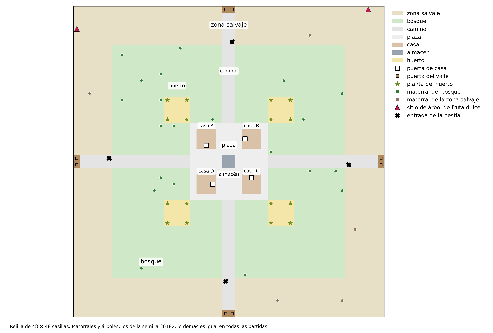
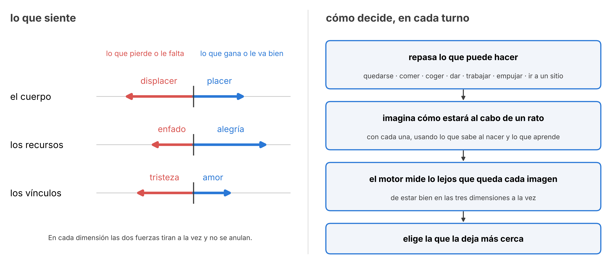
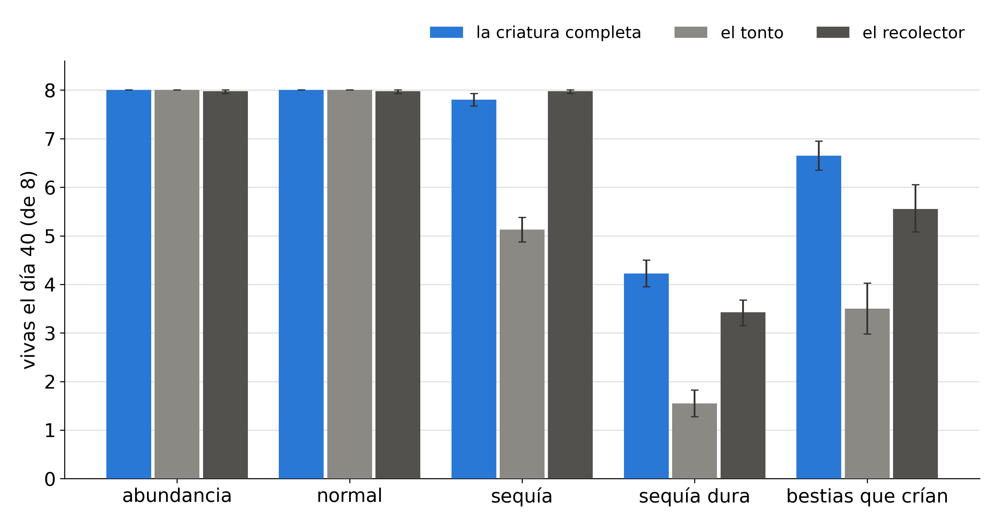
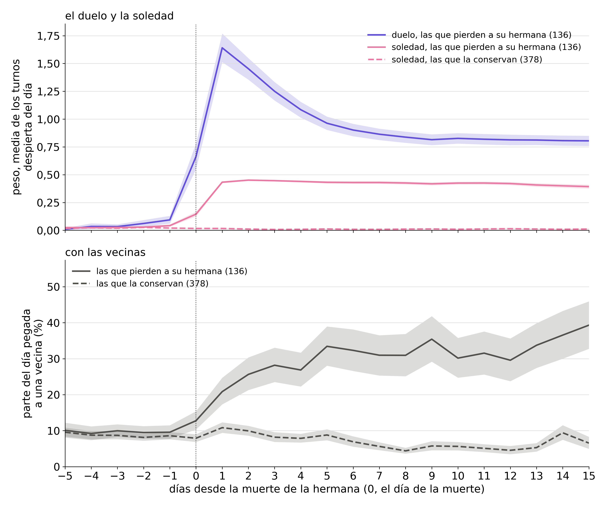
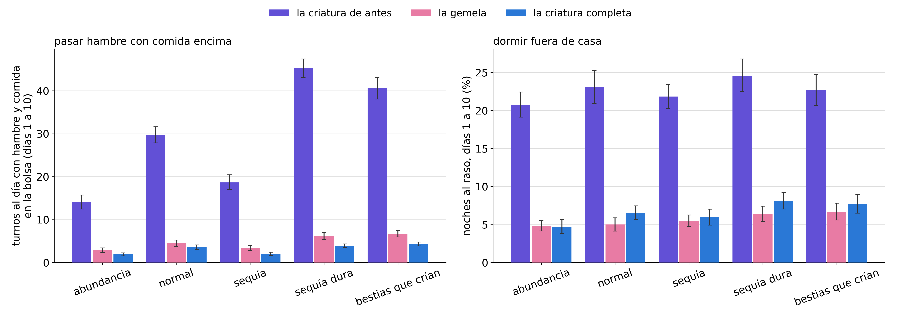
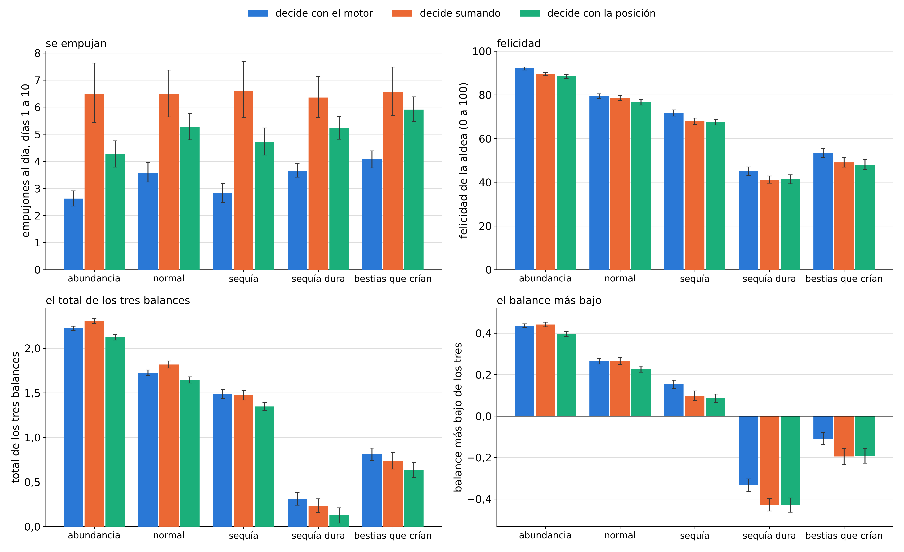

# G-EMV: emoción y razón en un agente

## Un cuerpo que vive el presente: una criatura, su hermana y un valle

Manel Enrico. Investigador independiente, Barcelona. ORCID: 0009-0008-1732-6310

Preprint, versión 1, noviembre de 2026. Toda la serie: github.com/Manelenrico/g-emv

Versión en español; en Zenodo, la inglesa. Octavo trabajo de una línea de investigación que empezó con el motor (Enrico, 2026); sigue al anterior (Enrico y Sklar, 2026).

# Resumen

Este trabajo presenta una criatura artificial que vive el presente, y pregunta qué vida hace sola. Siente lo que pierde y lo que gana en tres dimensiones a la vez, el cuerpo, los recursos y los vínculos con las otras, y busca su equilibrio en las tres: imagina un rato y decide para ese rato. No hay recompensa ni entrenamiento, no tiene razón y casi no tiene curiosidad. La ponemos con otras siete en un mundo pequeño donde hay que sobrevivir y convivir, porque en él se puede morir. El mundo es un valle hecho para ella, y es el mismo para todos los jugadores.

Lo que se nota en el momento le sale sin que nadie se lo diga: se junta ante el peligro, no mata a ninguna de las otras, cuida de su hermana y de quien pasa hambre, y vuelve a casa a dormir. Cuando el mundo aprieta vive más que un jugador de reglas simples. Cuando pierde a su hermana anda inquieta, llama y busca a las vecinas. El duelo lo escribimos nosotros, y también que la compañía lo alivia; la inquietud y las llamadas, no.

Lo que pide mirar lejos no le sale: no guarda para después ni va a por lo que está lejos. El valle se juega en cinco variantes, que llamamos mundos. En la más dura, donde la comida escasea dos veces durante cinco días seguidos, de las ocho llegan vivas al final unas cuatro: mueren de hambre aunque el valle haya dado de sobra antes. Dos costumbres sin sentido que tenía se arreglaron cambiando lo que puede ver, no un número. Arreglada vive mejor, pero en ese mundo no vive más, y ahí falló una de nuestras apuestas.

Por último comparamos tres criaturas que sienten lo mismo y solo se diferencian en cómo juntan lo que sienten para decidir: sumándolo, mirando lo lejos que queda cada dimensión de su meta, o con el motor. Llegan casi igual de lejos. La del motor se empuja menos y vive un poco más que la que suma. Si estar bien es que no le vaya mal en ninguna de las tres dimensiones, su aldea está bien más tiempo. Si es la suma de las tres, donde una cosa buena tapa una mala, las dos no se distinguen. No vemos que consiga más: lo reparte mejor.

Todo se midió en un solo valle, con 114 apuestas escritas antes de jugar, de las que se cumplieron 90. El valle se publica entero, y sobre él y sobre esta criatura se apoyan los trabajos que siguen.

**Palabras clave:** homeostasis, emoción artificial, ganancia y pérdida, vida en grupo, conducta sin entrenamiento, duelo y soledad, bienes comunes, cómo juntar varias necesidades, predicciones escritas antes.

# 1. La pregunta

**Un cuerpo que vive el presente.** La criatura de este trabajo siente, imagina un rato y decide para ese rato. Lo que aquí se cuenta es lo que un cuerpo así hace solo cuando se le da un sitio donde vivir con otros, y dónde se acaba. Hace bien lo que se nota en el momento: juntarse ante el peligro, cuidar de su hermana, volver a casa. No hace lo que solo se nota después: guardar para una escasez que aún no ha llegado, ir a por lo que está lejos. Ese límite es el punto de partida de los trabajos que siguen, que le añaden la curiosidad y una razón que mire lejos.

**De dónde venimos.** Esta serie pone junto a un cuerpo que siente una razón que habla, y pregunta qué le añade. En los trabajos anteriores ese cuerpo vivía en mundos hechos por otros: un combate por sobrevivir entre dieciséis, con pocas cosas, poca calma y mucho peligro, en partidas de unos minutos. Allí vimos que el cuerpo aprende de lo que vive, que aprende de su hermana y que puede servirse de una razón sin obedecerla.

**Lo que aquellos mundos no dejaban ver.** En un mundo así, casi todo lo que una criatura puede hacer es evitar: que no la golpeen, que no la alcance el fuego, que no se quede sola. Para sobrevivir le bastaba con perder lo menos posible en lo que le importa. No había tiempo para ir a buscar nada bueno. Y nuestro motor tiene, desde el primer trabajo, dos lados: lo que se pierde y lo que se gana. Del segundo, el de querer algo porque es bueno y no solo porque quita un mal, aquellas criaturas no usaban casi nada.

**Un paso atrás.** Por eso este trabajo da un paso atrás, y lo da en dos cosas a la vez. Desarrolla en la criatura el lado de ganar: lo que la ilusiona, lo que busca, lo que disfruta cuando lo tiene. Y le hace un mundo donde eso quepa, con menos apuro, con tiempo, y con cosas buenas que conseguir además de males que evitar. Queríamos ver a la criatura completa. Aquí no hay razón, y casi no hay curiosidad. Habíamos anunciado otra cosa para este trabajo, y antes hacía falta esta: sin saber qué hace el cuerpo entero cuando tiene sitio para vivir, no se puede decir después qué le añade una razón.

**La pregunta.** ¿Qué vida hace, sola, una criatura que siente lo que pierde y lo que gana, cuando se la pone con otras siete en un mundo donde hay que sobrevivir y convivir durante cuarenta días? De ahí salen dos preguntas más. La primera es si esa vida es mejor que la de jugadores más simples, que siguen unas pocas reglas. La segunda es la más incómoda: si para vivir así hace falta el motor con que la criatura junta lo que siente, o bastaría con sumar lo bueno, restar lo malo y elegir lo que más dé.

**La idea de fondo.** El modelo G-EMV da a la criatura tres dimensiones: la física, que aquí llamamos el cuerpo; la de los recursos; y la social, que aquí llamamos los vínculos. Una dimensión es cada una de las tres clases de cosas que una criatura puede ganar o perder. En cada una siente lo que pierde, que le pesa, y lo que gana, que la mueve a buscar. Nuestra apuesta es que de cuidar las tres a la vez sale, sin escribirla, una conducta que cualquiera reconoce: juntarse cuando hay peligro, cuidar de la hermana, volver a casa a dormir. No le decimos que lo haga. Le damos lo que le pesa y lo que la ilusiona, y miramos. Es una apuesta, no un resultado, y las secciones siguientes la ponen a prueba. También miran dónde se acaba.

**Lo que no hay, y lo que sí.** No hay premio que perseguir ni entrenamiento. El valle no da puntos y nadie le dice a la criatura si lo ha hecho bien. Lo que sí hay de nuestra mano hay que decirlo desde el principio. Le escribimos lo que sabe al nacer, como se le cuenta a una cría lo que hay en su aldea. Y la corregimos muchas veces, mirando cómo vivía, antes de dejarla como está. Cómo separamos esas correcciones de las medidas es parte de este trabajo.

**Apostar antes de jugar.** Antes de cada experimento dejamos escrito lo que esperábamos, y con qué medida lo íbamos a juzgar. En el valle hicimos 114 apuestas, y se cumplieron 90. Las que fallaron se cuentan igual, y entre ellas hay alguna de las que más nos importaban.

**Un mundo hecho para ella.** Todo pasa en un valle pequeño, con cuatro casas, un almacén, huertos, un bosque y una bestia. Esta vez el mundo lo hemos hecho nosotros, y eso tiene un riesgo que no escondemos: un mundo puede favorecer sin querer a quien lo construye. Por eso el valle no da puntos, es el mismo para todos los jugadores y se publica entero.

**Lo que sigue.** La sección 2 presenta el valle. La sección 3, la criatura y cómo medimos. La sección 4 cuenta lo que la criatura hace sola, y lo que no le sale. La sección 5, dos costumbres sin sentido que tenía, cómo las arreglamos y dónde nos equivocamos. La sección 6 compara tres maneras de decidir con lo mismo que se siente. La sección 7 pone el trabajo junto a otros que se preguntan cosas parecidas. La sección 8 dice hasta dónde llega lo que encontramos y qué deja abierto. Cómo se midió todo está en el apéndice.

# 2. El valle

El valle es un mundo pequeño, hecho para que en él se pueda vivir bien o mal, y para que se vea la diferencia. No da puntos ni tiene marcador.

Está construido alrededor de las tres dimensiones del modelo. La primera es el cuerpo: hay que comer, descansar y no hacerse daño. La segunda son los recursos: la comida no está ahí sin más, hay que buscarla o trabajarla, y lo guardado se estropea. La tercera son los vínculos: nadie vive solo en el valle, y casi todo lo que importa pasa entre dos. Son las mismas tres en las que, en la sección siguiente, la criatura va a sentir lo que pierde y lo que gana.

## El lugar y el día

El valle es un cuadrado de 48 casillas de lado. En el centro hay una plaza con cuatro casas y un almacén. Pegados a la plaza por fuera, en sus cuatro esquinas, están los huertos. Alrededor se extiende el bosque, y en el borde, rodeándolo todo, queda una franja de zona salvaje. Cuatro caminos salen de la plaza hacia los cuatro lados y acaban en una puerta cerrada. Del valle no se sale. La figura 2.1 lo muestra.

En él viven ocho criaturas, dos por casa. A las dos de una misma casa las llamamos hermanas, y a las de las otras casas, vecinas.

El tiempo va por turnos, y en cada turno cada criatura hace una sola cosa. Un día tiene 400 turnos: mañana, tarde, un anochecer corto y noche. Una partida dura 40 días. De noche se ve mucho menos: de día una criatura alcanza a ver cinco casillas a su alrededor, y de noche dos.

**Figura 2.1.** El valle. En el centro, la plaza con las cuatro casas y el almacén. En las cuatro esquinas de la plaza, por fuera, los cuatro huertos, cada uno con sus cuatro plantas. Alrededor, el bosque con sus matorrales, y en el borde, la zona salvaje, donde están los matorrales que dan el doble y los sitios donde aparece el árbol de fruta dulce. Las cruces marcan por dónde entra la bestia. Los matorrales son los de una partida; lo demás es igual en todas.

## El cuerpo: lo que hay que cuidar

Cada criatura tiene vida, hambre y cansancio.

El hambre sube sin que la criatura haga nada, un poco cada turno, y más si la criatura anda, si trabaja o si pasa frío. Necesita unas tres comidas al día. Si no come, en un día el hambre llega al tope, y desde ahí la vida se le va en medio día más.

El cansancio sube al andar, al trabajar y al empujar, y baja al dormir. Una criatura agotada se queda dormida donde esté, quiera o no.

De noche, fuera de las casas, hace frío. El frío no hiere, pero da hambre: una noche al raso cuesta un tercio de comida. Dentro de una casa siempre se está templado.

Y el cuerpo se puede herir. En la zona salvaje el terreno a veces hace daño, la bestia golpea fuerte, y también una criatura puede golpear a otra. La vida vuelve durmiendo, si no se tiene mucha hambre. Hay además una medicina, que solo aparece en la zona salvaje: devuelve la vida que quitaron las heridas, pero no la que quitó el hambre.

Una criatura muere cuando su vida llega a cero. En el valle se muere de hambre, de heridas o por la bestia.

## Los recursos: de qué se vive

Cada criatura nace con las manos vacías, pero no sin nada. Nace en una casa, la de su hermana y ella, y en esa casa hay una despensa que solo ellas dos pueden usar. Las casas no tienen cerradura: una vecina puede entrar. Pero dentro de una casa, de cualquiera, no hace frío y la bestia no alcanza a nadie.

Los huertos y el almacén son de todas. El bosque y la zona salvaje no son de nadie.

La comida hay que ir a buscarla, y se estropea. En el bosque hay una veintena de matorrales que dan fruto sin que nadie los cuide, y dan poco. En la zona salvaje los matorrales dan el doble, y de vez en cuando aparece un árbol de fruta dulce que dura unos días. Los huertos son otra cosa. Sus dieciséis plantas dan fruto todas a la vez, un día sí y otro no, y dan hasta cuatro veces más si se trabajan: una planta descuidada da un fruto, y una bien cuidada, cuatro.

El valle está medido para que, sin cuidar el huerto, haya apenas un poco más de lo que las ocho necesitan. Con el huerto bien cuidado hay de sobra. La holgura sale del trabajo.

Lo que se coge se puede llevar encima, guardar en casa o dejar en el almacén, y cada sitio aguanta un tiempo distinto. En la bolsa caben seis cosas y la comida dura dos días. En la despensa caben cuatro y dura cuatro días. En el almacén cabe todo y no se pudre, pero lo que una deja, otra lo puede coger. Al empezar hay en él comida para dos días.

## Los vínculos: con quién se vive

Una criatura ve de las demás lo que se nota por fuera: dónde están, de qué casa son, qué llevan, si están flacas, heridas o cansadas. No ve su hambre exacta.

Puede darle algo a la que tiene al lado. Puede empujarla, y entonces la que pierde suelta todo lo que lleva y la que gana se lo queda. En un empujón gana quien tiene a su hermana cerca, y si no, la menos cansada. Y puede golpearla, que quita vida. Nada de esto está prohibido ni mandado.

También puede llamar: decir dónde está, avisar de que hay comida o avisar de la bestia. Las llamadas pueden ser más suaves o más fuertes, y las fuertes se oyen el doble de lejos de lo que se ve. La criatura no miente con ellas: solo avisa de lo que tiene delante.

Y está la bestia. De día ronda por la zona salvaje. De noche, una de cada dos, baja a los huertos y se come parte del fruto. Si encuentra fuera a una criatura que lleva comida, se la quita. Si la criatura no lleva nada, o está dormida, la golpea, y un golpe suyo se lleva casi la mitad de una vida. Una sola criatura no puede con ella. Dos juntas sí: si la empujan a la vez, la echan del valle durante un día, y cuantas más son, más tarda en volver. También se la podría matar a golpes entre varias, pero cada golpe se devuelve, y en ninguna de nuestras partidas ocurre.

## Cinco mundos

El mismo valle se juega de cinco maneras, y solo cambia una cosa cada vez. En el normal, la comida crece siempre igual. En la abundancia, crece siempre un 30 por ciento más. En la sequía, la comida va por épocas de cinco días, y en los cuarenta días hay dos escaseces, del día 11 al 15 y del 31 al 35, en las que crece un 30 por ciento menos. En la sequía dura, las épocas son las mismas pero todo crece bastante menos: en los mejores días, algo menos que en el normal, y en la escasez, la mitad. En las bestias que crían, la bestia baja también de día, y a mitad de partida nace una segunda.

## Lo que no está en el valle

El valle no dice qué importa. Es un mundo: tiene cuerpos, cosas, vecinas y unas reglas. Es el mismo para nuestra criatura y para cualquier otro jugador que pongamos en él, y todos tienen delante las mismas acciones. Que el cuerpo importe, que lo que se tiene se eche de menos al perderlo y que estar con las otras sea una necesidad, eso no está en el mundo. Está en la criatura, y es lo que cuenta la sección siguiente.

# 3. La criatura

La criatura es un cuerpo puesto en ese valle, con un motor dentro. Nadie le dice qué tiene que hacer y nadie le pone nota. Lo que hace sale de lo que le importa, y lo que le importa son las mismas tres dimensiones para las que está hecho el valle.

Antes de seguir, una advertencia sobre las palabras. Diremos que la criatura siente, que algo le pesa o que echa de menos. En este trabajo esas palabras nombran siempre lo mismo: un número que mueve un cuerpo. No afirmamos que haya alguien dentro que lo sufra.

## Tres dimensiones, y dos lados en cada una

A la criatura le importan tres dimensiones de su vida: el cuerpo, los recursos y los vínculos. Son las del modelo G-EMV, que en el primer trabajo se llaman dominio físico, de recursos y social. En cada una hay dos fuerzas que tiran a la vez: una crece con lo que pierde o le falta, y la otra con lo que gana o le va bien. Son seis fuerzas, y a cada una le damos el nombre de una emoción humana, porque hace algo parecido a lo que esa emoción hace en nosotros: avisa de que en esa dimensión hay una pérdida o una ganancia. En el cuerpo, displacer y placer. En los recursos, enfado y alegría. En los vínculos, tristeza y amor.

Estos nombres son etiquetas para orientarse, no cajones. Casi nada de lo que le pasa a la criatura cae en una sola de las tres dimensiones. El hambre es sobre todo cuerpo, pero también es comida que falta. Ver herida a su hermana le pesa en los vínculos, y también un poco en el cuerpo y en los recursos. Lo que la criatura siente en cada momento es una mezcla de las seis fuerzas, con alguna que manda. Cuando digamos tristeza o enfado, nombramos una zona de esa mezcla, no una emoción pura.

Las dos fuerzas de una misma dimensión no se anulan. Una criatura puede tener hambre y estar comiendo, o estar junto a su hermana y verla herida. A lo que queda al restar la pérdida de la ganancia lo llamamos balance, y hay uno por dimensión: el del cuerpo, el de los recursos y el de los vínculos.

El motor que junta las seis fuerzas es el de nuestro primer trabajo (Enrico, 2026). Su código no se ha tocado, aunque dejamos una de sus piezas sin aplicar. Tiene una propiedad que conviene recordar: su punto de descanso no está en cero, sino algo inclinado hacia el lado de ganar. A la criatura no le basta con que no le falte nada. Por eso no se queda quieta cuando todo va bien, y por eso perder le pesa más que ganar lo mismo.

Esa pieza es el techo. Es un máximo para la suma de las seis fuerzas. Cuando una criatura siente más de lo que cabe, el motor las encoge todas en la misma proporción, como quien no puede atender a todo a la vez. Lo quitamos porque, al comparar opciones, engañaba: a una criatura desbordada de hambre, imaginar un dolor más le encogía el hambre, y la opción peor le salía un poco mejor. Ninguna criatura de este trabajo lo aplica. En lo que la criatura siente cambia poco, porque las fuerzas llegan a ese máximo entre uno y tres de cada mil turnos. Cuánto cambia lo que imagina, y con ello lo que decide, no quedó apuntado. Pero hay que decirlo: en eso, el motor de este trabajo no es exactamente el del primero. El apéndice lo cuenta entero.

## Lo que le pesa y lo que gana

En el cuerpo le pesan el hambre, el cansancio, el frío de la noche fuera de casa, la vida que le falta, y la bestia cuando está cerca o cuando ya le ha pegado. El hambre no pesa siempre igual: cuando aprieta, pesa hasta el doble.

En los recursos le pesa la comida que le falta. No mira solo la que tiene ahora, sino la que tiene frente a la que va a necesitar antes de que se le estropee. Le pesa también no llevar una medicina, y que a una de las otras le falte algo.

En los vínculos le pesa estar sola, estar lejos de su hermana, ver herida o flaca a una de las otras, y hacerles daño ella misma: pegar o empujar a una de las otras es una pérdida para quien lo hace. Y le pesa su muerte. A eso lo llamamos duelo, y con los días se va apagando.

Del otro lado está lo que gana. Gana cada vez que una de esas pérdidas se alivia: al comer, al descansar, al entrar en casa, al encontrar a su hermana. Gana cuando da algo a otra, por el gesto y por el alivio que le imagina. Y gana, sin más, cuando vive bien: con el cuerpo cuidado, comida para un par de días y su hermana a la vista. Lo bueno que siente le dura poco. Se le apaga a la mitad en lo que tarda una décima parte del día.

Hay, por tanto, dos maneras de que a la criatura le vaya mejor en una dimensión. Una es quitar una pérdida: eso es alivio. La otra es sumar una ganancia y dejar la pérdida donde está. No son lo mismo, porque en la segunda la pérdida sigue ahí, aunque pese menos en el conjunto. La sección 6 enseña que el motor las distingue, y que prefiere la primera.

Del lado de ganar le faltan dos cosas. No tiene una alegría propia de conseguir algo: cuando encuentra comida, lo que siente es que ya no le falta. Y cuando algo bueno que esperaba no llega, no le pesa. Aprende, y nada más.

De los pesos de antes, dos casi nunca se apagan, y conviene saberlo. El primero es la comida. La criatura quiere tener guardada la comida de los dos días siguientes, y le pesa lo que le falte para llegar. Para ella son seis o siete comidas, y en la bolsa solo caben seis. Por eso, aun con la bolsa llena, casi siempre le falta algo, y solo deja de pesarle cuando además tiene comida en la despensa. Así que la comida le pesa casi siempre, también cuando en el valle sobra.

El segundo es su hermana. La criatura no ve cuánta vida le queda a otra: solo ve si está sana, herida, muy herida o a punto de morir. Y a una hermana sana le supone, al hacer la cuenta, algo menos que la vida entera. El resultado es que su hermana le pesa siempre un poco, aunque esté bien. Ese efecto no lo buscamos, y lo declaramos. Tiene una consecuencia que hay que conocer: cuando la hermana muere, ese peso pequeño desaparece a la vez que llega el duelo, que es mucho mayor.

## Sus recursos y sus vínculos

Para la criatura, sus recursos son la comida guardada: la que lleva en la bolsa, la que hay en su despensa y una octava parte de la que ha visto en el almacén, como si le tocara su parte entre ocho. Cuenta también el fruto que espera del huerto que ha trabajado. La casa no la cuenta como algo que tiene. Y no hay en ella nada parecido a un territorio: ningún sitio vale más por ser suyo.

Sus vínculos son con su hermana y con sus vecinas, y cuentan de uno en uno. No hay en ella un sentimiento de grupo. Cada una de las otras le importa por dos cosas. La primera viene de nacimiento: la hermana le importa casi el triple que una vecina. La segunda se hace viviendo, y la llamamos trato: crece con el tiempo que pasan juntas y con lo que se dan, y baja con lo que se quitan. Una vecina que le quita la comida pasa a valerle menos.

## Cómo decide

En cada turno la criatura repasa lo que puede hacer: quedarse, comer, coger, dar, trabajar, empujar, ir a un sitio. Para cada cosa se imagina cómo estará al cabo de un rato si la hace, y con el motor mide lo lejos que queda ese estado de estar bien en las tres dimensiones a la vez. Elige la que la deja más cerca. No hay más regla que esa. La figura 3.1 lo resume.

Ese rato es corto: unos 44 turnos, la décima parte de un día. Y en cada imagen cabe una sola cosa, una acción o un sitio al que ir. La criatura no encadena planes. Solo al caer la tarde mira más lejos, hasta la mañana siguiente, y eso es lo que la hace buscar dónde dormir.

Es, en el sentido más literal, un cuerpo que vive el presente. Casi todo lo que este trabajo encuentra, lo bueno y lo que falta, viene de ahí.

**Figura 3.1.** La criatura por dentro. A la izquierda, lo que siente: en cada dimensión, una fuerza de perder y otra de ganar, que tiran a la vez. A la derecha, cómo decide: imagina cómo estará al cabo de un rato con cada cosa que puede hacer, el motor mide lo lejos que queda cada imagen de estar bien en las tres dimensiones a la vez, y elige la que la deja más cerca.

## Lo que sabe al nacer

La criatura no nace en blanco. Nace sabiendo lo que en una aldea se le cuenta a una cría, y eso se lo hemos escrito nosotros. Son treinta y una cosas, y no las olvida.

Sabe que una comida quita el hambre y que la medicina cura. Sabe que la zona salvaje hiere pero que allí está la medicina, que en el bosque hay matorrales que dan fruto, que el huerto trabajado da fruto a los dos días, y cuánto aguanta la comida en cada sitio. Sabe que de noche viene la bestia, que la casa es segura y que a quien duerme fuera la bestia le pega. Sabe que a la bestia se la echa entre dos. Y sabe que de vez en cuando aparece, lejos, un árbol de fruta dulce.

Conoce además el mapa: dónde están las casas, el almacén y los huertos. Lo que no sabe es dónde están los matorrales ni cuáles tienen fruto. Eso lo descubre andando.

No todo lo que sabe le sirve. De las treinta y una cosas, ocho están escritas y nada en ella las lee; el apéndice dice cuáles. Y hay tres huecos que importan aquí. Sabe que en el almacén la comida no se pudre, pero cuando calcula cuánta comida le hará falta mide todos los sitios con lo que aguanta la bolsa, y ese saber no entra en la cuenta. Sabe que aparece un árbol de fruta dulce, pero eso no la mueve a buscarlo. Y de las épocas de la sequía no sabe nada: no se lo contamos, y no tiene con qué notarlo. Son tres huecos nuestros, y pesan en lo que este trabajo deja abierto.

## Lo que aprende

Lo demás lo aprende viviendo, y lo apunta en lo que llamamos su cuaderno. Cada vez que le pasa algo, guarda lo que le hizo: cuánta hambre le quitó aquella comida, cuánto fruto dio su trabajo, qué le pasó la noche que durmió fuera, cómo le fue con cada vecina. Lo que cree de cada cosa es la media de lo que recuerda de ella.

Aprende deprisa y olvida despacio. Una sola experiencia ya pesa un tercio en lo que cree. Y lo vivido se va borrando: a las dos semanas pesa la mitad, y lo que cree vuelve hacia lo que le contaron al nacer.

Conviene decir de dónde le llega lo que aprende, porque es lo que separa a esta criatura de un agente entrenado. Le llega de su propio cuerpo, de lo que ve y de lo que oye a las otras. Nadie le dice si lo ha hecho bien. No hay ningún número que premie una conducta, ni en el valle ni en ella.

Lo que sí viene de fuera viene de nosotros, y hay que decirlo entero. Le hemos escrito lo que sabe al nacer. Y la hemos corregido a mano muchas veces, mirando cómo vivía, antes de dejarla como está. El apéndice cuenta cómo separamos esas correcciones de las medidas.

## Dos temperamentos

En cada casa, una hermana nace valiente y la otra prudente. A la valiente los miedos le pesan la mitad, y a la prudente, la mitad más. El temperamento solo toca los miedos: la bestia, la hermana en peligro, estar lejos de ella, no llevar medicina. No toca el hambre, ni la soledad, ni el duelo.

## Lo que esta criatura no tiene

No tiene razón: no hay en ella nada que piense con palabras ni que mire más allá de ese rato.

Tampoco tiene la curiosidad de nuestros trabajos anteriores. Le queda una pieza pequeña: le pesa un poco no saber dónde hay comida, y eso la lleva a explorar. Esa pieza se apaga antes de lo que debería, porque al contar los matorrales que conoce cuenta también las plantas del huerto. En casi todas las criaturas se ha apagado hacia el tercer día, cuando conocen más o menos la mitad de los matorrales del bosque y casi ninguno de la zona salvaje. Es un fallo nuestro. Lo dejamos como estaba al sellar, y lo declaramos.

La criatura de este trabajo lleva además dos piezas que llegaron tarde, la reserva y la voz de ir a casa. Tienen su historia, y la cuenta la sección 5. A la criatura sin esas dos piezas la llamamos la criatura de antes. A la que las lleva, la criatura completa: es la protagonista de este trabajo.

## Cómo medimos

**Apostar antes de jugar.** Cada experimento de este trabajo se ha hecho en dos tiempos. Primero escribimos lo que esperábamos que pasara, con la medida y el listón con que lo íbamos a juzgar, y lo guardamos con fecha de manera que no se pudiera cambiar después. Solo entonces jugamos las partidas, en valles sorteados que nadie había visto. La excepción es la comparación de las tres maneras de decidir, que se jugó en los valles del sellado anterior para poder comparar partida contra partida; la criatura del motor ya se había jugado en ellos. A eso lo llamamos sellar, y a cada cosa escrita, una apuesta. Lo que no se cumple se cuenta igual.

Este trabajo se apoya en tres experimentos sellados. En el primero jugó la criatura de antes, en 1.600 partidas. En el segundo, la criatura completa, en 1.200. En el tercero, 400 partidas más para comparar tres maneras de decidir, en los mismos valles del segundo.

**Con quién se compara.** La criatura se mide contra cinco jugadores que viven en el mismo valle y tienen delante las mismas acciones.

- **El tonto.** Sigue unas pocas reglas fijas: come si tiene hambre, va al almacén, trabaja el huerto o busca en el bosque cuando el almacén se vacía, y vuelve a casa al anochecer o si ve a la bestia. No da, no empuja y no llama. Es el suelo: lo mínimo que hace algo en el valle.

- **El recolector.** Es una máquina de buscar comida. Conoce todas las fuentes, recuerda cuándo las vio con fruto y vuelve a ellas. No trabaja el huerto y tampoco trata con nadie. Es el listón de eficacia.

- **La gemela sin lado positivo.** Es nuestra criatura con una sola diferencia: no siente lo que gana, solo lo que le falta. Sirve para saber qué añade el lado de ganar, y qué cuesta.

- **La que suma y la de la posición.** Son nuestra criatura entera, con otra manera de juntar lo que siente a la hora de decidir. Las presenta la sección 6.

Los dos primeros se diferencian de la criatura en muchas cosas a la vez. Enseñan si la criatura entera vive mejor o peor que algo sencillo, no qué pieza suya lo consigue. Para eso están las otras tres, que solo cambian una cosa.

**Qué se mide.** Lo primero es cuántas viven: de las ocho que empiezan, cuántas siguen vivas el día cuarenta, y de qué murieron las demás. Cuando decimos que una criatura vive una fracción de criatura más que otra, queremos decir que en su aldea llegan vivas al día cuarenta, de media, esas más.

Lo segundo son las conductas: con quién se juntan, a quién dan, dónde duermen. Cada una tiene su medida, y la cuenta la sección 4.

Lo tercero es cómo viven. Decimos que una criatura está bien en un turno cuando sus tres balances están a la vez por encima de cero: el del cuerpo, el de los recursos y el de los vínculos. Un balance por encima de cero quiere decir que, en esa dimensión, lo que gana le pesa más que lo que pierde. Llamamos felicidad de una criatura a la parte de su tiempo despierta en que está bien, y felicidad de la aldea a la media de las ocho.

No basta con que una dimensión le vaya muy bien: ninguna de las tres puede irle mal. Y la palabra se usa aquí como las demás de este trabajo. Nombra un estado de la criatura, no una vivencia. Tampoco es algo que el valle dé ni que la criatura persiga: lo calculamos nosotros después, mirando sus balances.

Un detalle importa para lo que viene. Los balances son lo que le llega al motor, no lo que el motor hace con ello: en cada dimensión, lo que la criatura gana menos lo que pierde. Así que esta medida no depende de la manera de decidir. Cuando en la sección 6 comparemos a nuestra criatura con otras que deciden de otro modo, las mediremos a todas con la misma vara, y esa vara no es la del motor.

Tiene una trampa que hay que conocer. Una criatura que muere cuenta por lo que vivió, y los primeros días suelen ser los buenos. Así que hemos repetido las cuentas con solo las que llegan vivas al final. Las diferencias que damos se mantienen.

**Cómo se compara.** Cada mundo se juega cuarenta veces. Cada vez, el azar es distinto: dónde están los matorrales, cuándo aparece el árbol, por dónde empieza la bestia. Dentro de un sellado, dos jugadores se comparan siempre en los mismos cuarenta valles, partida contra partida, para que la diferencia sea suya y no de la suerte.

De cada diferencia damos su tamaño y un margen, que sale de volver a sortear las cuarenta partidas diez mil veces. Cuando el margen entero queda a un lado del cero, decimos que la diferencia se separa. Cuando lo cruza, decimos que no se separa. Eso no es lo mismo que decir que no existe: es decir que con cuarenta partidas no la podemos distinguir del azar.

Y distinguimos siempre dos cosas. Una apuesta es algo escrito antes de jugar. Una observación es algo visto después, mirando los datos. Las dos se cuentan, y de cada número decimos cuál de las dos es. Una observación puede ser muy clara, pero no ha corrido el riesgo de fallar.

El apéndice cuenta con más detalle cómo se midió todo.

Lo que sigue es lo que un cuerpo así, sin razón y casi sin curiosidad, hace solo.

# 4. Lo que hace sola

A la criatura no le hemos dicho que se junte con las otras, ni que cuide de su hermana, ni que duerma en casa. No hay en ella ninguna regla que diga eso. Tiene las seis fuerzas, lo que sabe al nacer y un rato de imaginación. Esta sección cuenta lo que hace con eso cuando se la deja vivir cuarenta días.

Los números son de la criatura completa, en las doscientas partidas que jugó en el segundo de los tres sellados. Vivir más que el tonto, no matarse, juntarse ante la bestia y echarla, dar más a la hermana y a la que pasa hambre, y dormir en casa se apostaron antes de jugar, y se cumplieron. Se habían apostado ya, con las mismas palabras, para la criatura de antes, y también se cumplieron. Lo demás son observaciones, y lo decimos en su sitio. Al final van las cosas que no le salen.

## Vive

Lo primero que hay que pedirle a un cuerpo es que siga vivo. Donde la comida no falta, en el mundo normal y en la abundancia, llegan vivas al día cuarenta las ocho. Ahí la criatura no se distingue de nadie: también el tonto llega con las ocho.

La diferencia aparece cuando el mundo aprieta. En la sequía llegan vivas 7,8 de nuestras ocho criaturas, y 5,1 de los ocho tontos. Con las bestias que crían, 6,7 frente a 3,5. En la sequía dura, 4,2 frente a 1,6. Son cerca de tres criaturas más en cada uno de los tres mundos, y los tres márgenes quedan muy lejos del cero. Está en la figura 4.1.

**Figura 4.1.** Cuántas llegan vivas al día cuarenta, de ocho, en los cinco mundos. Cada barra es la media de cuarenta partidas, con su margen. En los dos mundos fáciles no hay diferencia. Cuando el mundo aprieta, la criatura vive más que el tonto en los tres mundos y más que el recolector en dos. En la sequía el recolector vive un poco más.

Con el recolector no habíamos apostado nada, así que esto es una observación. El recolector solo sabe buscar comida, y la busca mejor que ella. En la sequía vive un poco más: 8,0 frente a 7,8, una diferencia pequeña pero que se separa. En los otros dos mundos difíciles es nuestra criatura la que vive más: 4,2 frente a 3,4 en la sequía dura, y 6,7 frente a 5,6 con las bestias que crían.

Dos cosas hay que leer en esos números. Una criatura que no se entrenó para nada vive más que una máquina de buscar comida allí donde hace falta algo más que comida. Y en la sequía dura muere la mitad. De eso se ocupa la sección 5.

## No se matan

En el valle se puede golpear, y un golpe quita vida. En ninguna de las partidas, en ninguno de los cinco mundos, murió una criatura a manos de otra. No se lo impide ninguna regla. Pegar a otra le pesa a quien pega, y no ha hecho falta más.

## Se juntan cuando hay peligro

Cuando la bestia está a la vista, la criatura tiene a otra pegada a ella casi un tercio de las veces. El tonto, en la misma situación, una de cada doce. Ninguna regla la manda juntarse. Le pesa la bestia, le alivia la compañía, y el resultado se parece a un rebaño.

Y juntas la echan. La criatura sabe de nacimiento que a la bestia se la echa entre dos, pero ir a hacerlo es cosa suya: hay que acercarse a lo que da miedo, y acercarse a la vez que otra. En el mundo de las bestias que crían lo hacen unas siete veces por partida. En los otros mundos, donde la bestia solo baja algunas noches, casi nunca. La echaron 304 veces, siempre entre dos o más: una sola no puede. A la bestia también se la puede matar a golpes entre varias, y eso la criatura lo sabe igual de nacimiento. No lo hacen en ninguna partida: cada golpe que le dan, la bestia lo devuelve, y entre dos, a empujones, la echan sin recibir ninguno.

## Cuidan unas de otras

La criatura da comida, y casi toda se la da a su hermana: unas veinticinco veces más que a cada una de sus vecinas, y nunca menos de trece veces más en ningún mundo.

Importa también a quién va lo que da. En la abundancia, donde casi nadie pasa hambre, solo seis de cada cien comidas dadas van a una criatura flaca: se da por dar. En el mundo normal son veintiocho. En la sequía, cuarenta y dos, y en la sequía dura y con las bestias que crían, la mitad. Esa subida no quiere decir que reparta mejor cuando hay hambre. La criatura da a la que tiene pegada, que cuatro de cada cinco veces es su hermana, y casi nunca tiene a más de una. Cuando hay hambre, esa está flaca más a menudo, y dando sin mirar la cifra ya subiría casi lo mismo. Mirar a quién da añade entre dos y siete puntos de cada cien, y en la abundancia no se distingue de cero. Eso sí: en todas las entregas en que tenía pegada a alguna flaca, la comida fue a una flaca. La criatura no tiene una regla de repartir según la necesidad. Lo que tiene es que el hambre de las otras le pesa. La otra mitad, también en la sequía dura, sigue yendo a quien no está flaca.

## Duermen en casa

Al caer la tarde la criatura mira más lejos que de día, hasta la mañana siguiente, y lo que ve la lleva a casa: fuera hace frío y está la bestia, y dentro está su hermana. Duerme dentro de su casa entre el 86 y el 97 por ciento de las noches, según el mundo.

No siempre fue así. Dormir fuera sin motivo era una de las dos costumbres que tuvimos que entender, y la cuenta la sección 5.

## El duelo y la soledad

Cuando a una criatura se le muere la hermana le pasan dos cosas distintas, y conviene decir desde el principio cuál pusimos nosotros y cuál no. Casi nada de este apartado se apostó: son medidas hechas después, sobre 136 criaturas que pierden a su hermana, comparadas con 378 que la conservan en las mismas partidas. La figura 4.2 las pone juntas.

**Enterarse.** Lo primero es saberlo, y no es automático. La criatura solo sabe que su hermana ha muerto si lo ve: si la ve morir, o si ve el cuerpo, que se queda en su sitio hasta el final del día siguiente. Nadie se lo dice, y no lo deduce de dejar de verla. Contando todas las muertes de hermanas, de cada cinco criaturas, dos lo ven en el momento, dos encuentran el cuerpo un rato después y una no llega a saberlo nunca.

**El duelo lo escribimos nosotros.** Es un peso que aparece cuando la criatura sabe de la muerte, y tiene el tamaño de lo que la otra era para ella: una parte fija, de nacimiento, por ser su hermana, y otra que viene del trato que tuvieron. Lo hicimos para que aflojara. Lo más fuerte se va en unos cinco días, y queda un resto, algo menos de un tercio, que no se va. Lo quisimos así para que la pérdida no dejara a la criatura parada para siempre, ni tampoco como si nada. Por eso, cuando medimos que el duelo de una criatura baja a la mitad en unos cinco días, estamos midiendo nuestra propia regla. No es un hallazgo.

**La soledad no la escribimos para esto.** No hay en la criatura ninguna regla para la muerte de una hermana. Lo que tiene, desde siempre, es un peso por estar sola: sube cuando lleva medio día sin ver ni oír a su hermana, y solo su hermana se lo quita del todo. Una vecina a la vista lo alivia en parte. Cuando la hermana muere, ese peso sube como cualquier otro día en que se separan, y ya no hay quien lo quite. Quince días después conserva cuatro quintas partes de lo que subió. Le pasa igual a la que nunca llegó a saber que su hermana había muerto: no tiene duelo, pero está sola.

**Busca a las vecinas.** Esto sí lo habíamos apostado. De día se la ve pegada a una vecina casi el triple de veces que antes, y de noche también. Tampoco hay una regla que la mande con ellas. Sale de dos cosas. Una vale siempre y para todas: una vecina a la vista alivia la soledad. La otra la escribimos nosotros con el duelo: estar pegada a otra lo alivia. Esto segundo sí lo pusimos nosotros, y en una prueba anterior fue lo que más la acercaba a las vecinas en los primeros días.

**Figura 4.2.** Antes y después de perder a la hermana. Arriba, el duelo y la soledad, día a día, de las 136 criaturas que la pierden, y la soledad de las 378 que la conservan. El duelo sube y afloja. La soledad sube y se queda. El duelo dibujado es todo el que la criatura lleva, también el de las vecinas que han muerto, y no todas se enteran el mismo día: por eso la media no baja hasta el tercio que la regla deja para cada muerte. Abajo, la parte del día que pasan pegadas a una vecina. Las bandas son el margen.

**Y no se queda parada.** Lo miramos después, sin apuesta, y es lo que menos esperábamos. De día estaba quieta noventa y cinco turnos de doscientos cuarenta, y ahora lo está unos setenta, mientras las que conservan a su hermana se quedan más quietas que antes. Trabaja el huerto dos tercios más que antes. Llama tres cuartos más. Anda más lejos de su casa y duerme menos en ella: de ochenta y seis noches de cada cien a sesenta y cinco. Y pasa noches en vela, trece de cada cien donde antes eran tres. Llamamos así a la noche en que no duerme en un mismo sitio más de la mitad del tiempo. En los diez días siguientes, cuando lo fuerte del duelo ya se ha ido, aflojan las noches en vela y, a medias, las noches fuera de su casa y las llamadas, que se quedan en un 40 por ciento más que antes. Lo demás no afloja: comparada con las que conservan a su hermana, sigue parando poco, trabajando más y andando lejos, lo mismo que en los primeros días. No come menos ni pasa más hambre. Mueren 6 de las 136, frente a 11 de las 378 que conservan a su hermana: son tan pocas que no se puede decir si muere más, y el margen de la diferencia cruza el cero.

De dos de esas cosas sabemos de dónde vienen. Llama más porque, al imaginar una llamada, imagina que alguien acude y deja de estar sola. Y duerme menos en casa porque lo que la llevaba a casa era su hermana, y la voz de ir a casa ya no suena. De por qué trabaja más y no para quieta no tenemos explicación.

**No vuelve a estar bien.** De las 136, 84 no vuelven a estar bien ni un solo turno en lo que les queda de partida, en el sentido de la sección 3. Entre las 378 que conservan a su hermana, eso les pasa a 6. Hay que leerlo con lo anterior: el resto del duelo que no se va y la soledad que nadie quita le dejan dos pesos fijos, y con ellos es difícil tener los tres balances por encima de cero. Una parte de ese número la pusimos nosotros.

Lo que queda como resultado es modesto, y nos parece cierto. No escribimos qué hace una criatura cuando pierde a su hermana. Escribimos cuánto le pesa perderla, que ese peso afloja y que estar pegada a otra lo alivia. Lo demás sale de piezas que estaban ahí para otra cosa: que la soledad no afloje, que ande inquieta, llame y duerma mal, y que aun así siga comiendo y trabajando. Que busque compañía sale en parte de lo que escribimos. No afirmamos que eso sea pena. Afirmamos que tiene una forma que cualquiera reconoce.

## Lo que no le sale

Sería engañar contar solo lo anterior. Lo que sigue son observaciones, salvo donde se dice otra cosa.

**Se empujan, y no por hambre.** Un empujón le quita a la otra todo lo que lleva. En una partida hay unos cien, y casi nueve de cada diez los da una criatura que en ese momento no tiene hambre. Casi todos van a quien lleva algo: empuja para quedarse con lo que la otra lleva, no porque tenga hambre. La mayoría son entre vecinas. Después se separan, y vuelven a estar juntas casi siempre, en cuestión de horas. Pero algo queda: en la mitad de los casos, la que quitó no vuelve a valerle a la otra lo que le valía antes. No vemos castigo. A la que quitó se le da después algo menos, pero entre vecinas casi nunca se dan nada, ni antes ni después.

**Dan sin sentido.** Alguna vez dos hermanas hartas se pasan comida la una a la otra, turno tras turno. Apostamos que sería raro, y lo es: una partida de cada doscientas. No lo hemos arreglado.

**No aprovechan lo que hay lejos.** Del árbol de fruta dulce cogen menos de tres frutas de cada cien. El recolector, veintisiete. Esto también lo habíamos apostado: sin nada que mire lejos, la criatura apenas lo usa.

**No guardan en común.** La comida que hay en el almacén al empezar se la llevan en los tres primeros días, y después casi nadie deja nada allí: en las doscientas partidas, una sola comida. Guardan en su despensa, que es de las dos hermanas, y en su bolsa.

**En el mundo fácil no viven más que el tonto.** En el mundo normal la comida crece siempre igual y la bestia solo baja algunas noches. Para llegar al día cuarenta basta con comer cuando se tiene hambre y meterse en casa de noche, y eso el tonto lo hace con sus cuatro reglas. Las ocho de cada aldea llegan vivas. Todo lo que nuestra criatura tiene de más no le sirve ahí para vivir más tiempo. Le sirve cuando el mundo aprieta, y le sirve para vivir de otra manera: acompañada, y cuidando de las otras.

## Lo que deja dicho

A esta criatura nadie le ha dicho que se junte con las otras, que cuide de su hermana ni que vuelva a casa, y hace las tres cosas. Cuando el mundo aprieta vive más que un jugador de reglas. No mata a ninguna de las otras. Ante la bestia se junta, y entre dos la echan. Da casi todo lo que da a su hermana, y cuando tiene pegada a una que pasa hambre, la comida va a ella. Todo eso lo apostamos dos veces, y se cumplió las dos.

Cuando pierde a su hermana, la vida le cambia y el cambio dura. Una parte la escribimos nosotros: cuánto le pesa la muerte, y que ese peso afloje. La otra no la escribimos: anda inquieta, llama, busca a las vecinas y pasa noches en vela, y aun así sigue comiendo y trabajando.

Y hay cosas que no le salen. Quita comida a las otras sin tener hambre, no guarda en común y no va a por lo que está lejos. Casi todo tiene la misma raíz. La criatura imagina un rato y decide para ese rato. Lo que se nota en el momento lo hace bien: cuidar, juntarse, volver a casa. Lo que solo se nota después no lo hace. Esto último es nuestra lectura, no una medida.

Dos costumbres más no venían de ahí, sino de fallos en cómo hacía sus cuentas. Encontrarlas y arreglarlas es la sección siguiente.

# 5. Dos costumbres sin sentido, y sus dos arreglos

La criatura de la sección anterior no es la primera que sellamos. La anterior hacía casi todo lo que hemos contado, y además dos cosas que no tenían sentido: pasaba hambre llevando comida encima, y dormía al raso a unos pasos de su casa. Esta sección cuenta cómo las encontramos, qué eran y qué pasó al arreglarlas. La contamos entera porque es donde más nos equivocamos.

## Pasaba hambre con comida en la bolsa

En las sequías del primero de los tres sellados, la criatura de antes pasaba cada día unos treinta turnos despierta, con hambre y con comida en la bolsa, sin comérsela. Su gemela, la de la sección 3, que es igual que ella pero no siente lo que gana, pasaba así cinco turnos en los mismos valles.

Al principio no sabíamos ni siquiera si comer estaba entre las cosas que se planteaba. Volvimos a jugar unas partidas guardando, en cada decisión, todas las opciones que la criatura tenía delante y cuánto valía cada una. Comer estaba siempre entre ellas. Lo que pasaba es que perdía frente a quedarse quieta o a trabajar el huerto, y perdía sobre todo en una situación: cuando en la bolsa quedaba una sola comida. Siete de cada diez veces que no comía, llevaba solo una.

La criatura guardaba la última. Para ella la comida guardada es algo que tiene, y tenerla le va bien. Comerse una de cinco apenas cambia eso. Comerse la última deja la bolsa vacía, y esa pérdida le pesaba más que el hambre que se quitaba. Cuanto más dura la sequía, más la guardaba. Y la bolsa con una comida era justo lo que las otras le quitaban a empujones.

El arreglo no fue un número, fue una idea, y es de las pocas veces que cambiamos a la criatura por principio y no por un fallo de cuenta. La reserva vale por el hambre de la que te va a salvar. Cuando el hambre llega, comérsela no es perderla: es usarla. Así que, cuando la criatura tiene hambre suficiente para comer, comerse lo que lleva deja de contarle como perder lo que tiene. Mientras no tiene hambre, guardar le sigue yendo bien. A eso lo llamamos la reserva.

Lo decidimos antes de ver su efecto, con una regla escrita, y lo probamos una sola vez. Funcionó a la primera. En el experimento sellado, los turnos con hambre y comida en la bolsa pasan de treinta y dos al día a tres.

## Dormía fuera, a unos pasos de casa

La criatura de antes dormía al raso una de cada cuatro noches. Su gemela, una de cada dieciocho. Y no era por quedarse trabajando ni por ir lejos a por comida: al acabar la tarde se quedaba quieta en el bosque o en el huerto, a menos de veinte pasos de su puerta, y allí la cogía la noche.

Aquí nos equivocamos dos veces antes de acertar. Primero creímos que no veía venir el anochecer. Lo veía: la gemela, con la misma vista, se ponía en camino justo entonces. Después creímos que no le importaba bastante el frío. Jugamos un valle sin frío, y siguió durmiendo fuera igual.

La causa salió, otra vez, de mirar sus opciones una por una. Lo que la retenía era su hermana. Tenerla a la vista le va bien, y la hermana también estaba fuera. Cuando la criatura imagina que se va a casa, imagina que las demás se quedan donde están: irse es, para ella, dejar a su hermana. Su hermana hacía la misma cuenta. Cada una se quedaba porque la otra estaba. Las dos habrían estado mejor en casa, juntas, y ninguna de las dos podía imaginar «vamos las dos».

El arreglo es lo mínimo que resuelve eso. Desde media tarde, una criatura que se inclina por ir a casa lo dice, y solo se lo dice a su hermana, si está cerca y despierta. La hermana, al oírlo, puede imaginarse la casa con la otra dentro. No le manda nada: le deja ver una opción que antes no veía, y su motor decide. Lo llamamos la voz de ir a casa. Hay que decir que es una voz hecha por nosotros y más simple que las demás llamadas del valle: no cuesta nada, no pasa por el oído con que las criaturas oyen lo demás, y con ella la que escucha sabe dónde está su hermana aunque no la vea.

Antes de esta habíamos probado cuatro maneras más ricas de darles voz, entre ellas pedir, enseñar cómo se está y avisar. Ninguna mejoró nada, y alguna empeoró las cosas. Esta, que solo dice hacia dónde se inclina una, sí.

En la criatura completa, que lleva la reserva y la voz, las noches al raso pasan de una de cada cuatro a una de cada catorce (figura 5.1). La bajada es toda de la voz: con la reserva sola siguen en una de cada cuatro. Contamos como noche al raso la que pasa dormida fuera de su casa más de la mitad del tiempo, también si es en casa de otra. Las dos hermanas duermen en la misma casa entre el 83 y el 95 por ciento de las noches, según el mundo; antes, entre el 54 y el 70. Y la bestia las encuentra dormidas fuera muchas menos veces: de entre dos y cuatro golpes por partida a alrededor de uno.

**Figura 5.1.** Las dos costumbres, antes y después, en los diez primeros días del segundo experimento sellado, donde las tres criaturas juegan los mismos valles. A la izquierda, los turnos al día que pasan con hambre y con comida en la bolsa. A la derecha, las noches que duermen al raso. La criatura completa queda cerca de la gemela, que no siente lo que gana y casi no tenía esas costumbres.

## Lo que cambió, y lo que no

La criatura completa vive mejor que la de antes, y eso es claro. Pasa menos hambre, pasa menos frío, le quitan menos comida y la bestia la sorprende menos. Es la más feliz de todas en los cinco mundos. En la sequía, su aldea está bien el 72 por ciento del tiempo, frente al 67 de la de antes, y la criatura a la que peor le va, el 56 frente al 43.

También muere menos de hambre donde hay comida. En las cuarenta partidas de la sequía, las muertes de hambre bajan de dieciséis a tres, y con las bestias que crían, de veintiséis a diez. En la sequía llega viva al final un tercio de criatura más que la de antes. Esto último no lo habíamos apostado: es una observación, y son dos medias que no se pudieron comparar partida contra partida.

Y aquí está nuestro error. En las partidas de prueba, la reserva parecía dar casi una criatura más de vida en la sequía dura. Lo apostamos. En el experimento sellado, en valles nuevos, no dio ninguna que se vea: la diferencia queda pegada al cero, con el margen a los dos lados. Esa apuesta falló, y también la que hicimos para la criatura completa en ese mundo.

Habíamos dado por bueno un eslabón sin comprobarlo. La criatura de antes llegaba a la primera escasez con el doble de hambre que su gemela, y supusimos que por eso moría más. El doble de hambre se repitió en los valles nuevos. Las muertes de más, no. La criatura completa llega a la escasez con la mitad de hambre que la de antes, y muere igual.

## La sequía dura

En la sequía dura mueren de hambre unas ciento cuarenta criaturas en cuarenta partidas, sea cual sea la criatura: la de antes, la completa y la gemela. Casi todas mueren en las épocas de escasez.

No es que el valle no dé. De media produce el doble de lo que las vivas necesitan. Lo que pasa es que durante cinco días seguidos crece lo justo, y lo que sobró antes ya no está. Hemos hecho la cuenta, y es una cuenta, no un resultado: en los diez días anteriores a la primera escasez se pudren más de cincuenta comidas en las bolsas y en las plantas, sin contar las despensas, que no quedaron apuntadas, y en la escasez se comen unas veintisiete menos que en los cinco días de antes.

La reserva incluso tiene aquí un coste, que habíamos declarado antes de jugar y que se cumplió: una criatura que se come lo que lleva cuando tiene hambre llega a la escasez sin nada guardado más veces que una que guarda la última.

Así que la criatura completa, donde la comida escasea cinco días seguidos, muere como todas, aunque el valle haya dado de sobra antes. Arreglar sus cuentas le quitó el hambre sin sentido. No le dio lo que no tiene: guardar hoy para dentro de diez días, y guardarlo donde no se pudre, que es el almacén de todas.

## Lo que cuesta el lado positivo

Queda una pregunta que la gemela permite hacer. Una criatura que solo siente lo que le falta, ¿vive más que una que también siente lo que gana?

Con la criatura de antes, sí, un poco. En la sequía su gemela vivía un cuarto de criatura más, y salió del mismo tamaño en dos experimentos sellados; juntándolos, la diferencia se separa. En la sequía dura los dos experimentos no cuadran: en uno la gemela vivía casi una criatura más, en el otro lo mismo. No podemos dar un número.

Con la criatura completa, no. En ningún mundo vive menos que su gemela con una diferencia que se separe, y en el mundo normal vive algo más. Es razonable pensar que lo que la de antes perdía era, en buena parte, lo que le costaban sus dos costumbres, pero eso no lo hemos medido aparte.

Y hay que decir qué clase de vida es la de la gemela. No está bien nunca, en el sentido de la sección 3, porque no tiene con qué: para ella no existe lo bueno. Empuja la mitad que la criatura completa, eso sí. Vive lo mismo, y vive menos cosas.

## Lo que deja dicho

Las dos costumbres tenían la misma forma. La criatura hacía bien la cuenta que tenía, y la cuenta estaba mal planteada. Guardaba la última comida porque comérsela le contaba como perderla. Dormía fuera porque no podía imaginar que su hermana fuera a casa con ella. Ninguna de las dos se arregló subiendo o bajando un número. Se arreglaron cambiando lo que la criatura puede ver: que la reserva está para usarla, y que la otra también se inclina por ir a casa.

Arreglada, vive mejor. Pasa menos hambre y menos frío, le quitan menos, la bestia la sorprende menos, y su aldea está bien más tiempo. Y no vemos que sentir lo que gana le cueste ya vida frente a la gemela que solo siente lo que le falta.

No vive más donde la comida falta cinco días seguidos. Ahí nos equivocamos: dimos por bueno en las partidas de prueba lo que en valles nuevos no salió. Lo que se ve en una prueba no es una medida. Y lo que la sequía dura pide no es una cuenta mejor hecha. Es mirar lejos, y eso esta criatura no lo tiene.

Queda la pregunta que más nos importaba: si para todo esto hacía falta el motor, o habría bastado con sumar. Es la sección siguiente.

# 6. Decidir de tres maneras

Hasta aquí hemos comparado a la criatura con jugadores más simples que ella. Queda la pregunta más incómoda, y es la que más nos importaba. La criatura siente seis fuerzas, y con ellas decide. ¿Hace falta el motor para eso? ¿No bastaría con sumar lo bueno, restar lo malo y elegir lo que más dé?

Para saberlo hicimos tres criaturas que sienten exactamente lo mismo. Tienen el mismo cuerpo, saben lo mismo, sienten las mismas pérdidas y las mismas ganancias, llevan la reserva y la voz de ir a casa. Solo se diferencian en el último paso: cómo juntan lo que sienten para elegir.

- **La que suma.** En cada una de las tres dimensiones resta lo que pierde de lo que gana, suma los tres resultados y elige lo que más da. Es lo que haría cualquiera que no conociera nuestro motor.

- **La de la posición.** Usa del motor solo una parte: lo lejos que queda cada balance de su meta. Lo que pasa de la meta no le cuenta. No sabe nada de cuánta fuerza hay tirando a la vez.

- **La del motor.** Es nuestra criatura. Mira la posición igual que la anterior, y cuenta dos cosas más. Una es la tensión, que es lo que las dos fuerzas de una misma dimensión suman cuando tiran a la vez: al motor le cuesta que haya mucha ganancia y mucha pérdida juntas, aunque el balance sea el mismo. La otra es el cruce entre las tres dimensiones: cuanta más tensión hay en una, más le pesa lo lejos que estén las otras dos.

Un ejemplo ayuda a ver la diferencia. Tomemos cuatro estados que suman lo mismo. En el primero, las tres dimensiones van igual de bien. En el segundo, el cuerpo va mal y los recursos van muy bien. En el tercero, los tres balances son los del primero, pero salen de poca ganancia y poca pérdida. En el cuarto son también los del primero, pero salen de mucha ganancia y mucha pérdida a la vez.

Para la que suma, los cuatro son iguales, porque suman lo mismo. La de la posición solo distingue el segundo, que le parece peor: el cuerpo queda lejos de su meta, y eso le pesa más de lo que le ayuda que los recursos vayan muy bien. Los otros tres le dan igual. La del motor los ordena todos. Prefiere el tercero, después el primero, después el segundo, y el cuarto le parece con mucho el peor.

Dicho de otro modo. La que suma deja que una dimensión tape a otra del todo. La de la posición, solo a medias. Y la del motor, además, prefiere quitar una pérdida antes que taparla con una ganancia.

A cada una la pusimos en su propia aldea, con otras siete iguales que ella, en los mismos cuarenta valles de cada mundo. Y apostamos dos cosas.

## Vive un poco más

La primera apuesta era que, con los cinco mundos juntos, la del motor viviría más que la que suma. Se cumple, y por poco: llega viva al día cuarenta un quinto de criatura más, de ocho. El margen queda entero por encima del cero.

La segunda era lo mismo en la sequía sola. No se cumple: la diferencia es de una décima y el margen cruza el cero.

Solo en un mundo la ventaja se separa del cero. En la sequía dura la del motor vive media criatura más que la que suma, sobre todo porque muere menos de hambre: 139 muertes en cuarenta partidas frente a 169. Ese mundo pone la mitad de la ventaja. En los otros cuatro la diferencia toca el cero o lo cruza.

Frente a la de la posición, en vidas no se separa en ningún mundo.

Y hay que decir una cosa más. Con la criatura de antes habíamos medido esta misma ventaja y era el doble, dos quintos de criatura. Al arreglarle las cuentas a la criatura, la ventaja del motor se quedó en la mitad. No sabemos con certeza que sea por eso, porque entre un experimento y otro cambian también los valles, pero es lo que esperábamos que pudiera pasar y lo habíamos dicho antes.

Así que quien espere que el motor dé muchas más vidas que una suma no lo va a encontrar aquí. Nosotros lo esperábamos.

## Vive de otra manera

Lo que cambia con claridad es otra cosa, y no la habíamos apostado. Todo lo que sigue son observaciones.

**Se empuja menos, sobre todo al llegar.** En los diez primeros días, en los cinco mundos, en la aldea que suma hay unos seis empujones y medio al día. En la del motor, entre dos y medio y cuatro. La que suma se empuja igual haya la comida que haya. Pasados esos diez días las tres aldeas se empujan parecido, salvo en la abundancia, donde la del motor sigue empujando menos hasta el final. Y en el mundo normal, al final, es la del motor la que empuja un poco más.

**Duerme más en casa.** Las tres llevan la misma voz de ir a casa, y aun así, en los diez primeros días, la del motor pasa menos noches al raso que las otras dos en los cinco mundos. Del resto de la partida no hicimos la cuenta.

**Su aldea es unos puntos más feliz.** Con los cinco mundos juntos, la aldea del motor está bien tres puntos de cada cien más tiempo que la que suma, y cuatro más que la de la posición. Es una diferencia pequeña, y la damos con su tamaño. Se mantiene si contamos solo a las criaturas que llegan vivas al final. En la abundancia y en las dos sequías va por delante toda la partida, aunque en las sequías hay algún tramo en que la diferencia no se separa. Con las bestias que crían, hasta la mitad. En el mundo normal solo está al principio.

**Y vive más parejo.** La felicidad de una aldea sube y baja con el ritmo del huerto, que da fruto un día sí y otro no. A la aldea del motor ese vaivén la mueve menos que a las otras dos. Frente a la que suma se separa en cuatro mundos, en la sequía dura por poco, y en la abundancia no. Frente a la de la posición, en todos menos en la sequía dura.

**La vara con la que se mide.** Antes de seguir hay que mirar con qué se mide esto, porque cabe una sospecha razonable. La felicidad la definimos nosotros, los mismos que hicimos el motor. Si la hubiéramos definido con lo que el motor calcula, la criatura del motor saldría más feliz por construcción, y el resultado no valdría nada.

No es así. La felicidad se mide con los tres balances, que las tres criaturas tienen iguales: una criatura está bien en un turno cuando los tres están por encima de cero. Lo que las separa viene después de ese punto, y nada de ello entra en la medida: ni la tensión ni el cruce. Si la vara se parece a alguna de las tres, es a la que suma, que decide con esos mismos tres números y con nada más.

Una cosa de la vara sí es elección nuestra, y hay que decirla: pedimos que las tres dimensiones vayan bien a la vez. La que suma deja que un balance muy alto tape a otro bajo; la medida no. Así que medimos también de la otra manera, con el total de los tres balances, que es la vara de la que suma. Lo hicimos después, sin apuesta.

Con el total, la del motor y la que suma no se distinguen: con los cinco mundos juntos no se separan. En los dos mundos fáciles, la abundancia y el normal, el total de la que suma es más alto, y con claridad. En los tres difíciles no se separan.

Lo que sí separa a la del motor es la peor de las tres dimensiones. Si en cada turno miramos el balance más bajo de los tres, en la aldea del motor es más alto. Lo es en las dos sequías y con las bestias que crían. En los dos mundos fáciles no hay diferencia.

Dicho junto: la del motor no consigue más en total. Lo que consigue le queda mejor repartido entre las tres dimensiones, y eso aparece cuando el mundo aprieta. Que su aldea salga más feliz depende, por tanto, de lo que se entienda por estar bien. Si es tener las tres, sale por delante. Si es el total, las dos no se distinguen, y en los mundos fáciles va por delante la que suma. La figura 6.1 pone las cuatro medidas juntas.

**Figura 6.1.** Tres maneras de decidir, en los cinco mundos. Arriba a la izquierda, los empujones al día en los diez primeros días. Arriba a la derecha, la felicidad de la aldea, que es la parte del tiempo en que los tres balances están a la vez por encima de cero. Abajo a la izquierda, el total de los tres balances, que es la vara de la que suma. Abajo a la derecha, el balance más bajo de los tres. La del motor no consigue más en total, y en los mundos difíciles su peor dimensión queda menos baja. Cada barra lleva su margen; las diferencias que da el texto se calculan partida contra partida.

Frente a la de la posición no hay esa duda. La del motor queda por encima en las cuatro medidas de la figura, en los cinco mundos. En cuántas llegan vivas no se distinguen.

## Lo que deja dicho

Tres criaturas que sienten lo mismo, y que solo se diferencian en cómo juntan lo que sienten, llegan casi igual de lejos. La del motor vive un poco más que la que suma, por poco, y solo en un mundo esa ventaja se separa. Lo que cambia es cómo viven. La del motor se empuja menos, duerme más en casa, y su aldea va más pareja.

Que su aldea sea más feliz depende de la vara. Con la nuestra, que pide las tres dimensiones a la vez, lo es. Con el total, no: las dos no se distinguen, y en los mundos fáciles va por delante la que suma. Lo que vemos que hace el motor no es conseguir más. Es repartir mejor entre las tres dimensiones, y eso aparece cuando el mundo aprieta.

Frente a la criatura de la posición no hay esa duda: la del motor queda por encima con todas las varas de estar bien, aunque no vemos que viva más. La tensión y el cruce entre las tres dimensiones añaden algo.

No sabemos por qué. Tenemos una explicación que nos convence y no hemos probado: a la que suma, una ganancia grande le tapa una pérdida, y a la del motor no, porque en ella ganar y perder a la vez no se anulan: prefiere quitar una pérdida antes que taparla. Y por encima de las tres maneras de decidir está el mundo. En la sequía dura las tres aldeas están bien menos de la mitad del tiempo, decidan como decidan.

# 7. Con quién conversa este trabajo

Conviene separar dos cosas. La primera es el motor de la criatura, y es nuestro: lo presentamos en el primer trabajo de la serie (Enrico, 2026). Tiene tres dimensiones del mismo rango, el cuerpo, los recursos y los vínculos. En cada una hay una fuerza de ganar y otra de perder. Y la criatura decide imaginando qué la acerca a su equilibrio. La segunda es lo que hace este trabajo con ese motor. No le añade una pieza: le da un sitio donde vivir con otras durante cuarenta días, y compara tres maneras de decidir sintiendo lo mismo. Esta sección pone al lado lo que otros han hecho, y dice en qué nos parecemos y en qué no.

**Máquinas que cuidan de su equilibrio.** Que una máquina se guíe por mantener sus propias variables dentro de unos límites es una idea antigua: el homeostato de Ashby (1952). Man y Damasio (2019) propusieron construir desde ahí máquinas que sienten. Cañamero lleva más de dos décadas haciendo robots cuya conducta sale de cuidar su estado interno, con motivaciones y emociones que la modulan (Avila-García y Cañamero, 2005; Cañamero, 2019). Y Keramati y Gutkin (2014) mostraron cómo un agente puede aprender, a base de repetir, qué acciones lo acercan a su equilibrio. Compartimos con todos ellos el punto de partida. Lo nuestro tiene dos rasgos propios. A diferencia del agente de Keramati y Gutkin, nuestra criatura no se entrena: nace sabiendo algunas cosas de su mundo, imagina un rato y elige. Y el vínculo es en ella una necesidad del mismo rango que el cuerpo, de modo que en el valle no vive una criatura que se cuida: viven ocho que se necesitan.

**Las necesidades de las personas.** La psicología tiene una larga tradición de teorías sobre qué necesita una persona. Maslow (1943) las ordenó por escalones, de las del cuerpo a las más altas. Alderfer (1969) las redujo a tres familias: existir, relacionarse y crecer. Baumeister y Leary (1995) defendieron que pertenecer, tener lazos estables con otros, es una necesidad de fondo y no un añadido. Y Deci y Ryan (2000) tratan las necesidades como condiciones necesarias para estar bien. Nuestro motor tiene también tres, pero no son las de Alderfer: lo que él llama existir son aquí dos dimensiones, el cuerpo y los recursos, y crecer no tiene dimensión propia. Tampoco hay escalones: las tres valen lo mismo. Baumeister y Leary llegan a decir que pertenecer puede ser una necesidad casi tan fuerte como comer. Ponerla al mismo rango que el cuerpo es decisión nuestra. Y nuestra manera de medir si una criatura está bien, que pide las tres dimensiones a la vez, va en la línea de tratar las necesidades como condiciones y no como sumandos. La diferencia de fondo es de otra clase. Aquellas son teorías sobre personas, hechas con observación, experimentos y cuestionarios. Lo nuestro es una criatura que se puede poner a vivir y medir. No decimos que describa a las personas.

**Ganar y perder.** Que perder pesa más que ganar lo mismo es uno de los hallazgos más conocidos sobre cómo deciden las personas (Kahneman y Tversky, 1979). En nuestro motor eso no está escrito como regla: sale de dónde está el punto de equilibrio, y lo contamos en el primer trabajo. Más cerca de este trabajo queda la idea de Cacioppo y Berntson (1994) de que lo bueno y lo malo no son los dos extremos de una sola línea. Son dos cosas que se pueden activar por separado, y cuando se activan las dos a la vez no hay indiferencia, hay conflicto. A eso se parece lo que en nuestro motor llamamos tensión. La sección 6 pone esa idea a prueba en la conducta: una criatura que solo mira lo ganado menos lo perdido, y otra a la que además le pesa que las dos fuerzas tiren a la vez. Lo que encontramos es modesto: la segunda no consigue más en total, pero lo que consigue le queda mejor repartido.

**Juntar varias necesidades.** La pregunta de cómo juntar varias necesidades para elegir qué hacer tiene historia, y no somos los primeros en comparar maneras de hacerlo. Tyrrell (1993) puso varios mecanismos de elegir a vivir en un mismo mundo simulado, con las mismas necesidades, y los comparó. Cañamero y sus colaboradores compararon arquitecturas en las que manda la necesidad más fuerte con otras en las que todas votan, y las midieron por cuánto duraban y también por la calidad de esa vida (Cañamero, Avila-García y Hafner, 2002; Avila-García, Cañamero y te Boekhorst, 2003). Más cerca en el tiempo, Dulberg y otros (2023) compararon un agente que junta todas sus necesidades en un solo número con otro hecho de partes, una por necesidad, y encontraron que el segundo mantiene mucho mejor su equilibrio. Y Pihlakas y Pyykkö (2024) proponen pruebas para agentes en las que el exceso en una cosa no compensa la falta en otra. Nuestra comparación es de esa familia. Lo que tiene de propio es la suma de cuatro cosas. Las criaturas no se entrenan, a diferencia de los agentes de Dulberg, así que la diferencia no puede venir de que una aprenda mejor que otra. Viven ocho juntas, y el vínculo es una de las tres necesidades. La alternativa a la suma no es partir a la criatura en partes, sino dejar que ganar y perder en una misma dimensión pesen a la vez. Y el resultado lo leemos también con la vara de la que suma. Nuestro resultado es más modesto que los suyos: la criatura del motor no mantiene más en total, lo reparte mejor.

**La inferencia activa.** En la inferencia activa, un organismo actúa para que le pase lo que espera que le pase, y en su versión interoceptiva lo que espera son los estados de su propio cuerpo (Seth, 2013; Pezzulo, Rigoli y Friston, 2015). Usamos piezas parecidas con la jerarquía al revés, como dijimos en el trabajo anterior (Enrico y Sklar, 2026). Allí lo central es reducir la sorpresa, y las necesidades se escriben como predicciones. Aquí lo central son las necesidades. En este trabajo la criatura aprende poco, solo lo que apunta de lo que vive, y casi no explora, así que la comparación se queda en eso. Volverá con la curiosidad, que es el trabajo siguiente.

**El rebaño.** Hamilton (1971) mostró que un rebaño no necesita explicarse por el bien del grupo. Basta con que cada animal busque estar más seguro, poniendo a otros entre él y el depredador. Nuestras criaturas se juntan cuando la bestia está a la vista, y tampoco hay nada en ellas que mire por el grupo. Pero el camino es otro. No calculan dónde están más seguras: les pesa la bestia y les alivia la compañía. Y hacen algo que el rebaño de Hamilton no hace, que es echarla entre dos.

**Lo que es de todas.** Ostrom (1990) reunió casos de comunidades que cuidan durante generaciones de algo que es de todos, sin que nadie se lo imponga desde fuera. También describió lo que suelen tener las que duran: reglas hechas por los propios vecinos, vigilar que se cumplen y alguna respuesta para quien no las cumple. Con agentes artificiales entrenados se ha estudiado el mismo problema (Perolat y otros, 2017). Nuestras criaturas no tienen nada de eso. No pueden acordar una regla, y no hay en ellas ninguna pieza que mire más allá de un rato. El almacén común se vacía en tres días y casi nadie vuelve a dejar comida en él. A la luz de Ostrom no es una sorpresa. El problema del valle, además, no es exactamente el suyo: aquí no falta contenerse al coger, falta dejar algo para después. Lo contamos como un límite de esta criatura y como lo primero que querríamos ver cambiar cuando tenga una razón.

**Mirar lejos.** Suddendorf y Corballis (2007) sostienen una hipótesis discutida sobre los animales: que no pueden anticipar una necesidad que ahora no sienten, y que cuando guardan comida lo hacen por instinto, no pensando en un hambre futura. Nuestra criatura es un caso de eso hecho a propósito. Imagina un rato y decide para ese rato. Cuida, se junta y vuelve a casa, porque eso se nota en el momento. No guarda para dentro de diez días ni va a por el árbol que está a medio valle. No es un hallazgo sobre los animales: es lo que hace un cuerpo al que no le hemos dado con qué mirar lejos.

**Sociedades simuladas.** Hay una tradición de hacer crecer sociedades en un ordenador a partir de individuos con reglas muy simples. En el mundo de Epstein y Axtell (1996), agentes que se diferencian en poco más que cuánto ven y cuánto gastan siguen una regla como mirar alrededor e ir a donde hay más comida, y de ahí salen migraciones y desigualdad. En el otro extremo, Park y otros (2023) pueblan una aldea con agentes movidos por un modelo de lenguaje, que recuerdan, hacen planes y conversan. Nuestra criatura queda entre los dos. Tiene más dentro que una regla, porque siente en tres dimensiones e imagina, y no es un modelo de lenguaje ni se ha entrenado. Por eso la comparamos con dos jugadores de reglas simples, el tonto y el recolector. Y hay una diferencia de método: lo que esperábamos lo dejamos escrito antes de jugar, y lo que no se cumplió se cuenta.

**El duelo y la soledad.** Aquí hay que ir con cuidado. Bowlby (1980) describió en las personas, después de una pérdida, una fase de añoranza y de búsqueda, con inquietud. Stroebe y Schut (1999) describen el duelo como un ir y venir entre atender a la pérdida y atender a la vida que sigue. Cacioppo, Cacioppo y Boomsma (2014) proponen que la soledad es una señal que molesta, como el hambre, y que empuja a volver con los otros. Y hay medidas de que quien se siente solo no duerme menos horas, pero pasa más rato despierto durante la noche (Cacioppo y otros, 2002). La criatura que pierde a su hermana anda inquieta, llama más, busca a las vecinas y pasa noches en vela, y sigue comiendo y trabajando. La forma se parece, y hay que decir qué parte pusimos nosotros. Pusimos el duelo, su tamaño y que afloje en unos días: ese plazo es nuestro y no se compara con el de nadie. Pusimos también, desde el primer trabajo, que estar sola pese, igual que pesa el hambre: en eso coincidimos con Cacioppo por cómo está hecho el motor, no por lo que encontramos. Lo que no pusimos es la inquietud, las llamadas, las noches en vela ni que busque a las vecinas. Que todo eso tenga la forma que tiene en las personas no prueba que en ellas venga de lo mismo. Tampoco medimos lo mismo: nuestra noche en vela cuenta dónde y cuánto duerme la criatura, no el sueño de una persona, y no hemos mirado si cada criatura va y viene entre la pérdida y la vida que sigue.

**Lo que añade este trabajo.** Tres cosas. Un mundo hecho para una criatura así, donde el cuerpo, los recursos y los vínculos importan a la vez, y donde vive cuarenta días con otras siete. Una comparación entre tres maneras de decidir sintiendo lo mismo, leída con nuestra vara y también con la de la criatura que suma. Y una manera de trabajar: las apuestas escritas antes de jugar, las que fallaron contadas, y los fallos de la criatura contados junto a lo que le sale. La segunda es la que más nos importa, y conviene decirla despacio. Comparar maneras de juntar necesidades se ha hecho antes, como hemos dicho. Aquí las tres criaturas sienten exactamente lo mismo, ninguna se entrena, y las tres apuntan lo que viven de la misma manera. Así, lo que salga distinto entre ellas no puede venir de lo que sienten ni de cómo aprenden, solo de cómo lo juntan y de lo que esa manera de decidir cambia después en la vida de la aldea. Hecha así, con criaturas sin entrenar que viven juntas, no hemos encontrado esa comparación. Puede que exista y no la conozcamos.

# 8. Hasta dónde llega, y lo que abre

Esta sección reúne lo que este trabajo no puede decir, y las preguntas que deja preparadas.

## Hasta dónde llega

**Un solo valle, y hecho por nosotros.** Todo pasa en un valle, con ocho criaturas, durante cuarenta días. Los cinco mundos no son cinco sitios distintos: son ese mismo valle con una sola cosa cambiada cada vez, la comida que crece o las bestias que bajan. Nada se ha probado en otro sitio. Y el valle lo hicimos nosotros, los mismos que hicimos la criatura: un mundo puede favorecer sin querer a quien lo construye. Por eso no da puntos, es el mismo para todos los jugadores y se publica entero. Pero quien quiera estar seguro tendrá que poner a la criatura en un mundo que no sea nuestro.

**Lo firme y lo que apunta.** Lo más firme es lo que apostamos dos veces, con las mismas palabras, para la criatura de antes y para la completa, y se cumplió las dos: vive más que el tonto cuando el mundo aprieta, no se matan, se juntan ante la bestia y la echan, dan más a la hermana y a la que pasa hambre, y duermen en casa. Lo demás pesa menos. La comparación con el recolector es una observación. De las dos apuestas sobre el motor y la suma, una se cumplió por poco y la otra falló. Y casi todo lo que contamos de cómo viven las tres maneras de decidir, y de la criatura que pierde a su hermana, lo vimos después, sin haberlo apostado.

**Una ventaja pequeña, y que depende de la vara.** La criatura del motor vive un quinto de criatura más que la que suma, de ocho, y solo en un mundo esa ventaja se separa. Su aldea está bien unos puntos más de tiempo si estar bien es ganar más de lo que se pierde en las tres dimensiones a la vez, que es lo que quiere decir tener los tres balances por encima de cero. Si estar bien es el total de los tres, no se distinguen, y en los mundos fáciles va por delante la que suma. Quien espere que el motor dé una vida claramente mejor que una suma no lo encuentra aquí. No sabemos si es que el valle deja poco margen o que la suma ya lleva dentro casi todo lo que importa.

**No sabemos por qué.** Que la del motor se empuje menos y reparta mejor lo explicamos con una conjetura: en ella ganar y perder a la vez no se anulan. No la hemos probado. La medida que miraba decisión a decisión dónde se apartan las dos criaturas cambia de signo según qué decisiones se cuenten, y por eso no sostiene nada. Tampoco sabemos por qué la que pierde a su hermana trabaja más y no para quieta.

**Cada manera de decidir vivió en su aldea.** Las tres criaturas no se han cruzado. Cada una vivió con otras siete iguales que ella. No sabemos qué pasa cuando en la misma aldea conviven una que suma y una del motor, ni a quién le iría mejor.

**El duelo lo pusimos nosotros.** Cuánto pesa la muerte de una hermana y que ese peso afloje son reglas nuestras. Medir que a los cinco días ha bajado es medir la regla. Y que la mayoría de las que pierden a su hermana no vuelvan a estar bien viene en parte de ahí: el resto del duelo y la soledad les dejan dos pesos fijos. Lo que sale solo es la conducta, y esa, salvo que busca a las vecinas, la vimos sin apostarla.

**Una criatura corregida muchas veces.** La criatura de este trabajo es el resultado de más de sesenta versiones, y seis se sellaron. Entre un sellado y otro la mirábamos y la cambiábamos. Seguimos reglas para no afinar hasta que saliera, pero el riesgo existe, y una vez caímos: una pieza que en las pruebas parecía dar casi una criatura más de vida no dio ninguna en valles nuevos. Dieciocho de las 114 apuestas se escribieron después de ver pruebas y arriesgaban menos. Dos se cumplen porque bajamos el listón: con el de antes serían 88 cumplidas y 26 falladas.

**Lo que le dimos hecho.** La criatura no se entrena: solo apunta lo que le va pasando. Nace sabiendo treinta y una cosas de su mundo, que le escribimos nosotros, y ocho no llega a usarlas. Dos números suyos no salen de la teoría: cuánto le importa de nacimiento su hermana y cuánto una vecina se midieron en una versión anterior, en cuatro partidas. La voz de ir a casa es más simple que las demás llamadas del valle: no cuesta nada y llega sin pasar por el oído. Y no aplica una pieza del motor, el techo, como contamos en la sección 3.

**Le dimos a sentir menos de lo que el motor distingue.** El motor separa cuatro cosas en cada dimensión: que una pérdida suba, que baje, que una ganancia suba y que baje. Lo que esta criatura gana es de pocas clases. Gana cuando se le alivia una pérdida. Gana por estar bien: el cuerpo cuidado, comida guardada, las otras a la vista. Y poco más: el gusto de una comida y el gesto de dar. No hay en ella una alegría propia de conseguir algo, distinta del alivio de que ya no le falte. Y cuando algo bueno que esperaba no llega, no le pesa: solo lo apunta. Qué parte de lo que gana es de cada clase no lo sabemos, porque no quedó apuntado. Puede ser una de las razones de que la diferencia con la suma sea pequeña. No lo hemos medido.

**Los fallos que arrastra.** Al sellar conocíamos veintitrés fallos de la criatura, y al escribir han salido once más. Tres importan para leer este trabajo. Las ganas de explorar se le apagan al tercer día, así que la criatura de aquí casi no tiene curiosidad. Lleva, sin que lo buscáramos, un peso fijo por su hermana aunque esté sana. Y mide todos los sitios donde guardar con lo que dura la comida en la bolsa, de modo que el almacén, donde no se pudre, no le parece mejor que su casa. Están todos en el apéndice.

**No la hemos comparado con una criatura entrenada.** El tonto y el recolector son jugadores de reglas. No hemos puesto en el valle un agente que aprenda por refuerzo, así que no decimos que nuestra criatura viva mejor ni peor que uno.

**Las palabras.** Felicidad, duelo, soledad y miedo nombran aquí estados de la criatura que calculamos nosotros. No decimos que sienta nada. Y la felicidad, tal como la medimos, lleva una elección nuestra: pedir las tres dimensiones a la vez.

## Lo que abre

**La curiosidad, y un lado de ganar más rico.** Es el trabajo siguiente, y ya está empezado. La criatura de aquí casi deja de explorar hacia el tercer día y conoce poco de su valle. Queremos darle unas ganas de ver lo que no ha visto que no sean una cuarta necesidad, sino algo que atraviese las tres, y medir qué gana con ellas y qué le cuestan. Con ellas vienen las dos cosas que aquí faltan: que encontrar se note, y que no encontrar lo que se esperaba también. Y queremos mirar una cosa que toca de lleno a este trabajo: si la manera de juntar lo que se siente pesa más cuando hay algo que descubrir.

**Una razón que mire lejos.** Casi todo lo que a esta criatura no le sale pide lo mismo: mirar más allá de un rato. Guardar antes de la escasez. Ir a por lo que está lejos. No quitarle la comida a una vecina con la que mañana va a querer estar. En los trabajos anteriores de la serie, una razón proponía y el cuerpo decidía. El paso natural es traerla al valle y ver si una criatura con razón guarda a tiempo, y si la sequía dura deja de matar a la mitad. Guardar en el almacén de todas pide algo más que mirar lejos: que lo que una deja no se lo lleve otra. Se parece al problema de Ostrom, y viene detrás.

**Separar el duelo de la soledad.** Llegan casi a la vez y no los hemos podido separar. Hay dos maneras de hacerlo. Una ya está en los datos: las criaturas que nunca llegan a saber que su hermana ha muerto tienen soledad y no tienen duelo, pero son pocas. La otra es jugar con una criatura sin la regla del duelo y ver qué queda de la inquietud.

**Probar la conjetura.** La criatura de la posición es la del motor sin dos piezas: la tensión, que es lo que pesa cuando ganar y perder tiran a la vez, y el cruce, por el que la tensión de una dimensión hace pesar más lo lejos que están las otras dos. Es la que peor sale con todas las varas de estar bien. Algo añaden, entonces, esas dos piezas juntas. Falta separarlas, con una criatura que tenga tensión y no cruce, y otra al revés. Y falta mezclar las tres maneras de decidir en una misma aldea.

**Un sitio para probar ideas.** Publicamos el valle para que otros lo usen. Cualquiera puede poner en él a otro jugador, o cambiar el mundo: más días, más criaturas, criaturas que nazcan valorando cosas distintas. Preguntas sobre la soledad, el cuidado o lo que es de todos se pueden plantear aquí en pequeño, con criaturas a las que se les cambia una sola cosa. No sustituye a estudiar personas. Sirve para ver qué se sigue de una idea antes de ir a comprobarla.

# Disponibilidad de datos y código

El código del valle y de la criatura, los sellos de cada experimento con sus apuestas, los informes y los datos resumidos se publican en github.com/Manelenrico/g-emv, en la carpeta paper8. Las partidas completas, por su tamaño, están disponibles a petición.

# Declaración de ayuda

Este trabajo se hizo con la ayuda de modelos de lenguaje de Anthropic (Claude), usados en tres frentes: la programación del valle y de la criatura, la ejecución y comprobación de los experimentos, y la escritura de este texto. Dentro de las partidas no hay ningún modelo de lenguaje. Cada cifra citada se comprobó contra su fuente, y el apéndice dice de dónde sale cada una. El diseño de G-EMV, las decisiones de este trabajo y la responsabilidad de lo escrito son del autor.

# Referencias

Alderfer, C. P. (1969). An empirical test of a new theory of human needs. Organizational Behavior and Human Performance, 4(2), 142–175. https://doi.org/10.1016/0030-5073(69)90004-X

Ashby, W. R. (1952). Design for a Brain. Londres: Chapman and Hall.

Avila-García, O., y Cañamero, L. (2005). Hormonal modulation of perception in motivation-based action selection architectures. En L. Cañamero (ed.), Agents that Want and Like: Motivational and Emotional Roots of Cognition and Action, simposio AISB'05, pp. 9–16.

Avila-García, O., Cañamero, L., y te Boekhorst, R. (2003). Analyzing the performance of «winner-take-all» and «voting-based» action selection policies within the two-resource problem. En Advances in Artificial Life, ECAL 2003, Lecture Notes in Artificial Intelligence 2801, pp. 733–742. Springer. https://doi.org/10.1007/978-3-540-39432-7_79

Baumeister, R. F., y Leary, M. R. (1995). The need to belong: Desire for interpersonal attachments as a fundamental human motivation. Psychological Bulletin, 117(3), 497–529. https://doi.org/10.1037/0033-2909.117.3.497

Bowlby, J. (1980). Attachment and Loss, vol. 3. Loss: Sadness and Depression. Londres: Hogarth Press.

Cacioppo, J. T., y Berntson, G. G. (1994). Relationship between attitudes and evaluative space: A critical review, with emphasis on the separability of positive and negative substrates. Psychological Bulletin, 115(3), 401–423. https://doi.org/10.1037/0033-2909.115.3.401

Cacioppo, J. T., Cacioppo, S., y Boomsma, D. I. (2014). Evolutionary mechanisms for loneliness. Cognition and Emotion, 28(1), 3–21. https://doi.org/10.1080/02699931.2013.837379

Cacioppo, J. T., Hawkley, L. C., Berntson, G. G., Ernst, J. M., Gibbs, A. C., Stickgold, R., y Hobson, J. A. (2002). Do lonely days invade the nights? Potential social modulation of sleep efficiency. Psychological Science, 13(4), 384–387. https://doi.org/10.1111/1467-9280.00469

Cañamero, L. (2019). Embodied robot models for interdisciplinary emotion research. IEEE Transactions on Affective Computing, 12(2), 340–351 (en línea en 2019). https://doi.org/10.1109/TAFFC.2019.2908162

Cañamero, L., Avila-García, O., y Hafner, E. (2002). First experiments relating behavior selection architectures to environmental complexity. Proceedings of the IEEE/RSJ International Conference on Intelligent Robots and Systems, vol. 3, 3024–3029. https://doi.org/10.1109/IRDS.2002.1041732

Deci, E. L., y Ryan, R. M. (2000). The «what» and «why» of goal pursuits: Human needs and the self-determination of behavior. Psychological Inquiry, 11(4), 227–268. https://doi.org/10.1207/S15327965PLI1104_01

Dulberg, Z., Dubey, R., Berwian, I. M., y Cohen, J. D. (2023). Having multiple selves helps learning agents explore and adapt in complex changing worlds. Proceedings of the National Academy of Sciences, 120(28), e2221180120. https://doi.org/10.1073/pnas.2221180120

Enrico, M. (2026). G-EMV: A Geometric Architecture of Homeostatic Orientation for Agents. Zenodo. https://doi.org/10.5281/zenodo.21026795

Enrico, M., y Sklar, A. (2026). G-EMV: Emotion and Reason in an Agent. Learning by Living: A Creature, Its Sister and a Reason That Lies. Zenodo. https://doi.org/10.5281/zenodo.23674082

Epstein, J. M., y Axtell, R. L. (1996). Growing Artificial Societies: Social Science from the Bottom Up. Washington: Brookings Institution Press.

Hamilton, W. D. (1971). Geometry for the selfish herd. Journal of Theoretical Biology, 31(2), 295–311. https://doi.org/10.1016/0022-5193(71)90189-5

Kahneman, D., y Tversky, A. (1979). Prospect theory: An analysis of decision under risk. Econometrica, 47(2), 263–291. https://doi.org/10.2307/1914185

Keramati, M., y Gutkin, B. (2014). Homeostatic reinforcement learning for integrating reward collection and physiological stability. eLife, 3, e04811. https://doi.org/10.7554/eLife.04811

Man, K., y Damasio, A. (2019). Homeostasis and soft robotics in the design of feeling machines. Nature Machine Intelligence, 1(10), 446–452. https://doi.org/10.1038/s42256-019-0103-7

Maslow, A. H. (1943). A theory of human motivation. Psychological Review, 50(4), 370–396. https://doi.org/10.1037/h0054346

Ostrom, E. (1990). Governing the Commons: The Evolution of Institutions for Collective Action. Cambridge: Cambridge University Press.

Park, J. S., O'Brien, J. C., Cai, C. J., Morris, M. R., Liang, P., y Bernstein, M. S. (2023). Generative agents: Interactive simulacra of human behavior. Proceedings of the 36th Annual ACM Symposium on User Interface Software and Technology. https://doi.org/10.1145/3586183.3606763

Perolat, J., Leibo, J. Z., Zambaldi, V., Beattie, C., Tuyls, K., y Graepel, T. (2017). A multi-agent reinforcement learning model of common-pool resource appropriation. Advances in Neural Information Processing Systems, 30, 3644–3653. https://arxiv.org/abs/1707.06600

Pezzulo, G., Rigoli, F., y Friston, K. (2015). Active Inference, homeostatic regulation and adaptive behavioural control. Progress in Neurobiology, 134, 17–35. https://doi.org/10.1016/j.pneurobio.2015.09.001

Pihlakas, R., y Pyykkö, J. (2024). From homeostasis to resource sharing: Biologically and economically aligned multi-objective multi-agent AI safety benchmarks. https://doi.org/10.48550/arXiv.2410.00081

Seth, A. K. (2013). Interoceptive inference, emotion, and the embodied self. Trends in Cognitive Sciences, 17(11), 565–573. https://doi.org/10.1016/j.tics.2013.09.007

Stroebe, M., y Schut, H. (1999). The dual process model of coping with bereavement: Rationale and description. Death Studies, 23(3), 197–224. https://doi.org/10.1080/074811899201046

Suddendorf, T., y Corballis, M. C. (2007). The evolution of foresight: What is mental time travel, and is it unique to humans? Behavioral and Brain Sciences, 30(3), 299–313. https://doi.org/10.1017/S0140525X07001975

Tyrrell, T. (1993). Computational Mechanisms for Action Selection. Tesis doctoral, Universidad de Edimburgo. https://era.ed.ac.uk/handle/1842/20257

# Apéndice. Cómo se midió, los números y de dónde salen

En el texto las cifras van redondeadas y muchas en palabras. Este apéndice da de cada una el valor con más cifras, o la cuenta de la que sale. Lo preparó un programa que recorre el texto frase a frase y busca cada cifra en el registro que la contó. Son 185. Donde una no cuadraba se corrigió el texto. Para hacerlo no se jugó ninguna partida.

Aquí va lo que hace falta para leer el trabajo. Las tablas completas, con el fichero y la línea de donde sale cada número y el sitio de cada cosa en el código, se publican con los datos.

## Cómo se midió

Este apartado recoge cómo se hicieron las medidas y qué precauciones tomamos. Lo que no se puede concluir de ellas está en la sección 8.

**Los diez sellados.** En el valle hemos sellado diez veces. En total han sido 114 apuestas, y se han cumplido 90. Las 24 que fallaron están en A.2, una por una. Este trabajo se apoya en los tres últimos, que son los que presenta la sección 3. En cada uno se juegan los cinco mundos en cuarenta valles. Los valles de los dos primeros de esos tres se sortearon para la ocasión y nadie los había visto antes. El tercero se jugó en los mismos valles que el segundo, para poder comparar partida contra partida: la criatura del motor no se volvió a jugar, se leyó del segundo. Cuando escribimos las apuestas de ese tercero ya sabíamos, por tanto, cómo le había ido a la criatura del motor en esos valles.

**Mirar y corregir no es medir.** Entre un sellado y el siguiente hemos corregido a la criatura. La mirábamos vivir en partidas de prueba, encontrábamos una costumbre que no tenía sentido, buscábamos de dónde salía y cambiábamos una pieza. La criatura de este trabajo es el resultado de más de sesenta versiones, y seis de ellas se han sellado.

Eso tiene un peligro conocido: afinar hasta que salga. Para no caer en él hemos seguido tres reglas. Las partidas de prueba se juegan en valles ya vistos, y lo que pasa en ellas solo sirve para saber si una pieza hace lo que debe. Cuántas criaturas viven se cuenta solo en los sellados, nunca en las partidas de prueba. Y cada cambio se acepta o se rechaza con una regla escrita antes de probarlo.

Una vez nos fiamos de las partidas de prueba y nos equivocamos. En ellas, una pieza nueva parecía dar casi una criatura más de vida. En el experimento sellado no dio ninguna. Lo contamos en la sección 5.

Tampoco todas las apuestas valen lo mismo, y conviene decirlo. Dieciocho de las 114 se escribieron después de ver partidas de prueba: confirman en valles nuevos algo que ya habíamos visto, y arriesgan menos. Y dos se cumplen porque bajamos el listón: son la misma apuesta, hecha en dos sellados seguidos. Pedíamos que no hubiera ninguna racha de regalos sin sentido entre hermanas que no tienen hambre. No lo conseguimos, y pasamos a pedir que fueran pocas. A.2 dice cuáles son unas y otras. Y los márgenes son de cada comparación por separado: con tantas comparaciones, alguna se separará del cero por azar. Por eso el texto se apoya en lo apostado y trata lo demás como indicio.

**Con qué se calcula la felicidad.** La felicidad de una criatura es la parte de sus turnos, viva y despierta, en que sus tres balances son mayores que cero. Los balances se toman de lo que la criatura siente en ese turno, antes de que el motor haga nada con ello. Por eso la regla es la misma para las tres maneras de decidir de la sección 6. Además, el signo de cada balance no cambiaría si se tomara después del motor.

**El techo.** El motor tiene un máximo para todo lo que se puede sentir a la vez: si las fuerzas juntas lo pasan, las encoge todas en la misma proporción. La criatura de este trabajo no lo aplica. Lo quitamos porque, al comparar opciones, engañaba. Una criatura desbordada de hambre, al imaginar que golpeaba a su hermana, imaginaba más dolor, y con más dolor el motor le encogía el hambre: golpear le salía un poco mejor que no hacerlo. Desde entonces compara lo que imagina con las fuerzas enteras. Nuestra intención era quitarlo solo ahí. Al repasar el código para escribir este texto vimos que no lo aplica en ningún sitio: lo que siente en cada turno se apunta tal cual, sin ese último paso. En lo que siente, las fuerzas juntas pasan del máximo en algo más de uno de cada mil turnos. En lo que imagina no quedó apuntado. La tabla está en A.8. Por debajo del máximo las dos cuentas dan lo mismo, y lo comprobamos de manera automática. El fichero del motor no se ha tocado.

**La medida que no usamos.** Hay otra medida, hecha de otro modo, que mira decisión por decisión dónde se apartan la criatura y la que suma. Tiene un detalle que hay que declarar: en los empates exactos da por bueno lo que la criatura eligió, donde la criatura habría sorteado. En las diez partidas donde lo contamos son menos de cuatro de cada cien decisiones. La hemos seguido en cinco experimentos y cambia de signo según qué decisiones se cuenten. No la usamos para sostener nada, y ninguna pieza de la criatura se aceptó con ella. Está en A.7, entera.

**Lo que no quedó apuntado.** Las partidas guardan, turno a turno, las seis fuerzas ya juntadas y los tres balances de cada criatura. No guardan cada cosa que le hace ganar por separado. Por eso no podemos decir qué parte de lo que gana viene de un alivio y qué parte de estar bien.

**Los fallos que conocemos.** La criatura sellada arrastra fallos que conocemos y no hemos arreglado, porque arreglarlos habría sido volver a empezar. Al sellar conocíamos veintitrés, y al escribir este trabajo han salido once más. Están todos en A.3.

**Los números del texto.** En el texto las cifras van redondeadas y muchas en palabras. En A.9, cada una aparece con su valor exacto.

## A.1 Los diez sellados

Un sellado es un experimento con sus apuestas escritas y guardadas antes de jugar. Los tres experimentos del texto son los sellados 8, 9 y 10. Los otros siete son el camino hasta ellos, con versiones anteriores de la criatura, y sus apuestas falladas cuentan igual.

| sellado | qué se jugó | fecha | partidas | apuestas | cumplidas |
|---|---|---|---|---|---|
| 1 | cinco mundos, cuarenta valles | 02-11-2026 | 1.200 | 14 | 8 |
| 2 | dos mundos, para confirmar lo visto en el primero | 03-11-2026 | 320 | 6 | 4 |
| 3 | escenas cortas, no partidas enteras | 03-11-2026 | 2.800 cortas | 3 | 0 |
| 4 | preguntas a las criaturas, sin partidas | 03-11-2026 | 3.600 preguntas, ninguna partida | 3 | 0 |
| 5 | cinco mundos, cuarenta valles | 07-11-2026 | 1.400 | 12 | 11 |
| 6 | cinco mundos, cuarenta valles | 09-11-2026 | 1.400 | 15 | 10 |
| 7 | cinco mundos, cuarenta valles | 11-11-2026 | 1.400 | 15 | 14 |
| 8 | cinco mundos, cuarenta valles: la criatura de antes | 15-11-2026 | 1.600 | 21 | 21 |
| 9 | cinco mundos, cuarenta valles: la criatura completa | 18-11-2026 | 1.200 | 23 | 21 |
| 10 | los mismos valles del 9: las tres maneras de decidir | 19-11-2026 | 400 nuevas | 2 | 1 |
| total |  |  |  | 114 | 90 |

## A.2 Las 24 apuestas que fallaron

Cada una con el sellado en que se hizo, lo que apostamos y lo que salió. Los números entre corchetes son el margen. «La del motor», «la que suma» y «la de la posición» son las tres maneras de decidir, en la versión de la criatura que había en cada sellado; «sin ganancias» quiere decir sin el lado de ganar.

| # | sellado | nombre | lo que apostamos | lo que salió |
|---|---|---|---|---|
| 1 | 1 | P2a | Con la bestia de día, las de motor se apartan de la bestia más a menudo y antes que las de sumas, a igualdad de ganancias. | no se cumple |
| 2 | 1 | P2b | Con la bestia a 5 casillas o menos de la comida, las de sumas se acercan a la comida más veces que las de motor. | no se cumple |
| 3 | 1 | P3b | Con ganancias visitan más sitios distintos al día y pasan más tiempo con la hermana a la vista. | no: la hermana sí, los sitios no |
| 4 | 1 | P5b | Avisan de la bestia en más de la mitad de las veces que la ven. | no: sí en bestia de día, no en los otros cuatro |
| 5 | 1 | P5c | Tras la muerte de una de las otras, el amor de la superviviente baja y su tristeza sube en el día siguiente, más por la hermana que por una vecina. | no: el amor no baja |
| 6 | 1 | P5f | Las llamadas de contacto son más frecuentes con alguna de las otras al alcance de la voz que sin ninguna. | no: sale en 1 de 10 |
| 7 | 2 | C1 | En bestia de día, la del motor vive más que la que suma. | vivas, la del motor − la que suma: +0,30 [−0,05, +0,65] |
| 8 | 2 | C4 | En bestia de día, la del motor vive más que la de la posición (…) | vivas, la del motor − la de la posición: +0,05 [−0,28, +0,38] |
| 9 | 3 | D1 | En la escena F (tres dimensiones), la del motor y la que suma eligen distinto más a menudo que en las escenas de una dimensión (C y D). | F − media de C y D: −0,069 [−0,106, −0,037] |
| 10 | 3 | D2 | Sesgo de negatividad (el trabajo del motor): en las escenas A, B y E, la del motor necesita un escalón de ganancia más alto que la que suma para aceptar el dolor (…) | punto de cambio y aceptación: +0,00 en A y en B; E, −0,15 |
| 11 | 3 | D3 | Sin ganancias el motor y la suma casi no se separan: en todas las escenas, la del motor sin ganancias y la que suma sin ganancias eligen igual más a menudo que la del motor y la que suma. | en las seis escenas: no en ninguna |
| 12 | 4 | M1 | Sesgo de negatividad (el trabajo del motor): en A y B, la del motor necesita una ganancia mayor que la que suma para aceptar el dolor (…) | punto de cambio: +0,00 [0, 0] |
| 13 | 4 | M2 | Sin ganancias, motor y suma casi no se separan: la diferencia de puntos de cambio entre la del motor sin ganancias y la que suma sin ganancias es menor que entre la del motor y la que suma. | diferencia normalizada: +0,000 [0, 0] |
| 14 | 4 | M3 | La tensión: en C, el punto de cambio de la del motor se separa más del de la de la posición cuanto más alta es el hambre. | pendiente: −0,00615 [−0,00628, −0,00603] |
| 15 | 5 | P9 | La del motor duerme en casa al menos el 60 % de lo que duerme, en todos los mundos. | ≥ 60 % en los cinco: sequía dura 59,64 % |
| 16 | 6 | P9 | La del motor duerme dentro de su casa al menos el 45 % de las noches en todos los mundos, y nunca en una puerta tapando la entrada. | ≥ 45 % y 0 en una puerta: 172 veces en una puerta (129 tras la fe de erratas) |
| 17 | 6 | P11 | En los momentos ambivalentes, la del motor y la que suma eligen distinto más a menudo que en el resto, con la medida completa (también las decisiones de ir). | la medida de A.7 tenía que salir bajo cero: +0,132 [+0,103, +0,161] |
| 18 | 6 | P12 | Sin razón, la del motor coge menos del 15 % de la fruta del árbol, menos que el recolector, y más de la mitad de sus vueltas del árbol son después de anochecer. | las tres cosas: vueltas de noche, 48 % |
| 19 | 6 | P14 | Las vecinas que le han robado a la del motor reciben de ella menos comida, por cabeza, que las vecinas que nunca le han robado, en los mundos donde hay robos. | en todos esos mundos: en tres mundos reciben más |
| 20 | 6 | P15 | Ninguna racha de más de 10 regalos del mismo tipo de ida y vuelta entre las mismas dos criaturas, con menos de 40 turnos entre uno y otro, en ninguna partida. | ninguna > 10 en 200: una de 15 |
| 21 | 7 | P17 | La racha más larga de regalos de ida y vuelta de la del motor es de 10 o menos. | ninguna > 10 en 200: 89 y 29 |
| 22 | 9 | P25 | En la sequía dura, la de antes con la reserva vive más que la criatura de antes, con el límite inferior del intervalo sobre cero. | el margen entero tenía que quedar sobre cero: −0,05 [−0,40, +0,28] |
| 23 | 9 | P31 | En la sequía dura, la criatura completa vive más que la criatura de antes, con el límite inferior del intervalo sobre cero. | el margen entero tenía que quedar sobre cero: +0,20 [−0,23, +0,62] |
| 24 | 10 | E2 | En la sequía, la criatura completa vive más que la que suma | el margen entero tenía que quedar sobre cero: +0,12 [−0,07, +0,33] |

**Las que arriesgaban menos.** Dieciocho de las 114 apuestas se escribieron después de ver partidas de prueba, y lo dice el propio fichero sellado. Diez son del sellado 1 y ocho del sellado 9; entre estas últimas están las dos que fallaron en él. Otras ocho se escribieron después de mirar partidas ya selladas: las seis del sellado 2 y una misma apuesta en los sellados 7 y 8.

**Las que se cumplen porque se bajó el listón.** Son dos, y son la misma apuesta. En el sellado 7 pedíamos que no hubiera ninguna racha de más de diez regalos de ida y vuelta entre dos hermanas, y falló. En el 8 pasamos a pedir que hubiera cuatro o menos en las 200 partidas, y hubo una. El 9 la repite con ese listón, y hubo una. Con el listón primero, las dos habrían fallado.

## A.3 Los fallos que conocemos

La criatura sellada arrastra fallos que no arreglamos, porque arreglarlos habría sido volver a empezar. Los veintitrés primeros los conocíamos al sellar. Los once últimos han salido al escribir este trabajo.

- **1.** Lo que imagina no llega tan lejos como ir al árbol de fruta dulce y volver.

- **2.** Recuerda el árbol de fruta dulce como si fuera un matorral más.

- **3.** No ve cuánta vida le queda a la bestia. Al imaginar que la mata, la supone entera.

- **4.** Al imaginar que empuja a la bestia, cuenta a las que tiene pegadas como si empujaran con ella.

- **5.** El tamaño de la bolsa, seis cosas, está escrito a mano en lo que imagina al coger.

- **6.** El hambre de la otra la supone a ojo: mucha si la ve flaca, poca si no.

- **7.** Una de sus piezas quedó apagada, y por eso ve a su hermana más quieta.

- **8.** No sabe que las bestias crían ni que la comida va por épocas.

- **9.** El valle no anuncia las épocas.

- **10.** Lo que cree que cuesta dormir fuera lleva mezclada la vida que se pierde por el hambre.

- **11.** A veces empuja a quien no lleva nada: entre dos y seis de cada cien empujones.

- **12.** No sabe que de noche dormirá de un tirón.

- **13.** Al imaginar, llevar comida encima no le cuenta nada para el cuerpo.

- **14.** Al andar solo rodea a las otras cuando va hacia su casa.

- **15.** Quién le dio algo lo deduce de lo que ve, y puede equivocarse.

- **16.** Quita comida sin tener hambre (sección 4).

- **17.** Pasa algo más de hambre, de media, que una versión anterior, y no sabemos por qué.

- **18.** Dos hermanas hartas pueden pasarse comida la una a la otra sin parar (sección 4).

- **19.** Cuatro piezas para darles cara y voz están apagadas, porque no funcionaron (sección 5).

- **20.** No tiene forma de pedir ayuda.

- **21.** En una prueba, la criatura con la reserva y sin la voz vivió algo menos en la abundancia, y no sabemos por qué.

- **22.** En una prueba, frente a la gemela, vivió algo menos en la sequía dura.

- **23.** La voz de ir a casa solo vale entre hermanas, y solo despiertas.

- **24.** Las ganas de explorar se le apagan hacia el tercer día, porque al contar lo que conoce cuenta también las plantas del huerto y el árbol (sección 8).

- **25.** Carga un peso fijo por su hermana aunque esté sana, porque le supone menos vida de la que tiene (sección 8).

- **26.** Mide todos los sitios donde guardar con lo que dura la comida en la bolsa, y por eso el almacén no le parece mejor que su casa (sección 8).

- **27.** De lo que sabe al nacer, ocho cosas están escritas y nada en ella las lee.

- **28.** Lo que debería saber de las épocas no le llega.

- **29.** Guarda lo que creía antes de cada experiencia, pero nada en ella lo lee.

- **30.** No siente ninguna pérdida cuando una ganancia que esperaba no llega.

- **31.** Lo que siente al dar depende de lo que ella cree que valía lo que da, sin mirar si a la otra le sirvió.

- **32.** La medida que no usamos da por bueno lo elegido en los empates («Cómo se midió»).

- **33.** La voz de ir a casa no pasa por el oído ni cuesta nada, y con ella sabe dónde está su hermana aunque no la vea (sección 5).

- **34.** No aplica el techo del motor en ningún sitio («Cómo se midió»).

## A.4 Las treinta y una cosas que sabe al nacer

Son los recuerdos que la criatura trae de nacimiento, y lo que hace con cada uno. Ocho están escritos y nada en ella los lee. De otros dos no lee el recuerdo, pero usa lo que dicen por otro camino. Y tres más se leen, pero valen cero.

| # | qué sabe | ¿lo usa? |
|---|---|---|
| 1 | una comida quita hambre | sí, al decidir |
| 2 | la medicina cura | sí, al decidir y al aprender |
| 3-4 | la zona salvaje hiere (de día y de noche) | el daño sí; que allí hay medicina, no |
| 5-6 | en el bosque aparece comida (de día y de noche) | lo lee, pero vale cero |
| 7 | el huerto trabajado da fruto | sí, al decidir y al aprender |
| 8 | la comida se conserva: almacén | sí, pero de él solo usa lo que dura en la bolsa |
| 9-11 | la comida se conserva: despensa, bolsa y suelo | no |
| 12 | de noche viene la bestia | sí |
| 13 | la casa es segura de noche | lo lee, pero vale cero |
| 14 | dormida fuera, la bestia te pega | sí |
| 15 | los matorrales del bosque dan fruto | sí |
| 16 | si llamas, viene alguien la mitad de las veces | sí |
| 17 | la hermana, cerca | sí |
| 18 | la hermana, trato | sí, al decidir y al aprender |
| 19-21 | las fuentes: el almacén, las cajas, las bayas | sí; las bayas, solo si ve una |
| 22 | guardar una medicina | sí |
| 23 | dar una medicina | sí, si alguna está herida |
| 24 | dar una comida | sí, si alguna está flaca |
| 25 | a veces aparece un árbol dulce lejos | no |
| 26 | al atardecer la bestia pasa por los árboles | no |
| 27-28 | echar a la bestia y matarla | el recuerdo no; lo que dice sí lo usa, por otro camino |
| 29-31 | la bestia ataca a una sola; un empujón lo gana el bando mayor; empujar a la bestia sale bien con dos | no |

## A.5 Lo que le hace ganar

Son catorce cosas, de tres clases.

- **Alivio: baja una pérdida.** Al imaginar, cada pérdida que baja le cuenta como ganancia, y también que baje la necesidad de la otra cuando le da algo. Y dos las siente de verdad, durante un rato: comer cuando tiene hambre y conseguir comida cuando le falta.

- **Estar bien.** Tener el cuerpo comido, descansado y caliente. Tener comida guardada. Tener trato con su hermana y verla. Y que a las otras que tiene a la vista les vaya bien en el cuerpo, en los recursos y en los vínculos.

- **Solo al imaginar.** El gusto de lo que va a comer, el gusto que le dará a la otra recibir algo, y el gesto de dar comida. Y hay una que sí siente al hacerlo: dar.

Hay cinco más escritas y apagadas: el gusto del calor, el de comer, el de conseguir algo, el de estar juntas y el de una llamada. Qué parte de lo que la criatura gana viene de cada clase no quedó apuntado en las partidas.

## A.6 Las medidas

Cada medida que usa el texto, con su definición. Las letras con número entre paréntesis son el nombre de la apuesta o de la observación.

| medida | definición |
|---|---|
| **vivas al día cuarenta** | ocho menos las que han muerto |
| **de qué mueren** | la causa de cada muerte que apunta el valle: hambre, la bestia, el terreno o un golpe |
| **felicidad de una criatura** | la parte de sus turnos, viva y despierta, en que sus tres balances están a la vez por encima de cero. Los balances se toman de lo que siente en ese turno |
| **felicidad de la aldea** | la media de las criaturas que tienen algún turno despierta, cada una con el mismo peso; la que muere cuenta por lo que vivió |
| **la criatura a la que peor le va** (56 frente a 43) | la felicidad más baja de las ocho criaturas de la aldea |
| **solo las vivas el día 40** | las criaturas vivas en el último turno de la partida |
| **la peor de las tres** (el balance más bajo) | en cada turno despierta, el menor de los tres balances; la media por criatura y luego la de la aldea |
| **la suma de los tres balances** (la vara de la que suma) | la media, por turno despierta, del balance del cuerpo más el de los recursos más el de los vínculos |
| **noches al raso** (P28; 1 de 4 → 1 de 14) | de noche, dormida fuera de su casa más de la mitad del tiempo; en los diez primeros días de las dos sequías. Dormir en una casa ajena cuenta como fuera |
| **duerme dentro de su casa** (P9; del 86 al 97 %) | dónde está la primera vez que se duerme cada noche: dentro de su casa, sin contar la puerta |
| **las dos hermanas en la misma casa** (del 83 al 95 %) | cada noche, cada una cuenta en el sitio donde duerme más de la mitad del tiempo; «misma casa», si las dos están en la misma |
| **pegada a otra** (P4; un tercio frente a uno de cada doce) | fuera de cualquier casa y con alguna bestia a la vista, tener a otra criatura viva en la casilla de al lado |
| **pegada a una vecina** (P8 y A2) | tener en la casilla de al lado a otra criatura viva de otra casa; parte de los turnos del día |
| **comida dada a una flaca** (P7) | dar comida, con éxito, a quien el turno anterior tenía mucha hambre: más de 60 sobre 100 |
| **echarla entre dos** (304 de 304) | cada vez que la bestia sale echada; «entre dos», si ese turno la empujan dos criaturas o más |
| **empujones** | empujar a otra criatura, no a la bestia, y que el empujón llegue a darse |
| **sin tener hambre, a quien lleva algo** | quien empuja tenía el turno anterior menos de 15 de hambre sobre 100, que es estar harta, y la empujada llevaba algo |
| **quitar comida** | un empujón, entre criaturas de casas distintas, que hace soltar algo a la otra |
| **no vuelve a valerle** (M6) | lo que la que quitó le importa a la otra no vuelve a ser lo que era el día en que le quitó |
| **vuelven a estar juntas** | después de quitarle algo se separan, y vuelven a estar en casillas vecinas, las dos vivas |
| **el duelo y la soledad** (A4) | duelo: la suma de los pesos del duelo en el cuerpo, los recursos y los vínculos. Soledad: el peso de estar sola. De cada una, la media de los turnos despierta de cada día |
| **casos y controles** (136 y 378) | caso: su hermana muere el día 5 o después y ella vive cinco días más. Control: una criatura de otra casa de la misma partida, con su hermana viva hasta cinco días después. Una criatura puede servir de comparación a dos casos de su partida: las 378 son 274 criaturas distintas |
| **no vuelve a estar bien** (84 de 136) | desde el día siguiente a la muerte, ningún turno despierta con los tres balances por encima de cero |
| **quieta, llamadas, noches en vela** | quedarse quieta por la mañana y por la tarde; los turnos en que llama; y la noche cuenta como en vela si no duerme en ningún sitio más de la mitad |
| **hambre con comida en la bolsa** (P24 y P29) | turnos, viva y despierta, con más de 30 de hambre sobre 100 y comida en la bolsa; por criatura y día, en los diez primeros días |
| **fruta del árbol cogida** (P12) | de las frutas puestas, la parte cogida |
| **rachas de regalos** (P17) | entre dos criaturas y con una misma cosa, la racha más larga de regalos de ida y vuelta, con menos de 40 turnos entre uno y otro |
| **la felicidad día a día, los tramos y el vaivén** | la felicidad de la aldea de cada día; el vaivén es la media de los días de fruto menos la de los días sin fruto |
| **el margen** | se vuelven a sortear las cuarenta partidas diez mil veces, partida contra partida, y el margen recoge 95 de cada 100 resultados |

## A.7 La medida que no usamos

En cada decisión de la criatura del motor, el programa pregunta también a la que suma y a la de la posición qué habrían elegido en ese mismo momento, y apunta si coinciden. Las decisiones se ordenan por lo ambivalente que es el momento, que es cuánto hay de ganancia y de pérdida a la vez en una misma dimensión, y se parten en cuatro cuartos. La medida es cuánto coinciden la del motor y la que suma en el cuarto más ambivalente menos cuánto coinciden en el menos ambivalente. Si el motor se apartara de la suma justo cuando ganar y perder tiran a la vez, saldría negativa.

Tiene un defecto. Cuando dos opciones empatan del todo y lo que la criatura eligió está entre ellas, la medida da por bueno lo elegido, donde la criatura habría sorteado. En las diez partidas donde lo contamos son 3,4 de cada cien decisiones de día con la que suma y 3,7 con el motor.

Y esto es lo que dio. Con todas las decisiones, sale positiva desde el sellado 6. Sin las decisiones de dar, sale negativa. Por eso no sostiene nada.

| sellado | criatura | la medida | sin las decisiones de dar | sin las de ir | ¿era apuesta? |
|---|---|---|---|---|---|
| 5 | la del motor | −0,131 [−0,152, −0,111] | — | — | sí, y se cumple |
| 6 | la del motor | **+0,132 [+0,103, +0,161]** | — | +0,163 [+0,135, +0,192] | sí, y falla |
| 7 | la del motor | +0,143 [+0,116, +0,170] | −0,115 [−0,139, −0,089] | +0,161 [+0,131, +0,190] | sí, cambiada, y se cumple |
| 8 | la criatura de antes | +0,042 [+0,011, +0,074] | −0,175 [−0,204, −0,146] | +0,072 | sí, y se cumple |
| 9 | la criatura completa | +0,198 [+0,172, +0,224] | −0,026 [−0,049, −0,003] | +0,286 | no |

## A.8 El techo

La criatura sellada no aplica el techo del motor en ningún sitio: ni en lo que imagina ni en lo que siente. La tabla dice cuántas veces la suma de las seis fuerzas que siente llega al máximo, que es 8. En lo que imagina no quedó apuntado.

| sellado | criatura | turnos de criatura | suma de 8 o más | parte | la más alta |
|---|---|---|---|---|---|
| 9 | la criatura completa | 23.690.131 | 31.614 | 0,13 % | 12,05 |
| 9 | la de antes con la reserva | 23.472.476 | 32.351 | 0,14 % | 11,66 |
| 9 | la criatura de antes | 23.351.419 | 55.881 | 0,24 % | 11,82 |
| 10 | la que suma | 23.379.597 | 70.631 | 0,30 % | 12,00 |
| 10 | la de la posición | 23.559.974 | 41.226 | 0,17 % | 12,06 |

## A.9 Las cifras del texto, una por una

Algunas cifras se apoyan en menos que las demás, y conviene saber cuáles.

- «Seis o siete comidas» (sección 3) es una cuenta hecha con lo que hereda y con lo que sube el hambre en el mundo. Lo que ella aprende no quedó apuntado.

- «Más de cincuenta» comidas podridas (sección 5): lo podrido en las bolsas está reconstruido con las reglas del mundo, y lo de las despensas no quedó apuntado.

- «Siete de cada diez» (sección 5) y «menos de cuatro de cada cien» («Cómo se midió») se contaron en diez partidas.

- «Hacia el tercer día» y «la mitad de los matorrales» (sección 3) están reconstruidos a partir de los registros.

- «Un tercio de criatura más» (sección 5) es una diferencia de medias, sin comparar partida contra partida.

- Las noches al raso de las tres maneras de decidir (sección 6) se midieron solo en los diez primeros días.

En la última columna, «apuesta» es algo escrito antes de jugar y «observación» algo visto después. «Del mundo» y «del código» son números del valle y de la criatura, que no dependen de ninguna partida.

| sección | frase del texto | valor y margen | clase |
|---|---|---|---|
| 1 | «cuando se la pone con otras siete» | 7 · 4 casas × 2 por casa − ella | del mundo |
| Resumen | «de las ocho llegan vivas al final unas cuatro» | 4,22 | apuesta / observación |
| Resumen | «la comida escasea dos veces durante cinco días seguidos» | 5 | del mundo |
| Resumen | «con 114 apuestas escritas antes de jugar, de las que se cumplieron 90» | 114 · contado dos veces: a mano y con un programa, apuesta por apuesta | cuenta |
| 1 | «un combate por sobrevivir entre dieciséis» | 16 (ocho parejas) | de trabajos anteriores |
| 1 | «En el valle hicimos 114 apuestas, y se cumplieron 90» | 90 | cuenta |
| 2 | «El valle es un cuadrado de 48 casillas de lado» | 48 | del mundo |
| 2 | «una plaza con cuatro casas y un almacén» | 4 | del mundo |
| 2 | «en sus cuatro esquinas, están los huertos» | 4 | del mundo |
| 2 | «Cuatro caminos salen de la plaza» | 4 | del mundo |
| 2 | «En él viven ocho criaturas, dos por casa» | 2 | del mundo |
| 2 | «Un día tiene 400 turnos» | 400 | del mundo |
| 2 | «Una partida dura 40 días» | 40 · la config dice 20; los 40 los pone el lanzador | del mundo |
| 2 | «de día una criatura alcanza a ver cinco casillas a su alrededor, y de noche dos» | 5 · al anochecer, 3 (el texto no lo dice) | del mundo |
| 2 | «Necesita unas tres comidas al día» | 2,857 | del mundo |
| 2 | «en un día el hambre llega al tope» | 1 | del mundo |
| 2 | «la vida se le va en medio día más» | 0,5 | del mundo |
| 2 | «una noche al raso cuesta un tercio de comida» | 0,3323 · 11,63 / 35 | del mundo |
| 2 | «En el bosque hay una veintena de matorrales» | 21 | del mundo |
| 2 | «En la zona salvaje los matorrales dan el doble» | 2 | del mundo |
| 2 | «un árbol de fruta dulce que dura unos días» | 3 · dura 3 o 4 días | del mundo |
| 2 | «Sus dieciséis plantas dan fruto todas a la vez, un día sí y otro no» | 2 | del mundo |
| 2 | «una planta descuidada da un fruto, y una bien cuidada, cuatro» | 4 | del mundo |
| 2 | «haya apenas un poco más de lo que las ocho necesitan» | 1,028 · 23,5 frente a 22,86: un 2,8 % más | del mundo |
| 2 | «En la bolsa caben seis cosas y la comida dura dos días» | 2 | del mundo |
| 2 | «En la despensa caben cuatro y dura cuatro días» | 4 | del mundo |
| 2 | «Al empezar hay en él comida para dos días» | 2,1 · 48 / 22,86 = 2,1 días | del mundo |
| 2 | «De noche, una de cada dos, baja a los huertos» | 0,5 | del mundo |
| 2 | «un golpe suyo se lleva casi la mitad de una vida» | 0,4 · 40 de 100 | del mundo |
| 2 | «la echan del valle durante un día» | 1 | del mundo |
| 2 | «las fuertes se oyen el doble de lejos de lo que se ve» | 10 casillas frente a 5; la media llega a 7 y la suave a 4 | del mundo |
| 2 | «En la abundancia, crece siempre un 30 por ciento más» | 1,3 | del mundo |
| 2 | «la comida va por épocas de cinco días» | 5 | del mundo |
| 2 | «del día 11 al 15 y del 31 al 35, en las que crece un 30 por ciento menos» | 0,7 | del mundo |
| 2 | «en los mejores días, algo menos que en el normal, y en la escasez, la mitad» | 0,49 · los mejores días 0,91 | del mundo |
| 2 | «a mitad de partida nace una segunda» | 20 | del mundo |
| 2 | «en ninguna de nuestras partidas ocurre» | 0 · contado en las 3.200 partidas de los tres sellados | observación |
| 3 | «cuando aprieta, pesa hasta el doble» | 2 | del código |
| 3 | «Se le apaga a la mitad en lo que tarda una décima parte del día» | 0,11 · 44 / 400 = 0,11 | del código |
| 3 | «son seis o siete comidas» | 5,7 con el hambre a 0 y 7 con 45 de hambre | cuenta |
| 3 | «una octava parte de la que ha visto en el almacén» | 8 | del código |
| 3 | «la hermana le importa casi el triple que una vecina» | 2,684 · 0,9864 / 0,3675 = 2,68 | del código |
| 3 | «Ese rato es corto: unos 44 turnos, la décima parte de un día» | 44 · 44 / 400 = 0,11 | del código |
| 3 | «Son treinta y una cosas» | 31 | del código |
| 3 | «Una sola experiencia ya pesa un tercio en lo que cree» | 0,3333 | del código |
| 3 | «a las dos semanas pesa la mitad» | 13,5 | del código |
| 3 | «A la valiente los miedos le pesan la mitad, y a la prudente, la mitad más» | 1,5 | del código |
| 3 | «En casi todas las criaturas se ha apagado hacia el tercer día» | 3 · reconstruido de los registros del sellado 9 | observación (reconstruida) |
| 3 | «conocen más o menos la mitad de los matorrales del bosque y casi ninguno de la zona salvaje» | 0,4571 · el día 3: 9,6 a 10,0 de los 21 del bosque, 0,3 a 0,4 de los 5 salvajes | observación (reconstruida) |
| 3 | «En el primero jugó la criatura de antes, en 1.600 partidas» | 1600 | del diseño |
| 3 | «En el segundo, la criatura completa, en 1.200» | 1200 | del diseño |
| 3 | «En el tercero, 400 partidas más» | 400 | del diseño |
| 3 | «Cada mundo se juega cuarenta veces» | 40 | del diseño |
| 3 | «volver a sortear las cuarenta partidas diez mil veces» | 10000 | del método |
| 4 | «en las doscientas partidas que jugó en el segundo» | 200 | del diseño |
| 4 | «llegan vivas al día cuarenta las ocho» | 8 | apuesta |
| 4 | «también el tonto llega con las ocho» | 8 | observación |
| 4 | «En la sequía llegan vivas 7,8 de nuestras ocho criaturas, y 5,1 de los ocho tontos» | 7,8 | apuesta |
| 4 | «En la sequía llegan vivas 7,8 de nuestras ocho criaturas, y 5,1 de los ocho tontos» | 5,12 | apuesta |
| 4 | «Con las bestias que crían, 6,7 frente a 3,5» | 6,65 · 6,65: redondea a 6,6 o 6,7 | apuesta |
| 4 | «Con las bestias que crían, 6,7 frente a 3,5» | 3,5 | apuesta |
| 4 | «En la sequía dura, 4,2 frente a 1,6» | 4,22 | apuesta |
| 4 | «En la sequía dura, 4,2 frente a 1,6» | 1,55 | apuesta |
| 4 | «Son cerca de tres criaturas más» | +2,67 · +2,67 · +3,15 | apuesta |
| 4 | «los tres márgenes quedan muy lejos del cero» | 2,27 · los límites de abajo: +2,40, +2,27 y +2,58 | apuesta |
| 4 | «En la sequía vive un poco más: 8,0 frente a 7,8» | 7,97 | observación |
| 4 | «una diferencia pequeña pero que se separa» | −0,17 [−0,33, −0,05] · el margen entero bajo cero | observación |
| 4 | «4,2 frente a 3,4 en la sequía dura» | 3,42 | observación |
| 4 | «y 6,7 frente a 5,6 con las bestias que crían» | 5,55 | observación |
| 4 | «Y en la sequía dura muere la mitad» | 0,4725 · 3,78 de 8 muertas: el 47 % | observación |
| 4 | «En ninguna de las partidas, en ninguno de los cinco mundos, murió una criatura a manos de otra» | 0 · 0 en las 3.200 partidas de los tres sellados | apuesta |
| 4 | «la criatura tiene a otra pegada a ella casi un tercio de las veces» | 0,308 | apuesta |
| 4 | «El tonto, en la misma situación, una de cada doce» | 0,083 · 1/12 = 8,3 % | apuesta |
| 4 | «En el mundo de las bestias que crían lo hacen unas siete veces por partida» | 7,3 | apuesta |
| 4 | «La echaron 304 veces, siempre entre dos o más» | 304 de 304: el propio valle apunta cuántas empujan, y nunca son menos de dos | observación |
| 4 | «unas veinticinco veces más que a cada una de sus vecinas» | 24,9 | apuesta |
| 4 | «y nunca menos de trece veces más en ningún mundo» | 13,2 | observación |
| 4 | «solo seis de cada cien comidas dadas van a una criatura flaca» | 6 | apuesta |
| 4 | «En el mundo normal son veintiocho» | 28,4 | apuesta |
| 4 | «En la sequía, cuarenta y dos» | 41,7 | apuesta |
| 4 | «y en la sequía dura y con las bestias que crían, la mitad» | 50,9 % y 50,2 % | apuesta |
| 4 | «cuatro de cada cinco veces es su hermana» | 80 % de las entregas; de media tiene pegadas entre 1,04 y 1,19 criaturas a las que puede dar | observación |
| 4 | «Mirar a quién da añade entre dos y siete puntos de cada cien» | abundancia +1,6 [+0,0, +5,4]; normal +1,8 [+0,9, +2,8]; sequía +5,7 [+3,7, +8,3]; sequía dura +6,4 [+4,8, +8,2]; bestias que crían +6,7 [+4,5, +9,5] | observación |
| 4 | «Duerme dentro de su casa entre el 86 y el 97 por ciento de las noches» | 86 · 97, 95, 93, 86 y 91 % | apuesta |
| 4 | «sobre 136 criaturas que pierden a su hermana, comparadas con 378» | 136 | observación |
| 4 | «de cada cinco criaturas, dos lo ven en el momento» | 0,36 · 36 %; en quintos: 1,8 | observación |
| 4 | «dos encuentran el cuerpo un rato después» | 0,453 · 45 %; en quintos: 2,3 | observación |
| 4 | «y una no llega a saberlo nunca» | 0,186 · 19 % de las parejas; en los 136 casos, 21 (15 %) | observación |
| 4 | «el cuerpo, que se queda en su sitio hasta el final del día siguiente» | 1 | del mundo |
| 4 | «Lo más fuerte se va en unos cinco días» | 5 · es la mitad del duelo entero; la regla la pone el código | observación |
| 4 | «queda un resto, algo menos de un tercio, que no se va» | 0,3 | del código |
| 4 | «sube cuando lleva medio día sin ver ni oír a su hermana» | 0,5 · sube en rampa durante 200 turnos | del código |
| 4 | «Quince días después conserva cuatro quintas partes de lo que subió» | 0,81 | observación |
| 4 | «De día se la ve pegada a una vecina casi el triple de veces que antes» | 2,7 · del 10 al 27 %: 2,7 veces | observación |
| 4 | «y de noche también» | 2,857 · del 7 al 20 %: 2,9 veces | observación |
| 4 | «De día estaba quieta noventa y cinco turnos de doscientos cuarenta, y ahora lo está unos setenta» | 69,48 · 95,23 → 69,48; de día son los turnos 0 a 239 | observación |
| 4 | «mientras las que conservan a su hermana se quedan más quietas que antes» | 11,11 [+6,71, +15,36] | observación |
| 4 | «Trabaja el huerto dos tercios más que antes» | 0,6755 · +68 % | observación |
| 4 | «Llama tres cuartos más» | ×1,73 | observación |
| 4 | «de ochenta y seis noches de cada cien a sesenta y cinco» | 65,4 | observación |
| 4 | «trece de cada cien donde antes eran tres» | 13,3 · antes 2,6 | observación |
| 4 | «aflojan las noches en vela y, a medias, las noches fuera de su casa y las llamadas» | frente a sus controles, de los días 1-5 a los días 6-15: noches en vela +0,094 → +0,029; noches en su casa −0,213 → −0,119; turnos quieta −42,8 → −48,3; llamadas al día +40,8 → +29,3 | observación |
| 4 | «que se quedan en un 40 por ciento más que antes» | +15,75 llamadas al día [+5,00, +27,02] sobre las 39,3 de antes; en los días 1 a 5, +29,50, que es el 75 % | observación |
| 4 | «No come menos ni pasa más hambre. Mueren 6 de las 136, frente a 11 de las 378» | 4,4 · comidas +0,38 al día; hambre −3,99; mueren 6 de 136 frente a 11 de 378; la diferencia, +1,5 puntos de cada cien [−2,1, +5,6]; se cuentan desde cinco días después de morir la hermana hasta el día 40; de las seis, cuatro mueren por la bestia, una de hambre y una por el daño de la zona salvaje | observación |
| 4 | «De las 136, 84 no vuelven a estar bien ni un solo turno» | 84 | observación |
| 4 | «Entre las 378 que conservan a su hermana, eso les pasa a 6» | 6 | observación |
| 4 | «En una partida hay unos cien» | 99,7 | observación |
| 4 | «casi nueve de cada diez los da una criatura que en ese momento no tiene hambre» | 0,894 | observación |
| 4 | «Casi todos van a quien lleva algo» | 0,964 · el 3,6 % a quien no lleva nada | observación |
| 4 | «La mayoría son entre vecinas» | 0,9129 · empujones entre vecinas sobre el total entre criaturas | observación |
| 4 | «vuelven a estar juntas casi siempre, en cuestión de horas» | 0,955 · mediana 0,35 días (unas 8 horas del día del valle) | observación |
| 4 | «en la mitad de los casos, la que quitó no vuelve a valerle a la otra lo que le valía antes» | 0,48 · del 48 al 57 % según el mundo | observación |
| 4 | «A la que quitó se le da después algo menos» | −0,0012 [−0,0027, −0,0001] | observación |
| 4 | «Apostamos que sería raro, y lo es: una partida de cada doscientas» | 1 | apuesta |
| 4 | «Del árbol de fruta dulce cogen menos de tres frutas de cada cien» | 2,6 | apuesta |
| 4 | «El recolector, veintisiete» | 27 | apuesta |
| 4 | «se la llevan en los tres primeros días» | queda vacío el día 1, 2 o 3 en las 200 partidas (mediana, el 1) | observación |
| 4 | «en las doscientas partidas, una sola comida» | 1 (mundo normal, valle 30179, día 3) | observación |
| 5 | «pasaba cada día unos treinta turnos despierta, con hambre y con comida en la bolsa» | 30,3 · sellado 8, veinte valles, los diez primeros días | observación |
| 5 | «Su gemela, la de la sección 3, que es igual que ella pero no siente lo que gana, pasaba así cinco turnos» | 4,9 | observación |
| 5 | «Siete de cada diez veces que no comía, llevaba solo una» | 0,7 · 10 partidas rejugadas | observación |
| 5 | «pasan de treinta y dos al día a tres» | 31,97 · 2,98 frente a 31,97 | apuesta |
| 5 | «La criatura de antes dormía al raso una de cada cuatro noches» | 0,23 · 23 % y 24 % (sellado 8, los diez primeros días) | observación |
| 5 | «Su gemela, una de cada dieciocho» | 5,5 %: 350 de 6.400 noches, en las dos sequías juntas | observación |
| 5 | «a menos de veinte pasos de su puerta» | 19 | observación |
| 5 | «Antes de esta habíamos probado cuatro maneras más ricas de darles voz» | 4 · la cara, la voz nueva, aprender de la cara y el «para» | del código |
| 5 | «pasan de una de cada cuatro a una de cada catorce» | 14,29 · 7,0 %: una de cada 14,3, con margen [6,2, 7,8] %; sin las noches en casa de otra, 6,5 % | apuesta |
| 5 | «con la reserva sola siguen en una de cada cuatro» | 24,2 % [22,8, 25,6] con la reserva sola, frente a 23,2 % [21,9, 24,6] sin reserva ni voz | observación |
| 5 | «entre el 83 y el 95 por ciento de las noches, según el mundo; antes, entre el 54 y el 70» | 54 · la criatura completa 95, 90, 88, 83, 84 %; la criatura de antes 70, 67, 67, 54, 63 % | observación |
| 5 | «de entre dos y cuatro golpes por partida a alrededor de uno» | 1,95 · la criatura de antes 1,95 a 3,90; la criatura completa 0,40 a 1,43 | observación |
| 5 | «su aldea está bien el 72 por ciento del tiempo, frente al 67» | 72 | observación |
| 5 | «la criatura a la que peor le va, el 56 frente al 43» | 43 | observación |
| 5 | «las muertes de hambre bajan de dieciséis a tres» | 16 | observación |
| 5 | «y con las bestias que crían, de veintiséis a diez» | 26 | observación |
| 5 | «En la sequía llega viva al final un tercio de criatura más que la de antes» | 0,35 · 7,80 − 7,45 = 0,35 (medias; no emparejado) | observación |
| 5 | «la reserva parecía dar casi una criatura más de vida en la sequía dura» | 0,9 [+0,45, +1,35] | prueba, en valles ya vistos |
| 5 | «no dio ninguna que se vea: la diferencia queda pegada al cero, con el margen a los dos lados» | −0,05 [−0,40, +0,28] | apuesta |
| 5 | «La criatura de antes llegaba a la primera escasez con el doble de hambre que su gemela» | 1,946 · sellado 9, sequía dura; en el sellado 8 la diferencia es −24,6 puntos | observación |
| 5 | «La criatura completa llega a la escasez con la mitad de hambre que la de antes» | 0,453 · 24,6 / 54,3 = 0,45 | observación |
| 5 | «mueren de hambre unas ciento cuarenta criaturas en cuarenta partidas» | 144 · la criatura de antes 144, la gemela 138, la criatura completa 139 | observación |
| 5 | «Casi todas mueren en las épocas de escasez» | 0,8777 · 122 de 139: el 88 % | observación |
| 5 | «De media produce el doble de lo que las vivas necesitan» | 2,025 · 32,0 frente a 15,8 comidas al día | observación |
| 5 | «se pudren más de cincuenta comidas en las bolsas y en las plantas» | 56,3 por partida: 52,3 en las bolsas y 4,0 en las plantas; las despensas no quedaron apuntadas | observación (reconstruida) |
| 5 | «se comen unas veintisiete menos que en los cinco días de antes» | 27,3 menos que en los días 6 a 10 | observación |
| 5 | «una criatura que se come lo que lleva cuando tiene hambre llega a la escasez sin nada guardado más veces» | 0,96 | apuesta |
| 5 | «En la sequía su gemela vivía un cuarto de criatura más, y salió del mismo tamaño en dos experimentos» | 0,24 [+0,06, +0,41] · sellado 8 +0,25, sellado 9 +0,23; juntos +0,24 [+0,06, +0,41]: se separa | observación |
| 5 | «en uno la gemela vivía casi una criatura más, en el otro lo mismo» | 0,97 · sellado 8 +0,97; sellado 9 +0,10 [−0,28, +0,50] | observación |
| 5 | «y en el mundo normal vive algo más» | 0,23 [+0,10, +0,38] | observación |
| 5 | «Empuja la mitad que la criatura completa, eso sí» | 0,5371 · la gemela frente a la criatura completa: del 47 % al 67 % según el mundo; 54 % en total | apuesta |
| 6 | «llega viva al día cuarenta un quinto de criatura más, de ocho» | 0,19 [+0,07, +0,32] | apuesta |
| 6 | «la diferencia es de una décima y el margen cruza el cero» | 0,12 [−0,07, +0,33] | apuesta |
| 6 | «En la sequía dura la del motor vive media criatura más que la que suma» | 0,5 [+0,15, +0,85] | observación |
| 6 | «139 muertes en cuarenta partidas frente a 169» | 169 | observación |
| 6 | «En los otros cuatro la diferencia toca el cero o lo cruza» | −0,17 · abundancia [+0,00, +0,00], normal [+0,00, +0,12], sequía [−0,07, +0,33], bestias [−0,17, +0,75] | observación |
| 6 | «Frente a la de la posición, en vidas no se separa en ningún mundo» | 0 | observación |
| 6 | «era el doble, dos quintos de criatura» | 0,41 [+0,27, +0,57] · 0,41 / 0,19 = 2,2: «el doble»; «se quedó en la mitad» | apuesta del sellado 8 (motor frente a sumas) |
| 6 | «en la aldea que suma hay unos seis empujones y medio al día» | 6,5 · días 1-10: 6,5 · 6,5 · 6,6 · 6,4 · 6,5 en los cinco mundos | observación |
| 6 | «En la del motor, entre dos y medio y cuatro» | 4,1 · 2,6 · 3,6 · 2,8 · 3,7 · 4,1 (la de las bestias que crían, 4,1, redondea a 4) | observación |
| 6 | «Pasados esos diez días las tres aldeas se empujan parecido, salvo en la abundancia» | 0,6 [+0,2, +1,1] · en el normal, días 31-40, la del motor empuja algo más que la que suma, y se separa | observación |
| 6 | «la aldea del motor está bien tres puntos de cada cien más tiempo que la que suma, y cuatro más que la de la posición» | +0,031 [+0,022, +0,039] frente a la que suma · +0,039 frente a la de la posición | observación |
| 6 | «Se mantiene si contamos solo a las criaturas que llegan vivas al final» | 0,035 [+0,021, +0,049] · solo las vivas el día 40, los cinco juntos | observación |
| 6 | «va por delante toda la partida, aunque en las sequías hay algún tramo en que la diferencia no se separa» | no se separa en la sequía (días 36-40) ni en la sequía dura (días 16-30) | observación |
| 6 | «Con las bestias que crían, hasta la mitad» | −1,2 | observación |
| 6 | «En el mundo normal solo está al principio» | −1,7 | observación |
| 6 | «Frente a la que suma se separa en cuatro mundos, en la sequía dura por poco, y en la abundancia no» | abundancia −0,51 [−1,14, +0,12]; sequía dura −1,53 [−2,88, −0,20] | observación |
| 6 | «Con el total, la del motor y la que suma no se distinguen: con los cinco mundos juntos no se separan» | −0,002 [−0,036, +0,033] | observación |
| 6 | «En los dos mundos fáciles, la abundancia y el normal, el total de la que suma es más alto, y con claridad» | −0,048 · abundancia −0,083 [−0,116, −0,048]; normal −0,092 [−0,139, −0,048] | observación |
| 6 | «Lo es en las dos sequías y con las bestias que crían. En los dos mundos fáciles no hay diferencia» | 0,028 · sequía +0,055, sequía dura +0,095, bestias +0,086, los tres sobre cero; abundancia y normal cruzan | observación |
| 6 | «La del motor queda por encima en las cuatro medidas de la figura, en los cinco mundos» | frente a la de la posición, ninguna de las veinte casillas cruza el cero | observación |
| 6 | «En cuántas llegan vivas no se distinguen» | +0,10 [−0,03, +0,23] con los cinco juntos; cruza el cero también en cada uno de los cinco mundos | observación |
| 6 | «En la sequía dura las tres aldeas están bien menos de la mitad del tiempo» | 0,451 | observación |
| 8 | «es el resultado de más de sesenta versiones, y seis se sellaron» | 65 · 65 versiones en la línea principal; 6 selladas | cuenta |
| 8 | «Dos se cumplen porque bajamos el listón» | 2: la misma apuesta, en los sellados 8 y 9 | cuenta |
| 8 | «cuánto le importa de nacimiento su hermana y cuánto una vecina se midieron en una versión anterior, en cuatro partidas» | 4 | del código |
| 8 | «Al sellar conocíamos veintitrés fallos de la criatura» | 23 | del código |
| 8 | «Es la que peor sale con todas las varas de estar bien» | 0,017 · con los cinco juntos, la de la posición es la más baja en las cuatro medidas | observación |
| ap. | «En el valle hemos sellado diez veces» | 10 | cuenta |
| ap. | «Las 24 que fallaron están en A.2» | 24 | cuenta |
| ap. | «son menos de cuatro de cada cien decisiones» | 3,4 · 3,4 % (sumas) y 3,7 % (motor), en diez partidas del sellado 9, solo decisiones de día | observación (contada en diez partidas) |
| ap. | «La hemos seguido en cinco experimentos» | 5 | cuenta |
| ap. | «Al sellar conocíamos veintitrés, y al escribir este trabajo han salido once más» | 23 y 11 | del código |
| 4 | «Todo eso lo apostamos dos veces, y se cumplió las dos» | 2 | apuesta |
| 7 | «casi nadie vuelve a dejar comida en él» | 1 comida en 200 partidas | observación |
| ap. | «Este trabajo se apoya en los tres últimos» | 3 · sellado 8, sellado 9 y el sellado 10: los números 8, 9 y 10 de la lista | cuenta |
| ap. | «El tercero se jugó en los mismos valles que el segundo» | 30161 · valles 30161-30200 en el sellado 9 y en el sellado 10 | del diseño |

